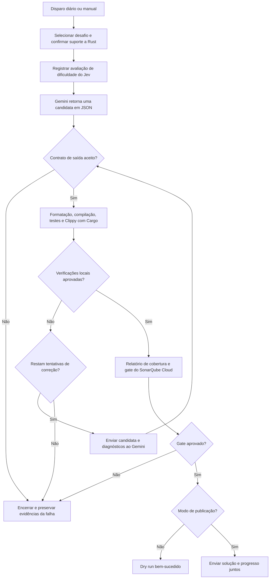

Uma forma familiar de usar IA generativa é escrever um pedido no chat, examinar a resposta e solicitar melhorias quando algo parece errado. A pessoa define o objetivo, identifica falhas e decide quando o trabalho terminou. Mesmo quando o modelo escreve a maior parte do código, a pessoa continua coordenando o processo.

Algumas tarefas permitem transferir essa coordenação para o software. Se conseguimos definir a entrada, as ações permitidas, a saída esperada e critérios de aceitação observáveis, um fluxo pode executar em um horário programado ou reagir a um evento. O modelo propõe um resultado; o sistema ao redor verifica, fornece feedback e decide se deve tentar novamente, concluir ou encerrar com falha.

Construí uma pequena prova de conceito para explorar isso: um [pipeline autônomo para resolver problemas do LeetCode em Rust][repository], com a intenção de processar um problema por dia usando a camada gratuita do Gemini, uma avaliação de dificuldade com o TypeSafe Jev, verificações locais de Rust e um quality gate do SonarQube Cloud. O ponto interessante é como o fluxo define e registra a conclusão.

## Dê ao fluxo uma definição observável de conclusão

No chat, “isso parece bom” pode ser suficiente para encerrar uma conversa. Uma automação agendada precisa de uma condição que o código consiga avaliar.

Neste experimento, o contrato de conclusão inclui um problema com suporte a Rust, uma solução candidata aceita com a interface esperada, verificações locais bem-sucedidas, aprovação no quality gate e entrega bem-sucedida ao repositório. Se alguma etapa obrigatória falhar, o fluxo precisa preservar essa distinção. Uma resposta do modelo, uma compilação aprovada e uma solução publicada são eventos diferentes.

Isso conecta duas ideias dos meus artigos anteriores:

- **[Harness engineering]()** define o ambiente, as ferramentas, as instruções, as credenciais, os contratos de entrada e saída e as verificações disponíveis para o fluxo.
- **[Loop engineering]()** conecta uma solução candidata ao feedback e a uma nova tentativa, com limites explícitos e condições de parada.

O modelo não precisa ser a autoridade sobre a correção da própria resposta. O harness fornece observações, e o fluxo impõe a regra de conclusão. Para uma tarefa de programação com escopo delimitado, isso pode eliminar trocas manuais repetidas, como “rode os testes”, “aqui está o erro” e “tente novamente”.

Isso também dá significado às execuções malsucedidas. Encerrar quando o orçamento de tentativas se esgota é um resultado terminal válido. A falha fica disponível para investigação, em vez de a tarefa ser silenciosamente marcada como concluída.

## A PoC: um problema em Rust por execução diária

O pipeline primeiro seleciona um desafio pendente ou busca o próximo problema do LeetCode em sequência pelo endpoint GraphQL acessível publicamente no site. Ele verifica o suporte a Rust e captura o enunciado, as restrições, os exemplos e a assinatura inicial. Problemas exclusivos para assinantes ou sem suporte são ignorados.

Os exemplos públicos se tornam contexto para os testes unitários gerados. Eles **não são os testes ocultos do juiz do LeetCode**, e o fluxo não submete a solução ao LeetCode para obter um veredito de aceitação. O endpoint também é uma dependência externa cujo formato de resposta pode mudar.

Em seguida, o Jev avalia a dificuldade de implementar o problema em Rust. O Gemini recebe o desafio e retorna uma solução candidata em um formato JSON definido. O pipeline verifica a estrutura da saída e construções restritas do código antes de executar a validação com Cargo.

O workflow atual permite uma candidata inicial e **duas tentativas de correção** após falhas na validação local. Os diagnósticos do compilador, dos testes e do Clippy fornecem o feedback. Cada revisão aceita passa novamente pelas verificações. Uma falha na geração ou na validação da saída encerra a execução; o ciclo de correção está ligado às etapas de validação com Cargo. O SonarQube Cloud executa após a aprovação local, e a reprovação no quality gate também impede a publicação. Esses limites aparecem no [workflow][workflow] e na [implementação do pipeline][pipeline].

A etapa final de entrega importa tanto quanto a geração. No modo de publicação, o workflow prepara o desafio, a solução, a avaliação e o registro de progresso, depois envia os commits juntos para `main`. Um push malsucedido não registra uma nova conclusão no progresso remoto. O modo dry run executa a validação sem publicar essas mudanças.

Este é um repositório educacional de escopo pequeno. Sua política atual de entrega é a publicação direta em `main`. Para um repositório de produto, eu normalmente escolheria uma pull request como saída automatizada e manteria a revisão dos desenvolvedores antes do merge.

## Agendamento: por que mudei o disparador

Inicialmente usei o agendador do GitHub Actions, mas os disparos não funcionaram como esperado neste repositório. Transferi o disparo diário principal para o [cron-job.org](https://cron-job.org/en/), que envia uma requisição autenticada ao endpoint `workflow_dispatch` do GitHub. O GitHub Actions continua executando o job. O workflow mantém um agendamento anual do GitHub como alternativa de baixa frequência.

O horário diário é **04:17 UTC, ou 01:17 em São Paulo**. Escolhi um período tranquilo da madrugada e evitei o início da hora. O GitHub documenta que workflows agendados podem atrasar sob carga elevada, especialmente no início de cada hora, e que alguns jobs na fila podem ser descartados (veja a [documentação de agendamento do GitHub](https://docs.github.com/en/actions/reference/workflows-and-actions/events-that-trigger-workflows#schedule)). Isso sustenta a escolha de outro minuto, mas não estabelece a causa de cada execução perdida neste experimento.

Uma requisição bem-sucedida do agendador significa que o GitHub aceitou o disparo. Não significa que um problema foi resolvido. As evidências de conclusão estão no resultado do Actions, na saída da validação e no estado do repositório. Essa separação também vale para automações orientadas a eventos: receber um evento e concluir seu trabalho são responsabilidades distintas.

Cada disparo tem um problema como alvo, mas geração, correções e fallbacks do provedor podem consumir várias requisições de API. O agendamento é uma meta de processamento; ele não garante uma solução bem-sucedida todos os dias.

## O que realmente executa no ambiente

O workflow examinado usa um runner hospedado pelo GitHub com `ubuntu-latest`. Não há declaração explícita de `container:` no job. Os scripts do pipeline e as ferramentas de Rust executam nesse ambiente temporário; **Gemini e Jev são serviços remotos acessados por API**. Os pesos dos modelos não estão executando dentro do job do Actions.

Um container é outra possibilidade para empacotar esse harness. As responsabilidades centrais continuam sendo ferramentas reproduzíveis, acesso delimitado, limites de execução e uma fronteira clara ao redor do código candidato.

A PoC disponibiliza as credenciais às etapas que precisam delas: a chave do Gemini para geração e correção, a do TypeSafe para avaliação e o token do Sonar para análise. Ela desabilita a persistência das credenciais do checkout e remove as variáveis listadas de tokens de API e do GitHub do ambiente dos subprocessos de compilação e teste. Filtros de código também rejeitam algumas construções, incluindo Rust unsafe, acesso ao sistema de arquivos, rede e execução de processos.

Essas medidas reduzem a exposição no experimento. Um runner temporário e filtros de código não estabelecem, por si só, contenção completa de código gerado arbitrariamente. Um isolamento mais forte seria um requisito separado antes de usar esse desenho em tarefas mais sensíveis.

## Respostas estruturadas e o papel do Jev

O Gemini deve retornar JSON com `rust_source` e `explanation`. O código precisa conter o ponto de entrada esperado em `impl Solution`, um tipo `Solution` local ao módulo e testes unitários. Um contrato de formato permite analisar a resposta e rejeitar uma candidata inutilizável antes de executar as verificações de Rust.

Acrescentei o Jev como uma etapa adicional de avaliação no experimento. Ele pontua a dificuldade algorítmica a partir dos requisitos fornecidos e registra probabilidades e confiança separadamente da classificação de dificuldade do próprio LeetCode. Ele não torna o problema mais difícil, não gera a solução e atualmente não decide se o Gemini pode tentar resolvê-lo.

O TypeSafe descreve o Jev como um modelo para decisões tipadas e probabilidades (consulte a [documentação de System One do TypeSafe](https://docs.typesafe.ai/concepts/system-one)). Isso o torna útil para um julgamento semântico específico dentro de um fluxo, embora sua resposta ainda precise ser avaliada para o uso pretendido.

Por exemplo, a [avaliação armazenada de Zigzag Conversion][assessment] registra uma pontuação de dificuldade de 1,24 em uma escala de 0 a 4, com “easy” como nível predominante. Isso é uma avaliação registrada do modelo, não uma probabilidade medida de sucesso do solver. Dificuldade e capacidade de concluir uma tarefa específica são perguntas diferentes.

## Modelos gratuitos também precisam de gestão de ciclo de vida

Escolhi a camada gratuita do Gemini para manter baixo o custo de geração do experimento. Nesta revisão, o modelo padrão configurado é **`gemini-3.8-flash`**, com versões anteriores do Flash na cadeia de fallback. A tabela publicada pelo Google inclui uso gratuito desse modelo (consulte o [catálogo de modelos Gemini](https://ai.google.dev/gemini-api/docs/models) e os [preços da API Gemini](https://ai.google.dev/gemini-api/docs/pricing)); o acesso efetivo e as cotas dependem da conta e dos limites do serviço.

Também documentei uma instrução para atualizar a automação quando os modelos elegíveis para a camada gratuita mudarem. Ainda não validei esse processo de manutenção com a descontinuação real do modelo padrão: o Gemini 3.8 Flash tem sido o padrão desde o início do experimento.

Há três capacidades distintas: usar fallbacks configurados, verificar disponibilidade de modelos e atualizar a configuração. O comando existente `check-models` consulta o catálogo e informa a disponibilidade dos modelos configurados. Ele não comprova elegibilidade para a camada gratuita, não reescreve o workflow e não valida o comportamento de um substituto. O workflow diário não o chama automaticamente.

Um futuro fluxo de manutenção poderia detectar um modelo ausente, identificar um substituto elegível, executar casos representativos de regressão e preparar uma pull request de configuração. Isso transformaria a instrução escrita de manutenção em outra automação que pode ser examinada. Continua sendo uma extensão da PoC.

## Deixe tarefas flexíveis esperarem por um horário melhor

Trabalhos sem prazo imediato podem ser agendados conforme a capacidade disponível ou os preços do provedor. Conforme verificado em **4 de outubro de 2026**, o DeepSeek publica tarifas fora de pico equivalentes à metade das tarifas de pico. As janelas de pico informadas para dias úteis são 01:00–04:00 e 06:00–10:00 UTC, exceto feriados chineses; os demais horários são fora de pico. Consulte a [página atual de preços](https://api-docs.deepseek.com/quick_start/pricing/) antes de depender dessa política.

Essa é uma opção para outro fluxo; a PoC usa Gemini. “Madrugada” precisa ser convertido para o fuso e as janelas tarifárias do provedor. Tarifas menores também precisam ser comparadas com tentativas adicionais, tempo de runner e esforço de revisão.

Eu agendaria dessa forma tarefas rotineiras de manutenção de repositórios, verificações de documentação ou lotes de tarefas de desenvolvimento adequadas. O trabalho ainda precisa de um prazo e de um caminho explícito para falhas, para não esperar indefinidamente por uma janela ideal.

## Estendendo o padrão para Jira e pull requests

Uma issue do Jira poderia disparar a mesma estrutura. Um webhook ou uma consulta periódica buscaria a issue e o contexto relevante do repositório. O código primeiro verificaria regras conhecidas, como o repositório permitido, o status elegível da issue e o escopo autorizado da mudança. O Jev poderia então avaliar uma pergunta semântica mais específica: se as informações fornecidas são suficientes para uma tentativa automatizada, ou em qual categoria de tarefa suportada a issue se encaixa.

Esse julgamento de encaminhamento deve ser avaliado com resultados reais de issues. Uma pontuação de dificuldade, sozinha, não estabelece que a IA consegue resolver um ticket, e a confiança do modelo não autoriza uma mudança.

Para issues elegíveis, o fluxo de programação poderia criar uma branch, tentar a mudança dentro de um orçamento, executar as verificações do repositório e abrir uma pull request com o diff e as evidências de validação. Os desenvolvedores fariam a revisão. Requisitos pouco claros, falta de acesso ou tentativas esgotadas produziriam um encaminhamento registrado para uma pessoa.

Ao contrário de um problema algorítmico delimitado, um ticket pode exigir conhecimento do domínio e mudanças em vários serviços. Os critérios de aceitação precisam representar o comportamento de negócio. Um identificador estável da issue e o registro da revisão usada como entrada também ajudariam a evitar pull requests duplicadas e trabalho baseado em um ticket desatualizado.

A integração com Jira e a criação automática de pull requests são possibilidades descritas aqui; elas não estão implementadas neste solver.

## O que o experimento demonstrou até agora

Este artigo examina o repositório no [commit `bed6b90`][snapshot], em **4 de outubro de 2026**. O [registro de progresso][progress] contém seis problemas publicados. O histórico do Actions mostra execuções de `workflow_dispatch` bem-sucedidas por volta de 04:17 UTC em [2 de outubro][run-2], [3 de outubro][run-3] e [4 de outubro][run-4]. São evidências iniciais úteis do caminho de execução diária.

O período de observação é curto. O repositório também contém correções posteriores nas interfaces das soluções geradas para o LeetCode. Seis registros de publicação não demonstram um histórico sem mudanças de mantenedores, aprovação nos testes ocultos ou correção para todas as restrições. Testes produzidos pelo mesmo modelo que escreveu a solução podem compartilhar suas suposições equivocadas, e cobertura mede código executado, não a adequação dessas suposições.

O experimento me dá uma forma concreta de estudar trabalho agendado com IA: um disparo, uma tentativa limitada, verificações observáveis, entrega e um registro persistente do resultado. Ampliar essa automação dependerá de quanto os critérios de aceitação de cada tarefa representam o que o usuário realmente precisa.

[repository]: https://github.com/marcelomiyake/autonomous-rust-leetcode-solver-pipeline
[snapshot]: https://github.com/marcelomiyake/autonomous-rust-leetcode-solver-pipeline/tree/bed6b909c38bb285d11c78ad316dc1faf0f9848f
[workflow]: https://github.com/marcelomiyake/autonomous-rust-leetcode-solver-pipeline/blob/bed6b909c38bb285d11c78ad316dc1faf0f9848f/.github/workflows/leetcode-solver.yml
[pipeline]: https://github.com/marcelomiyake/autonomous-rust-leetcode-solver-pipeline/blob/bed6b909c38bb285d11c78ad316dc1faf0f9848f/scripts/solver_pipeline.py
[progress]: https://github.com/marcelomiyake/autonomous-rust-leetcode-solver-pipeline/blob/bed6b909c38bb285d11c78ad316dc1faf0f9848f/state/progress.json
[assessment]: https://github.com/marcelomiyake/autonomous-rust-leetcode-solver-pipeline/blob/bed6b909c38bb285d11c78ad316dc1faf0f9848f/state/assessments/006-zigzag-conversion.json
[run-2]: https://github.com/marcelomiyake/autonomous-rust-leetcode-solver-pipeline/actions/runs/36963876071
[run-3]: https://github.com/marcelomiyake/autonomous-rust-leetcode-solver-pipeline/actions/runs/37096022945
[run-4]: https://github.com/marcelomiyake/autonomous-rust-leetcode-solver-pipeline/actions/runs/37176554618
