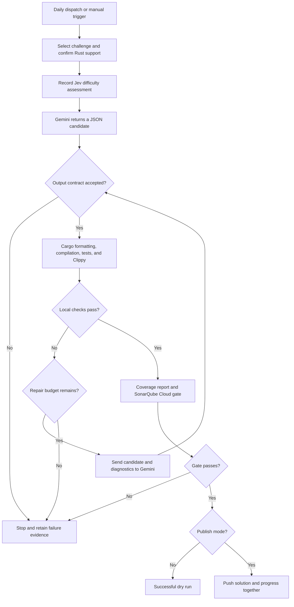

A familiar way to use generative AI is to write a request in a chat, inspect the response, and ask for improvements when something looks wrong. The person supplies the goal, notices failures, and decides when the work is finished. Even when the model writes most of the code, the person still coordinates the process.

Some tasks let us move that coordination into software. If we can define the input, the permitted actions, the expected output, and observable acceptance criteria, a workflow can run on a schedule or react to an event. The model proposes a result; the surrounding system checks it, supplies feedback, and decides whether to retry, finish, or stop with a failure.

I built a small proof of concept to explore this: an [autonomous Rust LeetCode solver pipeline][repository], intended to process one problem per day using Gemini's free tier, a TypeSafe Jev difficulty assessment, local Rust checks, and a SonarQube Cloud quality gate. The interesting part is how the workflow defines and records completion.

## Give the workflow an observable definition of done

In chat, “this looks good” can be enough to end a conversation. Scheduled automation needs a condition that code can evaluate.

For this experiment, the completion contract includes a problem with Rust support, an accepted candidate with the expected interface, successful local checks, a passing quality gate, and successful delivery to the repository. If any required step fails, the workflow must preserve that distinction. A response from the model, a passing compiler, and a published solution are different events.

This connects two ideas from my earlier posts:

- **[Harness engineering]()** defines the environment, tools, instructions, credentials, input and output contracts, and checks available to the workflow.
- **[Loop engineering]()** connects a candidate to feedback and another attempt, with explicit limits and stopping conditions.

The model does not need to be the authority on whether its own answer is correct. The harness supplies observations, and the workflow enforces the completion rule. For a bounded coding task, that can remove repeated manual exchanges such as “run the tests,” “here is the error,” and “try again.”

It also makes unsuccessful runs meaningful. Stopping after the retry budget is exhausted is a valid terminal outcome. It leaves a failure to investigate rather than quietly labeling the task complete.

## The PoC: one Rust problem per daily run

The pipeline first selects a pending challenge or retrieves the next sequential LeetCode problem through the site's publicly accessible GraphQL endpoint. It checks Rust support and captures the description, constraints, examples, and starter signature. Paid-only or unsupported problems are skipped.

The public examples become context for the generated unit tests. They are **not LeetCode's hidden judge tests**, and the workflow does not submit the solution to LeetCode for an accepted verdict. The endpoint is also an external dependency whose response shape can change.

Jev then assesses the difficulty of implementing the problem in Rust. Gemini receives the challenge and returns a candidate in a defined JSON format. The pipeline checks the output shape and restricted source constructs before running Cargo validation.

The current workflow allows an initial candidate and **two repair attempts** after local validation failures. Compiler, test, and Clippy diagnostics provide the feedback. Each accepted revision goes through the checks again. A failure in generation or output validation stops the run; the repair loop is attached to the Cargo validation steps. SonarQube Cloud runs after local success, and a failed quality gate also stops publication. These boundaries are visible in the [workflow][workflow] and [pipeline implementation][pipeline].

The final delivery step matters as much as generation. In publish mode, the workflow stages the challenge, solution, assessment, and progress record, then pushes the commits together to `main`. A failed push leaves no new completion in the remote progress store. Dry-run mode exercises validation without publishing those changes.

This is a deliberately small educational repository. Its current delivery policy is direct publication to `main`. For a product repository, I would usually choose a pull request as the automated output and retain developer review before merging.

## Scheduling: why I changed the trigger

I initially used GitHub Actions' scheduler, but delivery did not work as expected for this repository. I moved the primary daily trigger to [cron-job.org](https://cron-job.org/en/), which sends an authenticated request to GitHub's `workflow_dispatch` endpoint. GitHub Actions still executes the job. The workflow retains a yearly GitHub schedule as a low-frequency fallback.

The daily target is **04:17 UTC, or 01:17 in São Paulo**. I chose a quiet overnight period and avoided the start of the hour. GitHub documents that scheduled workflows can be delayed during high load, especially at the start of an hour, and some queued jobs can be dropped (see the [GitHub scheduling documentation](https://docs.github.com/en/actions/reference/workflows-and-actions/events-that-trigger-workflows#schedule)). That supports choosing a different minute, but does not establish the cause of every missed run in this experiment.

A successful scheduler request means GitHub accepted a dispatch. It does not mean a problem was solved. The completion evidence belongs in the Actions result, validation output, and repository state. This separation also applies to event-driven automation: receiving an event and completing its work are separate responsibilities.

One dispatch targets one problem, but generation, repairs, and provider fallbacks can consume several API requests. The schedule is a processing target; it cannot guarantee one successful solution every day.

## What actually runs in the execution environment

The checked workflow uses a GitHub-hosted `ubuntu-latest` runner. There is no explicit job `container:` declaration. The pipeline scripts and Rust tooling run in that temporary environment; **Gemini and Jev are remote API services**. Their model weights are not running inside the Actions job.

A container is another possible way to package this harness. The important responsibilities remain reproducible tools, scoped access, execution limits, and a clear boundary around candidate code.

The PoC scopes credentials to the steps that need them: Gemini's key for generation and repair, TypeSafe's key for assessment, and Sonar's token for analysis. It disables persisted checkout credentials and removes the listed API and GitHub token variables from compiler and test subprocess environments. Source filters also reject selected constructs, including unsafe Rust, filesystem access, networking, and process execution.

Those measures reduce exposure within the experiment. A temporary runner and source filters do not by themselves establish complete containment of arbitrary generated code. Stronger isolation would be a separate requirement before using this design for more sensitive tasks.

## Structured answers and Jev's role

Gemini is asked to return JSON with `rust_source` and `explanation`. The source must contain the expected `impl Solution` entry point, a module-local `Solution` type, and unit tests. A format contract lets the pipeline parse a response and reject an unusable candidate before executing the Rust checks.

I added Jev as an extra assessment step in the experiment. It scores algorithmic difficulty from the supplied requirements and records probabilities and confidence separately from LeetCode's own difficulty label. It does not make the problem harder, generate the solution, or currently decide whether Gemini is allowed to attempt it.

TypeSafe describes Jev as a model for typed decisions and probabilities (see [TypeSafe's System One documentation](https://docs.typesafe.ai/concepts/system-one)). That makes it useful for a narrow semantic judgment inside a workflow, though its answer still needs evaluation against the intended use.

For example, the stored [Zigzag Conversion assessment][assessment] records a difficulty score of 1.24 on a 0–4 scale, with “easy” as the dominant level. This is a recorded model assessment, not a measured probability that the solver will succeed. Difficulty and ability to complete a particular task are different questions.

## Free models still need lifecycle management

I chose Gemini's free tier to keep the experiment's generation cost low. At this review, the configured default is **`gemini-3.8-flash`**, with older Flash versions in the fallback chain. Google's published pricing includes free-tier use for this model (see the [Gemini model catalog](https://ai.google.dev/gemini-api/docs/models) and [Gemini API pricing](https://ai.google.dev/gemini-api/docs/pricing)); actual access and quotas depend on the account and service limits.

I also documented an instruction to update the automation when the eligible free-tier models change. I have not yet validated that maintenance process through a real default-model retirement: Gemini 3.8 Flash has been the default since the experiment began.

There are three distinct capabilities here: using configured fallbacks, checking model availability, and updating configuration. The existing `check-models` command queries the catalog and reports configured model availability. It does not prove free-tier eligibility, rewrite the workflow, or validate a replacement model's behavior. The daily workflow does not call it automatically.

A future maintenance flow could detect a missing model, identify an eligible replacement, run representative regression cases, and prepare a configuration pull request. That would turn the written maintenance instruction into another inspectable automation. It remains an extension to the PoC.

## Let flexible work wait for a better execution window

Work without an immediate deadline can be scheduled around available capacity or provider pricing. As checked on **October 4, 2026**, DeepSeek publishes off-peak rates at half its peak rates. Its listed weekday peak windows are 01:00–04:00 and 06:00–10:00 UTC, excluding Chinese public holidays; other hours are off-peak. Check the [current pricing page](https://api-docs.deepseek.com/quick_start/pricing/) before relying on that policy.

This is an option for another workflow; the PoC uses Gemini. “Early morning” must be converted into the provider's timezone and tariff windows. Lower rates also need to be weighed against extra attempts, runner time, and review effort.

I would schedule routine repository maintenance, documentation checks, or batches of suitable development tasks this way. The work still needs a deadline and an explicit failure path so it does not wait indefinitely for an ideal window.

## Extending the pattern to Jira and pull requests

A Jira issue could trigger the same structure. A webhook or periodic poll would retrieve the issue and the relevant repository context. Code would first check known rules, such as the allowed repository, eligible issue status, and authorized change scope. Jev could then assess a narrower semantic question: whether the supplied information is sufficient for an automated attempt, or which supported task category fits the issue.

That routing judgment should be evaluated on real issue outcomes. A difficulty score alone cannot establish that AI can solve a ticket, and model confidence does not authorize a change.

For eligible issues, the coding workflow could create a branch, attempt the change within a budget, run the repository's checks, and open a pull request containing the diff and verification evidence. Developers would review it. Unclear requirements, missing access, or exhausted attempts would produce a recorded handoff.

Unlike a fixed algorithm problem, a ticket may require domain knowledge and changes across services. The acceptance criteria must capture the business behavior. A stable issue identifier and a record of the input revision would also help avoid duplicate pull requests and work based on an outdated ticket.

Jira integration and automated pull request creation are possibilities described here; they are not implemented in this solver.

## What the experiment has demonstrated so far

This article reviews the repository at [commit `bed6b90`][snapshot] on **October 4, 2026**. The [progress store][progress] contains six published problem records. Actions history shows successful `workflow_dispatch` runs at approximately 04:17 UTC on [October 2][run-2], [October 3][run-3], and [October 4][run-4]. That is useful early evidence of the daily execution path.

It is a short observation period. The repository also contains later corrections to generated solutions' LeetCode interfaces. Six publication records do not demonstrate a history without maintainer changes, hidden-test acceptance, or correctness for every constraint. Tests produced by the same model as the solution can share its mistaken assumptions, and coverage measures executed code rather than the adequacy of those assumptions.

The experiment gives me a concrete way to study scheduled AI work: a trigger, a bounded attempt, observable checks, delivery, and a persistent record of the result. Broader automation will depend on how well each task's acceptance criteria reflect what the user actually needs.

[repository]: https://github.com/marcelomiyake/autonomous-rust-leetcode-solver-pipeline
[snapshot]: https://github.com/marcelomiyake/autonomous-rust-leetcode-solver-pipeline/tree/bed6b909c38bb285d11c78ad316dc1faf0f9848f
[workflow]: https://github.com/marcelomiyake/autonomous-rust-leetcode-solver-pipeline/blob/bed6b909c38bb285d11c78ad316dc1faf0f9848f/.github/workflows/leetcode-solver.yml
[pipeline]: https://github.com/marcelomiyake/autonomous-rust-leetcode-solver-pipeline/blob/bed6b909c38bb285d11c78ad316dc1faf0f9848f/scripts/solver_pipeline.py
[progress]: https://github.com/marcelomiyake/autonomous-rust-leetcode-solver-pipeline/blob/bed6b909c38bb285d11c78ad316dc1faf0f9848f/state/progress.json
[assessment]: https://github.com/marcelomiyake/autonomous-rust-leetcode-solver-pipeline/blob/bed6b909c38bb285d11c78ad316dc1faf0f9848f/state/assessments/006-zigzag-conversion.json
[run-2]: https://github.com/marcelomiyake/autonomous-rust-leetcode-solver-pipeline/actions/runs/36963876071
[run-3]: https://github.com/marcelomiyake/autonomous-rust-leetcode-solver-pipeline/actions/runs/37096022945
[run-4]: https://github.com/marcelomiyake/autonomous-rust-leetcode-solver-pipeline/actions/runs/37176554618
