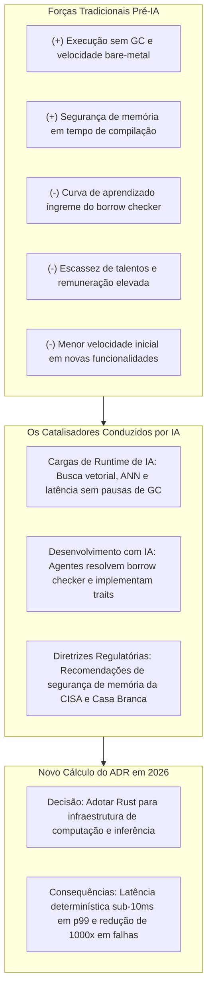
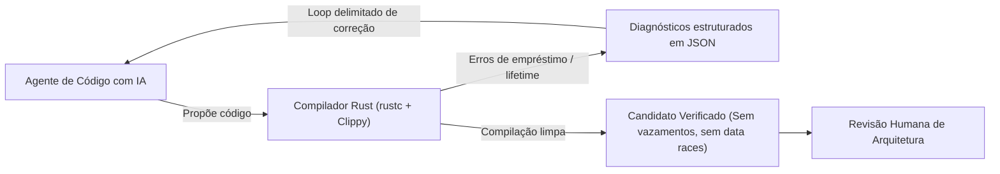

Quando arquitetos de software avaliam uma linguagem de programação, eles registram a decisão em um **Architecture Decision Record (ADR)**. Um ADR documenta o contexto, as forças em jogo, a direção escolhida e as consequências esperadas. Durante anos, os ADRs que avaliavam Rust na engenharia corporativa seguiam um roteiro conhecido: desempenho em tempo de execução e segurança de memória indiscutíveis de um lado; curva de aprendizado íngreme, escassez de talentos e velocidade inicial de desenvolvimento mais lenta do outro. Para a maioria dos serviços de backend tradicionais, a balança de trade-offs pesava contra o Rust.

A rápida ascensão da inteligência artificial está transformando os dois lados dessa balança.

Este é o primeiro artigo de uma série em que exploro como a IA está redefinindo as decisões de arquitetura de software documentadas em ADRs. Embora a IA tenha alterado visivelmente a forma como os desenvolvedores escrevem código no dia a dia, seu impacto mais profundo reside em desafiar premissas arquiteturais históricas. Neste post, analiso como as cargas de trabalho de IA em produção e os assistentes de programação com IA estão reescrevendo o clássico ADR de adoção de Rust nas empresas.



---

## O clássico ADR pré-IA para Rust: por que as empresas hesitavam

Para entender o que mudou, vale relembrar os trade-offs que caracterizavam a seleção de linguagens no ambiente corporativo entre 2018 e 2023. Ao comparar Rust com ambientes corporativos consolidados como Go, Java ou TypeScript, os arquitetos enfrentavam tensões estruturais claras:

| Vetor Arquitetural | Avaliação Pré-IA (Go / Java / Node) | Avaliação Pré-IA (Rust) | Impacto Clássico no ADR |
| :--- | :--- | :--- | :--- |
| **Gerenciamento de Memória** | Garbage collection automático (pausas de GC toleradas) | Ownership em tempo de compilação via RAII (sem GC em runtime) | Favorecia linguagens com GC pela conveniência |
| **Curva de Aprendizado** | Dias a poucas semanas para engenheiros júnior e pleno | Meses para dominar lifetimes, empréstimos e pinning assíncrono | **Forte penalidade contra o Rust** |
| **Mercado e Contratação** | Mercado amplo e dinâmico de profissionais experientes | Escassez de profissionais com bônus salarial de 15% a 24% | **Forte penalidade contra o Rust** |
| **Velocidade de Prototipação** | Iteração rápida; exceções tratadas em tempo de execução | Verificação rigorosa no compilador; atritos frequentes com o borrow checker | **Favorecia linguagens com GC para time-to-market** |
| **Garantias de Segurança** | Vulnerabilidade a data races, ponteiros nulos e vazamentos sutis | Ausência de data races e ponteiros nulos, limpeza determinística de recursos | Favorecia Rust para componentes especializados |

Naquele cenário, um ADR responsável quase inevitavelmente concluía:

> *"Embora o Rust ofereça segurança de memória e throughput superiores, a familiaridade da equipe com Go e o alto custo de capacitação no borrow checker superam os ganhos operacionais em APIs de negócio convencionais. Manteremos Go para os microsserviços e restringiremos Rust a bibliotecas criptográficas pontuais."*

Essa decisão fazia todo sentido dadas as restrições da época. No entanto, decisões de arquitetura duram apenas enquanto o contexto que as gerou permanecer válido. Antes de examinarmos como a IA rompe esse equilíbrio, é fundamental analisar a economia arquitetural de base: como o custo dos microsserviços em Rust se compara concretamente com Java, Python, Go e C/C++.

---

## A equação de custos da arquitetura: Rust vs. Java, Python, Go e C/C++

Ao avaliar arquiteturas de microsserviços, o custo total de propriedade (TCO) costuma ser calculado de forma incompleta. É comum que as equipes considerem apenas a velocidade inicial de desenvolvimento, desconsiderando custos operacionais contínuos de consumo de recursos, instabilidade de cauda de latência em sistemas críticos e esforço permanente de correção de vulnerabilidades.

A comparação entre Rust, Java, Python, Go e C/C++ revela trade-offs estruturais em três eixos principais:

### 1. Recursos: CPU, memória e densidade de empacotamento de contêineres

Em ambientes de nuvem orquestrados por Kubernetes ou runtimes serverless de contêineres, as faturas de infraestrutura são ditadas majoritariamente pelos **limites de alocação de memória**, e não pelo uso médio de CPU. Os pods são dimensionados pelas requisições de memória para evitar eventos de Out-Of-Memory (OOM).

* **Java (JVM)**: Microsserviços convencionais em Spring Boot ou Quarkus exigem rotineiramente memória residente (RSS) entre 250MB e 1GB por instância. Mesmo com compilação antecipada (AOT) via GraalVM, o consumo raramente cai abaixo de 80MB a 120MB. Além disso, runtimes com garbage collection necessitam de margem de segurança de memória (headroom de 30% a 50% acima do heap ativo) para prevenir ciclos excessivos de coleta. Em frotas com 200 réplicas de microsserviços, o consumo ocioso de baseline consome centenas de gigabytes de RAM antes de receber tráfego expressivo.
* **Python**: Além do overhead do interpretador, a representação dinâmica de objetos em Python amplia o uso de memória. Devido ao Global Interpreter Lock (GIL), serviços concorrentes (como FastAPI ou Django) utilizam múltiplos processos operários via Gunicorn, multiplicando o consumo de 150MB a 350MB por processo.
* **Go**: Apresenta runtime enxuto com binários pequenos e memória moderada (15MB a 45MB). Contudo, o coletor de lixo concorrente tri-color opera com meta padrão de crescimento de heap de 100% (`GOGC=100`). Sob altas taxas de alocação, Go requer quase o dobro de memória ativa para não degradar a CPU, forçando limites generosos de memória no Kubernetes para evitar evicções de pods.
* **C / C++**: Oferece consumo mínimo de memória de base (5MB a 20MB) e ausência de runtime intermediário. Porém, serviços de longa duração em C/C++ frequentemente enfrentam fragmentação de heap ao longo do tempo, demandando alocadores customizados (como `jemalloc` ou `tcmalloc`) e perfilamento contínuo para conter vazamentos graduais.
* **Rust**: Microsserviços em Rust compilados com Tokio e Axum operam tipicamente com **8MB a 25MB de RSS**. Como a desalocação é determinística em tempo de compilação via RAII sem garbage collector, não há necessidade de headroom artificial de heap. Em clusters densos, é possível empacotar de 4 a 10 vezes mais instâncias de Rust no mesmo pool de nós de Kubernetes quando comparado a Java ou Python, reduzindo diretamente a fatura de nuvem.

No consumo de CPU, estudos de eficiência energética e de instruções (como o estudo referencial de Pereira et al.) posicionam C e Rust como as linguagens mais eficientes (baseline normalizado de 1.00), com Go consumindo ~3.0x, Java ~2.0x e Python mais de 70x. Em microsserviços que processam milhões de requisições por segundo, a localidade de cache e a autovetorização SIMD de Rust maximizam o throughput por vCPU.

### 2. Projetos de missão crítica: execução determinística e previsibilidade em tempo real

Em domínios críticos — como plataformas financeiras, telemetria industrial, sistemas autônomos, telecomunicações e recuperação vetorial de IA em tempo real —, a latência média (p50) tem pouco valor se a cauda (p99, p99.9 e p99.99) for instável.

* **Java**: Coletores modernos como ZGC e Shenandoah mantêm pausas sub-milissegundo executando compactação concorrente junto com threads da aplicação. Todavia, isso tem um preço alto: 15% a 25% dos ciclos de CPU são consumidos em read-barriers e rastreamento de referências. Sob rajadas intensas de tráfego, as threads de GC podem não acompanhar as alocações, gerando pausas stop-the-world inesperadas que quebram SLOs contratuais.
* **Go**: Embora o coletor seja desenhado para pausas mínimas, ele utiliza mecanismos de ritmo ("GC Pacing" e "Mark Assist") que sequestram temporariamente goroutines da própria aplicação para ajudar na varredura de memória quando as alocações sobem rápido demais. Uma requisição de usuário que coincide com um ciclo de mark assist sofre um pico repentino e não determinístico de latência.
* **Python**: A combinação de GIL, contagem de referências e coletor cíclico torna o runtime totalmente não determinístico, inviabilizando-o para sistemas de tempo real estrito ou caminhos críticos de baixa latência.
* **C / C++**: Permite determinismo extremo sub-microssegundo, mas com alta fragilidade operacional. Uma única condição de corrida concorrente ou ponteiro corrompido pode provocar falhas silenciosas ou derrubar o processo em produção sob pico de demanda.
* **Rust**: Proporciona determinismo rígido sem coletor em runtime. A desalocação de recursos ocorre exatamente quando as variáveis saem de escopo. Sem pausas de stop-the-world, sem interferências de mark-assist e sem aquecimento de JIT, Rust entrega perfis planos e previsíveis no percentil 99,9, assegurando estabilidade em operações de missão crítica sob alto volume.

### 3. Economia da segurança: segurança de memória, concorrência e superfície de ataque

Vulnerabilidades de segurança não são apenas débitos técnicos; representam custos financeiros expressivos e riscos reputacionais graves.

* **Origem das Falhas de Memória**: Pesquisas consolidadas da Microsoft, Google e do projeto Chromium revelam que **aproximadamente 70% de todas as vulnerabilidades críticas (CVEs) em grandes sistemas C/C++ decorrem de problemas de segurança de memória** (use-after-free, buffer overflows e leituras fora dos limites). Manter código C/C++ seguro exige triagens contínuas, sanitizadores complexos (ASan, MSan) e frequentes deploys emergenciais de correção.
* **Riscos de Concorrência em Go e Java**: Java e Go eliminam buffer overflows diretos na memória, mas permitem condições de corrida concorrentes em tempo de execução. Em Go, leituras e escritas não sincronizadas em maps disparam panics fatais, enquanto mutações concorrentes em goroutines causam corrupção de estado. Em Java, deadlocks e exaustão de pools de threads continuam entre as principais causas de incidentes em produção.
* **Cadeia de Suprimentos e Superfície de Ataque**: Microsserviços em Java e Python carregam grafos de dependências massivos e runtimes complexos (JVM e interpretador). Incidentes como o Log4j (CVE-2021-44228) demonstraram os perigos da introspecção dinâmica em runtimes pesados. Por outro lado, Rust compila para binários estáticos independentes, executáveis em contêineres `scratch` ou `distroless` sem shell, sem gerenciador de pacotes e sem bibliotecas de sistema, reduzindo a superfície de ataque e o ruído em scanners de CVEs.
* **Segurança em Tempo de Compilação em Rust**: O Safe Rust elimina nativamente a categoria de 70% de falhas de memória sem precisar de garbage collector. Além disso, o sistema de tipos assegura concorrência segura por meio das traits `Send` e `Sync`, convertendo condições de corrida em erros de compilação.

### Matriz arquitetural comparativa

| Dimensão | Java (JVM) | Python | Go | C / C++ | Rust |
| :--- | :--- | :--- | :--- | :--- | :--- |
| **Consumo de Memória (RSS)** | 250 MB – 1 GB+ (elevado) | 150 MB – 400 MB / operário | 15 MB – 50 MB (moderado) | 5 MB – 20 MB (mínimo) | **8 MB – 25 MB (mínimo)** |
| **Margem de Heap Necessária** | 30% – 50% de RAM extra | Moderada | ~100% extra (`GOGC=100`) | Nenhuma (risco de fragmentação) | **Zero (RAII em compilação)** |
| **Eficiência de CPU / Energia** | ~2.0x baseline | ~70x+ baseline | ~3.0x baseline | 1.0x (ótimo) | **~1.0x (ótimo)** |
| **Determinismo de Execução** | Pausas concorrentes; 15-25% CPU de GC | Não determinístico (GIL + GC cíclico) | Pausas baixas; sujeito a Mark Assist | Determinístico; vulnerável a crashes | **Determinístico estrito; zero pausas de GC** |
| **Latência de Cauda (p99 / p99.9)** | Variável sob alta alocação | Alta dispersão | Picos esporádicos por ritmo de GC | Ultra-baixa (se livre de bugs) | **Consistentemente sub-10 ms** |
| **Segurança de Memória** | Segura (runtime gerenciado) | Segura (runtime gerenciado) | Segura (runtime gerenciado) | **Insegura (~70% das CVEs históricas)** | **Segura em compilação (sem GC)** |
| **Segurança de Concorrência** | Disputas possíveis em runtime | Serializado pelo GIL | Disputas possíveis (exige race detector) | Disputas possíveis (comportamento indefinido) | **Prevenção matemática em compilação (`Send`/`Sync`)** |
| **Superfície de Ataque** | Ampla (JVM + SO + bibliotecas) | Ampla (interpretador + pip) | Reduzida (binário estático) | Mínima (libc estática ou dinâmica) | **Mínima (binário estático `scratch`/distroless)** |
| **TCO de Nuvem em Escala** | Alto custo de memória | Alto custo de CPU/memória | Custo moderado de infraestrutura | Alto custo de manutenção e patches | **Menor TCO de infraestrutura** |

Essas diferenças estruturais explicam por que engenheiros de sistemas sempre admiraram Rust. Mas o que desencadeou a corrida para revisar os ADRs corporativos em 2026? Foi a colisão simultânea de dois catalisadores impulsionados por IA.

---

## Força 1: cargas de runtime de IA exigem latência determinística

O primeiro catalisador decorre dos requisitos operacionais das cargas de trabalho de IA em produção. Em aplicações CRUD tradicionais, latências medianas de 50 a 100 milissegundos e pausas ocasionais de 20 milissegundos causadas pelo garbage collector são facilmente toleradas. Na infraestrutura de IA, essas premissas falham.

Sistemas modernos de IA dependem intensamente de bancos de dados vetoriais, pipelines de Retrieval-Augmented Generation (RAG), geração de embeddings e serviços de inferência de modelos com alta concorrência. Em algoritmos de busca por vizinhos mais próximos aproximados (ANN - Approximate Nearest Neighbor) operando sobre milhões de vetores de alta dimensionalidade, a alocação e o descarte de memória são massivos e constantes.

Quando ambientes com garbage collection (como Go ou Java) processam esses grafos sob carga sustentada, as pausas de coleta provocam uma severa **amplificação da cauda de latência** nos percentis 99 e 99,9 (p99 e p99.9). Uma pausa de 15 milissegundos na recuperação de embeddings atrasa todo o pipeline downstream de geração, degradando a experiência do usuário e elevando os custos de nuvem.

O Rust elimina esse gargalo operacional com o modelo RAII (Resource Acquisition Is Initialization) em tempo de compilação, controle explícito da heap e otimizações SIMD nativas de hardware:

| Componente de Infraestrutura de IA | Modelo de Execução / Linguagem | Desempenho e Latência de Processamento | Consumo de Memória Residente (RSS) | Modelo Arquitetural em Runtime |
| :--- | :--- | :--- | :--- | :--- |
| **Qdrant Vector Engine** | Rust | **Latência p50 de 4 ms**; sustentada sub-10 ms | Paginação explícita; offload via `mmap` em NVMe | Binário nativo; sem GC; vetorização SIMD |
| **TorchServe (PyTorch)** | Python / C++ | **3,8 ms** imagem única; 28,6 ms em lote (32) | **892 MB** de memória residente | Runtime pesado; biblioteca libtorch; GIL do Python |
| **Hugging Face Candle** | Rust puro | **2,1 ms** imagem única; 18,4 ms em lote (32) | **312 MB** de memória residente | Runtime mínimo; binário estático; sem GIL |
| **Burn DL Framework** | Rust puro | **2,4 ms** imagem única; 21,1 ms em lote (32) | **348 MB** de memória residente | Múltiplos backends de computação; grafos compilados |

O framework **Candle** da Hugging Face ilustra bem essa transição. Projetado como um mecanismo de inferência em Rust puro, o Candle roda sem o runtime do CPython e sem dependências pesadas de C++ como o LibTorch. Ao empacotar modelos transformer em binários estáticos, o Candle atinge latência de 2,1 milissegundos por imagem (contra 3,8 ms do PyTorch), enquanto reduz o consumo de memória de 892 megabytes para 312 megabytes.

O ferramental do ecossistema Python de IA passa por transformação equivalente. O **`uv`** da Astral, gerenciador de pacotes e projetos escrito inteiramente em Rust, demonstrou como uma linguagem de sistemas pode substituir camadas lentas de script, alcançando 74% de aprovação na pesquisa de desenvolvedores do Stack Overflow em 2025.

Assim, arquiteturas modernas convergem para uma separação clara: **Python permanece como a API declarativa de alto nível para orquestração de modelos, enquanto o Rust assume os motores de computação de alta performance — gerenciamento de pacotes, ingestão de dados, indexação vetorial e inferência de baixa latência.**

---

## Força 2: assistentes de código com IA diminuem o custo de velocidade

O segundo catalisador atua diretamente no ciclo de desenvolvimento. Historicamente, a maior barreira para a adoção de Rust era a produtividade: equipes passavam tempo excessivo decifrando erros do borrow checker e gerenciando relações complexas de tempo de vida (lifetimes).

Agentes autônomos de código e assistentes de desenvolvimento (como Claude Code, Cursor e GitHub Copilot) transformam essa dinâmica de duas formas:

### 1. Agentes aceleram o aprendizado de Rust
Escrever Rust idiomático exige dominar semântica de ownership, implementação de traits, propagação de erros com `Result<T, E>` e anotações de lifetime. Esses padrões estruturados e fortemente tipados são exatamente a área em que modelos de linguagem se destacam.

Um desenvolvedor que ainda não domina Rust avançado não precisa passar horas tentando entender diagnósticos crípticos do compilador. Um assistente de IA explica instantaneamente por que uma referência não pode viver mais do que o valor emprestado, sugere padrões idiomáticos com `Arc<Mutex<T>>` ou canais e gera implementações completas de traits.

### 2. O compilador de Rust é o harness ideal para código gerado por IA
Em linguagens dinâmicas ou com checagens fracas, modelos de IA frequentemente geram códigos que parecem corretos superficialmente, mas quebram em produção — com ponteiros nulos em Java, coerções inesperadas em TypeScript ou condições de corrida sutis em Go. Engenheiros humanos precisam de revisões extensas para identificar essas falhas.

Em Rust, o cenário se inverte. O compilador atua como um harness determinístico e intransigente. Se um agente de IA gera código com ponteiros pendentes, disputas de dados entre threads ou branches de enum sem tratamento, **o compilador simplesmente rejeita o código antes de qualquer revisão humana**.

Esse loop de feedback se conecta diretamente aos conceitos que explorei em [Harness Engineering]() e [Loop Engineering](): o compilador gera diagnósticos estruturados que o agente consome iterativamente até que o código compile sem erros.



Evidências empíricas de grandes organizações confirmam esse ganho. A migração de componentes centrais do Android para Rust, documentada pelo Google ao longo de vários anos, apresentou dados expressivos:

* **Queda substancial em falhas de memória**: O volume anual de vulnerabilidades de memória caiu de 223 em 2019 para menos de 50 em 2024, reduzindo sua representatividade de 76% do total de falhas do sistema operacional para menos de 20%.
* **Densidade de defeitos ~1.000 vezes menor**: O código novo escrito em Rust apresentou uma densidade de vulnerabilidades de memória cerca de três ordens de magnitude menor do que o código legado em C/C++.
* **20% menos revisões antes do merge**: O código em Rust exigiu um quinto a menos de ciclos de ajustes durante o desenvolvimento.
* **Revisão de código 25% mais rápida**: Os revisores gastaram menos tempo procurando falhas de limite e vazamento de memória, pois essas garantias já haviam sido validadas pelo compilador.
* **Redução de 4x na taxa de rollback**: Serviços em Rust registraram uma frequência de rollback quatro vezes menor do que a média dos serviços legados.

Além disso, o Google constatou que vulnerabilidades em sistemas existentes decaem naturalmente conforme os bugs são corrigidos ao longo do tempo. As empresas não precisam reescrever todo o legado de uma só vez; exigir Rust para novos serviços de alto desempenho estanca imediatamente a injeção de novas falhas de memória.

---

## Padronização regulatória e maturidade do ecossistema

Essas mudanças técnicas são acompanhadas por diretrizes institucionais que influenciam diretamente as decisões de arquitetura:

* **Diretriz da Casa Branca e ONCD (fevereiro de 2024)**: No relatório *Back to the Building Blocks: A Path Toward Secure and Measurable Software*, o Escritório do Diretor Cibernético Nacional dos EUA, em conjunto com CISA, NSA e FBI, recomendou formalmente que operadores de infraestrutura crítica migrem para linguagens com segurança de memória, posicionando Rust como a principal recomendação.
* **Linguagem central do Kernel Linux (dezembro de 2025)**: O Linux Kernel Maintainers Summit reclassificou Rust de linguagem experimental para linguagem de desenvolvimento permanente do kernel, ao lado do C.
* **Certificações para sistemas críticos**: A cadeia de ferramentas Ferrocene obteve qualificação de segurança IEC 61508 SIL 2, liberando o uso de Rust em setores altamente regulados, como automotivo, aeroespacial e médico.
* **Evolução da comunidade**: Levantamento da SlashData apontou que a comunidade ativa de Rust chegou a 4 milhões de desenvolvedores no início de 2024 (o dobro de 2022). Em 2025, o Stack Overflow registrou o décimo ano consecutivo de Rust como a linguagem mais admirada do mundo.

---

## A estrutura de um ADR moderno para Rust

Ao integrar essas forças impulsionadas por IA em uma avaliação arquitetural, como fica o registro da decisão? Veja um exemplo de ADR baseado nesse novo equilíbrio de trade-offs:

```markdown
# ADR 0024: Adotar Rust para Serviços de Busca Vetorial e Inferência

## Status
Aceito

## Data
2026-10-08

## Contexto
Nossa plataforma corporativa está integrando recuperação aumentada por geração (RAG)
e embeddings vetoriais em tempo real. Nos caminhos críticos de telemetria e recomendação,
nossos microsserviços em Go apresentam picos de latência p99 superiores a 120ms provocados
por assistentes de ritmo de garbage collection (mark assist) durante a navegação em
grafos vetoriais. Protótipos alternativos em Python demonstraram consumo excessivo de
memória (acima de 800MB RSS por processo) e gargalos do GIL, enquanto serviços em Java
demandam grande margem de heap e pausas ocasionais de GC. A opção por C/C++ foi descartada
devido a diretrizes regulatórias (ONCD / CISA) que exigem linguagens com segurança de
memória comprovada para eliminar classes de falhas que historicamente respondem por ~70%
das vulnerabilidades críticas.

Anteriormente, rejeitamos Rust no ADR 0009 devido ao tempo de capacitação da equipe e
à escassez de desenvolvedores no mercado. Contudo, a introdução de assistentes de
código com IA (que interpretam erros do compilador e aceleram a resolução do borrow
checker) e a consolidação de ferramentas de IA em Rust (como Qdrant e Candle)
alteraram fundamentalmente essa equação.

## Decisão
Escreveremos todos os novos microsserviços de missão crítica, ingestão vetorial de alto
throughput e inferência de modelos em Rust. APIs CRUD de menor intensidade e fluxos de
orquestração geral permanecerão em Go e Python.

## Consequências

### Positivas
- **Latência Determinística de Missão Crítica**: Eliminação de pausas de GC em runtime;
  projeção de latência p99 estritamente abaixo de 10ms na busca vetorial por similaridade.
- **Eficiência de Recursos e Densidade**: Redução da memória residente do microsserviço
  para ~15MB–25MB, permitindo densidade de 5x a 8x mais contêineres nos nós de Kubernetes
  em relação a Java ou Python, reduzindo o custo de nuvem.
- **Segurança e Eliminação de Vulnerabilidades**: Segurança de memória em compilação sem GC;
  eliminação matemática de buffer overflows, use-after-free e data races (`Send`/`Sync`),
  atendendo às diretrizes da CISA e reduzindo a superfície de ataque para imagens distroless.
- **Aderência ao Harness de IA**: O compilador de Rust funciona como barreira de
  verificação automatizada para pull requests gerados por IA, garantindo conformidade.

### Negativas e Mitigações
- **Tempo de Compilação**: A compilação em Rust (monomorfização e expansão de macros) é
  mais lenta do que em Go.
  *Mitigação*: Implementaremos clusters compartilhados de `sccache` e delimitaremos crates
  modulares no pipeline de CI.
- **Complexidade de Código Assíncrono**: Padrões assíncronos e pinning exigem cuidado.
  *Mitigação*: Padronizaremos templates internos baseados em Tokio e Axum, acompanhados de
  regras explícitas em `AGENTS.md`.
```

---

## Trade-offs remanescentes: onde ainda é preciso ter cautela

Adotar Rust é um reposicionamento arquitetural estratégico, não uma solução mágica. Mesmo com auxílio de IA, alguns pontos de atrito permanecem relevantes:

1. **Latência de compilação afeta os loops de agentes**: A profundidade da análise do compilador de Rust custa tempo de compilação. Quando um agente autônomo executa loops de correção iterativa, aguardar minutos a cada tentativa pode desacelerar o ciclo de desenvolvimento. Mitigar isso exige investimento em cache distribuído de compilação (`sccache`) e arquitetura modular de crates.
2. **Rust assíncrono continua complexo**: Embora assistentes sugiram sintaxe com `async/await`, padrões assíncronos avançados — como cancelamento seguro, streams e projeção de pin — ainda exigem validação arquitetural humana experiente.
3. **Investimento em plataforma**: A integração de Rust aos pipelines corporativos de observabilidade, imagens base de contêineres e esteiras de integração contínua requer trabalho dedicado de engenharia de plataforma.

---

## Conclusão: a evolução do raciocínio do arquiteto

Os Architecture Decision Records existem para tornar os trade-offs transparentes. Quando as forças que sustentavam uma decisão mudam, o registro precisa ser reavaliado.

A IA alterou a balança do Rust em duas frentes complementares:
* **Em tempo de execução**, as cargas de IA (busca vetorial, indexação ANN, inferência) penalizam pausas de garbage collection e recompensam controle determinístico de memória.
* **No desenvolvimento**, os assistentes de código reduzem a barreira de entrada da sintaxe de Rust, enquanto o rigor do compilador atua como o harness perfeito para validar código gerado por IA com segurança e confiabilidade.

Se o último ADR da sua equipe rejeitou Rust devido à escassez de talentos ou à preocupação com velocidade de entrega, pode ser o momento certo de reabrir esse registro.

No próximo artigo, analisarei a segunda grande mudança arquitetural impulsionada por IA: **[por que as empresas estão voltando ao monorepo, mesmo mantendo arquiteturas de microsserviços]()**.

