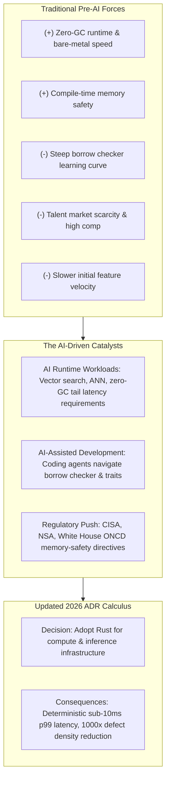
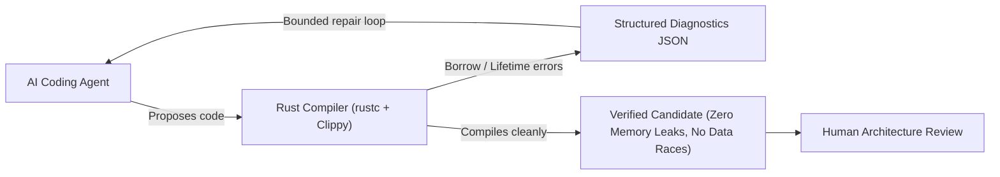

When software architects evaluate a programming language, they capture the decision in an **Architecture Decision Record (ADR)**. An ADR records the context, the forces at play, the chosen direction, and the expected consequences. For years, ADRs evaluating Rust in enterprise engineering followed a familiar script: undeniable runtime performance and memory safety on one side; a steep learning curve, talent scarcity, and slower initial development velocity on the other. For most general-purpose backend services, the trade-off calculus tipped against Rust.

The rapid rise of artificial intelligence is altering both sides of that equation.

This is the first article in a series exploring how AI is reshaping the trade-offs documented in software architecture decisions. While AI has visibly transformed how engineers write code on a day-to-day basis, its deeper impact lies in how it challenges long-standing architectural assumptions. In this post, I examine how AI workloads at runtime and AI coding assistants during development are rewriting the classic ADR for adopting Rust in the enterprise.



---

## The classic pre-AI Rust ADR: why companies hesitated

To understand what changed, consider the trade-offs that characterized enterprise language selection between 2018 and 2023. When evaluating Rust against mainstream enterprise runtimes such as Go, Java, or TypeScript, architects faced clear structural tensions:

| Architectural Vector | Pre-AI Assessment (Go / Java / Node) | Pre-AI Assessment (Rust) | Classic ADR Impact |
| :--- | :--- | :--- | :--- |
| **Memory Management** | Automatic garbage collection (GC pauses accepted) | Manual compile-time ownership via RAII (zero runtime GC) | Favored GC for developer convenience |
| **Learning Curve** | Days to weeks for junior and mid-level engineers | Months to master lifetimes, borrowing, and async pinning | **Heavy penalty against Rust** |
| **Hiring & Talent Pool** | Broad, liquid market of experienced practitioners | Scarce talent commanding 15% to 24% salary premiums | **Heavy penalty against Rust** |
| **Prototyping Velocity** | Rapid iteration; runtime exceptions handled downstream | Strict compiler checks; frequent fights with the borrow checker | **Favored GC languages for time-to-market** |
| **Safety Guarantees** | Vulnerable to data races, null pointers, and memory leaks | Zero data races, no null pointers, deterministic resource cleanup | Favored Rust for specialized kernels |

In that environment, a responsible ADR almost inevitably concluded:

> *"While Rust offers superior memory safety and raw throughput, the team's familiarity with Go and the high cost of ramping engineers on the borrow checker outweigh the operational savings for standard business APIs. We will continue using Go for microservices and restrict Rust to specialized cryptographic libraries."*

That decision was sound under the constraints of the time. But architecture decisions are only as durable as the context that generated them. Before examining how AI disrupts this balance, we need a rigorous look at the baseline architectural economics: how the cost of microservices in Rust actually compares against Java, Python, Go, and C/C++.

---

## The architectural cost equation: Rust vs. Java, Python, Go, and C/C++

When evaluating microservice architectures, total cost of ownership (TCO) is frequently miscalculated. Teams often focus exclusively on initial development velocity, ignoring the compounded operational costs of runtime resources, tail-latency instability in mission-critical paths, and continuous security triage.

Evaluating Rust against Java, Python, Go, and C/C++ reveals structural trade-offs across three primary vectors:

### 1. Resources: CPU, memory, and container packing density

In cloud-native environments managed by Kubernetes or serverless container runtimes, infrastructure bills are overwhelmingly driven by **memory allocation limits** rather than average CPU utilization. Pods are sized and scheduled according to their memory requests to prevent Out-Of-Memory (OOM) evictions.

* **Java (JVM)**: A production Spring Boot or Quarkus microservice routinely requires a baseline resident set size (RSS) between 250MB and 1GB. Even with ahead-of-time (AOT) compilation via GraalVM, baseline memory rarely drops below 80MB to 120MB. Crucially, garbage-collected runtimes require generous memory headroom (typically 30% to 50% above active heap usage) to prevent frequent, CPU-intensive GC cycles. Across a fleet of 200 microservice replicas, idle baseline memory alone consumes hundreds of gigabytes of cluster RAM before handling meaningful traffic.
* **Python**: In addition to interpreter overhead, Python's dynamic object representation incurs substantial memory bloat. Because of the Global Interpreter Lock (GIL), high-concurrency Python services (e.g., FastAPI, Django) rely on multi-process process managers like Gunicorn, multiplying the 150MB–350MB baseline per worker process.
* **Go**: Go provides an efficient runtime with small binaries and modest baseline memory (15MB–45MB). However, Go's runtime uses a concurrent tri-color mark-and-sweep collector with a default target of 100% heap growth (`GOGC=100`). Under high allocation throughput, Go requires roughly 2x its live memory footprint to avoid thrashing, forcing platform teams to set generous Kubernetes memory limits to avoid OOM pod evictions.
* **C / C++**: Delivers minimal baseline memory (5MB–20MB) and near-zero runtime overhead. However, long-running C/C++ microservices frequently suffer from heap fragmentation over time, requiring custom allocators (such as `jemalloc` or `tcmalloc`) and complex profiling to prevent gradual memory bloat.
* **Rust**: Rust microservices compiled with Tokio and Axum typically idle at **8MB to 25MB RSS**. Because memory is reclaimed deterministically at compile time via RAII with no runtime garbage collector, there is zero need for artificial heap headroom. In high-density cluster environments, teams can pack 4x to 10x more Rust microservice instances onto the same Kubernetes node pool compared to Java or Python, directly shrinking cloud infrastructure spend.

On the CPU front, empirical research on energy and instruction efficiency (such as the landmark Pereira et al. study) ranks C and Rust as the most energy-efficient languages (normalized baseline of 1.00), with Go at ~3.0x, Java at ~2.0x, and Python at over 70x. In microservice environments processing millions of requests per second, Rust's cache-conscious memory layouts and compiler auto-vectorization maximize throughput per vCPU.

### 2. Mission-critical projects: deterministic execution and real-time predictability

In mission-critical domains—such as financial market engines, industrial telemetry, autonomous systems, telecommunications, and real-time AI vector retrieval—average latency (p50) is irrelevant if tail latency (p99, p99.9, and p99.99) is erratic.

* **Java**: Modern garbage collectors like ZGC and Shenandoah achieve sub-millisecond pauses by executing compaction concurrently with application threads. However, this concurrency incurs a steep penalty: 15% to 25% of total CPU cycles are spent managing read-barriers and reference coloring. Under sudden burst traffic, concurrent GC threads can fall behind, causing fallback stop-the-world pauses that breach strict Service Level Objectives (SLOs).
* **Go**: Go's garbage collector is tuned for sub-millisecond pauses, but achieves this via "GC Pacing" and "Mark Assist"—a mechanism where the runtime forcibly hijacks application goroutines to help mark memory when allocation rates outpace collection. A user request arriving during a mark-assist cycle experiences a sudden, unpredictable latency spike.
* **Python**: The combination of the GIL, reference counting, and cyclic garbage collection makes Python entirely non-deterministic. Latency spikes are unpredictable, disqualifying it from hard real-time or mission-critical latency paths.
* **C / C++**: Capable of sub-microsecond determinism, but vulnerable to runtime fragility. A single concurrent race condition or memory corruption can silently corrupt state or crash the entire process under peak load, trading predictability for operational risk.
* **Rust**: Achieves hard determinism without a runtime collector. Resource cleanup occurs precisely when variables leave scope. By eliminating stop-the-world pauses, mark-assist stalls, and JVM warm-up compilation cycles, Rust provides flat, predictable latency profiles at the 99.9th percentile, ensuring mission-critical stability under heavy throughput.

### 3. Security economics: memory safety, concurrency, and attack surface

Security vulnerabilities are not merely technical debt; they represent enormous financial and reputational costs.

* **Memory Safety Defect Distribution**: Comprehensive research from Microsoft, Google, and the Chromium project consistently demonstrates that **~70% of all critical CVEs in large C/C++ systems are memory safety violations** (use-after-free, buffer overflows, double-frees, and out-of-bounds reads). While C and C++ offer unmatched performance, maintaining them requires continuous, expensive vulnerability triage, sanitizers (ASan, MSan), and emergency security patching.
* **Concurrency Hazards in Go and Java**: Java and Go protect against raw memory buffer overflows, but their runtimes permit concurrent data races. In Go, unsynchronized map reads and writes trigger fatal runtime panics, while shared mutable state across goroutines can produce silent data corruption. In Java, concurrency hazards like deadlocks and thread pool exhaustion remain frequent causes of production incidents.
* **Supply Chain and Attack Surface**: Java and Python microservices typically drag massive dependency graphs, transitive libraries, and runtime environments (the JVM or Python interpreter). Vulnerabilities like Log4j (CVE-2021-44228) highlighted the risk of large runtime reflection surfaces. By contrast, Rust compiles to self-contained, statically linked binaries that can run in `scratch` or `distroless` containers with zero shell, zero package manager, and zero external runtime dependencies, dramatically reducing the container attack surface and eliminating CVE noise in CI vulnerability scans.
* **Rust's Compile-Time Security**: Safe Rust guarantees memory safety without garbage collection, completely eliminating the 70% class of memory-safety CVEs. Concurrently, Rust's type system enforces thread safety through the `Send` and `Sync` traits, turning data races into compile-time errors.

### Comparative architectural matrix

| Dimension | Java (JVM) | Python | Go | C / C++ | Rust |
| :--- | :--- | :--- | :--- | :--- | :--- |
| **Microservice RSS Footprint** | 250 MB – 1 GB+ (high) | 150 MB – 400 MB / worker | 15 MB – 50 MB (moderate) | 5 MB – 20 MB (minimal) | **8 MB – 25 MB (minimal)** |
| **Heap Headroom Needed** | 30% – 50% extra RAM | Moderate | ~100% extra (`GOGC=100`) | None (fragmentation risk) | **Zero (compile-time RAII)** |
| **CPU / Energy Efficiency** | ~2.0x baseline | ~70x+ baseline | ~3.0x baseline | 1.0x (optimal) | **~1.0x (optimal)** |
| **Execution Determinism** | Concurrent GC pauses; 15-25% CPU overhead | Non-deterministic (GIL + cyclic GC) | Low STW pauses; subject to Mark Assist stalls | Deterministic; vulnerable to runtime crashes | **Strictly deterministic; zero GC pauses** |
| **Tail Latency (p99 / p99.9)** | Variable under heavy allocation | High variance | Occasional pacing spikes | Ultra-low (if bug-free) | **Consistently sub-10 ms** |
| **Memory Safety** | Safe (managed runtime) | Safe (managed runtime) | Safe (managed runtime) | **Unsafe (~70% of historical CVEs)** | **Compile-time safe (zero GC overhead)** |
| **Concurrency Safety** | Data races possible at runtime | Serialized by GIL | Data races possible (race detector needed) | Data races possible (undefined behavior) | **Data races prevented at compile time (`Send`/`Sync`)** |
| **Container Attack Surface** | Large (JVM + OS + libraries) | Large (Python runtime + pip packages) | Small (static binary) | Minimal (static or shared libc) | **Minimal (statically linked `scratch`/distroless)** |
| **Cloud TCO at Scale** | High memory costs | High CPU/memory costs | Moderate infrastructure cost | High maintenance & patch cost | **Lowest infrastructure TCO** |

These structural cost differences explain why systems engineers have always admired Rust. But what has triggered the sudden rush to revisit enterprise ADRs in 2026? It is the simultaneous collision of two AI-driven forces.

---

## Force 1: AI runtime workloads demand deterministic latency

The first catalyst comes from the operational requirements of production AI workloads. In traditional CRUD applications, median latencies of 50 to 100 milliseconds and occasional garbage collection pauses of 20 milliseconds are easily absorbed. In AI infrastructure, those assumptions break down.

Modern AI systems rely heavily on vector databases, retrieval-augmented generation (RAG) pipelines, embedding generation, and high-concurrency model inferencing. In Approximate Nearest Neighbor (ANN) search algorithms running over millions of high-dimensional vectors, memory churn is constant and intensive.

When garbage-collected runtimes like Go or Java process high-dimensional vector graphs under sustained query load, garbage collection pauses induce severe **tail-latency amplification** at the 99th and 99.9th percentiles. A 15-millisecond stop-the-world pause in an embedding retrieval step cascades across downstream model generation, degrading user experience and inflating infrastructure costs.

Rust resolves this operational bottleneck through compile-time Resource Acquisition Is Initialization (RAII), explicit heap control, and native hardware SIMD optimizations:

| AI Infrastructure Component | Runtime / Execution Model | Latency & Processing Performance | Resident Memory Footprint | Runtime Architectural Model |
| :--- | :--- | :--- | :--- | :--- |
| **Qdrant Vector Engine** | Rust | **4 ms p50 latency**; sustained sub-10 ms | Explicit paging; NVMe offload via `mmap` | Native binary; zero-GC; SIMD vectorization |
| **TorchServe (PyTorch)** | Python / C++ | **3.8 ms** single-image; 28.6 ms batch (32) | **892 MB** resident set size | Heavy runtime; libtorch shared library; Python GIL |
| **Hugging Face Candle** | Pure Rust | **2.1 ms** single-image; 18.4 ms batch (32) | **312 MB** resident set size | Minimal runtime; statically linked; zero-GIL |
| **Burn DL Framework** | Pure Rust | **2.4 ms** single-image; 21.1 ms batch (32) | **348 MB** resident set size | Flexible compute backends; compile-time graphs |

Consider Hugging Face’s **Candle** framework. Built as an inference-focused deep learning framework in pure Rust, Candle operates without the CPython runtime or heavyweight external C++ dependencies like LibTorch. By packaging transformer models into statically linked binaries, Candle achieves single-image execution latencies of 2.1 milliseconds compared to PyTorch’s 3.8 milliseconds, while slashing memory consumption from 892 megabytes to 312 megabytes.

Similarly, Python tooling in the AI ecosystem is undergoing a systemic replacement. Astral’s **`uv`**, a Python package and project resolver written entirely in Rust, demonstrated how systems programming can replace sluggish scripting layers, achieving a 74% admiration score in the 2025 Stack Overflow Developer Survey.

Modern architectures increasingly settle on a clean separation of concerns: **Python serves as the declarative, high-level API for model orchestration, while Rust powers the underlying execution engine—handling package management, data ingestion, vector indexing, and low-latency inference.**

---

## Force 2: AI coding assistants erode the velocity penalty

The second catalyst operates within the development lifecycle. Historically, the primary argument against Rust was developer productivity: teams spent too much time negotiating with the borrow checker and debugging complex lifetime relationships.

Autonomous AI coding agents and pair-programming assistants (such as Claude Code, Cursor, and GitHub Copilot) alter this dynamic in two fundamental ways:

### 1. Agents accelerate the Rust learning curve
Writing idiomatic Rust requires understanding ownership semantics, trait implementations, error propagation through `Result<T, E>`, and lifetime annotations. These are precisely the structured, syntax-heavy patterns where LLMs excel. 

An engineer unfamiliar with advanced Rust patterns no longer spends hours deciphering compiler diagnostics. An AI assistant can immediately explain why a reference cannot outlive a borrowed value, propose an idiomatic `Arc<Mutex<T>>` or channel-based design, and generate boilerplate trait implementations.

### 2. The Rust compiler serves as the ultimate harness for AI code
In dynamically typed or weakly checked languages, AI coding assistants can generate code that looks plausible but fails subtly at runtime—triggering `NullPointerException`s in Java, undefined access in TypeScript, or subtle data races in Go. Human engineers must spend extensive review cycles catching these hallucinations.

With Rust, the relationship flips. The compiler acts as an uncompromising, deterministic verification harness. If an AI agent generates code with dangling pointers, data races across thread boundaries, or unhandled enum variants, **the compiler simply rejects the code before it ever reaches review**. 

This feedback loop connects directly to the principles I discussed in [Harness Engineering]() and [Loop Engineering](): the compiler provides structured diagnostic output that the AI agent can consume iteratively until the solution compiles cleanly.



Empirical data from large-scale enterprise adoptions validates this effect. Google’s multi-year migration of foundational Android OS components to Rust revealed striking metrics:

* **Memory vulnerabilities dropped dramatically**: Absolute memory safety flaws fell from 223 in 2019 to under 50 in 2024, with memory bugs dropping from 76% of total OS vulnerabilities to under 20%.
* **~1,000x defect density reduction**: New Rust code exhibited approximately three orders of magnitude lower memory flaw density compared to legacy C/C++.
* **20% fewer review revisions**: Rust code required one-fifth fewer iterations before qualification compared to other languages.
* **25% faster review turnaround**: Reviewers spent less time hunting for edge cases because memory safety was already verified by the compiler.
* **4x reduction in production rollbacks**: Systems deployed in Rust experienced one-quarter the rollback frequency of legacy baselines.

Crucially, Google noted that legacy code vulnerabilities naturally decay as bugs are discovered and patched over time. Organizations do not need massive, risky rewrites of existing systems; introducing Rust for new high-throughput services immediately halts the injection of new memory-safety defects.

---

## Regulatory and industry standardization

These technical shifts are reinforced by institutional mandates that software architects cannot ignore:

* **White House ONCD Directive (February 2024)**: In *Back to the Building Blocks: A Path Toward Secure and Measurable Software*, the Office of the National Cyber Director, in coordination with CISA, NSA, and the FBI, called on commercial software vendors and critical infrastructure operators to systematically adopt memory-safe programming languages, explicitly naming Rust as a primary recommendation.
* **Linux Kernel Core Language (December 2025)**: The Linux Kernel Maintainers Summit reclassified Rust from an experimental language to a permanent core language alongside C, cementing its status across foundational operating system infrastructure.
* **Safety-Critical Certifications**: The Ferrocene compiler toolchain achieved IEC 61508 SIL 2 qualification, officially opening regulated automotive, aerospace, and medical device systems to Rust.
* **Developer Ecosystem Growth**: Longitudinal data from SlashData shows the global Rust developer community reached 4.0 million active developers by Q1 2024, doubling from 2.0 million in 2022. In the 2025 Stack Overflow Developer Survey, Rust marked its tenth consecutive year as the world's most admired programming language.

---

## What a modern Rust ADR looks like

When we incorporate these AI-driven forces into an architectural evaluation, how does the record read? Here is an example of an ADR structured around these updated trade-offs:

```markdown
# ADR 0024: Adopt Rust for Core Vector Search and Inference Services

## Status
Accepted

## Date
2026-10-08

## Context
Our enterprise platform is integrating retrieval-augmented generation (RAG) and real-time
vector embeddings. In our mission-critical telemetry and recommendation paths, existing
Go microservices experience p99 tail-latency spikes exceeding 120ms due to garbage collection
pacing assists during high-dimensional vector traversals. Alternative prototypes in Python
exhibit excessive memory footprints (exceeding 800MB RSS per worker) and GIL bottlenecks,
while our Java services require large heap allocations and suffer from sporadic GC pauses.
Evaluating C/C++ was rejected due to compliance mandates (White House ONCD / CISA guidelines)
requiring memory-safe languages to eliminate vulnerability classes that historically account
for ~70% of critical CVEs.

Historically, our team rejected Rust in ADR 0009 due to concerns over onboarding velocity
and talent scarcity. However, our adoption of AI coding assistants (which parse compiler
diagnostics to accelerate borrow-checker resolution) and the availability of mature
Rust AI tooling (such as Qdrant and Candle) have fundamentally altered that balance.

## Decision
We will write all new mission-critical, high-throughput vector ingestion, indexing, and model
inference microservices in Rust. Existing low-throughput CRUD APIs and high-level orchestration
workflows will remain in Go and Python.

## Consequences

### Positive
- **Deterministic Mission-Critical Latency**: Eliminates runtime GC pauses; benchmarks project
  p99 query latencies strictly below 10ms for vector similarity traversals.
- **Resource Efficiency & Container Density**: Lowers baseline microservice resident set size
  to ~15MB–25MB, allowing 5x to 8x higher container packing density on Kubernetes worker nodes
  compared to Java or Python runners, significantly lowering cloud compute costs.
- **Security & Vulnerability Elimination**: Zero-cost compile-time memory safety without a GC;
  eliminates buffer overflows, use-after-free defects, and concurrent data races (`Send`/`Sync`),
  meeting CISA memory-safety directives and reducing container attack surface to minimal
  distroless images.
- **AI Harness Fit**: The Rust compiler acts as an automated verification gate for
  AI-generated pull requests, ensuring that generated code satisfies strict safety contracts.

### Negative & Mitigations
- **Compilation Times**: Rust compilation (monomorphization and macro expansion) is slower
  than Go. 
  *Mitigation*: We will deploy shared `sccache` clusters and enforce modular crate boundaries
  in our CI pipeline.
- **Async Complexity**: Asynchronous Rust and lifetime pinning require careful design.
  *Mitigation*: We establish standardized internal service templates based on Tokio
  and Axum, accompanied by coding rules in `AGENTS.md`.
```

---

## Remaining trade-offs: what still requires vigilance

Adopting Rust is an architectural realignment, not a universal remedy. Even with AI assistance, several operational trade-offs remain significant:

1. **Compilation Latency Slows Agentic Feedback Loops**: The Rust compiler's thoroughness—borrow analysis, macro expansion, and generic monomorphization—comes at the expense of compile times. When an autonomous AI agent is running in an iterative repair loop, waiting minutes for a build to finish can introduce substantial latency into development workflows. Mitigating this requires investments in distributed build caching (such as `sccache`) and modular crate design.
2. **Asynchronous Rust Remains Non-Trivial**: While AI can draft `async/await` syntax, complex asynchronous patterns—such as stream processing, cancel-safety, and pin projection—still require human architectural scrutiny.
3. **Tooling and Infrastructure Investments**: Integrating Rust into enterprise observability pipelines, container base images, and continuous integration environments requires deliberate platform engineering.

---

## Summary: the architect's shifting calculus

Architecture Decision Records exist to make trade-offs transparent. When the underlying forces change, the decisions must be re-evaluated.

AI has altered the equation for Rust on two fronts simultaneously:
* **At runtime**, AI workloads (vector search, ANN indexing, inference serving) punish garbage-collected pauses and reward deterministic memory control.
* **During development**, AI coding agents lower the friction of learning Rust syntax, while Rust's uncompromising compiler serves as the ideal harness to keep AI-generated code safe and reliable.

If your team's last ADR rejected Rust because of the talent bottleneck or development velocity concerns, it may be time to revisit that record.

In the next article, I will look at the second architectural shift catalyzed by AI: **[why engineering organizations are moving back to monorepos, even while running microservices]()**.

