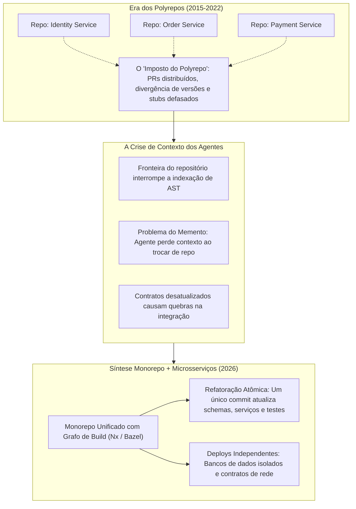
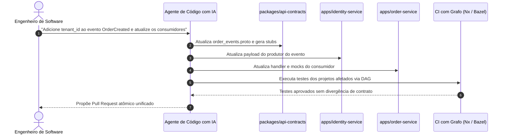

No [artigo anterior desta série](), analisei como a inteligência artificial está transformando os Architecture Decision Records (ADRs) na escolha de linguagens corporativas, convertendo o Rust de uma opção de nicho em uma decisão estratégica para cargas de alto desempenho.

Essa mudança operou principalmente na **camada de computação e runtime**. Contudo, a IA está catalisando uma transição igualmente profunda na **camada de gerenciamento de código-fonte**: a consolidação de microsserviços distribuídos de volta a monorepositórios unificados.

Entre 2015 e 2022, o consenso de engenharia favoreceu amplamente a abordagem de múltiplos repositórios (polyrepos) para microsserviços. Argumentava-se que isolar cada serviço em seu próprio repositório Git garantia modularidade, desacoplava deploys e respeitava a Lei de Conway.

Hoje, a adoção generalizada de agentes autônomos de programação — como Cursor, Claude Code e Copilot Workspace — expôs o atrito estrutural dos polyrepos. Arquitetos estão descobrindo que as fronteiras entre repositórios, criadas originalmente para proteger a autonomia dos times, tornaram-se barreiras intransponíveis de contexto para as ferramentas de IA.

O resultado é uma nova síntese arquitetural: **as organizações estão unificando o código em monorepos gerenciados por grafos, mantendo a independência de runtime dos microsserviços distribuídos.**



---

## O equívoco histórico: arquitetura de runtime versus topologia de código

Para entender essa transição sob a ótica de um ADR, precisamos separar duas decisões de design que a indústria frequentemente confundiu:

1. **Arquitetura de Execução em Runtime**: Define se a lógica roda em um único processo no mesmo espaço de memória (monólito) ou em serviços independentes que se comunicam através da rede (microsserviços).
2. **Topologia de Gerenciamento do Código-Fonte**: Define se o código desses serviços reside em centenas de repositórios separados (polyrepo) ou coabita um único repositório sob controle de versão (monorepo).

Durante a ascensão dos microsserviços, assumiu-se tacitamente que adotar microsserviços exigia adotar polyrepos. As empresas pulverizaram suas bases de código em dezenas — muitas vezes centenas — de repositórios Git.

Essa escolha trouxe um custo operacional invisível conhecido como o **"imposto do polyrepo"**.

Em um ambiente de polyrepos, qualquer mudança arquitetural que corte múltiplos serviços — como atualizar um contrato em Protocol Buffers, migrar um protocolo de autenticação ou alterar um modelo de domínio compartilhado — torna-se uma transação distribuída complexa. O desenvolvedor precisa:
1. Comitar a alteração de interface em um repositório central de bibliotecas.
2. Aguardar a esteira de CI gerar e publicar uma nova versão semântica em um registro interno.
3. Abrir pull requests individuais em cada um dos repositórios que consom a biblioteca.
4. Coordenar a sequência de merge e a ordem de deploy entre diferentes equipes.
5. Manter camadas temporárias de retrocompatibilidade para suportar deploys graduais.

Embora alterações transversais representem apenas 15% a 20% do volume total de commits, historicamente elas consumiam uma parcela desproporcional de esforço e coordenação humana. Os desenvolvedores toleravam esse atrito porque conseguiam navegar por canais de Slack e tickets de projeto.

Os agentes de IA não conseguem.

---

## A crise de contexto dos agentes em arquiteturas polyrepo

Agentes autônomos de código produzem implementações confiáveis apenas quando recebem contexto rico e preciso. Como detalhei em [Context Engineering](), um agente necessita de visibilidade clara sobre definições de tipos, contratos de API atualizados e implementações reais dos chamadores para trabalhar com precisão.

Em uma arquitetura de polyrepos, a fronteira do repositório funciona como uma barreira intransponível para a análise de árvore sintática (AST):

| Vetor Arquitetural | Microsserviços em Polyrepo (CI/CD Tradicional) | Microsserviços em Monorepo (CI/CD com IA) |
| :--- | :--- | :--- |
| **Fronteira de Contexto** | Fragmentada; restrita ao repositório do serviço atual | Unificada; visibilidade completa de serviços, contratos e clientes |
| **Escopo de Refatoração** | PRs múltiplos e distribuídos; risco de divergência de versões | Commit atômico único; validação transacional e revisão integrada |
| **Ingestão por Agentes de IA** | Indireta; depende de pacotes publicados ou documentação externa | Direta; parsing completo da AST e grafo de projetos |
| **Detecção de Quebra de Contrato** | Tardia; descoberta apenas em testes de integração ou homologação | Imediata; identificada no build, linting e checagem de tipos no CI |
| **Autonomia dos Agentes** | Baixa; a execução é interrompida na fronteira do repositório | Alta; execução ponta a ponta, do schema aos pontos de chamada |

Quando um agente de IA atua dentro de um repositório isolado:
* **Ele não enxerga quem consome nem quem é consumido**: Não consegue validar como clientes utilizam um endpoint nem verificar se a estrutura do payload de um produtor foi alterada.
* **Depende de definições desatualizadas**: O agente é obrigado a recorrer a pacotes publicados ou especificações que frequentemente estão defasadas em relação ao código real. Isso gera código que compila localmente, mas quebra durante a integração entre serviços.
* **O "efeito Memento" paralisa o trabalho**: Quando uma tarefa exige alterar um serviço upstream e depois atualizar o consumidor downstream, trocar de repositório zera a memória da sessão do agente. O engenheiro precisa reexplicar o contexto, refazer o prompt e reconciliar manualmente a transição.

Em resumo: **os polyrepos fragmentam justamente o contexto de que os agentes autônomos precisam para operar com eficácia.**

---

## A síntese monorepo + microsserviços: mecânica de coevolução com IA

Consolidar microsserviços em um monorepo unificado elimina essa barreira de contexto sem abrir mão da escalabilidade dos serviços distribuídos em produção.

No monorepo, alterações estruturais transversais tornam-se **operações atômicas**.

Quando um desenvolvedor solicita a um agente de IA a adição de um campo em um contrato gRPC ou a atualização de um cabeçalho de autenticação, o agente inspeciona todo o grafo de dependências em uma única passagem:
1. Atualiza a definição original no pacote de contratos compartilhados.
2. Executa os geradores de código locais para atualizar os stubs de tipagem.
3. Refatora os handlers de consumo em cada microsserviço no diretório `apps/`.
4. Atualiza os testes unitários, mocks e suítes de integração de todos os projetos afetados.

O pull request gerado representa um **commit atômico**. Ou todo o grafo compila e passa nos testes, ou o pull request é rejeitado. Não há estados intermediários quebrados nem divergência de versões em produção.



Os dados de velocidade observados no setor são contundentes:

* **Engenharia de Plataforma do Airbnb**: O Airbnb utilizou agentes de IA dentro de um monorepo unificado para concluir uma migração crítica de infraestrutura originalmente estimada em 18 meses em apenas **6 semanas** — uma aceleração de 12 vezes.
* **Benchmarks da Plataforma Nx**: Em medições controladas conduzidas pela Nx, engenheiros utilizando agentes em monorepos com grafos completaram alterações complexas entre múltiplos projetos **4 vezes mais rápido** do que em polyrepos, com redução de um terço no esforço total.
* **Stripe**: Realiza o merge de mais de **1.000 pull requests gerados por IA por semana** em um monorepo interno com centenas de milhões de linhas de código.
* **Razorpay**: Gera cerca de 1.000 pull requests automatizados semanalmente, com cerca de 100 integrados sem intervenção humana e um terço das revisões de código concluídas integralmente por IA.

---

## Guardrails arquiteturais: mantendo serviços desacoplados em um único repositório

Um receio clássico dos arquitetos é que colocar microsserviços em um monorepo recrie um monólito caótico e fortemente acoplado — onde serviços ignoram APIs de rede e importam diretamente modelos de banco ou utilitários internos de outros domínios.

Para prevenir essa degradação, as equipes de plataforma estabelecem regras estruturais rigorosas:

```text
monorepo/
├── apps/
│   ├── identity-service/        [Microsserviço com deploy independente]
│   ├── payment-service/         [Microsserviço com deploy independente]
│   └── order-service/           [Microsserviço com deploy independente]
├── packages/
│   ├── api-contracts/           [Definições Protobuf, gRPC e OpenAPI]
│   ├── domain-types/            [Estruturas canônicas de transferência de dados]
│   └── telemetry/               [Instrumentação de logs, métricas e tracing]
└── tools/
    ├── build-graph/             [Regras de DAG, cálculo de afetados e cache remoto]
    └── .cursor/rules            [Diretrizes arquiteturais para agentes de IA]
```

### 1. Compartilhe contratos livremente, isole implementações com rigor
Interfaces abstratas, schemas gRPC e Data Transfer Objects (DTOs) residem em pacotes dedicados dentro de `packages/`. A lógica de negócio interna, persistência e handlers permanecem restritos aos diretórios de seus respectivos serviços em `apps/`.

### 2. Bloqueie violações de fronteira no build
Linters arquiteturais e ferramentas de barreira de build (como regras de fronteira de projeto no ESLint ou visibilidade de pacotes no Bazel) proíbem qualquer importação direta entre serviços pelo sistema de arquivos.

Se o `order-service` tentar importar um módulo de `payment-service/src/internals`, o build quebra imediatamente. Os serviços só podem se comunicar por chamadas de rede (HTTP, gRPC ou mensageria).

### 3. Isole o banco de dados
Cada microsserviço mantém seu próprio schema de banco de dados isolado. O acesso direto de um serviço à base de outro continua estritamente proibido, evitando acoplamento na camada de dados.

### 4. Ferramental de build baseado em grafos
Monorepos corporativos não recompilam todo o repositório a cada commit. Ferramentas como **Nx, Turborepo, Bazel ou Pants** constroem um Grafo Acíclico Dirigido (DAG) do workspace.

Quando um agente de IA altera o `identity-service`, o sistema calcula exatamente os pacotes afetados e executa testes apenas para eles. Somado ao **cache remoto com hash criptográfico** das entradas, o tempo de CI cresce de forma controlada mesmo com o aumento do repositório.

Para organizações que não podem unificar repositórios fisicamente de imediato devido a exigências regulatórias, o **"monorepo sintético"** (como o Nx Polygraph) funciona como uma ponte: ele conecta repositórios distintos em um grafo unificado de metadados, oferecendo contexto para agentes sem exigir movimentação física de arquivos.

---

## A estrutura de um ADR moderno para Monorepo

Veja como um Architecture Decision Record pode registrar essa consolidação:

```markdown
# ADR 0025: Consolidar Microsserviços em Monorepo Gerenciado por Grafo

## Status
Aceito

## Data
2026-10-09

## Contexto
Nossa arquitetura conta com 34 microsserviços distribuídos em 34 repositórios Git distintos.
Nos últimos dois anos, alterações estruturais transversais (como atualizações de contratos
gRPC e padronização do OpenTelemetry) geraram alto custo de coordenação. Os engenheiros
precisam orquestrar PRs em múltiplas etapas, aguardar publicação de versões e manter
retrocompatibilidade temporária entre repositórios.

Além disso, o uso de agentes autônomos de código com IA (Claude Code, Cursor) tem sido
limitado pelas fronteiras dos repositórios. Os agentes não enxergam as implementações
clientes, alucinam contratos defasados e perdem contexto ao alternar entre repositórios.

## Decisão
Consolidaremos todos os 34 microsserviços e bibliotecas compartilhadas em um monorepo
unificado gerenciado por ferramenta baseada em grafo (Nx). Cada serviço manterá sua esteira
de deploy independente, banco de dados isolado e contêiner próprio de runtime.

## Consequências

### Positivas
- **Refatoração Atômica**: Atualizações de contratos, migrações e ajustes em consumidores
  são realizados em uma única branch e qualificados em um commit atômico.
- **Visibilidade de Contexto para IA**: Agentes ganham indexação completa de AST entre
  contratos e pontos de chamada, eliminando alucinações e divergências de API.
- **Eliminação de Divergência de Versões**: Bibliotecas internas são consumidas diretamente
  pelo workspace, sem necessidade de publicar versões intermediárias no registro.
- **Padronização Global**: Regras de linting, formatação, segurança e instruções em
  `AGENTS.md` passam a ser aplicadas de maneira uniforme.

### Negativas e Mitigações
- **Saturação da Janela de Contexto**: Carregar arquivos em excesso degrada o raciocínio
  do LLM e encarece o custo de tokens.
  *Mitigação*: Implementaremos filtros semânticos baseados no grafo de dependências para
  injetar apenas o subconjunto relevante no contexto do agente.
- **Latência na Cauda do CI**: Commits que tocam pacotes base podem acionar muitos testes.
  *Mitigation*: Implementaremos cache remoto, análise de impacto e paralelização de tarefas.
- **Risco de Acoplamento Indevido**: Desenvolvedores ou agentes podem tentar importar
  arquivos diretamente entre serviços.
  *Mitigação*: Linters de fronteira rejeitarão imports diretos entre serviços, exigindo
  contratos de rede (gRPC/HTTP) para toda a comunicação.
```

---

## Novos trade-offs operacionais no ADR de monorepo

A consolidação em monorepo introduz novos desafios que um ADR honesto precisa apontar:

1. **Saturação da Janela de Contexto ("Acessibilidade não é relevância")**: Um monorepo com milhares de arquivos contém bilhões de tokens potenciais. Inserir arquivos indiscriminadamente no prompt degrada o raciocínio dos modelos e eleva os custos de API. O monorepo precisa ser acompanhado de filtros semânticos inteligentes baseados na AST e em grafos de dependência para selecionar apenas o contexto indispensável.
2. **Cauda Longa no Pipeline de CI**: Estudos de benchmark da Faros mostram que, embora a mediana de tempo de PR em monorepos seja competitiva, o **percentil 90 pode apresentar caudas pesadas (>10 dias)** se grandes PRs transversais sobrecarregarem as suítes de teste. Mitigar isso exige testes atomizados e quarentena automatizada de testes instáveis.
3. **Atrito de Compilação em Escala**: Ao unir monorepos com linguagens como Rust (como discutido no [ADR de adoção de Rust]()), a expansão de macros e monomorfização de tipos genéricos podem aumentar o tempo de build, exigindo investimento em caches distribuídos.

---

## Conclusão: a arquitetura tripartite de 2026

A convergência entre agentes de desenvolvimento com IA e infraestrutura de sistemas consolida um modelo arquitetural em três camadas:

1. **A Camada de Runtime**: Permanece distribuída, operando microsserviços poliglota com baixo acoplamento que escalam de forma independente na nuvem.
2. **A Camada de Computação e Inferência**: Apoia-se em Rust para oferecer execução determinística, segura em memória e livre de pausas de garbage collection para cargas intensivas de IA.
3. **A Camada de Código-Fonte**: Consolida-se em monorepositórios unificados governados por grafos de build, garantindo a visibilidade de workspace e os commits atômicos indispensáveis para o potencial máximo dos agentes autônomos de IA.

Decisões de arquitetura são artefatos vivos. Conforme agentes autônomos se tornam participantes ativos do ciclo de desenvolvimento, a estrutura de nossos repositórios deve evoluir para acompanhar essa realidade operacional.

