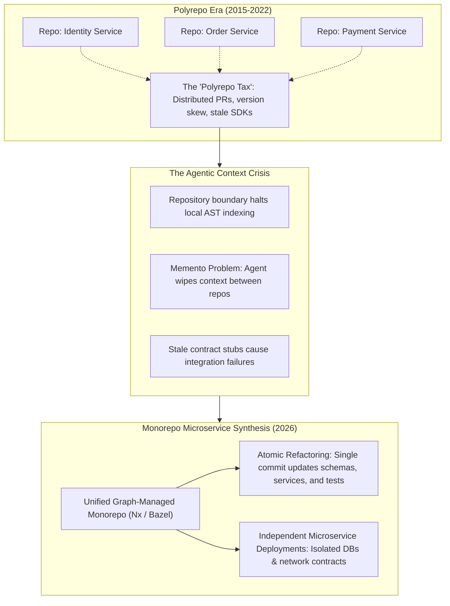
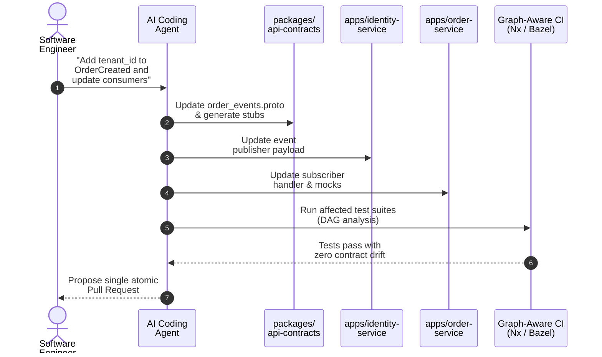

In the [previous post in this series](), I explored how artificial intelligence is altering the Architecture Decision Record (ADR) for enterprise systems languages, transforming Rust from a niche candidate into a strategic choice for high-throughput AI workloads. 

That shift operated primarily at the **runtime compute layer**. But AI is triggering an equally profound architectural migration at the **source code management layer**: the structural consolidation of distributed microservices back into unified monorepositories.

Between 2015 and 2022, enterprise engineering consensus strongly favored multi-repository (polyrepo) setups for microservices. Teams reasoned that isolating every service in its own Git repository enforced modularity, decoupled deployments, and respected Conway's Law. 

Today, the widespread adoption of autonomous AI coding agents—such as Cursor, Claude Code, and Copilot Workspace—has exposed the severe friction of polyrepo layouts. Architects are discovering that repository boundaries, once intended to guard team autonomy, have become context brick walls for AI tools.

The result is a new architectural synthesis: **teams are consolidating their codebases into graph-managed monorepos while preserving the runtime independence of distributed microservices.**



---

## The historical conflation: runtime architecture vs. code topology

To evaluate this shift within an ADR framework, we must first unravel an architectural conflation that dominated the previous decade. Software architects frequently blended two separate design dimensions:

1. **Runtime Execution Architecture**: Dictates whether application logic runs as a single process in one memory space (a monolith) or as independently deployable services communicating over network boundaries (microservices).
2. **Source Code Repository Topology**: Dictates whether the source code for those services resides in hundreds of separate repositories (polyrepo) or is co-located in a single version-controlled repository (monorepo).

During the microservices boom, organizations assumed that choosing a microservice runtime automatically required a polyrepo topology. Teams distributed their code across dozens—sometimes hundreds—of Git repositories.

That decision carried an invisible operational overhead often described as the **"Polyrepo Tax"**. 

In a polyrepo setup, making a cross-cutting architectural modification—such as updating a Protocol Buffer contract, migrating an authentication protocol, or patching a shared domain model—becomes a distributed transaction. An engineer must:
1. Commit the schema change in a central shared library repository.
2. Wait for continuous integration to build and publish a new semantic version to an internal registry.
3. Open separate pull requests across every consuming service repository to bump the dependency.
4. Coordinate the merge sequence and deployment order across multiple teams.
5. Maintain temporary backwards-compatibility shims to survive rolling production deployments.

While cross-cutting changes represent only 15% to 20% of an organization's total commits, they historically consumed an outsized share of engineering coordination time. Human engineers tolerated this friction because they could navigate asynchronous Slack channels and ticketing queues.

AI coding agents cannot.

---

## The agentic context crisis in polyrepos

Autonomous AI coding agents generate high-quality code only when provided with rich, relevant context. As I outlined in [Context Engineering](), an agent requires unambiguous visibility into active type definitions, current API schemas, and concrete caller implementations to produce reliable changes.

In a polyrepo architecture, the repository boundary acts as an impenetrable barrier to local Abstract Syntax Tree (AST) indexing:

| Architectural Vector | Polyrepo Microservices (Traditional CI/CD) | Monorepo Microservices (AI-Native CI/CD) |
| :--- | :--- | :--- |
| **Workspace Context Boundary** | Fragmented; restricted to the active service repository | Unified; complete visibility into services, contracts, and consumers |
| **Cross-Service Refactoring Scope** | Distributed, multi-stage PRs; version skew across services | Single atomic commit; unified review and transactional validation |
| **AI Agent Ingestion Mechanism** | Indirect; relies on published SDKs, API specs, or stale documentation | Direct; full AST parsing and complete project graph analysis |
| **Contract Drift Discovery** | Staggered; detected downstream during integration testing or staging | Immediate; surfaced during compile, lint, and type checking in CI |
| **Autonomous Agent Execution** | Low autonomy; execution halts at the repository boundary | High autonomy; end-to-end task execution from schema to callers |

When an AI agent works within an isolated polyrepo repository:
* **The agent cannot inspect callers or callees**: It cannot verify how downstream consumers utilize an API endpoint or whether an upstream payload structure has changed.
* **It relies on stale stubs**: The agent is forced to depend on published SDK packages or written API documentation, which are frequently out of date. Consequently, the agent generates code that compiles locally within its isolated repository but fails during cross-service integration testing.
* **The "Memento Problem" stalls iteration**: When a task requires modifying an upstream service and then updating a downstream consumer, moving to a new repository wipes the agent's conversational memory. The developer must re-prompt the model, re-explain previous architectural decisions, and manually bridge the organizational divide.

In short, **polyrepos fragment the very context that autonomous agents require to function effectively.**

---

## The monorepo microservice synthesis: mechanics of agentic co-evolution

Consolidating microservices into a unified monorepo eliminates this context barrier while retaining the scalability of distributed runtime services.

In a monorepo setup, cross-cutting architectural modifications become **atomic operations**. 

When an engineer instructs an AI agent to add a field to a Protocol Buffer contract or update an internal authentication header, the agent inspects the entire dependency graph in a single pass. In one continuous workflow, the agent:
1. Updates the source contract in the shared schema package.
2. Triggers local code generators to produce updated type bindings.
3. Refactors the request handlers across every consuming microservice in `apps/`.
4. Updates unit, mock, and end-to-end integration test suites across all affected projects.

The resulting pull request represents a **single atomic commit**. Either the entire dependency graph builds, passes linting, and clears integration tests, or the pull request is rejected. Version skew and broken intermediate states are structurally eliminated.



The empirical velocity gains of this model are striking:

* **Airbnb**: An [LLM-driven migration pipeline](https://airbnb.tech/infrastructure/accelerating-large-scale-test-migration-with-llms/) moved nearly 3,500 React test files from Enzyme to React Testing Library in **6 weeks**, against an estimated 1.5 years of manual engineering work.
* **Nx Platform Benchmarks**: In controlled developer benchmarks conducted by platform tooling provider Nx, software engineers utilizing AI agents within graph-managed monorepos completed complex cross-project changes **4x faster** than in multi-repo configurations, reducing overall engineering effort by one-third.
* **Stripe**: Merges over **1,000 AI-authored pull requests per week** against an internal monorepo spanning hundreds of millions of lines of code.
* **Razorpay**: Generates approximately 1,000 automated pull requests weekly, with roughly 100 merging with zero human intervention and one in three code reviews completing end-to-end via automated AI review.

---

## Architectural guardrails: keeping services independent inside one repo

A common fear among architects is that moving microservices into a monorepo inevitably leads to a monolithic "Big Ball of Mud"—where services bypass network APIs and directly import each other's database models or internal utilities.

To prevent this decay, platform teams enforce strict architectural guardrails:

```text
monorepo/
├── apps/
│   ├── identity-service/        [Independently deployed runtime service]
│   ├── payment-service/         [Independently deployed runtime service]
│   └── order-service/           [Independently deployed runtime service]
├── packages/
│   ├── api-contracts/           [Protobuf, gRPC, and OpenAPI definitions]
│   ├── domain-types/            [Shared canonical data transfer objects]
│   └── telemetry/               [Common logging, metrics, tracing hooks]
└── tools/
    ├── build-graph/             [DAG rules, affected analysis, remote cache]
    └── .cursor/rules            [Machine-readable architectural guardrails]
```

### 1. Share contracts freely, share implementation cautiously
Abstract interfaces, gRPC definitions, and Data Transfer Objects (DTOs) reside in dedicated packages under `packages/`. Internal business logic, persistence layers, and service handlers remain strictly private to their respective service directories under `apps/`.

### 2. Enforce build boundary rules in CI
Path-based architectural linters and build boundary rules (such as ESLint project boundaries or Bazel package visibility) strictly prohibit direct file-system imports between service directories. 

If `order-service` attempts to import a file from `payment-service/src/internals`, the build fails immediately. Services may only communicate across network boundaries (HTTP, gRPC, or message brokers).

### 3. Maintain database isolation
Each microservice maintains its own isolated database schema. Shared database access across services remains strictly prohibited to prevent data-layer coupling.

### 4. Graph-aware build tooling
Monorepos at scale do not rebuild the entire codebase on every commit. Build systems such as **Nx, Turborepo, Bazel, or Pants** parse a Directed Acyclic Graph (DAG) of the workspace. 

When an AI agent modifies `identity-service`, the build system computes the precise impact radius, executing builds and tests only for affected targets. Combined with **remote computation caching**—which stores and reuses build outputs using cryptographic input hashing—continuous integration pipelines scale sub-linearly with repository size.

For organizations whose regulatory structures or compliance boundaries prevent immediate physical consolidation into a single repository, the **"synthetic monorepo"** (such as Nx Polygraph) has emerged as an intermediate bridge. It links distributed repositories into a unified metadata graph, providing AI agents with cross-repo dependency context, though it lacks the true atomic commit guarantees of a physical monorepo.

---

## What a modern monorepo ADR looks like

Here is how an architecture decision record captures this structural migration:

```markdown
# ADR 0025: Consolidate Polyrepo Microservices into a Graph-Managed Monorepo

## Status
Accepted

## Date
2026-10-09

## Context
Our platform consists of 34 microservices distributed across 34 separate Git repositories.
Over the past two years, cross-cutting architectural changes (such as Protobuf contract updates
and OpenTelemetry standardization) have incurred severe coordination overhead. Engineers
must orchestrate multi-stage pull requests, wait for published package versions, and manage
temporary backwards-compatibility layers across repositories.

Furthermore, our rollout of autonomous AI coding agents (Claude Code, Cursor) has been
impeded by repository boundaries. Agents lack visibility into caller implementations, frequently
hallucinate stale API contracts, and suffer from context loss when switching repositories.

## Decision
We will consolidate all 34 microservices and shared libraries into a single, unified
monorepository managed by a graph-aware build tool (Nx). Each microservice will retain its
independent deployment pipeline, isolated database schema, and runtime container boundaries.

## Consequences

### Positive
- **Atomic Refactoring**: Cross-service API updates, schema migrations, and consumer adjustments
  can be executed in a single branch and qualified in a single atomic commit.
- **Agentic Context Visibility**: AI coding agents gain complete AST indexing across contracts
  and call sites, eliminating contract drift and hallucinated API signatures.
- **Zero Version Skew**: Internal shared libraries are consumed via workspace path references,
  removing the need to publish intermediate semantic packages to an internal registry.
- **Unified Standards**: Linters, formatting, security scanning, and machine-readable
  `AGENTS.md` guidelines are enforced uniformly across all services.

### Negative & Mitigations
- **Context Window Saturation**: Ingesting too many repository files into an LLM prompt degrades
  reasoning quality and inflates token costs.
  *Mitigation*: We deploy semantic AST filters and project graph indexers to inject only the
  relevant slice of the dependency graph into agent contexts.
- **CI Tail Latency**: Cross-cutting changes touching foundational packages can trigger massive
  downstream test runs.
  *Mitigation*: We implement remote computation caching, test impact analysis, and task
  atomization to execute affected suites in parallel.
- **Risk of Accidental Coupling**: Developers or agents might attempt direct file imports across
  service boundaries.
  *Mitigation*: Automated boundary linters strictly reject direct cross-service file imports,
  mandating network contracts (gRPC/HTTP) for all inter-service communication.
```

---

## New operational trade-offs in the monorepo ADR

Consolidating into a monorepo is not without operational challenges. An honest ADR must account for new failure modes:

1. **Context Window Saturation ("Reachability Does Not Equal Relevance")**: A monorepo containing 10,000 files represents millions of tokens. Unfiltered ingestion into an LLM degrades attention and escalates API costs. Monorepos must be paired with intelligent context filters—combining Abstract Syntax Tree indexing, structural symbol maps, and vector search over codebase fingerprints—to select only the relevant sub-graph.
2. **CI Pipeline Heavy Tails**: Benchmark analysis conducted by Faros across multiple engineering organizations revealed that while median pull request cycle times in monorepos remain competitive, the **90th percentile exhibits heavy tails (>10 days)** when large cross-cutting PRs saturate downstream verification pipelines. Mitigating this requires task atomization and automated test quarantine systems.
3. **Compiler Friction at Scale**: When combining monorepos with compiled languages like Rust (as explored in our [Rust ADR analysis]()), macro expansion and generic monomorphization can compound compilation latency, requiring dedicated investments in shared compiler caches.

---

## Conclusion: the tripartite architecture of 2026

The convergence of AI coding agents and systems-level infrastructure is cementing a clear three-tier architectural paradigm:

1. **The Runtime Layer**: Remains distributed, operating loosely coupled polyglot microservices that deploy and scale independently across cloud infrastructure.
2. **The Compute Engine Layer**: Relies on Rust to deliver memory-safe, deterministic, zero-GC execution for demanding AI workloads and vector data planes.
3. **The Source Code Layer**: Consolidates into unified monorepositories governed by graph-aware build systems, establishing the workspace visibility and atomic refactoring capabilities necessary to unleash the full potential of autonomous AI coding agents.

Architecture decisions are living documents. As autonomous agents become core members of the engineering team, our repository structures must evolve to support their operational realities.

In the next article, I explore the third architectural shift catalyzed by AI: **[the case for WebAssembly adoption in serverless inference and agentic sandboxing]()**.

