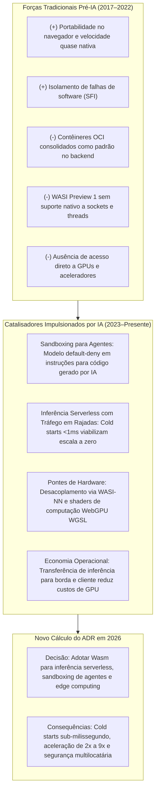
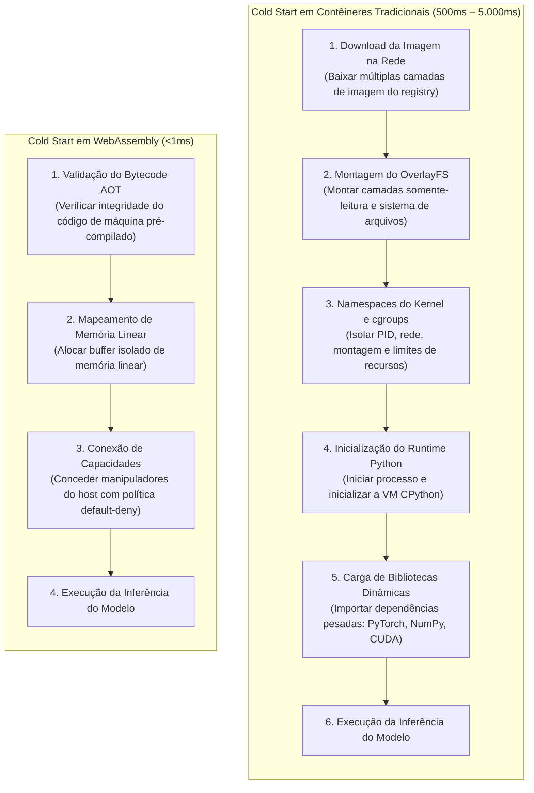
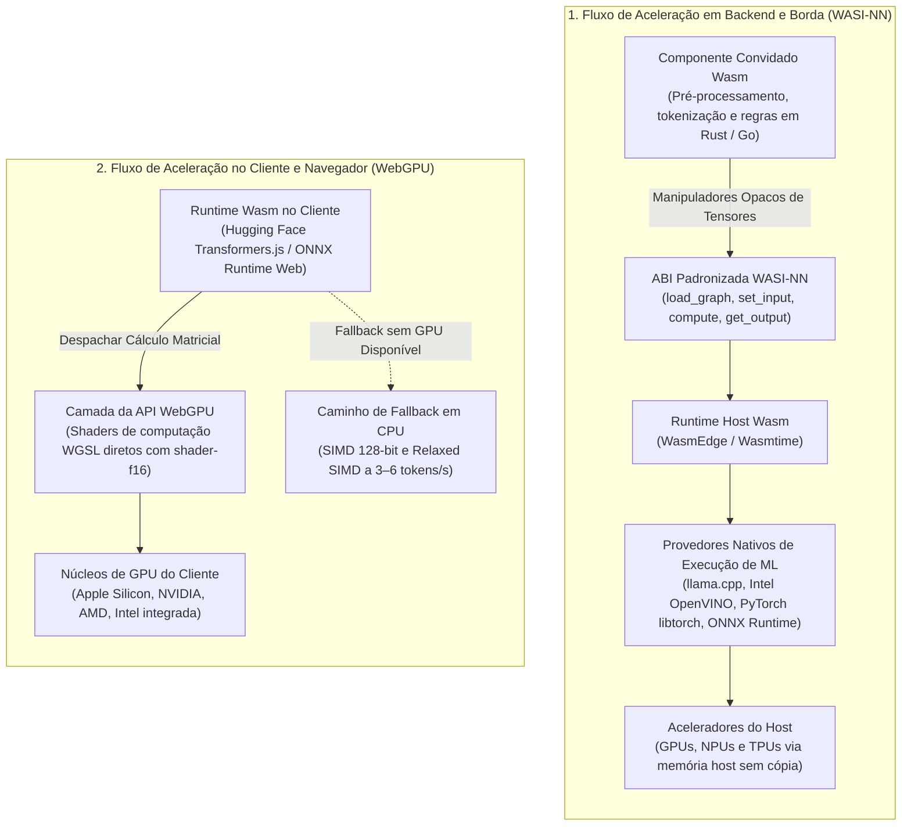

Nos dois primeiros artigos desta série, analisamos como a inteligência artificial está transformando premissas consagradas na arquitetura de software. Na [primeira parte](), examinamos como os requisitos de latência determinística para cargas de vetores e os ciclos de verificação com auxílio de compiladores alteraram o cálculo para a adoção corporativa de Rust. Na [segunda parte](), vimos como os agentes autônomos de programação desmontaram os argumentos a favor da fragmentação de polyrepos, impulsionando a unificação de microsserviços em monorepositórios governados por grafos de dependência.

Essas mudanças incidiram sobre a **camada de linguagem** e a **camada de gerenciamento de código-fonte**. Contudo, a inteligência artificial está promovendo uma revolução igualmente profunda na **camada de execução e runtime**: a rápida evolução do **WebAssembly (Wasm)** de uma tecnologia voltada a gráficos no navegador para um componente central de infraestruturas cloud-native.

Durante anos, os Architecture Decision Records (ADRs) que avaliavam o WebAssembly chegavam a uma conclusão rápida: por que adotar uma máquina virtual de bytecode não padronizada nos servidores quando contêineres Linux (Docker, OCI), orquestração madura com Kubernetes e namespaces nativos do kernel já resolviam o isolamento e a distribuição?

A disseminação de modelos de IA generativa e de fluxos de trabalho com agentes autônomos alterou radicalmente os trade-offs desse consenso. Neste artigo, apresento os motivos, as estatísticas empíricas e os benchmarks de produção que estão reescrevendo o ADR corporativo para a adoção de WebAssembly.



---

## O clássico ADR pré-IA para WebAssembly: por que os arquitetos hesitavam

Entre 2017 e 2022, o WebAssembly ocupava um espaço bem delineado. Quando avaliado em um ADR corporativo para computação de uso geral, a matriz de trade-offs favorecia consistentemente os contêineres Linux tradicionais:

| Vetor Arquitetural | Avaliação Pré-IA (Contêineres OCI / Docker) | Avaliação Pré-IA (WebAssembly) | Impacto no ADR Clássico |
| :--- | :--- | :--- | :--- |
| **Ambiente Principal** | Servidores de backend, VMs em nuvem, nós de Kubernetes | Navegadores web, proxies de rede de borda (Envoy / Istio) | Favorecia contêineres para computação corporativa |
| **Interfaces de Sistema** | API POSIX completa, namespaces do kernel, `cgroups`, rede Linux | WASI Preview 1; modelo single-threaded e shims de arquivo rudimentares | **Forte penalidade contra o Wasm** |
| **Acesso a Hardware** | Mapeamento direto de dispositivos (NVIDIA Container Toolkit, CUDA) | Confinado à máquina virtual; zero acesso a GPUs ou NPUs | **Desqualificava o Wasm para cargas aceleradas** |
| **Maturidade do Ecossistema** | Milhões de imagens prontas; ferramentas consolidadas de CI/CD | Cadeias de ferramentas fragmentadas; runtimes e interfaces WIT em evolução | Favorecia Docker para entregas previsíveis |
| **Sobrecarga de Inicialização** | Cold starts de 500ms a 5.000ms (mitigados por pools de instâncias aquecidas) | Inicialização em microssegundos (desnecessária para serviços de longa duração) | Neutralizava a vantagem de inicialização do Wasm |

Nesse contexto operacional, um ADR responsável concluía quase invariavelmente:

> *"Embora o WebAssembly ofereça sandboxing leve e inicialização quase instantânea, a ausência de conexões diretas com aceleradores de hardware, o suporte incompleto a redes POSIX e a fragmentação das ferramentas de runtime o tornam inadequado para serviços de backend. Manteremos contêineres Docker/OCI no Kubernetes e limitaremos o WebAssembly a decodificadores multimídia no cliente e filtros de proxy Envoy."*

Essa decisão fazia todo o sentido quando as cargas de trabalho eram APIs determinísticas com conexões contínuas a bancos de dados relacionais. No entanto, o paradigma operacional da era da IA inverteu esses requisitos.

---

## A mudança de paradigma: pré-IA vs. pós-IA operacional

As exigências operacionais das cargas de IA generativa expõem as fragilidades dos contêineres Linux e se alinham diretamente às propriedades essenciais do WebAssembly:

| Dimensão | Paradigma Pré-IA (2017–2022) | Paradigma Pós-IA (2023–Presente) |
| :--- | :--- | :--- |
| **Ambiente Principal de Execução** | Abas do navegador e proxies de borda (filtros Envoy/Istio) | Nós de borda distribuídos, funções cloud serverless, sandboxes de agentes de IA e GPUs de clientes |
| **Tipo Dominante de Carga** | Renderização gráfica 2D/3D, física, filtros de vídeo e portas de GUIs desktop | Inferência de LLMs quantizados, geração de embeddings, execução de código por agentes autônomos e NLP no dispositivo |
| **Tamanho dos Artefatos** | Módulos binários compactos variando de 1MB a 30MB | Microbinários (&le;2MB) com tensores pesados desacoplados na memória do host sem cópia |
| **Especificações de Interface** | Padrões W3C essenciais e shims de arquivo/socket da WASI Preview 1 | WASI 0.2 (Component Model), WASI-NN, WebGPU (WGSL) e extensões Relaxed SIMD |
| **Abstração de Hardware** | Tradução genérica de instruções de CPU via JIT ou compilação AOT | Execução direta em NPUs, GPUs via compute shaders WebGPU e bibliotecas nativas de ML (OpenVINO, llama.cpp) |
| **Arquitetura de Segurança** | Isolamento por origem no navegador e limites de memória linear | Segurança baseada em capacidades (zero-trust), chamadas de sistema bloqueadas por padrão e execução segura de código gerado |

---

## Dinâmica quantitativa de adoção e telemetria do ecossistema

A adoção do WebAssembly no ambiente corporativo deixou de ser teórica. A telemetria de tráfego web global, os levantamentos do ecossistema cloud-native e os benchmarks de desenvolvedores apontam para um ponto de inflexão evidente:

### 1. Telemetria nos navegadores
Os dados do **Chrome Platform Status** indicam que a proporção de carregamentos de página globais que executam WebAssembly subiu para cerca de **4,5%**, registrando um aumento anual superior a **1,0 ponto percentual**. Enquanto o crescimento inicial foi puxado por ferramentas como o Figma e o Google Earth, essa nova onda decorre da integração direta de busca vetorial no cliente, geração local de embeddings e bibliotecas de inferência rodando nas abas do navegador.

### 2. O panorama cloud-native
A Cloud Native Computing Foundation (CNCF) formalizou esse avanço criando o **CNCF WebAssembly Landscape**. O mapeamento registra:
* Mais de **120 projetos ativos e ofertas comerciais** divididos em 11 categorias de arquitetura.
* Mais de **US\$ 59,4 bilhões em valor de mercado agregado** entre as organizações participantes.
* Uma divisão clara entre **ferramentas de compilação** (backends LLVM, Binaryen, `rustc`, conectores WIT do Component Model) e **motores de orquestração distribuída** (Wasmtime da Bytecode Alliance, WasmEdge, Wasmer, Fermyon Spin).

### 3. Penetração corporativa e integração ao Kubernetes
A série histórica da pesquisa **CNCF Annual Cloud Native Survey** mostra a transição do WebAssembly de testes experimentais para a infraestrutura de produção:
* **Saturação de contêineres**: As organizações que rodam contêineres para a maioria ou totalidade das suas cargas de produção passaram de 41% para 56%, enquanto a presença do Kubernetes em produção saltou de 66% para **82%**.
* **Curva de adoção do Wasm**: Embora 65% das organizações historicamente não tivessem experiência direta com Wasm, as empresas com implementações completas em produção se consolidaram em **5%**, enquanto quase **30% das empresas relatam estar em fases ativas de avaliação, prototipagem ou projetos-piloto**.
* **Orquestração híbrida**: Essa integração é viabilizada por shims de contêiner — como `containerd-wasm-shim`, `Kuasar` e `Kwasm` —, permitindo que os planos de controle do Kubernetes orquestrem módulos Wasm leves ao lado de contêineres OCI convencionais usando a primitiva padrão `RuntimeClass`.

### 4. Linguagens preferidas e expansão fora do navegador
A pesquisa anual **State of WebAssembly** da Scott Logic revela que linguagens de sistemas dominam o desenvolvimento em produção:
* **Rust** figura como a linguagem **mais utilizada** e **mais desejada** para desenvolvimento em WebAssembly, devido ao seu runtime mínimo, controle estrito da memória linear e ausência de garbage collector.
* **Aplicações fora do navegador**: Cargas em backend, serverless e sistemas embarcados já representam mais de **38% da atividade de desenvolvimento**, impulsionadas por grandes empresas:
  * A **American Express** implementou uma infraestrutura interna de Function-as-a-Service (FaaS) baseada em WebAssembly para otimizar o roteamento de transações.
  * A **Visa** incorporou runtimes de WebAssembly diretamente em seus pipelines de processamento financeiro em tempo real para executar regras de verificação determinísticas com latência ultrabaixa.

### Principais métricas de adoção

| Métrica do Ecossistema | Valor / Benchmark Medido | Contexto de Infraestrutura / Fonte |
| :--- | :--- | :--- |
| **Participação no Chrome Global** | **~4,5%** das páginas (+1,0% ano a ano) | Telemetria do Chrome Platform Status |
| **Impacto Econômico no Cloud-Native** | **120+ projetos** em 11 áreas; avaliação de **US\$ 59,4B** | CNCF WebAssembly Landscape Analysis |
| **Penetração do Kubernetes em Produção** | **82%** dos ambientes corporativos com contêineres | Pesquisa Cloud Native da CNCF |
| **Adoção Corporativa em Produção do Wasm** | **5%** em produção plena; **~30%** em avaliação ou piloto | Acompanhamento longitudinal da pesquisa CNCF |
| **Tempo de Execução: Wasm vs. Python Nativo** | **2x a 9x mais rápido** na inferência de LLMs quantizados | Avaliação de desempenho do WasmEdge (Mixtral/LLaMA) |
| **Duração de Cold Start** | **&lt;1ms** (inicialização sub-milissegundo) | Benchmarks do Wasmtime e Fermyon Spin |
| **Tamanho do Artefato de Implantação** | **1,2MB – 2,0MB** (Wasm) vs. **242MB – 2,5GB** (Contêiner OCI) | Comparação entre microsserviços e contêineres de ML |
| **Fator de Aceleração WebGPU vs. Wasm CPU** | **3x a 30x+** (chegando a 120x em GPUs dedicadas) | Benchmarks de cliente com Transformers.js e ORT Web |

---

## Mecanismos arquiteturais que impulsionam a migração de cargas de IA

Por que a IA generativa está levando o WebAssembly para os ADRs corporativos? A resposta repousa em três mecanismos arquiteturais fundamentais:

### 1. Segurança orientada a capacidades e sandboxing para agentes

Agentes autônomos de IA (como interpretadores de código, geradores dinâmicos de consultas SQL e mecanismos de execução de ferramentas) criam um desafio de segurança inédito: **eles geram e executam código arbitrário em tempo de execução**.

Nos contêineres Linux tradicionais, o isolamento depende do compartilhamento do mesmo kernel: namespaces do Linux, `cgroups` e filtros `seccomp`. Embora essa estrutura funcione para artefatos previamente auditados, rodar código gerado dinamicamente por modelos de linguagem dentro de um contêiner acarreta sérios riscos:
* O contêiner compartilha o kernel do host; qualquer vulnerabilidade de escalonamento de privilégios no kernel pode comprometer todo o nó.
* Contêineres iniciam com acesso amplo a chamadas de sistema, a menos que sejam bloqueados manualmente por perfis complexos.

O WebAssembly neutraliza essa superfície de ataque por meio do **Isolamento de Falhas de Software (Software Fault Isolation - SFI)** aplicado diretamente no nível do conjunto de instruções:
1. **Memória Linear Isolada**: Todo módulo WebAssembly opera estritamente dentro de um buffer de memória linear delimitado (endereços de 0 até o seu limite). Qualquer tentativa de acessar endereços fora desse espaço dispara uma falha de execução imediata.
2. **Segurança por Capacidades com Bloqueio Padrão**: Sob a interface WASI, os módulos convidados não possuem **nenhum acesso inato** a chamadas de sistema, timers de hardware, sockets de rede ou sistemas de arquivos.
3. **Delegação Explícita pelo Host**: Toda capacidade externa precisa ser concedida explicitamente pelo host na inicialização (por exemplo, liberando apenas um descritor de diretório virtual específico ou um socket com restrições).

Se um agente de IA gerar código malicioso ou defeituoso, a execução permanece enclausurada na memória linear do módulo, fornecendo um isolamento comparável ao de máquinas virtuais sem a sobrecarga de inicialização ou o consumo excessivo de memória.

### 2. Cold starts sub-milissegundo e alta densidade de execução

As arquiteturas serverless tradicionais sobre Kubernetes enfrentam gargalos severos de custo e latência para atender a picos esporádicos de inferência de machine learning.

Para atender uma requisição, um contêiner tradicional precisa:
1. Baixar camadas de imagem de centenas de megabytes ou gigabytes pela rede.
2. Montar um sistema de arquivos unificado (OverlayFS).
3. Criar namespaces no kernel e rodar processos de inicialização do sistema operacional.
4. Carregar o interpretador Python, bibliotecas compartilhadas em C (`numpy`) e frameworks extensos (`torch`, `transformers`).

Esse fluxo impõe **latências de cold start de 500ms a 5.000ms**. Para mascarar esse atraso, as equipes mantêm pools de contêineres permanentemente aquecidos, pagando custos contínuos substanciais por instâncias de CPU e GPU ociosas.



O WebAssembly elimina essa sobrecarga através da **inicialização livre de processos**:
* O binário Wasm é pré-compilado e já foi validado antecipadamente via compilação Ahead-Of-Time (AOT).
* Motores como Wasmtime ou WasmEdge criam um novo contexto em microssegundos (**&lt;1ms**), alocando uma região de memória linear e associando as capacidades necessárias.
* Isso viabiliza uma **verdadeira escala a zero**: uma sandbox é criada instantaneamente ao chegar uma requisição e destruída assim que a resposta é enviada.
* Como não há overhead de namespaces do kernel, **milhares de contextos de execução Wasm podem rodar dentro de um único processo do sistema operacional**, proporcionando densidades ordens de magnitude superiores às frotas Docker.

### 3. Abstração de aceleradores de hardware: WASI-NN e WebGPU

Historicamente, o grande entrave para rodar aprendizado de máquina em WebAssembly era o isolamento em relação aos aceleradores de hardware: executar redes neurais apenas com instruções genéricas de CPU em bytecode de 32 bits causava degradações de desempenho inaceitáveis.

O ecossistema superou esse obstáculo desenvolvendo duas interfaces padronizadas:



#### WASI-NN (Backend e Borda)
A especificação **WASI-NN** estabelece uma Application Binary Interface (ABI) orientada a capacidades que separa a lógica de orquestração do cálculo matricial. O módulo convidado interage com uma API de tensores por meio de cinco etapas:
1. `load_graph`: Carrega o grafo do modelo.
2. `init_execution_context`: Inicializa um contexto isolado de execução.
3. `set_input`: Conecta os tensores de entrada.
4. `compute`: Dispara o processamento matricial.
5. `get_output`: Recupera os tensores resultantes.

O módulo Wasm gerencia o pré-processamento, a tokenização e as regras de negócio, passando manipuladores de memória opacos pela fronteira da ABI. Os runtimes do host (WasmEdge, Wasmtime) executam essas chamadas diretamente em bibliotecas nativas e provedores de aceleração como **Intel OpenVINO, PyTorch (`libtorch`), ONNX Runtime e `llama.cpp`**. Graças ao **mapeamento de memória sem cópia (zero-copy)**, pesos de modelos volumosos residentes na RAM do host não precisam ser duplicados na memória linear do Wasm, contornando o limite de 32 bits de endereçamento.

#### WebGPU (Navegadores)
No navegador, a aceleração ocorre via **WebGPU**, permitindo shaders de computação diretos com a WebGPU Shading Language (WGSL). O WebAssembly coordena a pipeline, a tokenização e o estado da aplicação, enquanto despacha buffers de dados para as filas de computação da GPU do cliente. Com a introdução de **operações em ponto flutuante de 16 bits (`shader-f16`)** e produtos escalares com inteiros compactados, o ganho de throughput atinge de **1,6x a 3,0x** em relação a floats tradicionais de 32 bits.

---

## Matriz comparativa: contêineres OCI vs. Python nativo vs. WebAssembly

A comparação direta entre as abordagens sintetiza a nova realidade arquitetural:

| Atributo | Contêineres Linux (OCI / Docker) | Python Nativo (PyTorch / C++) | WebAssembly (WASI-NN / WebGPU) |
| :--- | :--- | :--- | :--- |
| **Limite de Isolamento** | Nível de kernel do SO (`cgroups`, namespaces, `seccomp`) | Nenhum (acesso direto à memória do processo) | **Isolamento de falhas de software, memória linear, default-deny** |
| **Duração do Cold Start** | 500ms – 5.000ms | 2.000ms – 15.000ms (carga do interpretador) | **&lt;1ms – 5ms (sub-milissegundo)** |
| **Pegada Típica de Memória** | 250MB – 5.000MB (imagem do SO + camadas) | 500MB – 2.000MB (dependências do framework) | **1MB – 20MB (binário executável)** |
| **Vinculação de Hardware** | Mapeamento no kernel (NVIDIA Container Toolkit) | Linkagem dinâmica nativa via C-ABI | **SPI de host padronizado via ABI ou WebGPU WGSL** |
| **Alcance de Portabilidade** | Vinculado à CPU de destino e ABI do kernel | Específico do sistema operacional e `glibc` | **Binário portátil independente de arquitetura** |
| **Segurança Multilocatária**| Vulnerável a falhas de kernel compartilhado | Inseguro para código dinâmico não confiável | **Sandboxing em nível de instrução para código arbitrário** |
| **Adequação para Escala a Zero** | Inviável para tráfego em rajadas (exige pools quentes) | Ruim (alta latência de inicialização) | **Ideal; instanciação e encerramento instantâneos** |

---

## Casos de estudo em produção e benchmarks empíricos

Dados empíricos de ambientes produtivos comprovam essas vantagens na borda, em ambientes serverless e no navegador:

### 1. Inteligência na borda: WasmEdge e LlamaEdge
O **WasmEdge** (projeto sandbox da CNCF utilizado na ByteDance, Huawei Cloud e Red Hat) conta com plugins WASI-NN integrados ao `llama.cpp` para rodar modelos quantizados. A comparação direta entre o WasmEdge e scripts Python tradicionais executando `llama.cpp` revelou ganhos substanciais:

| Arquitetura do Modelo | Nível de Quantização | Tempo Python / `llama.cpp` | Tempo WasmEdge / WASI-NN | Fator de Aceleração Medido |
| :--- | :--- | :--- | :--- | :--- |
| **Microsoft Phi-2 (2.7B)** | Q4_K_M | ~280s | ~68s | **4,1x mais rápido** |
| **LLaMA-2 (7B)** | Q4_K_M | ~610s | ~195s | **3,1x mais rápido** |
| **Mixtral-8x7B-Instruct (46.7B)** | Q4_K_M | ~2.734s | ~302s | **9,0x mais rápido** |

A análise de perfil de baixo nível com o utilitário Linux `perf_events` identificou as causas desse ganho de 9,0x:
* O pipeline em Python sofria atrasos severos de agendamento e esperas de I/O por causa de **concorrência no Global Interpreter Lock (GIL)** e trocas de contexto entre chamadas de sistema.
* O WasmEdge dispensou totalmente a sobrecarga do interpretador, compilando a lógica de orquestração para código de máquina nativo via otimização AOT em LLVM e delegando as operações matriciais às bibliotecas do host.
* No WasmEdge, a execução registrou uma redução para **6,2 trilhões de instruções, 3 trilhões de ciclos de CPU e 573 bilhões de avaliações de desvio**, minimizando drasticamente as paradas por erro de predição de saltos.

### 2. IA serverless orientada a eventos: Fermyon Spin
Em implantações produtivas unindo redes de distribuição de conteúdo (CDNs) a nós de computação de borda, o **Fermyon Spin** (construído sobre o Wasmtime) demonstrou os impactos da migração de pipelines de análise de texto e transformação de imagens de contêineres para WebAssembly:
* O tamanho dos artefatos despachados caiu de contêineres de centenas de megabytes para binários Wasm entre **1,2MB e 2,0MB**.
* A eliminação do boot de contêineres e do download de imagens em registries reduziu a **latência em P99 de 340ms para 23ms**.
* Tornou-se viável a escala a zero orientada a eventos: instâncias são criadas ao receber uma requisição, executam a inferência sobre modelos pré-aquecidos e são destruídas imediatamente.

### 3. Inferência local no navegador: Transformers.js e ONNX Runtime Web
Utilizando o Microsoft ONNX Runtime Web e o Transformers.js da Hugging Face:
* O processamento matricial em shaders de computação WebGPU proporciona **ganhos de 3x a 30x** sobre a execução em CPU via Wasm em laptops comuns, alcançando **mais de 120x em GPUs desktop dedicadas**.
* **Mecanismo de contingência com SIMD**: Caso o dispositivo não tenha suporte a WebGPU, a execução é redirecionada para threads de CPU Wasm com instruções SIMD de 128 bits e Relaxed SIMD. Em dispositivos móveis sem aceleração de GPU, modelos quantizados de 8 bits rodam a **3 a 6 tokens por segundo**, mantendo a experiência do usuário sem depender da nuvem.

### 4. Transição corporativa no desktop: O ecossistema Adobe
A Adobe Systems estabeleceu um marco ao compilar seu motor de renderização de desktop em C++ para WebAssembly, obtendo um **desempenho três vezes superior** ao de tecnologias web convencionais.

Após o lançamento dos modelos generativos Firefly, a Adobe expandiu o uso de WebAssembly em sua plataforma **Unified Extensibility Platform (UXP)**:
* A UXP serve como plataforma unificada de plugins para o **Photoshop, Premiere Pro e Illustrator**.
* Desenvolvedores terceiros compilam módulos em Rust e C++ diretamente para plugins Wasm isolados que manipulam buffers de pixels e executam modelos de aprendizado de máquina localmente.
* Projetos de código aberto independentes, como o **PhotoCraft**, provam a viabilidade de recriar suítes completas compatíveis com o Photoshop rodando inteiramente no navegador através de Rust compilado para WebAssembly.

---

## Vetores econômicos, de privacidade e operacionais

Além do ganho de desempenho, três fatores econômicos e regulatórios estão levando os arquitetos a revisar seus registros de decisão:

### 1. Custos de infraestrutura em nuvem
Hospedar modelos de linguagem em instâncias de nuvem exige gastos contínuos expressivos com hardware acelerado. Compilar modelos para WebAssembly e delegar a inferência para a borda ou para o navegador transfere o custo computacional para os dispositivos dos usuários. Como exemplo, a equipe de analytics da **IBM migrou ferramentas de modelagem estatística de VMs na nuvem para execução em Wasm no navegador, gerando reduções substanciais nas faturas de servidores centrais**.

### 2. Privacidade de dados e conformidade regulatória
Em setores como saúde, direito e gestão de propriedade intelectual, o tráfego de dados confidenciais de clientes para APIs de terceiros envolve riscos de conformidade sob leis como LGPD, GDPR, HIPAA e o AI Act europeu.

O WebAssembly permite **levar o modelo até os dados**, em vez de transportar dados sensíveis até a nuvem:
* Atividades confidenciais — como geração de embeddings de documentos, sumarizações e processamento biométrico — ocorrem na memória local do cliente.
* As informações do usuário nunca saem do dispositivo, eliminando preocupações com armazenamento indevido ou uso não autorizado em treinamentos de modelos externos.

### 3. Redução da latência de trânsito na rede
APIs hospedadas na nuvem introduzem atrasos de ida e volta na rede (RTT) entre **100ms e 250ms por requisição**. Em recursos interativos — como transcrição em tempo real, reconhecimento de escrita, análise de vídeo e preenchimento automático —, essa espera compromete a usabilidade. A inferência local com Wasm elimina o tráfego de rede e assegura funcionamento ininterrupto mesmo offline.

---

## Gargalos técnicos e trade-offs estruturais

Um Architecture Decision Record confiável precisa registrar os trade-offs e limitações com transparência. Embora o WebAssembly apresente vantagens evidentes, limitações arquiteturais importantes impedem que ele substitua os contêineres Linux em todas as etapas:

### 1. Teto de memória linear de 32 bits (`wasm32`)
A maioria dos módulos e ferramentas de WebAssembly em uso ainda tem como alvo um endereçamento linear de 32 bits (`wasm32`), que restringe cada memória ao limite de **4 GiB**:

**Memória máxima endereçável (wasm32) = 2<sup>32</sup> bytes = 4 GiB**
{: .text-center }

Embora 4 GiB sejam suficientes para microsserviços, essa capacidade é limitada para modelos generativos modernos, cujos parâmetros, caches contextuais KV e tensores intermediários facilmente ultrapassam dezenas de gigabytes.
* O [WebAssembly 3.0](https://webassembly.org/news/2025-09-17-wasm-3.0/), concluído em setembro de 2025, padronizou memórias de 64 bits (`memory64`), mas na web uma memória de 64 bits fica limitada a 16 GB, e o suporte de runtimes e ferramentas ainda precisa ser verificado para cada alvo. Para modelos maiores, os runtimes desacoplam o armazenamento de tensores na memória do host (o padrão do WASI-NN).
* Caso a aplicação tente alocar tensores diretamente em uma memória linear `wasm32`, ocorrerão erros imediatos de alocação ao atingir o teto de 4 GiB.

### 2. Concorrência: WASI Preview 1 vs. Preview 2 e 3
A evolução das interfaces de sistema fora do navegador gerou momentos de fragmentação:
* O padrão inicial **WASI Preview 1** era estritamente single-threaded e carecia de sockets nativos. Instâncias Wasm em servidores multiprocessados só conseguiam utilizar um único núcleo de CPU, entregando vazão menor que contêineres Linux com suporte multithread.
* Extensões proprietárias (como o WASIX da Wasmer) tentaram adicionar threads e APIs POSIX, mas fragmentaram o ecossistema.
* A especificação **WASI 0.2 (Preview 2)** equacionou essa lacuna ao consolidar o **WebAssembly Component Model** e padronizar interfaces para `wasi-sockets` e `wasi-http`.
* A **[WASI 0.3](https://bytecodealliance.org/articles/WASI-0.3)**, lançada em junho de 2026, torna o I/O assíncrono nativo nos componentes por meio dos tipos `stream` e `future`; o suporte nos runtimes e nas ferramentas dos módulos convidados ainda está sendo disponibilizado. Ela não adiciona multithreading dentro de um componente, por isso ambientes de alta concorrência continuam distribuindo as requisições em pools de instâncias Wasm individuais em vez de sincronizar threads concorrentes dentro de um mesmo módulo.

### 3. A divisão estrutural entre treinamento e inferência
O WebAssembly é projetado como um **mecanismo de execução e inferência**; ele não é adequado para o treinamento de modelos:
* O treinamento distribuído exige comunicação entre múltiplos nós com bibliotecas de baixo nível (como NVIDIA NCCL) sobre barramentos de altíssima velocidade (NVLink), somado a rotinas customizadas de retropropagação em precisão mista.
* O WebAssembly não oferece primitivas para orquestrar clusters de hardware ou manipular diretamente núcleos tensores de GPUs.

Dessa forma, a infraestrutura corporativa de machine learning se divide em duas camadas distintas:
* **Camada de Treinamento**: Permanece ancorada em contêineres Linux com Python, PyTorch e CUDA.
* **Camada de Implantação e Inferência**: Modelos pré-treinados e quantizados (ONNX, GGUF, OpenVINO IR) são distribuídos para runtimes de WebAssembly para execução segura e rápida na borda, em funções serverless e no navegador.

---

## O ADR atualizado de 2026: modelo prático

Como fica a redação de um Architecture Decision Record quando consideramos esses fatores técnicos e estatísticas? Veja a seguir um exemplo representativo de um ADR corporativo moderno:

```markdown
# ADR 0038: Adotar WebAssembly para Inferência Serverless de IA e Sandboxing de Agentes

## Status
Aprovado

## Data
2026-10-11

## Contexto
Nossa plataforma corporativa está lançando duas novas funcionalidades de IA:
1. Uma estrutura de agentes autônomos que gera e executa scripts dinâmicos de limpeza e transformação
   de dados a partir de instruções em linguagem natural dos usuários.
2. Um pipeline serverless para geração de embeddings e sumarização de texto sujeito a tráfego intermitente.

A infraestrutura atual em contêineres Docker no AWS EKS apresenta duas falhas operacionais críticas:
- Risco de segurança: Executar scripts gerados dinamicamente por modelos de IA dentro de contêineres
  Linux expõe o kernel do host a riscos de escalonamento de privilégios e varredura lateral de rede.
  Criar perfis seccomp personalizados para conter esse código é complexo e vulnerável a falhas.
- Custos de cold start: Funções serverless em contêiner sofrem cold starts entre 1.800ms e 4.200ms
  devido ao download de camadas de imagem volumosas e à inicialização do interpretador Python. Manter
  pools de contêineres pré-aquecidos gera um custo mensal de US$ 18.000 em instâncias ociosas.

Historicamente, o ADR 0014 rejeitou o WebAssembly pela ausência de suporte a aceleradores de hardware
e pela imaturidade de rede no WASI Preview 1.

## Decisão
Adotaremos o WebAssembly como runtime principal para sandboxing de código de agentes e pipelines serverless
de inferência de IA:
1. Implementaremos Wasmtime e WasmEdge via containerd-wasm-shim para executar módulos Wasm em nosso
   cluster Kubernetes sob um RuntimeClass dedicado.
2. Todo código gerado por agentes de IA rodará estritamente dentro de instâncias Wasm convidadas com
   políticas de segurança baseadas em capacidades (default-deny).
3. Os componentes de inferência serão compilados de Rust para Wasm, utilizando a ABI do WASI-NN para
   delegar o processamento dos modelos quantizados (all-MiniLM e Phi-3) a aceleradores do host.
4. O pré-treinamento e o ajuste fino de modelos permanecerão em contêineres Linux/CUDA tradicionais.

## Consequências

### Positivas
- Cold starts sub-milissegundo: Binários Wasm inicializam em menos de 1ms, permitindo escala a zero
  real e economizando US$ 18.000 mensais em contêineres ociosos.
- Sandboxing por instrução: O Isolamento de Falhas de Software (SFI) garante que scripts gerados por IA
  não ultrapassem os limites da memória linear nem acessem chamadas de sistema sem autorização expressa.
- Densidade operacional: Binários de 1,8MB substituem imagens de 600MB, viabilizando uma densidade de
  locatários até 20 vezes maior por nó do Kubernetes.
- Eficiência de execução: A dispensa do interpretador Python resulta em uma aceleração de 3x a 4x no
  processamento das cargas de inferência.

### Negativas e Mitigações
- Limite de memória linear de 4 GiB (wasm32): Instâncias não podem endereçar mais de 4 GiB.
  Mitigação: Usamos a gestão de tensores na memória do host via WASI-NN, garantindo que os pesos do
  modelo fiquem na RAM do host enquanto o módulo convidado manipula apenas referências.
- Concorrência no WASI 0.2: Falta de suporte a multithreading nativo dentro de um único módulo.
  Mitigação: Utilizamos pools de instâncias (uma instância Wasm por requisição) orquestradas pelo host,
  aproveitando a inicialização quase instantânea em vez de gerenciar sincronização interna de threads.
- Ferramentas de observabilidade: Agentes tradicionais de monitoramento de contêiner não inspecionam
  automaticamente o interior de módulos Wasm.
  Mitigação: Padronizamos métricas e rastreamentos com OpenTelemetry compilados diretamente nos modelos
  de serviços em Rust.
```

---

## Conclusão: a divisão de papéis na arquitetura moderna

Os Architecture Decision Records existem para dar transparência aos compromissos e trade-offs estruturais da engenharia. Quando as tecnologias evoluem e novas forças operacionais surgem, essas decisões precisam ser reexaminadas.

Os três artigos desta série demonstram como a inteligência artificial está reconfigurando cada nível da arquitetura corporativa moderna:

1. **A Camada de Linguagem e Computação ([Rust]())**: O churn de vetores e a busca em tempo real penalizam pausas de garbage collection, tornando a previsibilidade do Rust e as garantias do seu compilador essenciais.
2. **A Camada de Código-Fonte e Repositórios ([Monorepos]())**: Agentes autônomos de código demandam indexação abrangente de AST e refatorações atômicas, transformando as divisões de múltiplos repositórios em barreiras de contexto.
3. **A Camada de Execução e Runtime (WebAssembly)**: Código não confiável gerado por IA requer isolamento baseado em capacidades no nível de instrução, enquanto a inferência em rajadas exige cold starts sub-milissegundo que contêineres pesados não conseguem entregar.

O WebAssembly não vai extinguir os contêineres Linux, da mesma forma que os contêineres não eliminaram as máquinas virtuais. Em vez disso, estabeleceu-se uma clara especialização: **os contêineres Linux lideram o treinamento pesado de modelos e serviços dependentes de SO; o WebAssembly assume o sandboxing de agentes, a inferência serverless e a computação na borda.**

Se o último ADR da sua equipe descartou o WebAssembly por considerá-lo restrito ao navegador, é hora de reabrir esse registro.

No [próximo artigo desta série](), coloco essa fronteira à prova em uma Prova de Conceito prática ([`nodes-vs-pixels`](https://github.com/marcelomiyake/nodes-vs-pixels)), comparando exatamente a mesma interface de cadastro construída com nós DOM em React e com Rust compilado para WebAssembly desenhando diretamente em um `<canvas>`.

