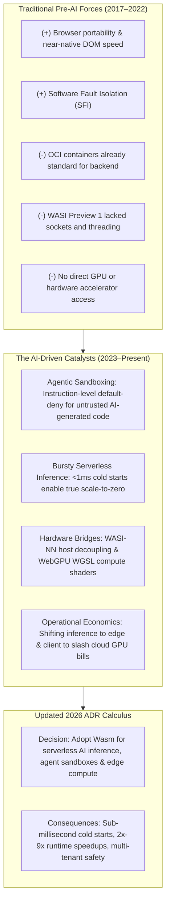
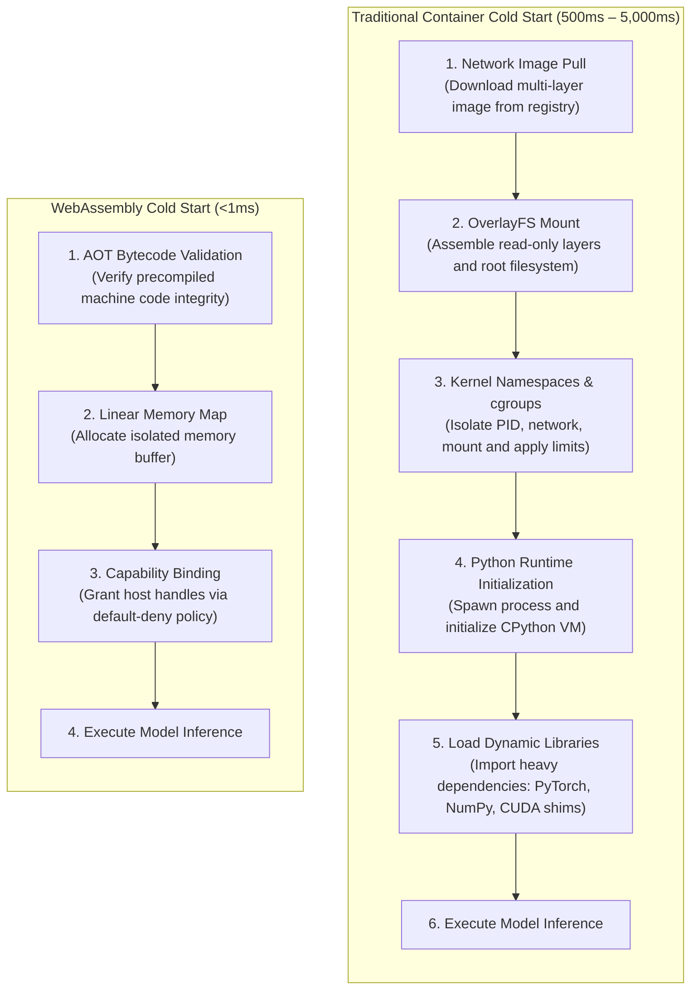
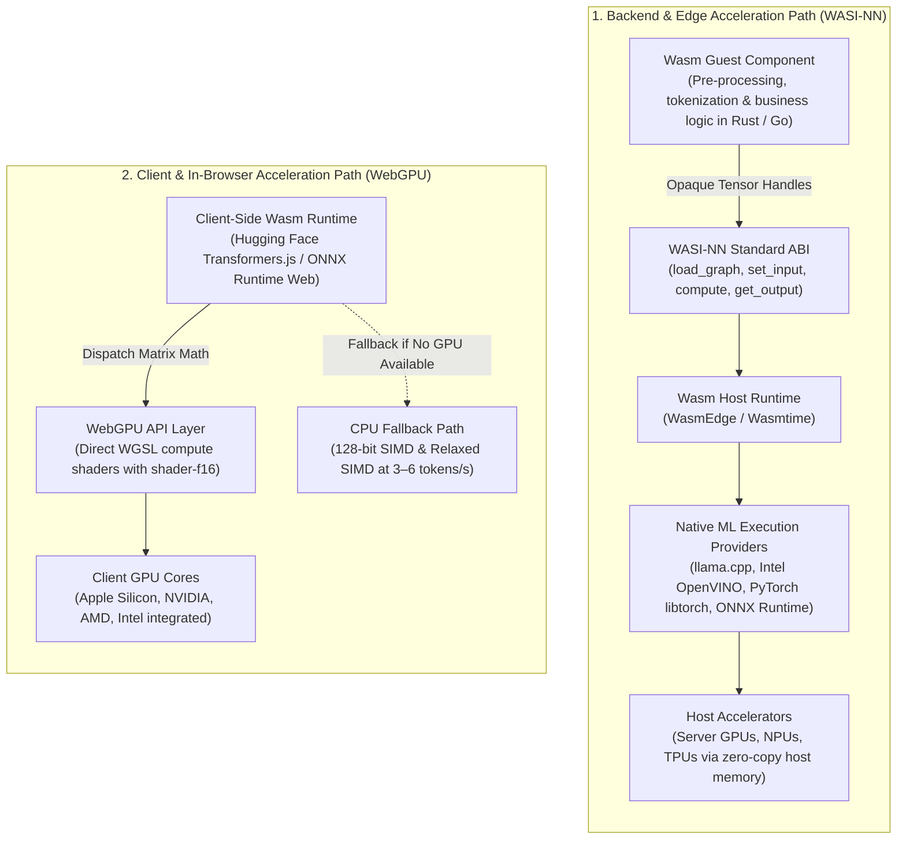

In the first two articles of this series, we examined how artificial intelligence is altering long-standing assumptions in software architecture. In [part one](), we explored how deterministic tail-latency requirements for vector workloads and compiler-assisted verification loops flipped the calculus for enterprise Rust adoption. In [part two](), we saw how autonomous AI coding agents dismantled the case for polyrepo fragmentation, prompting teams to consolidate microservices into graph-managed monorepos.

Those shifts addressed the **language layer** and the **source code layer**. But artificial intelligence is driving an equally fundamental disruption at the **execution substrate layer**: the rapid elevation of **WebAssembly (Wasm)** from a browser graphics toy into a core cloud-native runtime.

For years, Architecture Decision Records (ADRs) evaluating WebAssembly reached a swift conclusion: why introduce a non-standard bytecode virtual machine when Linux containers (Docker, OCI), mature Kubernetes orchestration, and native kernel namespaces already solve isolation and packaging?

The widespread deployment of generative AI models and autonomous agentic workflows has broken the trade-offs underpinning that consensus. In this post, we analyze the reasons, empirical statistics, and production benchmarks that are rewriting the enterprise ADR for WebAssembly.



---

## The classic pre-AI WebAssembly ADR: why architects hesitated

Between 2017 and 2022, WebAssembly occupied a well-defined, bounded niche. When evaluated within an enterprise ADR for general-purpose computing, the trade-off matrix consistently favored conventional Linux containers:

| Architectural Vector | Pre-AI Assessment (OCI Containers / Docker) | Pre-AI Assessment (WebAssembly) | Classic ADR Impact |
| :--- | :--- | :--- | :--- |
| **Primary Venue** | Universal backend servers, cloud VMs, Kubernetes nodes | Client web browsers, edge network proxies (Envoy / Istio) | Favored containers for enterprise compute |
| **System Interfaces** | Full POSIX API, kernel namespaces, `cgroups`, Linux networking | WASI Preview 1; single-threaded, rudimentary file shims | **Heavy penalty against Wasm** |
| **Hardware Access** | Direct kernel device mounting (NVIDIA Container Toolkit, CUDA) | Trapped inside virtual machine; zero GPU / NPU access | **Disqualified Wasm for accelerated workloads** |
| **Ecosystem Maturity** | Millions of containerized images; ubiquitous CI/CD tooling | Fragmented toolchains; nascent runtimes and WIT bindings | Favored Docker for predictable delivery |
| **Startup Overhead** | 500ms to 5,000ms cold starts (tolerated via continuous warm pools) | Microsecond initialization (unnecessary for long-running servers) | Neutralized Wasm's startup advantage |

In that operational environment, a responsible ADR almost universally concluded:

> *"While WebAssembly provides lightweight sandboxing and fast startup, its lack of direct hardware accelerator bindings, immature POSIX networking, and fragmented runtime tooling make it unsuitable for backend services. We will retain Docker/OCI containers on Kubernetes and limit WebAssembly to client-side audio/video decoders and Envoy proxy filters."*

That decision was sound when workloads consisted of deterministic microservice APIs backed by persistent database connections. But the transition to the post-AI operational paradigm has inverted these requirements.

---

## The paradigm shift: pre-AI vs. post-AI operational realities

The operational requirements of generative AI workloads directly expose the architectural weaknesses of Linux containers while aligning precisely with WebAssembly's core properties:

| Dimension | Pre-AI Paradigm (2017–2022) | Post-AI Paradigm (2023–Present) |
| :--- | :--- | :--- |
| **Primary Execution Venue** | Client browser tabs and edge network proxies (Envoy/Istio filters) | Distributed edge nodes, serverless cloud functions, AI agent sandboxes, and client GPUs |
| **Dominant Workload Type** | 2D/3D graphics rendering, physics simulation, video frame filtering, and desktop GUI ports | Quantized LLM inference, embedding generation, autonomous agent code execution, and on-device NLP |
| **Artifact Packaging Size** | Compact binary modules typically ranging from 1MB to 30MB | Micro-binaries (&le;2MB) coupled with decoupled, zero-copy host tensor weights |
| **Interface Specifications** | Core W3C standards and WASI Preview 1 POSIX file/socket shims | WASI 0.2 (Component Model), WASI-NN, WebGPU (WGSL), and Relaxed SIMD extensions |
| **Hardware Abstraction** | Generic CPU instruction translation via host JIT or AOT compilation engines | Pass-through execution to NPUs, GPUs via WebGPU compute shaders, and native ML libraries (OpenVINO, llama.cpp) |
| **Security Architecture** | Browser origin-level isolation and linear memory bounds checking | Zero-trust capability security, default-deny system calls, and sandboxed execution of untrusted generated code |

---

## Quantitative adoption dynamics and ecosystem telemetry

Enterprise adoption of WebAssembly is no longer theoretical. Quantitative telemetry across global web traffic, cloud-native survey data, and developer benchmarks reflects an unmistakable inflection point:

### 1. Browser runtime telemetry
Telemetry collected by **Chrome Platform Status** indicates that the proportion of global page loads executing WebAssembly rose to approximately **4.5%**, reflecting an annualized increase exceeding **1.0 percentage point**. While early client-side adoption was driven by collaborative design tools (such as Figma) and Google Earth, this contemporary rise aligns directly with client-side vectorized search, in-browser embedding generation, and client-side machine learning inference libraries.

### 2. The cloud-native ecosystem footprint
The Cloud Native Computing Foundation (CNCF) formalized this runtime format by establishing the **CNCF WebAssembly Landscape**. This index now documents:
* Over **120 active projects and commercial offerings** across 11 architectural categories.
* More than **\$59.4 billion in collective enterprise valuation** represented across participating organizations.
* A clear division of labor between **compilation toolchains** (LLVM backends, Binaryen, `rustc`, Component Model WIT binders) and **distributed orchestration engines** (Bytecode Alliance Wasmtime, WasmEdge, Wasmer, Fermyon Spin).

### 3. Enterprise penetration and Kubernetes integration
Longitudinal tracking from the **CNCF Annual Cloud Native Surveys** reveals that WebAssembly is transitioning from experimental trials into production infrastructure:
* **Container saturation**: Organizations running containers for most or all production workloads grew from 41% to 56%, while production Kubernetes penetration expanded from 66% to **82%**.
* **Wasm adoption curve**: While 65% of surveyed organizations historically reported having no direct Wasm experience, organizations operating mature, full-scale production deployments solidified at **5%**, alongside nearly **30% actively evaluating, prototyping, or piloting Wasm workloads**.
* **Hybrid orchestration**: This bridge is enabled by container shim layers—notably `containerd-wasm-shim`, `Kuasar`, and `Kwasm`—which allow standard Kubernetes control planes to schedule lightweight Wasm modules side-by-side with conventional OCI images using standard `RuntimeClass` primitives.

### 4. Language preferences and non-browser expansion
The annual **State of WebAssembly** surveys published by Scott Logic demonstrate that systems languages dominate production development:
* **Rust** ranks as both the **most used** and **most desired** language for WebAssembly authoring, driven by its minimal runtime, precise linear memory control, and absence of a garbage collection runtime.
* **Non-browser expansion**: Backend, serverless, and embedded deployments now capture over **38% of active development activity**, with marquee enterprise implementations leading the way:
  * **American Express** built an internal Function-as-a-Service (FaaS) infrastructure powered by WebAssembly to optimize real-time transaction routing.
  * **Visa** embedded WebAssembly runtimes directly inside real-time financial processing pipelines to execute deterministic, low-latency verification rules.

### Key adoption benchmarks at a glance

| Ecosystem & Adoption Metric | Measured Benchmark / Value | Source / Infrastructure Context |
| :--- | :--- | :--- |
| **Global Chrome Browser Page Load Share** | **~4.5%** of total page loads (+1.0% YoY growth) | Chrome Platform Status telemetry |
| **Economic Footprint of Cloud-Native Wasm** | **120+ projects** across 11 categories; **\$59.4B** aggregate valuation | CNCF WebAssembly Landscape Analysis |
| **Production Kubernetes Cluster Penetration** | **82%** of containerized enterprise environments | CNCF Cloud Native Survey |
| **Production Enterprise Wasm Deployment** | **5%** fully deployed in production; **~30%** evaluating or piloting | CNCF Cloud Native Survey longitudinal tracking |
| **Wasm Execution Latency vs. Native Python** | **2x to 9x runtime speedup** on quantized LLM inference | WasmEdge performance evaluation across Mixtral/LLaMA |
| **Cold Start Startup Duration** | **&lt;1ms** (sub-millisecond instantiation) | Bytecode Alliance Wasmtime & Fermyon Spin benchmarks |
| **Deployment Artifact Footprint Delta** | **1.2MB – 2.0MB** (Wasm) vs. **242MB – 2.5GB** (OCI Container) | Microservice and ML container footprint comparison |
| **WebGPU Acceleration Factor over Wasm CPU** | **3x to 30x+** (up to 120x on discrete GPUs) | Hugging Face / ONNX Runtime Web client-side benchmarks |

---

## Architectural mechanisms driving AI workload migration

Why is generative AI propelling WebAssembly into enterprise ADRs? The migration is driven by three architectural mechanisms:

### 1. Capability-based security and agentic sandboxing

Autonomous AI agents (such as code interpreters, autonomous SQL generators, and tool-calling execution engines) present a novel security challenge: **they generate and execute arbitrary code at runtime**.

In a traditional Linux container architecture, isolation relies on shared-kernel constructs: Linux namespaces, `cgroups`, and `seccomp` filters. While robust for vetted application binaries, running untrusted, model-generated code in a container introduces severe risk:
* A container shares the host Linux kernel; a single kernel vulnerability (such as a local privilege escalation or dirty cow variant) compromises the underlying host node.
* Containers initialize with broad operating system call visibility unless manually stripped down via restrictive profiles.

WebAssembly eliminates this attack surface through **Software Fault Isolation (SFI)** enforced directly at the instruction-set level:
1. **Isolated Linear Memory**: Every WebAssembly module operates strictly inside an isolated linear memory buffer (addresses 0 to its bound). The module cannot reference memory addresses outside its designated address space without triggering an immediate hardware/runtime fault.
2. **Default-Deny Capability Security**: Under the WebAssembly System Interface (WASI), guest modules possess **zero innate access** to system calls, hardware timers, network sockets, or the filesystem.
3. **Explicit Host Delegation**: Every external capability must be explicitly passed into the instance by the host embedder at initialization (e.g., granting read access to a single virtual directory descriptor or a specific constrained network socket).

If an autonomous AI agent produces buggy or adversarial code, the execution remains trapped within the module's sandboxed linear memory. This provides hypervisor-grade isolation without the multi-second startup and virtualization memory penalties of virtual machines.

### 2. Sub-millisecond cold starts and hyper-density

Conventional serverless architectures running on Kubernetes face severe economic and performance bottlenecks when serving bursty machine learning inference requests. 

A traditional container runtime must:
1. Pull multi-hundred-megabyte or multi-gigabyte container image layers across the network.
2. Assemble a union filesystem (OverlayFS).
3. Spawn OS namespaces and run init sequences.
4. Load Python interpreters, NumPy shared libraries, and heavy framework dependencies (`torch`, `transformers`).

This sequence results in **cold-start latencies of 500ms to 5,000ms**. To hide this latency from users, platform teams maintain over-provisioned "warm pools" of worker containers, paying substantial continuous infrastructure bills for idle GPU and CPU allocations.



WebAssembly eliminates this operational overhead through **process-free instantiation**:
* A precompiled Wasm binary contains self-contained bytecode validated during ahead-of-time (AOT) compilation.
* Engines like Wasmtime or WasmEdge instantiate a fresh module context in microseconds (**&lt;1ms**) by establishing a linear memory region and binding capability handles.
* Serverless AI architectures can **scale to zero instantly**, creating a fresh sandbox per inference request and destroying it immediately upon completion.
* Because Wasm contexts run without kernel namespace overhead, **thousands of concurrent execution contexts can execute within a single host OS process**, delivering container packing densities orders of magnitude higher than Docker fleets.

### 3. Hardware acceleration abstraction: WASI-NN and WebGPU

Historically, the fatal flaw of WebAssembly for machine learning was isolation from hardware accelerators: evaluating neural networks entirely in generic 32-bit stack CPU bytecode resulted in unacceptable slowdowns.

The ecosystem resolved this by establishing two standardized hardware-bridging interfaces:



#### WASI-NN (Backend & Edge)
The **WASI-NN** specification defines a capability-safe Application Binary Interface (ABI) that decouples orchestration logic from matrix execution. A guest module (written in Rust, Go, or C++) interacts with a high-level tensor graph API across five lifecycle steps:
1. `load_graph`: Loads the model graph representation.
2. `init_execution_context`: Allocates an isolated execution context.
3. `set_input`: Binds input tensors.
4. `compute`: Dispatches the matrix calculation.
5. `get_output`: Reads the resulting tensor outputs.

The Wasm guest manages data pre-processing, tokenization, and business logic while passing opaque memory handles across the ABI boundary. Host runtimes (WasmEdge, Wasmtime) execute these calls against native libraries and hardware execution providers—including **Intel OpenVINO, PyTorch (`libtorch`), ONNX Runtime, and `llama.cpp`**. By incorporating **zero-copy host memory mappings**, large model weights stored in physical RAM bypass the Wasm instance's linear memory entirely, eliminating copying overhead and neutralizing 32-bit address space limits.

#### WebGPU (Client Browsers)
In browser runtimes, hardware acceleration is achieved through **WebGPU**, which provides direct compute shader access via the WebGPU Shading Language (WGSL). WebAssembly manages the overarching pipeline, tokenization algorithms, and application state while streaming data buffers to WebGPU compute pipelines running across the client's GPU cores. Browser engine enhancements—specifically **16-bit floating point precision (`shader-f16`)** and packed integer dot products—deliver **1.6x to 3.0x** throughput gains over standard 32-bit floats.

---

## Architectural matrix: OCI containers vs. Python vs. WebAssembly

To see how these forces reconfigure an evaluation matrix, consider the direct architectural comparison:

| Attribute | Linux Containers (OCI / Docker) | Native Python (PyTorch / C++) | WebAssembly (WASI-NN / WebGPU) |
| :--- | :--- | :--- | :--- |
| **Isolation Boundary** | OS kernel level (`cgroups`, namespaces, `seccomp`) | None (direct process memory access) | **Software Fault Isolation, linear memory, default-deny** |
| **Cold Start Duration** | 500ms – 5,000ms | 2,000ms – 15,000ms (interpreter init) | **&lt;1ms – 5ms (sub-millisecond)** |
| **Typical Runtime Footprint** | 250MB – 5,000MB (OS image + layers) | 500MB – 2,000MB (framework libraries) | **1MB – 20MB (executable binary)** |
| **Hardware Binding** | Kernel device mounting (NVIDIA Container Toolkit) | Direct native C-ABI dynamic linking | **Standardized ABI host SPI or WebGPU WGSL** |
| **Portability Span** | Bound to target CPU arch & host kernel ABI | OS and `glibc` specific | **Architecture-independent portable binary** |
| **Multi-Tenancy Safety** | Vulnerable to shared-kernel CVEs | Unsafe for untrusted dynamic code | **Built-in instruction sandboxing for untrusted logic** |
| **Scale-to-Zero Suitability**| Impractical for bursty traffic (warm pools needed) | Poor (heavy startup latency) | **Optimal; instant instantiation and teardown** |

---

## Production case studies and empirical benchmarks

Empirical data from enterprise deployments validates these architectural advantages across edge, serverless, and browser environments:

### 1. Edge intelligence: WasmEdge and LlamaEdge
**WasmEdge** (a CNCF sandbox project deployed across ByteDance, Huawei Cloud, and Red Hat) incorporates dedicated WASI-NN plugins for `llama.cpp` to execute quantized models. Empirical profiling comparing WasmEdge against conventional Python inference wrappers running `llama.cpp` demonstrates dramatic performance gains:

| Model Architecture | Quantization Level | Python / `llama.cpp` Elapsed Time | WasmEdge / WASI-NN Elapsed Time | Recorded Acceleration Factor |
| :--- | :--- | :--- | :--- | :--- |
| **Microsoft Phi-2 (2.7B)** | Q4_K_M | ~280s | ~68s | **4.1x faster** |
| **LLaMA-2 (7B)** | Q4_K_M | ~610s | ~195s | **3.1x faster** |
| **Mixtral-8x7B-Instruct (46.7B)** | Q4_K_M | ~2,734s | ~302s | **9.0x faster** |

Kernel-level profiling via Linux `perf_events` revealed the structural drivers of this 9.0x performance delta:
* Python inference incurred severe scheduling latency and I/O wait states due to **Global Interpreter Lock (GIL) contention** and thread-management context switches across OS system calls.
* WasmEdge bypassed interpreter overhead entirely, compiling orchestration logic to machine code via LLVM AOT optimization while delegating matrix math to low-level backend libraries.
* Under WasmEdge, execution recorded an instruction count reduction to **6.2 trillion instructions, 3 trillion CPU clock cycles, and 573 billion branch evaluations**, drastically minimizing branch misprediction stalls.

### 2. Serverless event-driven AI: Fermyon Spin
In production deployments combining Content Delivery Networks (CDNs) with edge compute nodes, **Fermyon Spin** (built on Wasmtime) demonstrated the impact of migrating text analysis and image transformation pipelines from containers to WebAssembly:
* Application deployment binaries dropped from multi-hundred-megabyte container images to **1.2MB – 2.0MB** Wasm binaries.
* Eliminating container boot sequences and container registry image pulls reduced **P99 latency from 340ms to 23ms**.
* Enabled true event-driven scale-to-zero: instances instantiate upon request arrival, execute inference against pre-warmed model handles, and terminate instantly.

### 3. Client-side and in-browser inference: Transformers.js and ONNX Runtime Web
Using Microsoft ONNX Runtime Web and Hugging Face Transformers.js:
* Dispatching tensor math to WebGPU compute pipelines yields **3x to 30x performance improvements** over CPU-bound Wasm execution on consumer laptops, exceeding **120x on discrete desktop GPUs**.
* **SIMD Fallback**: If a client device lacks WebGPU support, runtime execution falls back to Wasm CPU threads leveraging 128-bit SIMD and Relaxed SIMD instructions. On resource-constrained mobile hardware, 8-bit quantized models execute via SIMD-accelerated Wasm at **3 to 6 tokens per second**, preserving core functionality without server calls.

### 4. Enterprise desktop migration: The Adobe ecosystem
Adobe Systems provided an enterprise benchmark by compiling its C++ desktop rendering engine to WebAssembly, delivering a **three-fold performance increase** over previous web technologies. 

Following the rollout of its Firefly generative AI models, Adobe extended WebAssembly into its **Unified Extensibility Platform (UXP)**:
* UXP powers a shared plugin execution framework across **Photoshop, Premiere Pro, and Illustrator**.
* Third-party developers compile Rust and C++ modules directly into sandboxed Wasm plugins that manipulate local pixel buffers and execute machine learning models within application memory.
* Clean-room reimplementations like **PhotoCraft** demonstrate that complete Photoshop-compatible suites—layered raster rendering, vector parsing, and neural filters—can execute entirely in the browser via Rust-compiled WebAssembly.

---

## Economic, privacy, and operational drivers

Beyond raw throughput, three macroeconomic forces are compelling architects to re-evaluate WebAssembly:

### 1. Cloud infrastructure expenditure
Hosting large language models on cloud infrastructure incurs steep compute and memory costs. Compiling machine learning frameworks to WebAssembly and offloading inference to edge nodes or client browsers shifts compute expenses onto client hardware. For example, internal analytics teams at **IBM transitioned statistical modeling services from cloud virtual machines into in-browser Wasm execution, drastically reducing central server compute spend**.

### 2. Data privacy and regulatory compliance
In legal analysis, healthcare informatics, and enterprise intellectual property management, transmitting user data across public networks to third-party model providers introduces regulatory risk under GDPR, HIPAA, and the EU AI Act.

WebAssembly enables software architectures to **move the model to the data**, rather than moving sensitive data to remote servers:
* Sensitive tasks—such as semantic text embeddings, document summarization, and biometric processing—occur entirely in local client memory.
* User data never leaves the client device boundary, eliminating unauthorized data retention and preventing customer telemetry from leaking into third-party training corpora.

### 3. Network transit latency elimination
Cloud-based model APIs introduce network round-trip times (RTT) ranging from **100ms to 250ms per call**, depending on physical distance and network congestion. In interactive applications—such as live audio transcription, handwriting recognition, live video analytics, and keystroke autocompletion—this latency breaks the user experience. Local Wasm execution removes network transit time entirely, while supporting full offline capabilities during network outages.

---

## Technical bottlenecks and structural trade-offs

A credible Architecture Decision Record must document trade-offs with unsparing rigor. While WebAssembly offers undeniable strengths, several architectural bottlenecks prevent it from replacing Linux containers across all computing tiers:

### 1. Linear memory limits and the 32-bit ceiling (`wasm32`)
Most deployed WebAssembly modules and toolchains still target a 32-bit linear address space (`wasm32`), which restricts a single memory to a maximum of **4 GiB**:

**Max addressable memory (wasm32) = 2<sup>32</sup> bytes = 4 GiB**
{: .text-center }

While 4 GiB is generous for microservices, it is insufficient for modern generative AI models, where parameter weights, Key-Value (KV) context caches, and intermediate activation tensors routinely require tens of gigabytes.
* [WebAssembly 3.0](https://webassembly.org/news/2025-09-17-wasm-3.0/), completed in September 2025, standardized 64-bit memories (`memory64`), but on the web a 64-bit memory is limited to 16 GB, and runtime and toolchain support still has to be checked per target. For larger models, host runtimes decouple tensor memory from the Wasm instance using host-side memory mappings (the WASI-NN pattern).
* If an application attempts to manipulate multi-gigabyte model weights directly inside a `wasm32` linear memory, it risks immediate allocation faults when approaching the 4 GiB boundary.

### 2. Concurrency bottlenecks: WASI Preview 1 vs. Preview 2/3
Ecosystem fragmentation across system interfaces has created concurrency challenges:
* **WASI Preview 1** was single-threaded and lacked native socket and process management. Early Wasm micro-containers running on multi-core servers could only utilize a single CPU core, producing lower throughput than multi-threaded Linux containers.
* Non-standard forks (such as Wasmer's WASIX) introduced threading and POSIX APIs, but created fragmentation.
* **WASI 0.2 (Preview 2)** resolved this by establishing the **WebAssembly Component Model** and standardizing `wasi-sockets` and `wasi-http`.
* **[WASI 0.3](https://bytecodealliance.org/articles/WASI-0.3)**, released in June 2026, makes asynchronous I/O native to components through first-class `stream` and `future` types; runtime and guest toolchain support is still rolling out. It does not add multithreading inside a component, so high-throughput server environments still distribute traffic across pools of individual Wasm instances rather than managing concurrent threads within a single module.

### 3. The structural bifurcation between training and inference
WebAssembly is strictly an **execution and inference engine**; it is currently unsuited for model training:
* Training deep neural networks requires distributed communication libraries (such as NVIDIA NCCL) coordinating across multi-GPU clusters via high-bandwidth interconnects (NVLink), combined with custom mixed-precision backpropagation algorithms.
* WebAssembly lacks the low-level abstractions required for cluster interconnect management and raw tensor core orchestration.

Consequently, enterprise machine learning architecture is bifurcating into two distinct tiers:
* **Model Training Tier**: Anchored permanently in Linux, Python, PyTorch, and CUDA container infrastructure.
* **Model Deployment Tier**: Quantized model weights (ONNX, GGUF, OpenVINO IR) are dispatched to WebAssembly runtimes for secure, low-latency execution across edge nodes, cloud functions, and client browsers.

---

## The updated 2026 ADR: sample template

When these technical forces and empirical statistics are synthesized into an Architecture Decision Record, how does the document read? Below is an example of an enterprise ADR reflecting this updated calculus:

```markdown
# ADR 0038: Adopt WebAssembly for Serverless AI Inference and Agentic Sandboxing

## Status
Accepted

## Date
2026-10-11

## Context
Our enterprise platform is deploying two new AI capabilities:
1. An autonomous agent framework that generates and executes dynamic data-cleansing scripts
   based on natural language user prompts.
2. A serverless embedding generation and summarization pipeline servicing bursty user traffic.

Our existing container infrastructure (Docker on EKS) introduces two critical operational failure modes:
- Security risk: Executing AI-generated scripts inside Linux containers exposes the underlying host
  kernel to privilege escalation and unauthorized lateral network discovery. Locking down containers
  via custom seccomp profiles is error-prone and maintenance-intensive.
- Cold-start economics: Serverless container workers incur cold starts of 1,800ms to 4,200ms due to
  multi-gigabyte container image layers and Python interpreter initialization. Retaining pre-warmed
  container pools costs over $18,000/month in idle cloud compute.

Historically, ADR 0014 rejected WebAssembly due to the absence of hardware accelerator bindings and
immature networking in WASI Preview 1.

## Decision
We will adopt WebAssembly as our primary execution substrate for agentic code sandboxing and serverless
AI inference pipelines:
1. We will deploy Wasmtime and WasmEdge via containerd-wasm-shim to execute Wasm modules within our
   existing Kubernetes cluster under a dedicated RuntimeClass.
2. AI-generated code will execute strictly inside sandboxed Wasm guest instances with zero-trust,
   default-deny capability configurations.
3. Serverless inference components will compile from Rust to Wasm, using WASI-NN bindings to delegate
   quantized model execution (all-MiniLM and Phi-3) to host-side native accelerators.
4. Model pre-training and parameter fine-tuning will remain anchored in Linux/CUDA OCI containers.

## Consequences

### Positive
- Sub-Millisecond Cold Starts: Wasm modules instantiate in <1ms, enabling true scale-to-zero serverless
  execution and eliminating $18,000/month in idle container pool reservation costs.
- Instruction-Level Sandboxing: Software Fault Isolation (SFI) guarantees that untrusted, AI-generated
  scripts cannot breach linear memory boundaries or access system calls without explicit host grants.
- Container Density: Footprints drop from 600MB container images to 1.8MB Wasm binaries, allowing 20x
  higher tenant density per Kubernetes worker node.
- Runtime Acceleration: Bypassing the Python interpreter yields a 3x to 4x throughput improvement on
  quantized inference pipelines.

### Negative & Mitigations
- 32-Bit Memory Ceiling (wasm32): Instances cannot allocate more than 4 GiB of linear memory.
  Mitigation: We use WASI-NN host-managed memory mappings, ensuring large tensor weights reside in
  host RAM while guest modules only manipulate references.
- Concurrency Model: WASI 0.2 lacks native multi-threading within a single module.
  Mitigation: We use instance pooling (one Wasm instance per request) managed by the host runtime,
  relying on microsecond instantiation speeds rather than complex in-module thread synchronization.
- Observability Tooling: Traditional container APM agents do not automatically trace Wasm guest internals.
  Mitigation: We standardize on OpenTelemetry tracing compiled directly into our Rust Wasm guest templates.
```

---

## Summary: the three-layer architectural reality

Architecture Decision Records exist to make structural trade-offs explicit and transparent. When technological capabilities and operational forces shift, the recorded decisions must be re-opened and re-evaluated.

The three entries in this series demonstrate how artificial intelligence is methodically rewriting each tier of modern enterprise architecture:

1. **The Language & Compute Layer ([Rust]())**: AI vector churn and real-time inference punish garbage collection pauses, making Rust's deterministic, zero-GC execution and compiler verification harnesses essential.
2. **The Source Code & Repository Layer ([Monorepos]())**: Autonomous AI coding agents require holistic AST visibility and atomic cross-service refactoring, turning polyrepo boundaries into context walls.
3. **The Execution Substrate Layer (WebAssembly)**: Untrusted AI-generated code demands instruction-level capability sandboxing, while bursty serverless inference demands sub-millisecond cold starts that heavy Linux containers cannot deliver.

WebAssembly will not eliminate Linux containers, just as containers did not eliminate virtual machines. Instead, a clean separation of concerns has emerged: **Linux containers own heavy distributed model training and legacy operating system services; WebAssembly owns secure agent sandboxing, serverless inference, and edge execution.**

If your team's last ADR dismissed WebAssembly as a browser-only technology, it is time to reopen that record.

