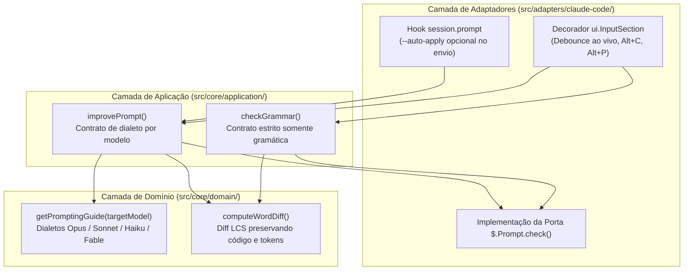

Quando um fluxo de programação autônoma falha em produção — entrando em loop infinito em um teste quebrado, consumindo dezenas de milhares de tokens com stack traces ruidosos ou alterando arquivos fora do escopo da tarefa — o reflexo imediato costuma ser culpar o modelo de linguagem. No entanto, estudos empíricos baseados em dezenas de milhares de execuções de benchmark e implantações reais em empresas como Stripe, Uber, Spotify e Ramp apontam para outro gargalo: **o harness de runtime que envolve o modelo**.

Nos artigos anteriores sobre [Prompt Engineering](/posts/prompt-engineering/), [Context Engineering](/posts/context-engineering/), [Harness Engineering](/posts/harness-engineering/), [Loop Engineering](/posts/loop-engineering/) e [Modelos mais baratos com um Harness robusto](/posts/cheaper-models-strong-harness/), explorei como loops explícitos de verificação e ambientes em sandbox tornam o código gerado por IA auditável. Neste artigo, analisamos as pesquisas recentes da indústria que comprovam **por que a engenharia de harness (harness engineering) importa para empresas e projetos**, comparamos a nova geração de harnesses programáveis — incluindo o **DeepSeek Harness (`dsh`)** e o **Claude Code Mods** — e mostramos um exemplo prático que construí rapidamente no repositório [`marcelomiyake/prompt-dialect`](https://github.com/marcelomiyake/prompt-dialect) para adaptar prompts ao modelo selecionado no Claude Code.

---

## Por que o modelo é apenas metade de um sistema agêntico

A engenharia de software moderna trata um agente autônomo não como uma rede neural isolada, mas como um sistema composto:

$$\text{Agente} = \text{Modelo} + \text{Harness}$$

Nessa decomposição, o **modelo** fornece raciocínio probabilístico, síntese de código e planejamento de alto nível. O **harness** é a infraestrutura de software determinística que envolve o modelo — gerenciando a janela de contexto, mediando o acesso ao sistema de arquivos e à rede, executando ferramentas em sandboxes isolados e devolvendo sinais diagnósticos estruturados para o ciclo de raciocínio.

### A matriz de controle cibernético: guias e sensores

Como Birgitta Böckeler detalha em [Harness engineering for coding agent users](https://martinfowler.com/articles/harness-engineering.html), um harness eficaz opera como um **sistema de controle cibernético em malha fechada**. Ele regula um modelo probabilístico combinando duas direções de controle com dois modos de execução:

| Direção de Controle | Computacional / Determinístico (Custo Zero de Tokens, 100% de Precisão) | Inferencial / Semântico (Baseado em LLM, Flexibilidade Contextual) |
| :--- | :--- | :--- |
| **Guias Feedforward** *(Direcionamento antecipado antes da ação)* | Snapshots de sandbox pré-aquecidos, injeção estática de grafos AST, schemas determinísticos de ferramentas, isolamento `chroot`, allowlists de rede | Prompts constitucionais no `AGENTS.md` / `CLAUDE.md`, playbooks sob demanda em `SKILL.md`, exemplos arquiteturais few-shot |
| **Sensores de Feedback** *(Verificação reativa após a ação)* | Diagnósticos de compilador (`rustc`, `tsc`), regras de linter, executores de testes unitários e de integração, testes de mutação, bloqueadores de diff por caminho | Revisores de PR no padrão LLM-as-a-Judge, subagentes avaliadores de QA adversarial, detectores semânticos de desvio de escopo |

{: width="1600" height="1278" }
_O Harness de Agente Cibernético combina guias feedforward antecipados com sensores de feedback pós-ação em uma arquitetura de runtime de quatro camadas._

### O que revelam 4 milhões de linhas de código de agentes em produção

Uma auditoria comparativa do código-fonte de **11 agentes de programação em produção** — somando cerca de **4 milhões de linhas de código** entre Claude Code, OpenAI Codex CLI, Gemini CLI, OpenHands, Cline, Aider, OpenCode, Goose (Block), Plandex, SWE-agent e Qwen Code — demonstra que o loop central de inferência (`while (tool_call)`) representa apenas uma fração mínima do sistema. Independentemente da linguagem (TypeScript, Rust, Python ou Go), os harnesses de produção convergem para **nove primitivas essenciais de runtime**:

1. **Loop de Execução Agêntica**: Orquestração de turnos, parsing de chamadas de ferramentas em streaming, retentativas com backoff e condições explícitas de parada (`end_turn`, tetos de orçamento ou validação terminal).
2. **Ferramental de Arquivos e Shell**: Parsers de patch baseados em busca e substituição (`edit`), busca regex via ripgrep (`grep`), navegação de símbolos com AST e sessões persistentes de shell PTY.
3. **Hierarquia de Instruções em Camadas**: Combinação de políticas corporativas globais, arquivos `AGENTS.md` / `CLAUDE.md` na raiz do repositório e regras específicas por subdiretório.
4. **Compactação Adaptativa de Contexto**: Monitoramento da pressão de tokens e sumarização de saídas antigas de ferramentas antes de atingir a **zona de degradação de contexto (context rot)** (onde a precisão cai após 65–75% de saturação da janela).
5. **Motor de Permissões e Políticas em Camadas**: Classificação de ações entre leituras pré-aprovadas, edições restritas ao workspace e mutações críticas que exigem validação de política ou aprovação humana.
6. **Criação de Subagentes e Isolamento de Contexto**: Delegação de buscas ruidosas ou verificações paralelas para subagentes com janelas de contexto limpas, retornando apenas resumos concisos ao agente principal.
7. **Checkpoints Determinísticos e Rollback**: Uso de repositórios git sombra ou snapshots de worktree para reverter edições malsucedidas em múltiplos arquivos.
8. **Recuperação de Falhas e Persistência Append-Only**: Gravação de cada turno em disco (`JSONL` ou SQLite) para retomar sessões longas interrompidas sem perda de estado.
9. **Protocolos de Extensibilidade**: Suporte a clientes do Model Context Protocol (MCP), carregamento preguiçoso (lazy-loading) de skills e hooks de ciclo de vida em memória (in-process).

---

## O que mostram os estudos: ganhos de acurácia e variação de 3x no custo

Para líderes de engenharia, a descoberta mais relevante das pesquisas recentes é que **alterar o harness — mantendo os pesos do modelo exatamente iguais — muda drasticamente tanto a taxa de resolução de tarefas quanto a fatura de inferência em nuvem**.

### 1. O estudo Harbor com 94.000 execuções: economizando US\$ 830 a cada 1.000 tarefas

No estudo [We Ran 94,000 Trials to Measure the Cost of Harness Choice](https://strandsagents.com/blog/we-ran-94000-trials-to-measure-the-cost-of-harness-choice/), pesquisadores executaram **82.400 testes válidos em containers** no framework Harbor avaliando **5 harnesses de produção** (`Strands`, `Claude Code`, `Codex`, `Gemini CLI` e `OpenHands`), **6 suítes de benchmark de engenharia de software** (`SWE-bench Verified`, `Terminal-Bench 2.0`, `GitBug-Java`, `SWT-bench`, `Aider Polyglot` e `ColBench`) e **20 modelos**.

Mantendo o modelo subjacente constante, o estudo comprovou três resultados empíricos centrais:

* **Variações de 3 a 8 pontos percentuais na acurácia**: Com o mesmo checkpoint de modelo, trocar apenas o harness deslocou a taxa de resolução em 3 a 8 pontos percentuais devido a diferenças na formatação de diffs, recuperação de timeouts de bash e limpeza de contexto.
* **Diferença de 2x a 3x no custo por tarefa**: Harnesses verbosos que injetam system prompts extensos, carregam dezenas de schemas de ferramentas em todos os turnos e permitem loops de exploração irrestritos custam **de 2x a 3x mais por tentativa** do que harnesses enxutos e orientados a eventos.
* **Economia de até US\$ 830 a cada 1.000 tarefas**: Executar o `Claude Sonnet 4.5` em um harness CLI padrão pesado custou **US\$ 1,32 por tentativa**, enquanto rodar o exato mesmo modelo no harness enxuto `Strands` custou **US\$ 0,49 por tentativa** com acurácia equivalente — uma **redução de custo de 62,9%** (US\$ 830 economizados a cada 1.000 tarefas). No `Claude Opus 4.5`, o custo caiu de **US\$ 1,15** para **US\$ 0,53** (**53,9% de economia**).

### 2. Comparação de scaffolds no DeepSWE v1.1 e Terminal-Bench 2.1

Avaliações controladas na [suíte de benchmarks do DeepSeek-V4.1-Flash](https://github.com/deepseek-ai/deepseek-harness/blob/master/BENCHMARK.md) reforçam que a arquitetura do scaffold governa diretamente o teto de resolução. Ao avaliar exatamente os mesmos pesos do modelo `DeepSeek-V4.1-Flash` em diferentes harnesses nos benchmarks `DeepSWE v1.1` (300 tarefas, contexto de 128K, limite de 100 turnos) e `Terminal-Bench 2.1` (89 tarefas complexas de CLI):

| Suíte de Benchmark | DeepSeek Harness (`dsh`) | Claude Code Harness | OpenHands / Terminus-2 | Ganho do Harness |
| :--- | :--- | :--- | :--- | :--- |
| **DeepSWE v1.1** *(300 tarefas, Pass@1)* | **61,1%** | 59,3% | 57,1% *(OpenHands)* | **+1,8 a +4,0 pts** |
| **Terminal-Bench 2.1** *(89 tarefas, Pass@1)* | **55,6%** | 47,9% | 50,9% *(Terminus-2)* | **+4,7 a +7,7 pts** |

{: width="1600" height="2506" }
_Acima: Custo de inferência por tentativa entre modelos equivalentes no estudo Harbor (82.400 execuções). Abaixo: Taxas de resolução para um checkpoint fixo do DeepSeek-V4.1-Flash em diferentes harnesses._

### 3. Escalonamento de modelos vs. complexidade do harness: `mini-SWE` vs. `OpenCode`

Um harness mais complexo e cheio de ferramentas sempre ajuda? Um estudo longitudinal no **SWE-bench Pro** ($N = 300$) acompanhou cinco gerações de modelos DeepSeek (`R1` $\rightarrow$ `V3` $\rightarrow$ `V3.1` $\rightarrow$ `V3.2` $\rightarrow$ `V4-Pro`) em dois scaffolds opostos:

* **`mini-SWE`**: Um harness minimalista em Python (~250 linhas) que expõe apenas uma ferramenta `bash` sem estado e histórico linear.
* **`OpenCode`**: Um harness completo de produção que expõe **mais de 25 ferramentas especializadas** (busca de símbolos AST, diagnósticos via LSP, editores semânticos, inspetores de árvore de diretórios e delegação multiagente).

| Geração do Modelo | Passos Médios (`mini-SWE`) | Passos Médios (`OpenCode`) | Tokens de Prompt (`mini-SWE`) | Tokens de Prompt (`OpenCode`) | Pass@1 (`mini-SWE`) | Pass@1 (`OpenCode`) |
| :--- | :--- | :--- | :--- | :--- | :--- | :--- |
| **DeepSeek-R1** *(Raciocínio inicial)* | 28,4 | 44,1 | 0,82M | 1,89M | 31,2% | 28,9% |
| **DeepSeek-V3** *(MoE base)* | 26,1 | 38,7 | 0,75M | 1,54M | 34,8% | 35,1% |
| **DeepSeek-V3.1** *(Ajustado para tools)* | 23,5 | 29,4 | 0,68M | 1,12M | 41,0% | 43,2% |
| **DeepSeek-V3.2** *(RL multi-scaffold)* | 20,8 | 22,6 | 0,61M | 0,84M | 46,5% | 48,9% |
| **DeepSeek-V4-Pro** *(RL de fronteira)* | **17,9** | **18,2** | **0,52M** | **0,65M** | **50,3%** | **52,7%** |

A lição arquitetural é decisiva para times de plataforma:

1. **Modelos menores ou mais antigos sofrem em superfícies complexas de ferramentas**: Quando o `DeepSeek-R1` rodou dentro do `OpenCode`, a indecisão na escolha de ferramentas inflou a execução de 28,4 para **44,1 passos** (+55%), fez o consumo de prompt saltar de 0,82M para **1,89M tokens** (+130%) e *reduziu* a taxa de acerto em 2,3 pontos percentuais em comparação ao loop de 250 linhas do `mini-SWE`.
2. **Modelos de fronteira internalizam a ergonomia do harness**: Modelos treinados com aprendizado por reforço (RL) em múltiplos scaffolds (`V3.2` e `V4-Pro`) comprimiram as trajetórias no `OpenCode` para **18,2 passos** e **0,65M tokens** — uma **redução de 58,7% nos passos** e **65,6% na sobrecarga de tokens** em relação ao `R1`, alcançando **52,7%** de resolução.

{: width="1600" height="2922" }
_Comparação entre o minimalista `mini-SWE` e o complexo `OpenCode` no SWE-bench Pro (N=300): modelos iniciais sofrem forte inflação de passos e tokens em harnesses complexos, enquanto modelos de fronteira treinados com RL comprimem o custo e extraem maior acurácia._

---

## Harnesses extensíveis de nova geração: DeepSeek Harness e Claude Code Mods

Durante os primeiros anos das ferramentas de programação com IA, os harnesses funcionavam como caixas-pretas monolíticas. Personalizá-los significava adicionar mais texto ao `AGENTS.md` (que o modelo podia ignorar) ou disparar scripts shell externos lentos. Em 2026, duas arquiteturas redefiniram o harness como um **runtime modular e programável**: o **DeepSeek Harness (`dsh`)** e o **Claude Code Mods**.

### 1. DeepSeek Harness (`dsh`): micro-kernel de plugins open source e 99% de acerto de KV-cache

Lançado como um monorepo TypeScript open source (`@deepseek-harness/*` sob licença MIT), o [DeepSeek Harness (`dsh`)](https://github.com/deepseek-ai/deepseek-harness) substitui loops monolíticos por uma **arquitetura de micro-kernel baseada em plugins**, construída sobre o framework de Injeção de Dependência (DI) e eventos **Cordis**.

Cada capacidade do `dsh` — edição de arquivos (`builtin-file-tools`), controle de permissões (`builtin-permissions`), compactação de contexto (`builtin-compact`), integração MCP (`builtin-mcp`), carregamento de `SKILL.md` (`builtin-skills`) e delegação para subagentes (`builtin-subagent`) — opera como um plugin isolado que registra hooks tipados no kernel (`session.prompt`, `api.request`, `tool.call`, `permission.decide`, `context.compact`). Equipes podem executar o `dsh` como uma interface interativa React Ink no terminal, um daemon headless em pipelines de CI ou um SDK embarcado em portais internos de engenharia.

Igualmente importante é sua **arquitetura de sessão `JSONL` append-only**, projetada especificamente para a economia de KV-cache dos LLMs:

* Muitos harnesses convencionais alteram turnos anteriores da conversa diretamente na memória ao podar saídas de ferramentas ou atualizar estados do sistema. Modificar um único token no início de um prompt de 100 mil tokens invalida o prefixo do KV-cache do transformer, obrigando o provedor de inferência a recalcular todo o prefixo pelo preço cheio.
* O `dsh` grava cada sessão como um log `JSONL` imutável e estritamente append-only. Quando a compactação de contexto é acionada, o `dsh` anexa um **Compaction Marker** (marcador de compactação) e um bloco de resumo sem reescrever os turnos anteriores durante as janelas ativas de cache.
* Em tarefas longas de engenharia de software, essa preservação estrita do prefixo atinge **99% de taxa de acerto de cache de prompt (cache hit rate)**, reduzindo o custo efetivo de tokens de entrada em APIs de fronteira em **até 90%** (por exemplo, de US\$ 0,30/1M de tokens sem cache para US\$ 0,03/1M em cache).

### 2. Claude Code Mods: `Function Hooks` TypeScript in-process

O **Claude Code**, da Anthropic, seguiu um caminho complementar ao evoluir de uma CLI fechada para uma plataforma extensível por meio do **Claude Code Mods** e dos **`Function Hooks` em TypeScript executados in-process**.

Anteriormente, personalizar o Claude Code exigia configurar comandos shell externos no `settings.json` (`PreToolUse`, `PostToolUse`). Embora úteis para linters simples, os hooks em shell tinham três limitações arquiteturais: criavam um novo subprocesso do sistema operacional a cada chamada de ferramenta (adicionando 50 a 200ms de latência de serialização), comunicavam-se apenas via códigos de saída e `stdout`, e não conseguiam inspecionar ou transformar requisições de API em memória, componentes de UI ou estados de compactação de contexto em tempo real.

O Claude Code Mods substitui essa comunicação entre processos por **middlewares in-process** executados diretamente dentro do runtime Bun do Claude Code, utilizando a assinatura de três argumentos `($, e, next)`:

* `$`: A **API de Contexto da Sessão**, oferecendo acesso tipado à configuração do modelo ativo, estado do workspace, logger e subconsultas internas de LLM (`$.Prompt.check()`).
* `e`: O **Payload do Evento Interceptado** — seja o envio de um prompt pelo usuário, uma requisição de API para o modelo, uma chamada de ferramenta de edição ou a renderização do componente de entrada no terminal.
* `next()`: A função de continuação que avança o pipeline de middlewares, permitindo que um Mod transforme entradas antes de chamar `await next()`, inspecione ou mascare saídas depois, ou interrompa a execução.

```mermaid
flowchart LR
    accTitle: Pipeline de middlewares in-process em harnesses de agentes programáveis
    accDescr: Um prompt do desenvolvedor ou chamada de ferramenta entra no barramento de eventos do harness, passa por plugins TypeScript ou Function Hooks in-process para transformação de dialeto e validação de políticas, executa no modelo ou sandbox e retorna o resultado verificado.
    Input["Prompt do Dev / Chamada de Tool"] --> Hook1["Hook 1: Transformação de Entrada & Adaptação de Dialeto"]
    Hook1 --> Hook2["Hook 2: RBAC, Redação de Segredos & Escopo"]
    Hook2 --> Core["Inferência do Modelo / Execução em Sandbox"]
    Core --> Sensor["Hook 3: Linter Determinístico & Sensor de Saída"]
    Sensor --> Output["Resultado Verificado / Renderização na UI"]
```



Como os `Function Hooks` rodam no mesmo processo e com os mesmos privilégios do terminal do desenvolvedor, eles também introduzem uma **fronteira crítica de segurança da cadeia de suprimentos (supply chain)**. Auditorias estáticas iniciais em Mods publicados pela comunidade identificaram padrões de risco em **12,4%** dos pacotes analisados, incluindo chamadas de rede externas não sanitizadas ou envio de contexto de prompts para endpoints de telemetria de terceiros. Em ambientes corporativos, times de plataforma tratam o diretório `.claude/mods/` com o mesmo rigor de pipelines de CI/CD: exigindo registros internos assinados, fixando Mods globais de segurança em diretórios somente leitura (`/etc/claude-code/managed-mods/`) e restringindo o tráfego de saída na rede.

### Comparativo entre os principais harnesses programáveis

| Dimensão Arquitetural | DeepSeek Harness (`dsh`) | Claude Code (com Mods) | OpenAI Codex CLI |
| :--- | :--- | :--- | :--- |
| **Licença e Modelo de Código** | **Open Source MIT** (monorepo TypeScript `@deepseek-harness/*`) | CLI proprietária com SDK aberto de Mods em TypeScript | **Open Source Apache-2.0** (núcleo em Rust + bindings TypeScript) |
| **Arquitetura de Runtime** | Micro-kernel DI **Cordis**; cada recurso nativo é um plugin removível | Runtime em Bun com middlewares in-process `($, e, next)` | Runtime nativo em Rust otimizado para sandboxing no nível do SO |
| **Ecossistema de Modelos** | Agnóstico a modelos (+100 provedores via Vercel AI SDK: DeepSeek, Claude, OpenAI, Gemini, Ollama) | Otimizado para modelos Anthropic Claude (Opus, Sonnet, Haiku, Fable) | Otimizado para modelos de raciocínio da OpenAI (séries `o3`, `o4-mini`, `GPT-5`) |
| **Estratégia de Contexto e Cache** | Log `JSONL` append-only com Compaction Markers (**99% de acerto de KV-cache**) | Sumarização automática `/compact` + cache de prompt do `CLAUDE.md` | Compressão de turnos sem estado com snapshots locais de diff |
| **Isolamento e Segurança** | Plugin configurável de permissões + adaptadores de sandbox Docker/Bubblewrap | Regras de permissão em camadas + política corporativa de managed-mods | Isolamento no kernel via `Seatbelt` (macOS) e `Landlock` / `seccomp` (Linux) |

---

## Como organizações de engenharia constroem harnesses de produção

Quando empresas evoluem de desenvolvedores individuais usando chat na IDE para agentes autônomos em background que fazem merge de milhares de pull requests por semana, **a engenharia de harness personalizada torna-se o principal diferencial competitivo**. Em sete implantações corporativas amplamente documentadas, o padrão se repete: equipes bem-sucedidas restringem os graus de liberdade do modelo e transferem a verificação para estágios determinísticos do harness.

| Empresa e Sistema | Arquitetura Base | Principais Inovações no Harness | Impacto Medido em Produção |
| :--- | :--- | :--- | :--- |
| **Stripe** (`Minions`) | Fork do harness `Goose` (Block) rodando em devboxes AWS EC2 isoladas | **Blueprints** intercalam turnos de LLM com nós determinísticos de git/lint; pré-carrega contexto do Jira/Sourcegraph antes do Turno 1; restringe o agente a **15 ferramentas curadas** entre +500 do `Toolshed`; **limite estrito de 2 rodadas de CI** | **+1.300 PRs autônomos com merge por semana** sem código digitado por humanos |
| **Uber** (`Software Factory`, `Code-Mode`, `uReview`) | Máquinas de estado **LangGraph** integradas ao monorepo Bazel e ao `GenAI Gateway` | **Code-Mode MCP** substitui dezenas de chamadas JSON conversacionais por um único script Python em lote; `uReview` impõe orçamento de `<1%` de comentários ruidosos | **Redução de 98,3%–99,9% em tokens** em consultas de dados; **>60% de aprovação** e **72% de taxa de correção** em code reviews; dezenas de milhares de migrações JUnit 4 $\rightarrow$ 5 |
| **Spotify** (`Honk` & `Xirp`) | Runtime do Claude Code integrado a pipelines de Fleet Management e resposta a incidentes | **Judge Agents** em dupla camada (Juiz Determinístico de Diff + Juiz Semântico LLM) vetam **25%** das alterações inseguras antes do PR; `Xirp` correlaciona alertas, logs e deploys | **+1.500 PRs com merge**; **60–90% de redução de tempo** em migrações de datasets; **73% menos trabalho manual** na triagem de incidentes |
| **Ramp** (`Inspect`) | Sandboxes efêmeros full-stack em nuvem orquestrados na **Modal** | Restaura a stack completa (Postgres, Redis, Python, Ruby, Node, Vite) a partir de snapshots aquecidos em **<2s**; validação visual e de DOM com **Playwright** em Chromium headless | **+30% de todos os PRs de engenharia com merge** criados por agentes em background |
| **Cursor** (`Agent Runtime`) | Harness próprio de IDE com indexação vetorial semântica e Shadow Workspaces | **Lazy-loading de schemas de ferramentas MCP** sob demanda; valida edições em instâncias LSP ocultas antes de exibir o diff | **Redução de 46,9%** no consumo ocioso de tokens de contexto |
| **Anthropic** (`GAN App Harness`) | Loop multiagente `Planner` $\rightarrow$ `Generator` $\rightarrow$ `Evaluator` | Desacopla a implementação da avaliação adversarial de QA durante sprints autônomos de múltiplas horas | Construção full-stack de 6 horas concluída por **US\$ 200,99** (**84,2%** em sprints de build, **14,3%** em verificação de QA) |
| **Harvey** (`Spectre`) | Roteador jurídico multimodelo + verificador determinístico de citações | Roteia subtarefas entre modelos OpenAI, Anthropic e fine-tunes jurídicos; **Verificador de Citações Zero-Alucinação** valida cada lei/jurisprudência nas APIs LexisNexis/Westlaw | **+34% de ganho de acurácia** no BigLaw Bench com fundamentação determinística |

Duas técnicas arquiteturais dessas implantações merecem destaque especial para qualquer organização que esteja projetando seu próprio harness:

1. **Agrupamento de Ferramentas em Code-Mode da Uber (98,3%–99,9% de economia de tokens)**: Configurações tradicionais de MCP expõem dezenas de ferramentas granulares (`get_table_schema`, `run_query`, `fetch_partition`). Quando um agente investiga uma anomalia entre múltiplas tabelas, ele executa de 15 a 30 turnos sequenciais, despejando megabytes de JSON intermediário na janela de contexto. O **Code-Mode** da Uber instrui o agente a escrever um único script Python executado em sandbox isolado que consulta Presto, Hive e Pinot localmente, cruza e filtra as linhas em memória e retorna apenas a tabela final resumida de ~300 tokens para o LLM — reduzindo um fluxo de join de 150.000 tokens para **120 tokens** (**99,9% de redução**).
2. **Teto de 2 Rodadas de CI da Stripe e Portão de Veto de 25% do Spotify**: Loops de retentativa sem limite são a maneira mais rápida de queimar orçamento de nuvem enquanto se degrada a qualidade do código. Os `Minions` da Stripe rodam um linter local em menos de 5 segundos após cada edição, permitem no máximo **duas rodadas completas de reparo no CI** e abortam a execução com um diagnóstico estruturado se a segunda tentativa falhar. De forma semelhante, o `Honk` do Spotify combina um bloqueador determinístico de diff (que impede qualquer tentativa do agente de modificar `Dockerfile`, Terraform ou arquivos YAML de CI) com um agente juiz semântico, barrando **25% das execuções defeituosas** antes mesmo de abrir um pull request para revisão humana.

{: width="1600" height="2498" }
_Acima: O agrupamento de consultas em scripts sandboxed no Code-Mode da Uber reduz o consumo de tokens entre 98,3% e 99,9% em relação a chamadas JSON multi-turno. Abaixo: Distribuição de custo e tempo no harness multiagente Planner-Generator-Evaluator da Anthropic._

---

## Um exemplo prático: `prompt-dialect` para o Claude Code

Os harnesses corporativos da Stripe, Uber e Spotify operam sobre monorepos gigantescos, clusters de build e APIs internas. Mas você não precisa de uma equipe de plataforma com mil engenheiros para aplicar harness engineering. Cada fronteira entre a pessoa desenvolvedora, o modelo e o runtime de execução é uma oportunidade para introduzir um loop de controle determinístico ou sensível ao modelo.

Para demonstrar na prática como funciona a extensibilidade de um harness in-process, construí rapidamente um plugin open source chamado **[`prompt-dialect`](https://github.com/marcelomiyake/prompt-dialect)** — um Mod para o Claude Code que intercepta o prompt diretamente no compositor do terminal antes do início da trajetória principal do agente.

### Por que os "dialetos de prompt" específicos de cada modelo importam

Mesmo dentro de um harness bem instrumentado, toda sessão começa com um prompt humano (`session.prompt`). Como a própria Anthropic documenta no guia oficial [Claude prompting best practices](https://platform.claude.com/docs/en/build-with-claude/prompt-engineering/claude-prompting-best-practices), diferentes gerações e categorias de modelos Claude não respondem da mesma forma à mesma estrutura de texto — cada família possui seu próprio **dialeto de prompt**:

| Família de Modelos Claude | Perfil Comportamental | Ajustes Necessários no Dialeto de Prompt |
| :--- | :--- | :--- |
| **Claude Opus 5.5 / Opus 5** | Planejadores de fronteira de alta autonomia com controle adaptativo de `effort` e uso proativo de ferramentas | Remover marcadores agressivos legados (`CRITICAL: YOU MUST`, `think step by step`) que causam excesso de raciocínio (overthinking) e criação redundante de subagentes; definir claramente o estado final desejado e as restrições |
| **Claude Opus 4.8** | Modelo de raciocínio arquitetural profundo na transição para a ergonomia 5.x | Equilibrar enquadramento explícito de contexto com regras delimitadas de exploração |
| **Claude Sonnet 5.5 / Sonnet 5** | Motores rápidos e literais otimizados para ciclos ágeis de edição e teste | Adicionar limites explícitos de escopo, regras para tratamento de ambiguidades e critérios concretos de verificação para que o modelo faça perguntas em vez de adivinhar requisitos |
| **Claude Haiku 5.5** | Modelo de baixíssima latência para tarefas leves, roteamento e checagens em background | Decompor pedidos em instruções diretas de responsabilidade única com estrutura estrita de saída (como tags XML ou schemas JSON) |
| **Claude Fable 5.1 / Fable 5** *(Mythos Preview)* | Modelos de raciocínio de fronteira de próxima geração | Eliminar contornos históricos de prompt e textos defensivos repetitivos que degradam o raciocínio nativo; declarar objetivo e restrições de forma direta |

No dia a dia, alternamos entre esses modelos o tempo todo — usando Haiku ou Sonnet para refatorações rápidas e Opus para mudanças arquiteturais em múltiplos arquivos —, mas quase ninguém reescreve seu estilo de prompt toda vez que executa `/model`. Além disso, ao digitar rápido no terminal, é comum cometer erros de digitação ou omitir restrições importantes que levam o agente para o caminho errado logo no primeiro turno.

### O que o `prompt-dialect` faz

O [`prompt-dialect`](https://github.com/marcelomiyake/prompt-dialect) utiliza a arquitetura de Mods in-process do Claude Code (`src/adapters/claude-code/register.tsx`) para adicionar dois controles feedforward leves diretamente ao compositor de entrada, com **zero dependências externas de runtime**:

1. **Correção Ao Vivo Apenas de Gramática (`Alt+C` / `Option+C` ou debounce automático)**:
   * Quando você faz uma breve pausa na digitação (debounce configurável, padrão de `900ms`), o `prompt-dialect` envia o rascunho para um modelo rápido e econômico em background (`claude-haiku-5-5` por padrão) via `$.Prompt.check()` com um contrato estrito de revisão gramatical.
   * Ele corrige **apenas ortografia, gramática e pontuação**, preservando o idioma original (português, inglês, espanhol etc.), o tom, identificadores técnicos, caminhos de arquivos, `@menções`, `/comandos` e blocos de código.
   * Um motor próprio de diff por palavra baseado em Longest Common Subsequence (LCS) ([`src/core/domain/diff.ts`](https://github.com/marcelomiyake/prompt-dialect/blob/main/src/core/domain/diff.ts)) destaca apenas os tokens exatos que mudaram e permite aplicar a correção com um único atalho.
2. **Reescrita de Prompt Adaptada ao Modelo Selecionado (`Alt+P` / `Option+P` ou `--auto-apply` ao enviar)**:
   * Inspeciona o **modelo atualmente selecionado no Claude Code** (por exemplo, `claude-opus-5-5`, `claude-sonnet-5-5` ou `claude-haiku-5-5`) e carrega o guia de engenharia de prompt correspondente em [`src/core/domain/prompting-guides.ts`](https://github.com/marcelomiyake/prompt-dialect/blob/main/src/core/domain/prompting-guides.ts).
   * Reestrutura o rascunho de acordo com o dialeto daquele modelo específico — suavizando imperativos agressivos para o Opus 5.5 ou adicionando limites explícitos de escopo e verificação para o Sonnet 5.5.
   * **Guardrail contra invenção de requisitos**: Em vez de inventar detalhes ausentes (como adivinhar qual banco de dados ou estratégia de autenticação você deseja), o contrato de instrução exige que o reescritor insira marcadores curtos `[placeholder]` onde faltarem definições críticas.

{: width="1200" height="640" }
_Demonstração do `prompt-dialect` rodando dentro do Claude Code: verificação gramatical ao vivo com diff por palavra (`Alt+C`) e reescrita de prompt adaptada ao modelo Claude selecionado (`Alt+P`)._

### Por dentro do design em Clean Architecture

Mesmo em um plugin compacto, separar as regras de domínio do SDK do harness hospedeiro mantém a lógica testável e portável para outros harnesses:



Em [`src/core/application/instructions.ts`](https://github.com/marcelomiyake/prompt-dialect/blob/main/src/core/application/instructions.ts), os dois contratos de sistema impõem uma separação rigorosa entre **corrigir apenas a gramática** e **adaptar o dialeto do prompt ao modelo**:

```typescript
export const GRAMMAR_SYSTEM_PROMPT = `You are a proofreader for prompts sent to an AI coding assistant.
Fix ONLY spelling, grammar, and punctuation errors in the user's text.

Strict rules:
- Preserve the original language (do NOT translate).
- Preserve all code snippets, shell commands, file paths, URLs, @mentions, /commands, and identifiers verbatim.
- Do NOT rewrite for style, expand instructions, or answer the prompt.
- Return ONLY the corrected text, with no quotes or preamble.`;

export function buildImprovePromptSystemInstruction(targetModel: string): string {
  const guide = getPromptingGuide(targetModel);
  return `You are an expert prompt engineer optimizing a developer's prompt for ${guide.familyName} (${targetModel}).

Model Behavioral Profile:
${guide.characteristics.map((c) => `- ${c}`).join("\n")}

Prompting Best Practices for ${guide.familyName}:
${guide.rules.map((r) => `- ${r}`).join("\n")}

Strict rules:
- Preserve the original language, intent, code snippets, file paths, @mentions, and /commands.
- Do NOT invent requirements or assume unstated architecture choices; insert brief [placeholder] markers if critical details are missing.
- Return ONLY the improved prompt text.`;
}
```

E em [`src/adapters/claude-code/register.tsx`](https://github.com/marcelomiyake/prompt-dialect/blob/main/src/adapters/claude-code/register.tsx), o Mod se conecta ao evento `session.prompt` quando `--auto-apply` está ativo, otimizando o prompt para o modelo selecionado antes que o Claude Code dispare o turno principal:

```typescript
$("session.prompt", async (e, next) => {
  if (!config.autoApply) return next();

  const targetModel = e.model || config.defaultTargetModel;
  const result = await improvePrompt(
    { text: e.prompt, targetModel, checkerModel: config.checkerModel },
    promptChecker
  );

  if (result.hasChanges) {
    e.prompt = result.improvedText;
  }
  return next();
});
```

---

## De um pequeno plugin à engenharia de harness corporativa

O `prompt-dialect` é propositalmente um exemplo pequeno e focado: ele atua na fronteira de entrada do prompt (`ui.InputSection` e `session.prompt`) e adapta instruções ao modelo ativo do Claude Code sem depender de um projeto específico.

Contudo, o mecanismo arquitetural que ele utiliza — interceptar eventos de ciclo de vida dentro do runtime do harness antes e depois da inferência do modelo — é exatamente a mesma base usada para governar sistemas corporativos em larga escala. Quando passamos de um plugin individual para grandes projetos empresariais, podemos adaptar essas mesmas fronteiras do harness em três dimensões fundamentais:

### 1. Adaptação à infraestrutura da empresa e topologia interna

Em vez de obrigar cada agente a redescobrir a estrutura do repositório do zero (gastando 20 turnos e centenas de milhares de tokens executando `find` e `grep`), um harness corporativo prepara o ambiente antecipadamente:

* **Hidratação de Contexto Pré-Turno**: Como nos `Minions` da Stripe, um hook em `session.prompt` pode identificar IDs de chamados (`JIRA-1234`), buscar a especificação da tarefa, consultar catálogos internos de microsserviços ou índices do Sourcegraph e injetar o subgrafo arquitetural relevante antes do Turno 1.
* **Integração com o Grafo de Build**: Como na `Software Factory` da Uber, um hook em `tool.call` pode traduzir comandos genéricos de teste em alvos herméticos do Bazel ou Buck2 (`bazel test //services/ledger/...`) e agrupar consultas a bancos de dados em scripts **Code-Mode** executados em sandbox.
* **Disciplina Append-Only para Cache de Prompt**: Estruturar system prompts, arquivos `AGENTS.md` e schemas de ferramentas em uma ordem determinística e estritamente append-only preserva os **99% de acerto de KV-cache** demonstrados pelo DeepSeek Harness — cortando a fatura de API pela metade sem trocar de modelo.

### 2. Diferentes níveis de acesso à informação e RBAC

Instruções em linguagem natural no prompt não garantem governança de dados; o runtime do harness precisa mediar o acesso de forma determinística:

* **Credenciais Efêmeras com Escopo Mínimo**: Em vez de expor chaves de nuvem de longa duração no shell, o harness injeta tokens OIDC temporários e somente leitura restritos à fronteira do serviço da tarefa atual, removendo variáveis sensíveis dos subprocessos de compilação e teste.
* **Redação Pré-Envio de PII e Segredos**: Um middleware em `api.request` inspeciona os blocos de contexto antes do envio para a API, mascarando dados pessoais de clientes (PII), chaves criptográficas internas ou algoritmos proprietários antes que o payload saia da VPC corporativa.
* **Gateways de Dados por Nível de Permissão**: Quando um agente consulta dados operacionais via MCP, o harness roteia a chamada por um gateway autenticado que aplica segurança em nível de linha (row-level security) e mascaramento de colunas conforme o perfil de acesso do engenheiro ou do projeto.

### 3. Guardrails determinísticos e portões verificáveis de conclusão

Por fim, um harness corporativo nunca confia cegamente na mensagem do próprio modelo dizendo *"Todos os testes passaram e a funcionalidade está pronta"*:

* **Bloqueio de Caminhos Protegidos**: Como no Juiz de Diff do `Honk` no Spotify, um sensor determinístico em `tool.call` bloqueia edições em `.github/workflows/`, `Dockerfile`, políticas de IAM, histórico de migrations de banco ou supressões de linter (`// eslint-disable`), a menos que haja autorização explícita.
* **Diagnósticos Acionáveis de Arquitetura**: Seguindo o padrão de sensores de manutenibilidade de Böckeler, linters arquiteturais customizados retornam mensagens estruturadas no formato `VIOLAÇÃO` / `REGRA` / `CORREÇÃO` diretamente para o fluxo de observação do agente, permitindo corrigir vazamentos entre camadas em um único turno.
* **Orçamentos Delimitados de Reparo**: Impor um teto rígido (como duas rodadas de reparo local de compilador/testes e duas rodadas de CI) evita gastos descontrolados de tokens e encaminha falhas ambíguas para revisão humana acompanhadas de evidências claras de reprodução.

---

## Principais conclusões para equipes de engenharia

1. **Meça o harness, não apenas o modelo**: O estudo Harbor com 82.400 execuções comprova que a escolha do harness gera **diferenças de 3 a 8 pontos percentuais na acurácia** e uma **variação de 2x a 3x no custo** mantendo exatamente o mesmo modelo. Audite a sobrecarga de tokens do seu harness antes de migrar para um modelo mais caro.
2. **Alinhe a complexidade do harness à capacidade do modelo**: Use scaffolds enxutos (`mini-SWE`, `Strands`) para modelos menores ou mais antigos para evitar inflação de passos na escolha de ferramentas, e reserve harnesses ricos em ferramentas (`OpenCode`, `dsh`, `Claude Code`) para modelos de fronteira treinados com RL.
3. **Transfira guardrails do prompt para o código**: Utilize kernels de plugins programáveis (`DeepSeek Harness`) e middlewares in-process (`Claude Code Mods`) para aplicar RBAC, redação de segredos, proteção de arquivos críticos e limites de retentativas de CI de maneira determinística.
4. **Comece pequeno nos pontos de maior alavancagem**: Mesmo uma extensão compacta como o [`prompt-dialect`](https://github.com/marcelomiyake/prompt-dialect) — corrigindo apenas a gramática com um modelo rápido e alinhando o dialeto do prompt ao modelo selecionado no Claude Code — mostra como interceptar o ciclo de vida do harness torna a engenharia com IA mais produtiva, econômica e segura.

