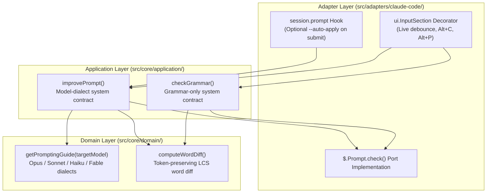

When an autonomous coding workflow fails in production—looping endlessly on a broken test, burning through tens of thousands of tokens on noisy stack traces, or modifying files outside its task scope—the reflex is often to blame the underlying language model. Yet empirical studies across tens of thousands of benchmark runs and production deployments at companies like Stripe, Uber, Spotify, and Ramp point to a different bottleneck: **the runtime harness surrounding the model**.

In earlier articles on [Prompt Engineering](), [Context Engineering](), [Harness Engineering](), [Loop Engineering](), and [Cheaper Models with a Strong Harness](), I explored how explicit verification loops and sandboxed environments make AI-generated code reviewable. In this post, we examine the industry research proving **why harness engineering matters for companies and projects**, compare the new wave of programmable harnesses—including **DeepSeek Harness (`dsh`)** and **Claude Code Mods**—and walk through a small, practical example I built in [`marcelomiyake/prompt-dialect`](https://github.com/marcelomiyake/prompt-dialect) to adapt developer prompts to the active model inside Claude Code.

---

## Why the model is only half of an agentic system

Modern software engineering treats an autonomous agent not as an isolated neural network, but as a composite system:

$$\text{Agent} = \text{Model} + \text{Harness}$$

In this decomposition, the **model** provides probabilistic reasoning, code synthesis, and high-level planning. The **harness** is the deterministic software infrastructure that wraps the model—governing its context window, mediating filesystem and network access, executing tools inside isolated sandboxes, and feeding structured diagnostic signals back into the reasoning loop.

### The cybernetic control matrix: guides and sensors

As Birgitta Böckeler outlines in [Harness engineering for coding agent users](https://martinfowler.com/articles/harness-engineering.html), an effective harness operates as a **closed-loop cybernetic control system**. It regulates a probabilistic model through two directional mechanisms crossed with two execution modes:

| Control Direction | Computational / Deterministic (Zero Token Cost, 100% Precision) | Inferential / Semantic (LLM-Driven, Contextual Flexibility) |
| :--- | :--- | :--- |
| **Feedforward Guides** *(Anticipatory steering before action)* | Pre-hydrated sandbox snapshots, static AST call-graph injection, deterministic tool schemas, filesystem chroot, network egress allowlists | Root `AGENTS.md` / `CLAUDE.md` constitutional prompts, on-demand `SKILL.md` playbooks, architectural few-shot examples |
| **Feedback Sensors** *(Reactive verification after action)* | Compiler diagnostics (`rustc`, `tsc`), linter rules, unit/integration test runners, mutation testing, git diff path blockers | LLM-as-a-Judge PR reviewers, adversarial QA evaluator subagents, semantic scope-creep detectors |

{: width="1600" height="1278" }
_The Cybernetic Agent Harness combines anticipatory feedforward guides with post-action feedback sensors across a four-layer runtime architecture._

### What 4 million lines of production agent code reveal

A comparative source-code audit of **11 production coding agents**—spanning roughly **4 million lines of code** across Claude Code, OpenAI Codex CLI, Gemini CLI, OpenHands, Cline, Aider, OpenCode, Block's Goose, Plandex, SWE-agent, and Qwen Code—demonstrates that the core `while (tool_call)` inference loop accounts for only a tiny fraction of an agent's codebase. Regardless of language (TypeScript, Rust, Python, or Go), production harnesses converge on **nine essential runtime primitives**:

1. **The Agentic Execution Loop**: Managing turn taking, streaming tool-call parsing, retry backoff, and explicit stop conditions (`end_turn`, budget caps, or terminal verification).
2. **Rich File & Shell Tooling**: Search-and-replace patch parsers (`edit`), ripgrep-backed regex search (`grep`), AST-aware symbol navigation, and persistent PTY shell sessions.
3. **Layered Instruction Hierarchy**: Merging global enterprise policy, repository-root `AGENTS.md` / `CLAUDE.md` files, and subdirectory-scoped rules.
4. **Adaptive Context Compaction**: Monitoring token pressure and summarizing stale tool outputs before hitting the **context rot zone** (where recall degrades past 65–75% window saturation).
5. **Tiered Permission & Policy Engine**: Classifying actions into auto-approved reads, workspace-bounded edits, and high-risk mutations requiring policy verification or human approval.
6. **Subagent Spawning & Context Isolation**: Delegating noisy exploration or parallel verification tasks to child workers with fresh context windows so only concise summaries return to the parent agent.
7. **Deterministic Checkpoints & Rollback**: Using shadow git repositories or worktree snapshots to revert failed multi-file edits cleanly.
8. **Crash Recovery & Append-Only Persistence**: Recording every turn to disk (`JSONL` or SQLite) so interrupted long-horizon sessions resume without losing state.
9. **Extensibility Protocols**: Exposing Model Context Protocol (MCP) clients, lazy-loaded skills, and in-process lifecycle hooks.

---

## What the benchmarks show: accuracy gains and a 3x cost spread

For engineering leaders, the most consequential finding from recent research is that **changing the harness—while keeping the model weights completely fixed—dramatically alters both task resolution rates and cloud inference bills**.

### 1. The 94,000-trial Harbor study: saving \$830 per 1,000 tasks

In [We Ran 94,000 Trials to Measure the Cost of Harness Choice](https://strandsagents.com/blog/we-ran-94000-trials-to-measure-the-cost-of-harness-choice/), researchers executed **82,400 valid containerized trials** inside the Harbor framework across **5 production harnesses** (`Strands`, `Claude Code`, `Codex`, `Gemini CLI`, and `OpenHands`), **6 software engineering benchmarks** (`SWE-bench Verified`, `Terminal-Bench 2.0`, `GitBug-Java`, `SWT-bench`, `Aider Polyglot`, and `ColBench`), and **20 models**.

Holding the underlying model constant, the study established three core empirical results:

* **3 to 8 percentage-point accuracy swings**: Across identical model checkpoints, switching the harness shifted benchmark resolution rates by 3 to 8 percentage points purely due to differences in diff formatting, bash timeout recovery, and context pruning.
* **2x to 3x cost variance per trial**: Verbose harnesses that inject massive system prompts, eagerly load dozens of tool schemas on every turn, and permit unconstrained exploration loops cost **2x to 3x more per task** than minimal, event-driven harnesses.
* **Up to \$830 saved per 1,000 tasks**: Running `Claude Sonnet 4.5` inside a heavy default CLI harness cost **\$1.32 per trial**, whereas running the exact same model inside the lightweight `Strands` harness cost **\$0.49 per trial** at comparable resolution accuracy—a **62.9% cost reduction** (\$830 saved per 1,000 tasks). On `Claude Opus 4.5`, per-trial cost dropped from **\$1.15** to **\$0.53** (**53.9% savings**).

### 2. Scaffold comparisons on DeepSWE v1.1 and Terminal-Bench 2.1

Controlled evaluations on the [DeepSeek-V4.1-Flash benchmark suite](https://github.com/deepseek-ai/deepseek-harness/blob/master/BENCHMARK.md) reinforce that scaffold architecture directly governs resolution ceilings. When evaluating the exact same `DeepSeek-V4.1-Flash` model weights across multiple harnesses on `DeepSWE v1.1` (300 tasks, 128K context, 100-turn cap) and `Terminal-Bench 2.1` (89 complex CLI tasks):

| Benchmark Suite | DeepSeek Harness (`dsh`) | Claude Code Harness | OpenHands / Terminus-2 | Harness Delta |
| :--- | :--- | :--- | :--- | :--- |
| **DeepSWE v1.1** *(300 tasks, Pass@1)* | **61.1%** | 59.3% | 57.1% *(OpenHands)* | **+1.8 to +4.0 pts** |
| **Terminal-Bench 2.1** *(89 tasks, Pass@1)* | **55.6%** | 47.9% | 50.9% *(Terminus-2)* | **+4.7 to +7.7 pts** |

{: width="1600" height="2506" }
_Top: Per-trial inference cost across matched models in the 82,400-trial Harbor study. Bottom: Resolution rates for a fixed DeepSeek-V4.1-Flash checkpoint across different agent harnesses._

### 3. Model scaling vs. harness complexity: `mini-SWE` vs. `OpenCode`

Does a richer harness with more tools always help? A longitudinal study on **SWE-bench Pro** ($N = 300$) tracked five generations of DeepSeek models (`R1` $\rightarrow$ `V3` $\rightarrow$ `V3.1` $\rightarrow$ `V3.2` $\rightarrow$ `V4-Pro`) across two contrasting scaffolds:

* **`mini-SWE`**: A minimalist, ~250-line Python harness exposing a single stateless `bash` execution tool and linear history.
* **`OpenCode`**: A feature-rich production harness exposing **25+ specialized tools** (AST symbol search, LSP diagnostics, semantic file editors, directory tree inspectors, and multi-agent delegation).

| Model Generation | `mini-SWE` Avg Steps | `OpenCode` Avg Steps | `mini-SWE` Prompt Tokens | `OpenCode` Prompt Tokens | `mini-SWE` Pass@1 | `OpenCode` Pass@1 |
| :--- | :--- | :--- | :--- | :--- | :--- | :--- |
| **DeepSeek-R1** *(Early reasoning)* | 28.4 | 44.1 | 0.82M | 1.89M | 31.2% | 28.9% |
| **DeepSeek-V3** *(Base MoE)* | 26.1 | 38.7 | 0.75M | 1.54M | 34.8% | 35.1% |
| **DeepSeek-V3.1** *(Tool-tuned)* | 23.5 | 29.4 | 0.68M | 1.12M | 41.0% | 43.2% |
| **DeepSeek-V3.2** *(Multi-scaffold RL)* | 20.8 | 22.6 | 0.61M | 0.84M | 46.5% | 48.9% |
| **DeepSeek-V4-Pro** *(Frontier RL)* | **17.9** | **18.2** | **0.52M** | **0.65M** | **50.3%** | **52.7%** |

The architectural takeaway is critical for platform teams:

1. **Smaller or older models choke on complex tool surfaces**: When `DeepSeek-R1` ran inside `OpenCode`, tool-selection confusion inflated execution from 28.4 to **44.1 steps** (+55%), ballooned prompt consumption from 0.82M to **1.89M tokens** (+130%), and *lowered* accuracy by 2.3 percentage points compared to the 250-line `mini-SWE` loop.
2. **Frontier models internalize harness ergonomics**: Models trained via multi-scaffold reinforcement learning (`V3.2` and `V4-Pro`) compressed `OpenCode` trajectories down to **18.2 steps** and **0.65M tokens**—a **58.7% reduction in steps** and **65.6% reduction in token overhead** compared to `R1`, while unlocking a **52.7%** resolution rate.

{: width="1600" height="2922" }
_Comparing minimalist `mini-SWE` against complex `OpenCode` on SWE-bench Pro (N=300): early models suffer severe step and token bloat in complex harnesses, while frontier RL-trained models compress overhead and extract higher accuracy._

---

## Next-generation extensible harnesses: DeepSeek Harness and Claude Code Mods

For the first few years of AI coding tools, agent harnesses were monolithic black boxes. Customizing them meant either stuffing more prose into `AGENTS.md` (which models could ignore) or spawning slow external shell scripts. In 2026, two architectures redefined the harness as a **programmable, modular runtime**: **DeepSeek Harness (`dsh`)** and **Claude Code Mods**.

### 1. DeepSeek Harness (`dsh`): open-source plugin micro-kernel and 99% KV-cache hits

Released as an open-source TypeScript monorepo (`@deepseek-harness/*` under the MIT license), [DeepSeek Harness (`dsh`)](https://github.com/deepseek-ai/deepseek-harness) rejects monolithic agent loops in favor of a **micro-kernel plugin architecture** powered by the **Cordis** Dependency Injection (DI) and event framework.

Every capability inside `dsh`—file editing (`builtin-file-tools`), permission gates (`builtin-permissions`), context compaction (`builtin-compact`), MCP connectivity (`builtin-mcp`), `SKILL.md` loading (`builtin-skills`), and child task delegation (`builtin-subagent`)—is implemented as an isolated plugin that registers typed hooks on the kernel (`session.prompt`, `api.request`, `tool.call`, `permission.decide`, `context.compact`). Teams can run `dsh` as an interactive React Ink TUI, a headless CI daemon, or an embedded SDK inside internal developer portals.

Equally important is its **append-only JSONL session architecture** designed specifically for LLM KV-cache economics:

* Many naive harnesses mutate earlier conversation turns in-place when pruning tool output or updating system state. Modifying even a single token near the beginning of a 100K-token prompt invalidates the transformer's KV-cache prefix, forcing the inference provider to re-compute the entire prefix at full price.
* `dsh` stores every session as an immutable, append-only `JSONL` log. When context compaction triggers, `dsh` appends a **Compaction Marker** and summary block rather than rewriting earlier turns during active prefix windows.
* Across multi-turn software engineering tasks, this strict prefix stability achieves a **99% prompt cache hit rate**, dropping effective input token costs on frontier APIs by **up to 90%** (for example, from \$0.30/1M uncached tokens down to \$0.03/1M cached tokens).

### 2. Claude Code Mods: in-process TypeScript `Function Hooks`

Anthropic's **Claude Code** took a complementary path by evolving from a closed CLI tool into an extensible platform through **Claude Code Mods** and in-process **TypeScript `Function Hooks`**.

Previously, customizing Claude Code required configuring external shell command hooks in `settings.json` (`PreToolUse`, `PostToolUse`). While useful for basic linting, shell hooks had three architectural limitations: they spawned a new OS subprocess on every tool call (adding 50–200ms of serialization latency), they communicated only via coarse exit codes and `stdout`, and they could not inspect or transform in-memory API requests, UI components, or context compaction state mid-flight.

Claude Code Mods replace subprocess IPC with **in-process middleware** executed directly inside Claude Code's Bun runtime using a three-argument middleware signature `($, e, next)`:

* `$`: The **Session Context API**, providing typed access to the active model configuration, workspace state, logger, and internal LLM sub-queries (`$.Prompt.check()`).
* `e`: The **Intercepted Event Payload**—whether a user prompt submission, an outgoing model API request, a file edit tool call, or a terminal UI render pass.
* `next()`: The continuation function that advances the middleware pipeline, allowing a Mod to mutate inputs before calling `await next()`, inspect or redact outputs afterward, or short-circuit execution entirely.

```mermaid
flowchart LR
    accTitle: In-process middleware pipeline in programmable agent harnesses
    accDescr: A user prompt or tool action enters the harness event bus, passes through in-process TypeScript plugins or Function Hooks for transformation and policy checks, executes against the model or sandbox, and returns verified output.
    Input["Developer Prompt / Tool Call"] --> Hook1["Hook 1: Input Transform & Dialect Adaptation"]
    Hook1 --> Hook2["Hook 2: RBAC, Secret Redaction & Scope Gate"]
    Hook2 --> Core["Model Inference / Sandboxed Tool Execution"]
    Core --> Sensor["Hook 3: Deterministic Linter & Output Sensor"]
    Sensor --> Output["Verified Result / UI Render"]
```



Because `Function Hooks` execute in-process with the host privileges of the developer's terminal, they also introduce a critical **supply-chain security boundary**. Early static security audits of community-published Mods flagged **12.4%** for risky patterns such as unsanitized external network calls or forwarding prompt context to third-party telemetry endpoints. In enterprise environments, platform teams treat `.claude/mods/` with the same rigor as CI/CD pipeline code: enforcing signed internal Mod registries, locking global security Mods inside read-only `/etc/claude-code/managed-mods/` directories, and restricting outbound network egress.

### Comparing the leading programmable harnesses

| Architectural Dimension | DeepSeek Harness (`dsh`) | Claude Code (with Mods) | OpenAI Codex CLI |
| :--- | :--- | :--- | :--- |
| **License & Source Model** | **MIT Open Source** (`@deepseek-harness/*` TypeScript monorepo) | Proprietary CLI with open TypeScript Mod SDK | **Apache-2.0 Open Source** (Rust core + TypeScript bindings) |
| **Core Runtime Architecture** | **Cordis** DI micro-kernel; every built-in feature is a removable plugin | Bun-powered runtime with in-process `($, e, next)` middleware hooks | Native Rust runtime optimized for OS-level sandboxing |
| **Model Ecosystem** | Model-agnostic (100+ providers via Vercel AI SDK: DeepSeek, Claude, OpenAI, Gemini, Ollama) | Optimized for Anthropic Claude models (Opus, Sonnet, Haiku, Fable) | Optimized for OpenAI reasoning models (`o3`, `o4-mini`, `GPT-5` series) |
| **Context & Cache Strategy** | Append-only `JSONL` log with Compaction Markers (**99% KV-cache hit rate**) | Automatic `/compact` summarization + `CLAUDE.md` prompt caching | Stateless turn compression with local diff snapshotting |
| **Isolation & Security Model** | Configurable permission plugin + Docker/Bubblewrap sandbox adapters | Tiered permission rules + enterprise managed-mods policy | Kernel-enforced `Seatbelt` (macOS) and `Landlock` / `seccomp` (Linux) |

---

## How engineering organizations build production harnesses

When companies move from individual developers prompting in an IDE to autonomous background agents merging thousands of pull requests a week, **custom harness engineering becomes the primary differentiator**. Across seven widely studied enterprise deployments, the pattern is consistent: successful teams constrain the model's degrees of freedom and shift verification into deterministic harness stages.

| Company & System | Base Architecture | Key Harness Innovations | Measured Production Impact |
| :--- | :--- | :--- | :--- |
| **Stripe** (`Minions`) | Forked Block `Goose` harness running in isolated AWS EC2 devboxes | **Blueprints** interleave LLM turns with deterministic git/lint nodes; pre-fetches Jira/Sourcegraph context before Turn 1; restricts agent to **15 curated tools** out of 500+ in internal `Toolshed`; strict **2-round CI retry cap** | **1,300+ autonomous PRs merged per week** with zero human-typed code |
| **Uber** (`Software Factory`, `Code-Mode`, `uReview`) | **LangGraph** state machines integrated with Bazel monorepo & `GenAI Gateway` | **Code-Mode MCP** replaces multi-turn JSON tool chatter with single sandboxed Python batch scripts; `uReview` enforces `<1%` noisy-comment budget via calibration filters | **98.3%–99.9% token reduction** on data queries; **>60% thumbs-up** & **72% fix rate** on PR reviews; tens of thousands of JUnit 4 $\rightarrow$ 5 migrations |
| **Spotify** (`Honk` & `Xirp`) | Claude Code runtime inside Fleet Management & incident pipelines | Dual-layer **Judge Agents** (Deterministic Diff Judge + Semantic LLM Judge) veto **25%** of unsound agent diffs before PR creation; `Xirp` automates incident log/trace correlation | **1,500+ PRs merged**; **60–90% time savings** on dataset migrations; **73% reduction** in manual incident triage toil |
| **Ramp** (`Inspect`) | Ephemeral full-stack cloud sandboxes orchestrated on **Modal** | Restores full stack (Postgres, Redis, Python, Ruby, Node, Vite) from warm snapshots in **<2s**; headless Chromium **Playwright** visual & DOM verification | **30%+ of all merged engineering PRs** authored by background agents |
| **Cursor** (`Agent Runtime`) | Custom IDE harness with semantic vector indexing & Shadow Workspaces | **Lazy-loads MCP tool schemas** on demand; validates edits against hidden background LSP instances before rendering diffs | **46.9% reduction** in idle context token consumption |
| **Anthropic** (`GAN App Harness`) | Multi-agent `Planner` $\rightarrow$ `Generator` $\rightarrow$ `Evaluator` loop | Decouples implementation from adversarial QA evaluation across multi-hour autonomous build sprints | Completed 6-hour full-stack build for **\$200.99** (**84.2%** build sprints, **14.3%** QA verification) |
| **Harvey** (`Spectre`) | Domain-specific legal multi-model router + deterministic verifier | Routes sub-tasks across OpenAI, Anthropic, and custom legal models; **Zero-Hallucination Citation Verifier** checks every case/statute against LexisNexis/Westlaw APIs | **+34% accuracy gain** on BigLaw Bench with deterministic citation grounding |

Two architectural techniques from these deployments stand out for any organization designing its own harness:

1. **Uber's Code-Mode Tool Batching (98.3%–99.9% token savings)**: Traditional MCP setups expose dozens of granular tools (`get_table_schema`, `run_query`, `fetch_partition`). When an agent investigates a multi-table anomaly, it executes 15 to 30 sequential tool turns, stuffing megabytes of intermediate JSON into the context window. Uber's **Code-Mode** instructs the agent to write a single Python script executed in an isolated sandbox that queries Presto, Hive, and Pinot locally, joins and filters the rows in memory, and returns only the final 300-token summary table to the LLM—cutting a 150,000-token join workflow down to **120 tokens** (**99.9% reduction**).
2. **Stripe's 2-Round CI Cap and Spotify's 25% Veto Gate**: Unbounded retry loops are the fastest way to burn cloud budgets while degrading code quality. Stripe's `Minions` run a sub-5-second local linter check after every edit, allow at most **two full CI repair rounds**, and abort with a structured diagnostic summary if the second attempt fails. Similarly, Spotify's `Honk` pairs a deterministic diff gate (which blocks any agent attempt to modify `Dockerfile`, Terraform, or CI YAML files) with a semantic judge agent, intercepting **25% of faulty agent runs** before a human reviewer ever sees a pull request.

{: width="1600" height="2498" }
_Top: Uber's Code-Mode sandboxed script batching reduces query token consumption by 98.3% to 99.9% compared to multi-turn JSON tool calls. Bottom: Cost and duration breakdown across Anthropic's multi-agent Planner-Generator-Evaluator harness._

---

## A practical example: `prompt-dialect` for Claude Code

Industry harnesses at Stripe, Uber, and Spotify operate across massive monorepos, build clusters, and internal APIs. But you do not need a thousand-engineer platform team to start applying harness engineering. Every boundary between the developer, the model, and the execution runtime is an opportunity to introduce a deterministic or model-aware control loop.

To explore how in-process harness extensibility works in practice, I built a small open-source plugin called **[`prompt-dialect`](https://github.com/marcelomiyake/prompt-dialect)**—a Claude Code Mod that intercepts the developer's prompt right inside the Claude Code composer before the main agent trajectory begins.

### Why model-specific "prompt dialects" matter

Even inside a well-tooled harness, every session starts with a human prompt (`session.prompt`). As Anthropic documents in [Claude prompting best practices](https://platform.claude.com/docs/en/build-with-claude/prompt-engineering/claude-prompting-best-practices), different Claude generations and tiers do not respond identically to the same phrasing—each model family has its own **prompt dialect**:

| Claude Model Tier | Behavioral Profile | Prompt Dialect Adjustments Needed |
| :--- | :--- | :--- |
| **Claude Opus 5.5 / Opus 5** | High-agency frontier planners with adaptive `effort` reasoning and strong proactive tool use | Strip legacy aggressive markers (`CRITICAL: YOU MUST`, `think step by step`) that trigger overthinking and redundant subagent spawning; express clear target states and constraints |
| **Claude Opus 4.8** | Deep architectural reasoning model transitioning toward 5.x tool ergonomics | Balance explicit context framing with bounded exploration rules |
| **Claude Sonnet 5.5 / Sonnet 5** | Fast, literal coding workhorses optimized for rapid edit-test loops | Add explicit scope boundaries, ambiguity handling rules, and concrete verification steps so the model asks clarifying questions instead of silently guessing |
| **Claude Haiku 5.5** | Ultra-low-latency model for lightweight tasks, routing, and background checks | Decompose requests into direct, single-responsibility instructions with strict output structure (such as XML tags or JSON schemas) |
| **Claude Fable 5.1 / Fable 5** *(Mythos Preview)* | Next-generation frontier reasoning models | Remove historical prompt workarounds and defensive boilerplate that degrade native reasoning; state the objective and constraints directly |

Developers switch between these models constantly during a workday—using Haiku or Sonnet for quick refactors and Opus for multi-file architectural changes—yet almost nobody rewrites their prompting style every time they run `/model`. Furthermore, when typing quickly in a terminal, developers frequently introduce typos or underspecified requirements that send the agent down the wrong path on Turn 1.

### What `prompt-dialect` does

[`prompt-dialect`](https://github.com/marcelomiyake/prompt-dialect) uses Claude Code's in-process Mod architecture (`src/adapters/claude-code/register.tsx`) to add two lightweight feedforward controls directly to the input composer, with **zero external runtime dependencies**:

1. **Grammar-Only Live Check (`Alt+C` / `Option+C` or live debounce)**:
   * As you pause typing (configurable debounce, default `900ms`), `prompt-dialect` sends the draft text to a fast, inexpensive background model (`claude-haiku-5-5` by default) via `$.Prompt.check()` with a strict grammar-only contract.
   * It fixes **only spelling, grammar, and punctuation**, preserving the original language (English, Portuguese, Spanish, etc.), tone, technical identifiers, file paths, `@mentions`, `/commands`, and code blocks.
   * A custom word-level Longest Common Subsequence (LCS) diff engine ([`src/core/domain/diff.ts`](https://github.com/marcelomiyake/prompt-dialect/blob/main/src/core/domain/diff.ts)) highlights only the exact tokens that changed and lets you accept the clean text with a single shortcut.
2. **Model-Aware Prompt Rewrite (`Alt+P` / `Option+P` or `--auto-apply` on submit)**:
   * Inspects the **currently active model in Claude Code** (for example, `claude-opus-5-5`, `claude-sonnet-5-5`, or `claude-haiku-5-5`) and loads its curated prompting guide from [`src/core/domain/prompting-guides.ts`](https://github.com/marcelomiyake/prompt-dialect/blob/main/src/core/domain/prompting-guides.ts).
   * Restructures the draft prompt to match that specific model's dialect—dialing back aggressive imperatives for Opus 5.5, or adding explicit scope boundaries and verification expectations for Sonnet 5.5.
   * **Anti-fabrication guardrail**: Instead of inventing missing requirements (such as guessing which database engine or authentication strategy you meant), the instruction contract requires the rewriter to insert brief `[placeholder]` questions where critical details are missing.

{: width="1200" height="640" }
_Demonstration of `prompt-dialect` running inside Claude Code: live grammar checking with word-level diffs (`Alt+C`) and model-aware prompt rewriting tailored to the selected Claude model (`Alt+P`)._

### Inside the Clean Architecture design

Even for a compact plugin, separating domain rules from the host harness SDK keeps the logic testable and portable across harnesses:



In [`src/core/application/instructions.ts`](https://github.com/marcelomiyake/prompt-dialect/blob/main/src/core/application/instructions.ts), the two system contracts enforce a strict separation between **fixing grammar** and **adapting the prompt dialect**:

```typescript
export const GRAMMAR_SYSTEM_PROMPT = `You are a proofreader for prompts sent to an AI coding assistant.
Fix ONLY spelling, grammar, and punctuation errors in the user's text.

Strict rules:
- Preserve the original language (do NOT translate).
- Preserve all code snippets, shell commands, file paths, URLs, @mentions, /commands, and identifiers verbatim.
- Do NOT rewrite for style, expand instructions, or answer the prompt.
- Return ONLY the corrected text, with no quotes or preamble.`;

export function buildImprovePromptSystemInstruction(targetModel: string): string {
  const guide = getPromptingGuide(targetModel);
  return `You are an expert prompt engineer optimizing a developer's prompt for ${guide.familyName} (${targetModel}).

Model Behavioral Profile:
${guide.characteristics.map((c) => `- ${c}`).join("\n")}

Prompting Best Practices for ${guide.familyName}:
${guide.rules.map((r) => `- ${r}`).join("\n")}

Strict rules:
- Preserve the original language, intent, code snippets, file paths, @mentions, and /commands.
- Do NOT invent requirements or assume unstated architecture choices; insert brief [placeholder] markers if critical details are missing.
- Return ONLY the improved prompt text.`;
}
```

And in [`src/adapters/claude-code/register.tsx`](https://github.com/marcelomiyake/prompt-dialect/blob/main/src/adapters/claude-code/register.tsx), the Mod hooks cleanly into `session.prompt` when `--auto-apply` is enabled, rewriting the prompt for the currently selected model before Claude Code dispatches the main turn:

```typescript
$("session.prompt", async (e, next) => {
  if (!config.autoApply) return next();

  const targetModel = e.model || config.defaultTargetModel;
  const result = await improvePrompt(
    { text: e.prompt, targetModel, checkerModel: config.checkerModel },
    promptChecker
  );

  if (result.hasChanges) {
    e.prompt = result.improvedText;
  }
  return next();
});
```

---

## From a small plugin to enterprise harness engineering

`prompt-dialect` is intentionally a small, focused example: it operates at the prompt entry boundary (`ui.InputSection` and `session.prompt`) and adapts instructions to the active Claude model without knowing anything about a specific company's codebase.

However, the architectural mechanism it uses—intercepting lifecycle events inside the harness runtime before and after model inference—is the exact same foundation used to govern large-scale enterprise systems. When you move from a personal plugin to an organization-wide engineering platform, you can extend those same harness seams across three critical dimensions:

### 1. Adapting to company infrastructure and internal topology

Instead of making every agent rediscover your repository layout from scratch (burning 20 turns and hundreds of thousands of tokens running `find` and `grep`), an enterprise harness pre-wires the environment:

* **Pre-Turn Context Hydration**: Like Stripe's `Minions`, a `session.prompt` hook can parse ticket IDs (`JIRA-1234`), fetch the issue specification, query internal service catalogs or Sourcegraph symbol indexes, and inject the relevant architectural subgraph before Turn 1 starts.
* **Build-Graph Integration**: Like Uber's `Software Factory`, a `tool.call` hook can translate generic test commands into hermetic Bazel or Buck2 target invocations (`bazel test //services/ledger/...`) and batch data queries through sandboxed **Code-Mode** scripts.
* **Append-Only Cache Discipline**: Structuring system prompts, `AGENTS.md` files, and tool schemas in a deterministic, append-only prefix order preserves the **99% KV-cache hit rate** demonstrated by DeepSeek Harness—cutting enterprise API bills in half without changing models.

### 2. Enforcing tiered information access levels and RBAC

Prompt instructions cannot enforce data governance; the harness runtime must mediate access deterministically:

* **Scoped Ephemeral Credentials**: Rather than exposing long-lived cloud keys in the shell environment, the harness injects short-lived, read-only OIDC tokens scoped strictly to the current task's service boundary and strips secrets from compiler and test subprocesses.
* **Pre-Flight PII & Secret Redaction**: An `api.request` middleware hook scans outgoing context blocks for customer PII, internal cryptographic keys, or proprietary algorithms, masking sensitive tokens before the payload leaves the corporate VPC.
* **Tiered Data Gateways**: When an agent queries operational data via MCP, the harness routes requests through an authenticated gateway that enforces row-level security and column masking based on the invoking engineer's identity and project clearance.

### 3. Deterministic guardrails and verifiable completion gates

Finally, an enterprise harness never trusts the model's self-reported *"All tests pass and the feature is ready"* message:

* **Protected Path Blockers**: Like Spotify's `Honk` Diff Judge, a deterministic `tool.call` sensor blocks edits to `.github/workflows/`, `Dockerfile`, IAM policies, database migration history, or linter suppression rules (`// eslint-disable`) unless explicitly authorized by an elevated workflow.
* **Actionable Diagnostic Remediation**: Following Böckeler's maintainability sensor pattern, custom architectural linters return structured `VIOLATION` / `RULE` / `REMEDIATION` messages directly to the agent's observation stream so it can self-correct module boundary leaks in one turn.
* **Bounded Repair Budgets**: Enforcing a hard cap (such as two local compiler/test repair rounds and two CI rounds) prevents runaway token spend and escalates ambiguous failures to human engineers with a clean reproducibility report.

---

## Key takeaways for engineering teams

1. **Measure the harness, not just the model**: The 82,400-trial Harbor study proves that harness choice drives **3 to 8 percentage-point accuracy shifts** and a **2x to 3x cost spread** on identical models. Audit your harness's token overhead before upgrading to a more expensive model tier.
2. **Match harness complexity to model capability**: Use lean, minimal scaffolds (`mini-SWE`, `Strands`) for smaller or older models to avoid tool-selection bloat, and reserve rich multi-tool harnesses (`OpenCode`, `dsh`, `Claude Code`) for frontier RL-trained models.
3. **Shift guardrails from prompts to code**: Use programmable plugin kernels (`DeepSeek Harness`) and in-process middleware (`Claude Code Mods`) to enforce RBAC, secret redaction, protected file boundaries, and bounded CI loops deterministically.
4. **Start small at the highest-leverage seams**: Even a compact extension like [`prompt-dialect`](https://github.com/marcelomiyake/prompt-dialect)—fixing grammar with a fast model and aligning prompt dialects with the selected Claude model—demonstrates how intercepting the harness lifecycle makes everyday AI engineering faster, cheaper, and safer.

