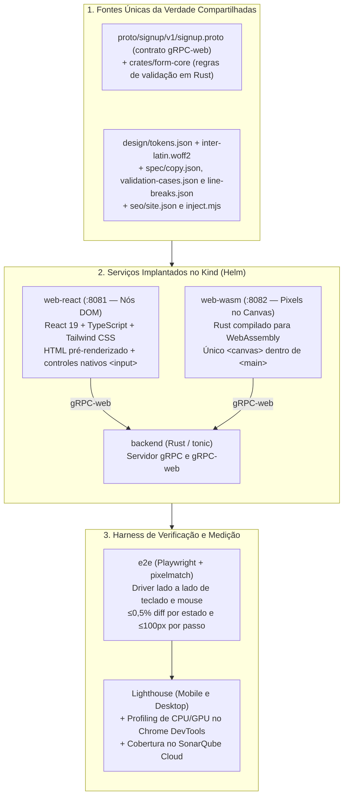
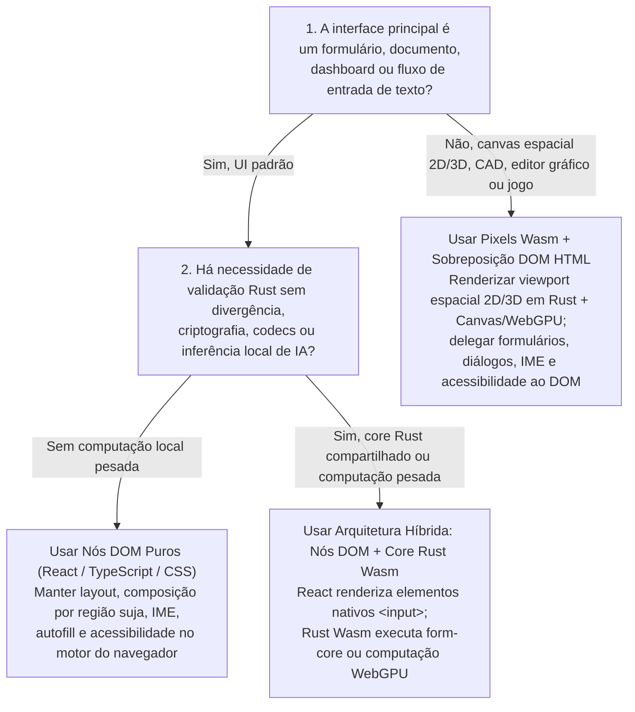

No artigo anterior desta série, [Como a IA está reescrevendo Architecture Decision Records: a adoção de WebAssembly nas empresas](), analisamos por que as cargas de trabalho de IA generativa — execução de código não confiável gerado por agentes, inferência serverless em rajadas exigindo cold starts sub-milissegundo e pontes de aceleração de hardware via `WASI-NN` e `WebGPU` — inverteram o ADR corporativo a favor do WebAssembly. Somado aos artigos anteriores sobre [a adoção corporativa de Rust]() e [a volta ao monorepo com microsserviços](), consolidou-se uma tendência clara: agentes autônomos de programação reduzem drasticamente o custo de escrever código de baixo nível em Rust e compilá-lo para WebAssembly.

Essa produtividade levanta uma pergunta inevitável para arquitetos de software: **se assistentes de IA conseguem escrever milhares de linhas de Rust e WebAssembly sem comprometer a velocidade de entrega, por que parar nos sandboxes de backend e pipelines de inferência? Deveríamos também substituir frontends tradicionais baseados no DOM HTML (React, TypeScript e CSS) por Rust compilado para WebAssembly desenhando diretamente em um `<canvas>`?**

Para responder a essa pergunta com dados empíricos em vez de hipóteses de quadro branco, construí o experimento **[`marcelomiyake/nodes-vs-pixels`](https://github.com/marcelomiyake/nodes-vs-pixels)**: uma Prova de Conceito (PoC) controlada que implementa exatamente a mesma interface de cadastro duas vezes dentro de um único monorepo:

* **`web-react` (Nodes)**: React 19, TypeScript e Tailwind CSS renderizando nós padrão do DOM HTML (`<form>`, `<input>`, `<label>`, `<button>`), pré-renderizados em tempo de build com CSS inline.
* **`web-wasm` (Pixels)**: Rust compilado para `wasm32-unknown-unknown` via `wasm-pack`, pintando cada pixel da página em **um único `<canvas>` dentro de `<main>`** — sem nenhum elemento `<input>`, `<label>` ou `<button>` no DOM.

Ambos os frontends se comunicam com o mesmo **backend em Rust (`tonic`)** via **gRPC-web** (`application/grpc-web+proto`), compartilham os mesmos design tokens, fonte, textos e vetores de conformidade de validação, e são verificados lado a lado por uma suíte Playwright de paridade visual que falha se mais de **0,5%** dos pixels divergirem.

Neste artigo, detalho como o experimento foi construído, o que é necessário na prática para reimplementar o DOM do navegador em Rust, quantos tokens e rodadas de revisão os agentes de IA gastaram em cada frontend, os perfis reais de CPU e memória de GPU medidos no Chrome, os prós e contras de cada abordagem e como essas descobertas refinam um ADR moderno de WebAssembly.

---

## O desenho de um experimento controlado: [`nodes-vs-pixels`](https://github.com/marcelomiyake/nodes-vs-pixels)

Quando comparações arquiteturais entre React e Rust/WebAssembly falham, quase sempre é porque as duas implementações não executam exatamente o mesmo trabalho: uma delas usa fontes ou espaçamentos diferentes, ignora casos de borda na validação, omite a navegação por teclado ou simula a camada de rede.

Para eliminar qualquer divergência entre os dois frontends e o backend, o repositório [`nodes-vs-pixels`](https://github.com/marcelomiyake/nodes-vs-pixels) foi estruturado como um workspace unificado onde cada contrato, token visual, texto e regra de validação vem de uma fonte única da verdade:



### Estrutura do repositório e contratos compartilhados

| Caminho | Papel no Experimento |
| :--- | :--- |
| [`proto/`](https://github.com/marcelomiyake/nodes-vs-pixels/tree/main/proto) | Define o serviço `signup.v1.SignupService/SignUp` (`SignUpRequest`, `SignUpResponse`, `FieldViolation`, `Field` e `ViolationCode`). |
| [`design/`](https://github.com/marcelomiyake/nodes-vs-pixels/tree/main/design) | [`tokens.json`](https://github.com/marcelomiyake/nodes-vs-pixels/blob/main/design/tokens.json) e a fonte [`inter-latin.woff2`](https://github.com/marcelomiyake/nodes-vs-pixels/tree/main/design/fonts) compartilhados por ambos os frontends. O `web-react` gera variáveis CSS a partir do `tokens.json`; o `web-wasm` gera constantes Rust em tempo de compilação no [`build.rs`](https://github.com/marcelomiyake/nodes-vs-pixels/blob/main/web-wasm/build.rs). |
| [`spec/`](https://github.com/marcelomiyake/nodes-vs-pixels/tree/main/spec) | [`copy.json`](https://github.com/marcelomiyake/nodes-vs-pixels/blob/main/spec/copy.json) (todos os rótulos, placeholders, dicas e mensagens de erro), [`validation-cases.json`](https://github.com/marcelomiyake/nodes-vs-pixels/blob/main/spec/validation-cases.json) (vetores de conformidade executados pelas suítes de teste em Rust e TypeScript) e [`line-breaks.json`](https://github.com/marcelomiyake/nodes-vs-pixels/blob/main/spec/line-breaks.json) (pontos de quebra de linha gravados do Chrome na largura `min-content`). |
| [`seo/`](https://github.com/marcelomiyake/nodes-vs-pixels/tree/main/seo) | Fonte única de metadados de SEO ([`site.json`](https://github.com/marcelomiyake/nodes-vs-pixels/blob/main/seo/site.json)) injetada tanto em `web-react/dist/client` quanto em `web-wasm/dist` durante o build pelo [`inject.mjs`](https://github.com/marcelomiyake/nodes-vs-pixels/blob/main/seo/inject.mjs). |
| [`crates/form-core/`](https://github.com/marcelomiyake/nodes-vs-pixels/tree/main/crates/form-core) | Crate Rust puro de validação (225 linhas em [`src/lib.rs`](https://github.com/marcelomiyake/nodes-vs-pixels/blob/main/crates/form-core/src/lib.rs)) compilado diretamente tanto no `backend` quanto no `web-wasm`. |
| [`backend/`](https://github.com/marcelomiyake/nodes-vs-pixels/tree/main/backend) | Servidor Rust `tonic` + `tonic-web` atendendo gRPC nativo e gRPC-web (HTTP/1.1) em uma única porta, validando cadastros com `form-core` e emitindo identificadores UUIDv4. |
| [`web-react/`](https://github.com/marcelomiyake/nodes-vs-pixels/tree/main/web-react) | Frontend em React 19, TypeScript, Vite e Tailwind CSS v4 usando `@connectrpc/connect-web` para chamadas gRPC-web, pré-renderização SSR no build ([`scripts/prerender.mjs`](https://github.com/marcelomiyake/nodes-vs-pixels/blob/main/web-react/scripts/prerender.mjs)) e CSS inline. |
| [`web-wasm/`](https://github.com/marcelomiyake/nodes-vs-pixels/tree/main/web-wasm) | Crate Rust compilado para WebAssembly (`wasm32-unknown-unknown`) que calcula o layout, pinta a interface e processa todas as interações em um único elemento `<canvas>`. |
| [`e2e/`](https://github.com/marcelomiyake/nodes-vs-pixels/tree/main/e2e) | Suíte de testes end-to-end em Playwright que pilota ambos os frontends simultaneamente e verifica a paridade visual por pixel com `pixelmatch`. |
| [`deploy/`](https://github.com/marcelomiyake/nodes-vs-pixels/tree/main/deploy) | Configuração do cluster Kubernetes local (`Kind`), templates de proxy reverso Nginx (servindo arquivos estáticos e encaminhando `/signup.v1.SignupService/` ao backend) e chart Helm. |

### Como a PoC foi construída e verificada

Seguindo as práticas de engenharia de harness e loops de verificação abordadas nos artigos anteriores, o repositório foi desenvolvido com um fluxo de autoria e revisão entre dois modelos:

1. **Autoria ([Claude Code](https://claude.com/claude-code) com Claude Opus 5.5)**: Cada alteração foi feita em uma branch curta como um [Conventional Commit](https://www.conventionalcommits.org/) de no máximo 1.000 linhas alteradas (descontando lockfiles), passando por `cargo clippy` (nativo e `--target wasm32-unknown-unknown` com `-D warnings`), `cargo test`, ESLint, checagem de tipos do TypeScript e testes no Vitest.
2. **Revisão adversarial de cada commit ([Codex](https://developers.openai.com/codex) com `gpt-6.1-sol` em esforço `medium`)**: Antes de qualquer fast-forward para a `main`, o Codex revisava cada commit localmente:
   ```sh
   codex review --commit <sha> -c model='"gpt-6.1-sol"' -c model_reasoning_effort='"medium"'
   ```
   O Claude Code corrigia cada apontamento válido no próprio commit a que ele se referia (ou registrava por que o comportamento real do Chrome mostrava que o apontamento estava incorreto) e repetia a revisão até não restar nenhuma pendência.
3. **Análise estática e validação em cluster**: Os projetos em Rust e TypeScript foram analisados em cobertura e qualidade no **SonarQube Cloud** (`make sonar`), implantados em um cluster Kubernetes local com **Kind** e Helm (`make deploy`), testados ponta a ponta com Playwright (`make e2e`) e auditados com **Lighthouse** em perfis mobile e desktop (`make lighthouse`).

---

## Paridade visual: Nodes vs. Pixels lado a lado

Um módulo Rust compilado para WebAssembly pintando em um `<canvas>` HTML consegue reproduzir visualmente uma página React + Tailwind CSS até o nível de pixels individuais?

Sim. Em [`e2e/tests/parity.spec.ts`](https://github.com/marcelomiyake/nodes-vs-pixels/blob/main/e2e/tests/parity.spec.ts), o Playwright abre `http://localhost:8081/` (`web-react`) e `http://localhost:8082/` (`web-wasm`) nas resoluções desktop (`1280×800`) e celular (`390×844`) em três estados — **Vazio (`empty`)**, **Erros (`errors`)** e **Sucesso (`success`)** — e compara capturas de tela completas usando `pixelmatch` (`threshold: 0.1`). O teste falha se mais de **0,5%** (`MAX_DIFF = 0.005`) dos pixels diferirem. Nos passos interativos de [`e2e/tests/form.spec.ts`](https://github.com/marcelomiyake/nodes-vs-pixels/blob/main/e2e/tests/form.spec.ts), no máximo **100 pixels** (`SAME = 100`) podem divergir (e na bateria de aferição dos benchmarks, no máximo **69 pixels** diferiram entre as etapas 4 e 6).

Veja as capturas de tela reais geradas no cluster Kind pelo comando `make screenshots`:

| Estado e Viewport | `web-react` (Nós DOM) | `web-wasm` (Pixels no Canvas) |
| :--- | :---: | :---: |
| **Vazio (Desktop, 1280×800)** | {: width="320" height="214" } | {: width="320" height="214" } |
| **Vazio (Celular, 390×844)** | {: width="195" height="422" } | {: width="195" height="422" } |
| **Erros de Validação (Desktop)** | {: width="320" height="235" } | {: width="320" height="235" } |
| **Erros de Validação (Celular)** | {: width="195" height="440" } | {: width="195" height="440" } |
| **Conta Criada (Desktop)** | {: width="320" height="200" } | {: width="320" height="200" } |
| **Conta Criada (Celular)** | {: width="195" height="422" } | {: width="195" height="422" } |

### Como testar uma página sem controles no DOM

Um detalhe revelador da suíte E2E está em [`e2e/tests/form.spec.ts`](https://github.com/marcelomiyake/nodes-vs-pixels/blob/main/e2e/tests/form.spec.ts#L108-L119), que verifica toda a árvore DOM da aplicação WebAssembly:

```typescript
test('the canvas app is one canvas that takes all input', async ({ page }) => {
  await open(page, APPS[1].url);
  expect(await page.evaluate(() => [...document.body.querySelectorAll('*')].map((element) => element.tagName))).toEqual([
    'MAIN',
    'CANVAS',
    'SCRIPT',
  ]);
  const canvas = page.getByRole('main').locator('canvas');
  await expect(canvas).toHaveAttribute('tabindex', '0');
  await expect(canvas).toHaveAccessibleName('Create your account');
  await expect(page.locator('input, button, label, select, textarea')).toHaveCount(0);
});
```

Como o `web-wasm` não possui nenhum `<input>`, `<button>` ou `<label>`, o Playwright não tem como buscar campos por seletor dentro do canvas. Em vez disso, o driver `Pair` em [`e2e/tests/apps.ts`](https://github.com/marcelomiyake/nodes-vs-pixels/blob/main/e2e/tests/apps.ts) consulta o retângulo (`boundingBox()`) do seletor na página **React** (`this.react.locator(selector).boundingBox()`) e dispara os cliques exatamente nas mesmas coordenadas `(x, y)` e as mesmas sequências de teclas em **ambas** as abas. Como os dois projetos calculam layouts idênticos, cada clique simples, duplo clique para seleção de palavra, navegação com `Tab`, exclusão de palavra com `Control+Backspace` e rolagem da página atinge exatamente o mesmo pixel nas duas versões.

---

## O preço de substituir o DOM: 680 linhas de React vs. 7.528 linhas de Rust

Quando escrevemos `<input type="password" id="password" />` no React, uma única linha de JSX delega décadas de engenharia de sistemas ao motor Blink/Chrome: modelo de caixas CSS, shaping de fontes, texto bidirecional, segmentação de grafemas, navegação por palavras, agrupamento de histórico de desfazer/refazer, proteção de área de transferência, anéis de foco, intermitência do cursor (caret) e ancoragem de rolagem (scroll anchoring).

Quando você substitui o DOM por um único `<canvas>`, **a sua aplicação precisa se tornar o motor do navegador**.

No início do experimento (commit [`76337f2`](https://github.com/marcelomiyake/nodes-vs-pixels/commit/76337f2)), o `web-wasm` desenhava o cartão no canvas mas posicionava controles HTML nativos transparentes sobre ele (`overlay.rs`) para deixar a edição de texto e o foco a cargo do Chrome. Para testar uma arquitetura genuinamente baseada apenas em pixels, os commits [`45e5963`](https://github.com/marcelomiyake/nodes-vs-pixels/commit/45e5963) e [`0018b68`](https://github.com/marcelomiyake/nodes-vs-pixels/commit/0018b68) removeram completamente a sobreposição nativa e transferiram toda a gestão de entrada, edição, foco, área de transferência e rolagem para o Rust.

A comparação do volume de código entre os dois frontends evidencia o custo imediato de abrir mão do DOM:

| Subsistema / Responsabilidade | `web-react` (TypeScript / TSX / MJS) | `web-wasm` (Rust) |
| :--- | :--- | :--- |
| **Geração de Código / SSR / Tema no Build** | [`prerender.mjs`](https://github.com/marcelomiyake/nodes-vs-pixels/blob/main/web-react/scripts/prerender.mjs) (30) + [`theme.mjs`](https://github.com/marcelomiyake/nodes-vs-pixels/blob/main/web-react/scripts/theme.mjs) (56) = **86 linhas** | [`build.rs`](https://github.com/marcelomiyake/nodes-vs-pixels/blob/main/web-wasm/build.rs) (176) + [`lib.rs`](https://github.com/marcelomiyake/nodes-vs-pixels/blob/main/web-wasm/src/lib.rs) (33 prod / 47 teste) + [`style.rs`](https://github.com/marcelomiyake/nodes-vs-pixels/blob/main/web-wasm/src/style.rs) (41) = **250 linhas prod** (297 total) |
| **Regras de Validação do Formulário** | [`validation.ts`](https://github.com/marcelomiyake/nodes-vs-pixels/blob/main/web-react/src/validation.ts) = **119 linhas** | Compartilhado de [`crates/form-core/src/lib.rs`](https://github.com/marcelomiyake/nodes-vs-pixels/blob/main/crates/form-core/src/lib.rs) (185 prod / 40 teste) |
| **Máquina de Estados e Textos** | [`useSignUpForm.ts`](https://github.com/marcelomiyake/nodes-vs-pixels/blob/main/web-react/src/useSignUpForm.ts) (77) + [`copy.ts`](https://github.com/marcelomiyake/nodes-vs-pixels/blob/main/web-react/src/copy.ts) (18) = **95 linhas** | [`form.rs`](https://github.com/marcelomiyake/nodes-vs-pixels/blob/main/web-wasm/src/form.rs) = **203 linhas prod** (353 total com testes) |
| **Transporte Cliente gRPC-Web** | [`api.ts`](https://github.com/marcelomiyake/nodes-vs-pixels/blob/main/web-react/src/api.ts) (`@connectrpc/connect-web`) = **52 linhas** | [`grpc_web.rs`](https://github.com/marcelomiyake/nodes-vs-pixels/blob/main/web-wasm/src/grpc_web.rs) (codec próprio de frames de 5 bytes e trailers) = **157 linhas prod** (319 total) |
| **Componentes de UI / Layout e Pintura** | [`SignUpForm.tsx`](https://github.com/marcelomiyake/nodes-vs-pixels/blob/main/web-react/src/SignUpForm.tsx) (95), [`TermsCheckbox.tsx`](https://github.com/marcelomiyake/nodes-vs-pixels/blob/main/web-react/src/components/TermsCheckbox.tsx) (70), [`TextField.tsx`](https://github.com/marcelomiyake/nodes-vs-pixels/blob/main/web-react/src/components/TextField.tsx) (66), [`SuccessPanel.tsx`](https://github.com/marcelomiyake/nodes-vs-pixels/blob/main/web-react/src/components/SuccessPanel.tsx) (32), [`BrandMark.tsx`](https://github.com/marcelomiyake/nodes-vs-pixels/blob/main/web-react/src/components/BrandMark.tsx) (12), [`App.tsx`](https://github.com/marcelomiyake/nodes-vs-pixels/blob/main/web-react/src/App.tsx) (19), [`main.tsx`](https://github.com/marcelomiyake/nodes-vs-pixels/blob/main/web-react/src/main.tsx) (21), [`entry-server.tsx`](https://github.com/marcelomiyake/nodes-vs-pixels/blob/main/web-react/src/entry-server.tsx) (13) = **328 linhas** | [`layout.rs`](https://github.com/marcelomiyake/nodes-vs-pixels/blob/main/web-wasm/src/layout.rs) (452 prod / 250 teste) + [`scene.rs`](https://github.com/marcelomiyake/nodes-vs-pixels/blob/main/web-wasm/src/scene.rs) (321 prod / 465 teste) = **773 linhas prod** (1.488 total) |
| **Shaping de Texto, Bidi e Quebra de Linha** | *Delegado ao motor DOM / CSS do navegador* (**0 linhas**) | [`text.rs`](https://github.com/marcelomiyake/nodes-vs-pixels/blob/main/web-wasm/src/text.rs) = **672 linhas prod** (949 total) |
| **Editor de Linha Única, Seleção e Máscara** | *Delegado ao `<input>` nativo* (**0 linhas**) | [`editing.rs`](https://github.com/marcelomiyake/nodes-vs-pixels/blob/main/web-wasm/src/editing.rs) = **625 linhas prod** (905 total) |
| **Máquina de Estados de Backspace para Emojis** | *Delegado ao `<input>` nativo* (**0 linhas**) | [`backspace.rs`](https://github.com/marcelomiyake/nodes-vs-pixels/blob/main/web-wasm/src/backspace.rs) = **152 linhas prod** (202 total) |
| **Histórico de Undo / Redo da Página** | *Delegado ao histórico nativo do navegador* (**0 linhas**) | [`history.rs`](https://github.com/marcelomiyake/nodes-vs-pixels/blob/main/web-wasm/src/history.rs) = **95 linhas prod** (184 total) |
| **Motor de Teclado, Mouse, Foco e Rolagem** | *Delegado ao loop de eventos do navegador* (**0 linhas**) | [`input.rs`](https://github.com/marcelomiyake/nodes-vs-pixels/blob/main/web-wasm/src/input.rs) (1.173 prod / 895 teste) + [`web.rs`](https://github.com/marcelomiyake/nodes-vs-pixels/blob/main/web-wasm/src/web.rs) (763 prod) = **1.936 linhas prod** (2.831 total) |
| **Total do Frontend (Produção / Todas)** | **680 linhas de produção** (+ 378 de teste = **1.058 no total**) | **4.863 linhas de produção** (+ 2.665 de teste inline = **7.528 no total**) |

Mesmo para um simples formulário com quatro campos de texto, um checkbox e um botão, **o frontend `<canvas>` em Rust exige ~7,1x mais código de produção (4.863 vs. 680 linhas)** do que o frontend DOM em React. Inspecionar os módulos internos do `web-wasm` mostra o porquê:

### 1. Renderização subpixel de fontes e alinhamento em pixels inteiros (`web.rs`, `layout.rs`, `scene.rs`)
Por padrão, um `<canvas>` HTML possui fundo transparente (`alpha: true`), o que força o Chrome a usar suavização em escala de cinza em vez do antialiasing subpixel LCD aplicado em elementos DOM opacos. Em [`web-wasm/src/web.rs`](https://github.com/marcelomiyake/nodes-vs-pixels/blob/main/web-wasm/src/web.rs#L58-L64), o contexto 2D precisa ser inicializado com `{ alpha: false }` para igualar a nitidez tipográfica do DOM. Além disso, o CSS alinha bordas e o cursor de 1px em coordenadas inteiras de pixels físicos; o `web-wasm` precisou replicar esse arredondamento (commit [`c60f8fc`](https://github.com/marcelomiyake/nodes-vs-pixels/commit/c60f8fc)) e o cálculo de half-leading (`((line_height - ascent - descent) / 2.0).floor()`) para que nenhuma linha de base desviasse sequer 1 pixel.

### 2. Texto bidirecional e medição contextual de grafemas (`text.rs`)
A API Canvas 2D oferece apenas `measureText(text).width` para uma string inteira — ela não informa onde cada caractere ou posição de cursor fica dentro de uma palavra ligada. Em [`web-wasm/src/text.rs`](https://github.com/marcelomiyake/nodes-vs-pixels/blob/main/web-wasm/src/text.rs#L59-L165):
* `char_bounds` executa o **Algoritmo Bidirecional do Unicode** (`unicode_bidi::BidiInfo`) para ordenar trechos visuais mistos da esquerda para a direita (latino) e da direita para a esquerda (árabe, hebraico), retornando os limites de cada caractere na ordem lógica.
* Como ligaturas, pares de kerning, junções cursivas do árabe e sinais vocálicos dependentes de escritas índicas alteram a largura de um cluster de grafemas conforme seus vizinhos, `run_bounds` mede cada cluster no contexto de `CONTEXT = 2` grafemas adjacentes de cada lado (e mede marcas combinantes isoladas sobre um círculo pontilhado `◌`, `\u{25CC}`, exatamente como o HarfBuzz/Chrome faz).

### 3. A máquina de estados do Backspace do Chrome para emojis e acentos (`backspace.rs`)
No Chrome, as teclas `Backspace` e `Delete` são assimétricas:
* Se você digitar `e` seguido de um acento agudo combinante (`\u{0301}`), `Backspace` apaga **apenas o acento** (preservando o `e`), enquanto `Delete` antes do caractere apaga o cluster inteiro.
* Porém, se o cursor estiver após um emoji composto por múltiplos code points — como modificadores de tom de pele (`👍🏽`), keycaps (`1️⃣`), pares de bandeiras regionais (`🇺🇸`), bandeiras de subdivisão com tags (`🏴󠁧󠁢󠁥󠁮󠁧󠁿`) ou sequências familiares unidas por Zero-Width Joiner (`👨‍👩‍👧`, 5 code points) —, o `Backspace` apaga **toda a sequência do emoji de uma só vez**.

Para reproduzir esse comportamento, [`web-wasm/src/backspace.rs`](https://github.com/marcelomiyake/nodes-vs-pixels/blob/main/web-wasm/src/backspace.rs) implementa um autômato finito de 11 estados sobre propriedades Unicode do crate `icu_properties` (`VariationSelector`, `RegionalIndicator`, `EmojiModifierBase`, `ExtendedPictographic`, `CanonicalCombiningClass`).

### 4. Proteção de limites de palavras em senhas, agrupamento de Undo e ancoragem de rolagem (`editing.rs`, `history.rs`, `input.rs`)
* **Segurança de senhas na navegação por palavras**: Em [`editing.rs`](https://github.com/marcelomiyake/nodes-vs-pixels/blob/main/web-wasm/src/editing.rs#L109-L114), um campo de senha mascara cada cluster de grafema com `•` (`\u{2022}`) e trata todo o valor como **uma única palavra** ao pressionar `Ctrl+Seta` / `Alt+Seta` — caso contrário, pular palavras revelaria onde há espaços ou símbolos dentro da senha mascarada. Pelos mesmos motivos, `Event::Copy` e `Event::Cut` são bloqueados em campos de senha.
* **Histórico de desfazer/refazer unificado na página**: O Chrome mantém uma única pilha de undo para a página inteira, e não uma por `<input>`. Em [`history.rs`](https://github.com/marcelomiyake/nodes-vs-pixels/blob/main/web-wasm/src/history.rs), digitações consecutivas se fundem no passo aberto, `Backspace` só se une após outro `Backspace`, `Delete` se une a qualquer passo aberto e colagens/recortes (`Paste`/`Cut`) criam passos isolados.
* **Ancoragem de rolagem (`Anchor`)**: Em uma tela curta (`390×300`), sair com `Tab` de um campo inválido acima da área visível insere uma mensagem de erro que empurra o restante do formulário para baixo. O Scroll Anchoring do Chrome ajusta `scrollY` para manter o controle visível parado na tela; [`web-wasm/src/web.rs`](https://github.com/marcelomiyake/nodes-vs-pixels/blob/main/web-wasm/src/web.rs#L115-L125) e [`layout.rs`](https://github.com/marcelomiyake/nodes-vs-pixels/blob/main/web-wasm/src/layout.rs) precisaram implementar um resolvedor explícito de ancoragem (`Anchor`) para igualar `Math.round(scrollY)` pixel a pixel.

---

## O que os agentes de IA gastaram: tokens, tempo e rodadas de revisão

Linhas de código são apenas um indicador indireto de esforço. Os logs de sessão dos dois agentes medem esse esforço diretamente.

O Claude Code escreveu o repositório inteiro em uma única sessão: Claude Opus 5.5 com esforço `xhigh`, 11 horas de relógio (7,3 delas ativas), 1.148 chamadas de API e nove compactações automáticas de contexto. O próprio Claude Code estimou o custo da sessão em **US$ 110,52**. Atribuindo cada chamada de API à área tocada por suas ferramentas — caminhos como `web-react/` ou `web-wasm/`, comandos como `pnpm --filter web-react` ou `wasm-pack` —, a sessão se divide assim:

| Área | Chamadas de API | Tokens de Saída | Todos os Tokens | Tempo Ativo | Parcela dos US$ 110,52 |
| :--- | :---: | :---: | :---: | :---: | :---: |
| **`web-react`** | 94 | 0,14 M | 22 M | 0,6 h | ~US$ 10 |
| **`web-wasm`** | 663 | 0,98 M | 150 M | 3,7 h | ~US$ 65 |
| **Ambos os frontends** (testes e2e e de paridade, builds dos dois) | 266 | 0,44 M | 59 M | 2,3 h | ~US$ 26 |
| **Compartilhado** (contrato, tokens, `form-core`, backend, SEO, deploy) | 125 | 0,12 M | 22 M | 0,7 h | ~US$ 10 |
| **Total** | **1.148** | **1,67 M** | **254 M** | **7,3 h** | **US$ 110,52** |

Os tokens de saída incluem o raciocínio (thinking) do modelo. *Todos os tokens* soma a entrada lida por cada chamada: toda chamada relê o contexto inteiro (cerca de 220.000 tokens em média, quase todos do cache de prompt), então o esforço cresce com o número de chamadas. O *tempo ativo* conta o intervalo entre cada chamada e a seguinte, incluindo os builds e testes executados, limitado a 5 minutos.

O Codex revisou os commits em 104 execuções de `codex review` (GPT-6.1 Sol com esforço `medium`). O log de cada execução identifica o commit revisado, e um commit era revisado novamente após cada correção, então as revisões correspondem a rodadas de revisão:

| Área | Revisões | Commits | Tokens de Entrada | Tokens de Saída | Tempo de Revisão |
| :--- | :---: | :---: | :---: | :---: | :---: |
| **`web-react`** | 13 | 6 | 2,3 M | 11 mil | 0,2 h |
| **`web-wasm`** | 73 | 23 | 26,2 M | 157 mil | 1,9 h |
| **Compartilhado, testes e docs** | 18 | 15 | 2,1 M | 12 mil | 0,2 h |
| **Total** | **104** | **44** | **30,6 M** | **180 mil** | **2,3 h** |

Quatro resultados se destacam:

1. **Escrever o frontend em canvas custou cerca de 7x o frontend React**: 7x as chamadas de API e os tokens de saída, 6,8x os tokens e 6x o tempo ativo — próximo da proporção de 7,1x no código de produção. Dividindo o trabalho em "ambos os frontends" igualmente, a proporção cai para 3,5x; atribuindo tudo ao canvas, cuja paridade esses testes verificam, sobe para 9,5x.
2. **A maior parte desse custo veio depois da remoção dos inputs nativos**: Até eu apontar que a primeira versão do canvas (commit [`76337f2`](https://github.com/marcelomiyake/nodes-vs-pixels/commit/76337f2)) ainda dependia de elementos `<input>` HTML sobrepostos ao canvas, o `web-wasm` tinha consumido 50 M de tokens contra 18 M do React (2,8x). Reconstruir tudo o que esses inputs faziam — cursor, seleção, desfazer, rolagem e área de transferência — exigiu outros 101 M de tokens, além de 32 M em trabalho nos dois frontends, sobretudo nos testes de paridade.
3. **As revisões divergiram ainda mais: 11x os tokens e 12x o tempo**: Os commits do canvas precisaram de mais rodadas (3,2 em média contra 2,2, e 9 para `feat(web-wasm): break canvas text where Chrome does`), e cada revisão leu o dobro (358.000 tokens contra 178.000).
4. **Revisar saiu barato perto de escrever**: O Codex usou um oitavo dos tokens do Claude Code (31 M contra 254 M) e rodou em uma assinatura ChatGPT Plus, sem custo por token; o uso do limite semanal do Codex na conta subiu de 1% para 26% durante a sessão. Somando os dois agentes, o `web-wasm` consumiu 177 M de tokens e o `web-react`, 24 M — 7,3x.

Os logs também revelam uma falha no ciclo de revisão: todo commit feito na sessão tem ao menos uma revisão do Codex, exceto o [`0018b68`](https://github.com/marcelomiyake/nodes-vs-pixels/commit/0018b68) (`refactor(web-wasm): remove the overlay of native controls`), que nenhum log de revisão menciona.

*(Método: cada chamada de API é atribuída a partir de suas chamadas de ferramentas, e uma chamada sem ferramentas herda a área da anterior. As compactações de contexto do Claude Code, cerca de 2% dos seus tokens, e as sessões posteriores apenas de documentação ficaram de fora.)*

---

## Resultados empíricos: Lighthouse, CPU e o imposto oculto na memória da GPU

Depois que ambos os frontends atingiram paridade visual e comportamental no cluster Kind, como eles se saíram nas medições?

### 1. Tamanho dos pacotes, notas do Lighthouse e o paradoxo da acessibilidade

Ambos os frontends são servidos por contêineres Nginx com a mesma fonte e os mesmos metadados de SEO:
* **Artefatos do `web-react`**: `index.html` pré-renderizado de `19 KiB` (com `14 KiB` de Tailwind CSS inline), pacote JS minificado de `340 KiB` (`index-pOAmR297.js`) e a fonte `inter-latin.woff2` — **`155 KiB` de transferência total comprimida** segundo o Lighthouse.
* **Artefatos do `web-wasm`**: `index.html` de `2,2 KiB`, glue JS do `wasm-bindgen` de `36 KiB` (`web_wasm.js`), binário WebAssembly otimizado de `288 KiB` (`web_wasm_bg.wasm`) e a fonte compartilhada — **`178 KiB` de transferência total comprimida** segundo o Lighthouse.

A execução de `make lighthouse` contra os dois serviços produziu os seguintes resultados (dos relatórios `lighthouse/*.json` gravados localmente; o diretório é ignorado pelo git, então os relatórios não estão no repositório):

| Métrica do Lighthouse | `web-react` Desktop | `web-wasm` Desktop | `web-react` Mobile | `web-wasm` Mobile |
| :--- | :---: | :---: | :---: | :---: |
| **Nota de Performance** | **100** | **100** | **100** | **99** |
| **Nota de Acessibilidade** | **100** | **100** | **100** | **100** |
| **Nota de Boas Práticas** | **100** | **100** | **100** | **100** |
| **Nota de SEO** | **100** | **100** | **100** | **100** |
| **First Contentful Paint (FCP)** | 0,3 s | **0,2 s** | 1,2 s | **0,8 s** |
| **Largest Contentful Paint (LCP)** | **0,4 s** | **0,4 s** | **1,7 s** | 2,0 s |
| **Total Blocking Time (TBT)** | **0 ms** | **0 ms** | **10 ms** | 110 ms |
| **Cumulative Layout Shift (CLS)** | **0** | **0** | **0** | **0** |
| **Trabalho na Main Thread** | **0,1 s** | **0,1 s** | **0,3 s** | 0,4 s |
| **Peso Total Transferido** | **155 KiB** | 178 KiB | **155 KiB** | 178 KiB |

Observe com atenção a **Nota de Acessibilidade: 100** no `web-wasm`. Como uma página com **zero elementos `<input>`, `<label>` ou `<button>`** tirou nota máxima (100/100) em Acessibilidade no Lighthouse?

Porque o `web-wasm` renderiza `<main><canvas id="app" tabindex="0" aria-label="Create your account"></canvas></main>`. As regras automatizadas do axe/Lighthouse verificam se os elementos existentes no DOM possuem landmarks, contraste e nomes acessíveis válidos. Como o `<canvas>` está dentro de `<main>` e tem um `aria-label`, o verificador automático não encontra nenhuma violação — embora um usuário real de leitor de tela ouça apenas *"Create your account"* e não consiga enxergar nenhum campo de texto, mensagem de erro ou botão desenhado nos pixels. **Auditorias automatizadas de acessibilidade validam nós do DOM; elas são cegas para interfaces aprisionadas dentro de pixels.**

### 2. Benchmarks de CPU em tempo de execução nas 6 etapas de uso

O Lighthouse mede apenas o carregamento inicial da página. Para medir o uso de CPU e memória durante a interação real, ambos os aplicativos foram conduzidos pelas mesmas seis etapas no Chrome 156 headless contra a implantação no Kind em Linux (Intel Core i7-8750H, NVIDIA GeForce GTX 1060, viewport `1280×800`, mediana de 5 execuções por app com navegador limpo a cada rodada):

1. **Carregamento (`Load`)**: Carregar a página e aguardar 3 segundos após a primeira pintura.
2. **Ocioso sem foco (`Idle`)**: Permanecer 10 segundos sem interação.
3. **Ocioso com campo focado (`Idle, field focused`)**: Pressionar `Tab` para focar o primeiro campo (`fullName`) e aguardar 10 segundos.
4. **Envio vazio (`Empty submit`)**: Pressionar `Enter` para acionar os erros de obrigatoriedade nos 5 campos e aguardar 1 segundo.
5. **Digitação (`Typing`)**: Digitar os quatro campos (63 caracteres a 50 ms por tecla) usando `Tab` entre eles, seguido de `Tab` e `Space` para marcar o aceite dos termos.
6. **Cadastro (`Sign-up`)**: Pressionar `Enter` para enviar via gRPC-web ao backend Rust e aguardar 1 segundo.

A tabela a seguir apresenta a mediana do tempo de CPU em milissegundos (`web-react` / `web-wasm`) com rasterização por GPU em proporção de pixels `1×`:

| Etapa | Main Thread (`React / Wasm`) | Script (`React / Wasm`) | Layout e Estilo (`React / Wasm`) | Processo Renderer da Aba (`React / Wasm`) | Processo de GPU (`React / Wasm`) |
| :--- | :---: | :---: | :---: | :---: | :---: |
| **1. Carregamento (3 s)** | 73 / **64 ms** | 37 / **24 ms** | 3,6 / **0,5 ms** | 120 / **100 ms** | 70 / **60 ms** |
| **2. Ocioso sem foco (10 s)** | **0,3** / 1,9 ms | **0** / 0,3 ms | 0 / 0 ms | 0 / 0 ms | 20 / 20 ms |
| **3. Ocioso, campo focado (10 s)** | **5,7** / 24 ms | **0** / 16 ms | 0 / 0 ms | **10** / 40 ms | **50** / 100 ms |
| **4. Envio vazio (1 s)** | **6,2** / 8,3 ms | **3,1** / 5,6 ms | 0,6 / **0,1 ms** | **10** / 20 ms | 10 / 10 ms |
| **5. Digitação (63 teclas)** | **130** / 178 ms | **27** / 117 ms | 11,6 / **0,4 ms** | **220** / 290 ms | **180** / 410 ms |
| **6. Cadastro (gRPC-web)** | 12 / **10 ms** | **5,1** / 5,5 ms | 1,8 / **0 ms** | 10 / 10 ms | **10** / 20 ms |

Cinco resultados estruturais se repetiram em todas as execuções:

1. **O carregamento inicial consome um pouco menos de main thread em Wasm (`64 ms` vs. `73 ms`)**: Como a página do canvas possui apenas 65 nós DOM no total (`<head>` + `<main><canvas><script>`) e nenhuma árvore de layout CSS para calcular, o `web-wasm` gasta `24 ms` em script e `0,5 ms` em layout/estilo, contra `37 ms` em script (execução e hidratação do React) e `3,6 ms` em layout/estilo no `web-react`.
2. **Digitar custa ao app em canvas 4,3x mais tempo de script e 2,3x mais tempo de GPU**: No `web-react`, digitar uma letra atualiza o estado do React e deixa o motor Blink invalidar apenas o trecho de texto dentro daquele `<input>` (`27 ms` de script, `11,6 ms` de layout/estilo e `180 ms` de GPU ao longo de 63 teclas). No `web-wasm`, cada tecla pressionada recalcula o layout e repinta **todo o `<canvas>` de `1280×856`** a partir do Rust via chamadas FFI do Canvas 2D (`__wbg_set_font_…`, `__wbg_set_fillStyle_…`, `fillText`), consumindo **`117 ms` de tempo de script** e **`410 ms` no processo de GPU**.
3. **Manter um campo focado consome CPU e GPU mesmo com a página ociosa**: Quando um `<input>` está focado no `web-react`, o próprio Chrome pisca o cursor nativo com **0 ms de JavaScript** (`5,7 ms` na main thread e `50 ms` na GPU em 10 segundos). No `web-wasm`, um timer de `500 ms` (`BLINK_MS` em `web-wasm/src/web.rs`) acorda duas vezes por segundo e repinta o canvas inteiro apenas para alternar o cursor de 1px — gastando **`16 ms` de script**, **`24 ms` na main thread (4,2x o React)** e **`100 ms` no processo de GPU (2x o React)** enquanto o usuário não toca no teclado.
4. **Telas de alta densidade (`2×` Retina) multiplicam o custo de GPU para pixels, mas não para nós**: Em uma tela `2×`, o `web-wasm` precisa rasterizar **4x mais pixels**. Seu tempo no processo de GPU salta de `100 ms` para **`160 ms`** durante o foco ocioso (Etapa 3) e de `410 ms` para **`640 ms`** durante a digitação (Etapa 5), enquanto o `web-react` permanece praticamente estável em **`60 ms`** e **`190 ms`**.
5. **Sem GPU, a rasterização por software penaliza severamente o canvas**: Em ambientes sem aceleração por GPU, o Chrome pinta o `<canvas>` na própria main thread da página. Sob rasterização via software, digitar os 63 caracteres no `web-wasm` consome **`700 ms` de main thread** contra **`130 ms` do `web-react` (5,4x mais lento)**, e **`810 ms`** de CPU no processo renderer contra **`230 ms`**. Mesmo parado com um campo focado, o canvas consome **`96 ms`** a cada 10 segundos contra **`5,6 ms`** do React (**17x mais trabalho na main thread**).

### 3. Memória e o imposto oculto do buffer de pixels na GPU

À primeira vista, as métricas padrão de memória da aba no Chrome fazem os dois aplicativos parecerem quase idênticos em RAM:

| Métrica de Memória e DOM (Rasterização por GPU, `1×`) | Após Carregar (`React / Wasm`) | Após Cadastrar (`React / Wasm`) |
| :--- | :---: | :---: |
| **Memória Privada do Processo Renderer (`/proc/<pid>/smaps_rollup`)** | **17,5** / 17,7 MiB | **19,8** / 21,1 MiB |
| **Heap JavaScript Usado (após GC)** | 2,67 / **1,52 MiB** | 3,27 / **1,64 MiB** |
| **Memória Linear do WebAssembly (`ArrayBuffer`)** | — / **1,19 MiB** | — / **1,19 MiB** |
| **Soma Heap JS + Memória Wasm** | **2,67** / 2,71 MiB | 3,27 / **2,83 MiB** |
| **Nós DOM** | 114 / **65** | 66 / **65** |
| **Event Listeners em JS** | 162 / **26** | 157 / **26** |

No heap de CPU, o `web-wasm` é extremamente enxuto: seu heap JS de bindings (`1,52 MiB`) somado à memória linear do Rust (`1,19 MiB`, que não cresceu em nenhum momento do teste) totaliza `2,71 MiB` — empatando com os `2,67 MiB` do `web-react` após o carregamento e ficando abaixo do `web-react` (`2,83 MiB` vs. `3,27 MiB`) após o cadastro, com um sexto dos event listeners (`26` vs. `162`).

**Contudo, a memória privada da aba esconde onde os pixels do canvas realmente moram.** O buffer de pixels do `<canvas>` cobre a página inteira na resolução física da tela:

**Buffer do Canvas = largura da página × altura da página × DPR<sup>2</sup> × 4 bytes**
{: .text-center }

Para uma página de `1280×856`, um único buffer RGBA descomprimido ocupa **`4,18 MiB` em `1×`** e **`16,72 MiB` em `2×`**. Inspecionar o dump `memory-infra` do Chrome logo após digitar o nome revela o custo real dentro do processo de GPU:

| Alocação de GPU / Pixels (dump `memory-infra`) | Em `1×` DPR (`React / Wasm`) | Em `2×` DPR (`React / Wasm`) |
| :--- | :---: | :---: |
| **Recursos de GPU do Skia (no processo de GPU)** | **8,5** / 52 MiB *(6,1x)* | **8,5** / 147 MiB *(17,3x)* |
| **Imagens Compartilhadas (no processo de GPU)** | **10–12** / 15–20 MiB | **10** / 53 MiB *(5,1x)* |
| **Buffer do Canvas (no renderer da página)** | — / 12,5–16,7 MiB | — / 50 MiB |

*(Nota: as categorias do `memory-infra` podem se sobrepor, portanto as linhas não devem ser somadas diretamente.)*

* Em `1×`, os recursos de GPU do Skia são **6,1x maiores** para a aplicação em canvas (`52 MiB` vs. `8,5 MiB`).
* Em `2×` (o padrão em notebooks e celulares modernos), os recursos de GPU do Skia saltam para **`147 MiB` no `web-wasm` contra `8,5 MiB` no `web-react` — um multiplicador de 17,3x** — enquanto o Chrome retém **`50 MiB`** no renderer para um canvas cujos pixels brutos ocupam `16,7 MiB`.
* Sem aceleração por GPU (rasterização por software), esse buffer vai parar na própria memória RAM da aba, elevando a memória privada do renderer do `web-wasm` após o carregamento para `22,7 MiB` contra `18,6 MiB` do React (uma diferença de `4,1 MiB`, equivalente aos `4,2 MiB` do canvas `1280×856` em `1×`).

---

## Prós e contras: nós DOM em React vs. pixels em Rust WebAssembly

Reunindo a implementação de engenharia e a telemetria de execução, chegamos a um balanço claro dos prós e contras de cada arquitetura:

### Opção A: React + TypeScript + Tailwind CSS (`web-react` — Nós DOM)

#### Prós
* **Integração gratuita com a plataforma do navegador e do sistema operacional**: Ao renderizar elementos semânticos `<form>`, `<input>`, `<label>` e `<button>`, a aplicação herda automaticamente suporte a métodos de entrada (IME) para chinês, japonês e coreano (CJK), teclados virtuais em celulares (`type="email"`, `type="password"`), gerenciadores de senhas (1Password, Bitwarden, iCloud Keychain e preenchimento automático do Chrome via `autocomplete`), corretor ortográfico, menus de contexto e seleção nativa de texto.
* **Acessibilidade real para leitores de tela**: Tecnologias assistivas (NVDA, JAWS, VoiceOver) navegam por todos os rótulos, dicas (`aria-describedby`), estados de erro (`aria-invalid`) e alertas dinâmicos (`role="alert"`) sem exigir pontes customizadas.
* **Eficiência do compositor durante a digitação**: O Chrome repinta apenas a região alterada dentro do `<input>` ativo ao digitar (`27 ms` de script vs. `117 ms`) e o próprio Chrome pisca o cursor de texto com **`0 ms`** de custo em JavaScript.
* **Memória de GPU constante em telas de alta resolução**: O uso de memória de GPU no Skia permanece estável em **`8,5 MiB`** tanto em telas `1×` quanto em `2×`.
* **Base de código 7x menor**: `680` linhas de produção em TypeScript/TSX contra `4.863` linhas de produção em Rust, pois o shaping de texto, o algoritmo bidirecional, o histórico de undo e a máquina de estados de teclado/mouse já fazem parte do navegador. Também exigiu cerca de sete vezes menos tokens de autoria dos agentes de IA (22 M contra 150 M) e onze vezes menos tokens de revisão.

#### Contras
* **Duplicação de regras de validação entre linguagens**: Quando o backend é escrito em Rust (`crates/form-core`) e o frontend em TypeScript (`web-react/src/validation.ts`), as regras precisam ser mantidas nas duas linguagens e sincronizadas por vetores de conformidade (`spec/validation-cases.json`) — onde surgem diferenças sutis de biblioteca padrão, como o `String.prototype.trim` do JS não coincidir com a propriedade Unicode `White_Space` do `str::trim` do Rust (exigindo uma função customizada com `\p{White_Space}` em [`validation.ts`](https://github.com/marcelomiyake/nodes-vs-pixels/blob/main/web-react/src/validation.ts#L43-L51)) — ou compiladas para um pequeno módulo auxiliar em Wasm.
* **Mais listeners no DOM e crescimento do heap sob GC**: Registra `162` event listeners (contra `26`) e expande o heap JS de `2,67 MiB` para `3,27 MiB` após o uso do formulário.

---

### Opção B: Rust + WebAssembly + `<canvas>` (`web-wasm` — Pixels)

#### Prós
* **Compartilhamento direto de código com o backend em Rust**: Vincula [`crates/form-core`](https://github.com/marcelomiyake/nodes-vs-pixels/tree/main/crates/form-core) e [`proto/signup/v1/signup.proto`](https://github.com/marcelomiyake/nodes-vs-pixels/blob/main/proto/signup/v1/signup.proto) diretamente tanto no servidor `tonic` quanto no binário cliente. Cliente e servidor executam exatamente as mesmas funções Rust compiladas para contagem de code points Unicode, limpeza de espaços e validação de símbolos em senhas.
* **Layout determinístico e memória linear estável**: Elimina variações de cascata CSS e recálculos de layout DOM (`0,4 ms` vs. `11,6 ms`), mantém a memória linear do WebAssembly estática em **`1,19 MiB`**, e permite testar toda a lógica de layout, pintura, edição, Backspace e histórico nativamente com `cargo test` em milissegundos sem precisar abrir um navegador.
* **Primeiro carregamento um pouco mais leve e rápido no desktop**: `64 ms` vs. `73 ms` de main thread e First Contentful Paint de `0,2 s` vs. `0,3 s`, com HTML mínimo e sem hidratação de DOM.

#### Contras
* **Perda de recursos essenciais de entrada do navegador e do sistema operacional**:
  1. **Sem suporte a IME ou teclado virtual em celulares**: Um `<canvas>` não possui vínculo com métodos de entrada do sistema; não é possível compor caracteres CJK via IME, e tocar em um campo no celular não abre o teclado na tela.
  2. **Sem preenchimento automático, gerenciadores de senhas ou corretor ortográfico**: Cofres de senhas e o autofill do navegador não enxergam campos desenhados como pixels.
  3. **Inacessível para leitores de tela**: Leitores de tela enxergam apenas um único elemento `<canvas aria-label="Create your account">`; os campos internos, o checkbox e as mensagens de erro ficam invisíveis para a árvore de acessibilidade.
  4. **Sem menu de contexto ou seleção de texto da página**: O clique direito não oferece Recortar/Copiar/Colar/Traduzir, e os textos estáticos do cartão não podem ser selecionados nem buscados com `Ctrl+F`.
  5. **Diferenças em atalhos de teclado por sistema operacional**: Implementa os atalhos de edição do Linux e macOS, mas não cobre as regras de salto de palavra do Windows nem os atalhos estilo Emacs com Control no macOS (`Ctrl+A`, `Ctrl+E`, `Ctrl+K`).
  6. **Desvios de posicionamento do cursor em escritas complexas**: Como o Canvas 2D mede apenas strings inteiras (`measureText`), escritas onde o HarfBuzz reordena ou divide glifos entre clusters de grafemas — como **birmanês, cingalês, canarês e khmer** — podem posicionar o cursor alguns pixels distante da posição nativa do Chrome.
* **Maior consumo de CPU na digitação, gasto ocioso e 6x–17x mais memória de GPU**: Repintar o canvas a cada tecla e a cada `500 ms` de piscada do cursor consome 4,3x mais tempo de script ao digitar, gasta CPU/GPU com a página parada, salta para `700 ms` de main thread sem GPU e ocupa `147 MiB` de recursos de GPU no Skia em telas `2×`.
* **Opacidade de depuração em produção no Chrome DevTools**: A menos que o binário seja recompilado sem `wasm-opt` (`--no-opt`, o que quase dobra seu tamanho), os gráficos de chama de CPU exibem apenas nomes anônimos como `wasm-function[209]`, e o painel Memory mostra toda a memória do Rust como um único `system / JSArrayBufferData` opaco, sem rastreamento por estrutura.

---

## Como este experimento refina o ADR de WebAssembly em 2026

Na [Parte 3 desta série](), vimos por que as cargas de IA estão impulsionando a adoção de WebAssembly em inferência serverless, funções na borda e sandboxes de agentes. Como o experimento [`nodes-vs-pixels`](https://github.com/marcelomiyake/nodes-vs-pixels) se encaixa nesse quadro arquitetural?

Ele comprova um princípio fundamental para Architecture Decision Records na era da IA:

> **Agentes autônomos de código comprimem o *custo de desenvolvimento* (build time) de softwares complexos de baixo nível, mas não alteram a *física de execução* (runtime) nem as *fronteiras de integração da plataforma* onde o código roda.**

Antes dos assistentes de código com IA, nenhuma equipe dedicaria semanas para escrever 7.500 linhas de Rust — incluindo algoritmo bidirecional Unicode, máquina de estados de 11 estados para Backspace em emojis e resolvedor próprio de ancoragem de rolagem — apenas para desenhar um formulário de cadastro em um `<canvas>`. Com o Claude Opus 5.5 escrevendo commits atômicos e o GPT-6.1 Sol revisando cada um deles contra uma suíte Playwright com `pixelmatch`, construir esse motor tornou-se perfeitamente viável: o frontend em canvas inteiro levou 3,7 horas ativas e cerca de US$ 65 do custo estimado da sessão do Claude Code, além de 73 rodadas de revisão do Codex. Viável — mas ainda cerca de sete vezes o custo do frontend React, porque a IA reduz o custo absoluto de um motor de UI próprio, não a sua proporção em relação ao motor que o navegador já entrega.

**Contudo, o fato de a IA conseguir construir um motor de UI em canvas de forma rápida não significa que sua arquitetura deva substituir o DOM.** Mesmo com uma implementação em Rust impecável e precisa até o nível de pixels:
* Você continua pagando um **imposto de 17x em memória de GPU** (`147 MiB` vs. `8,5 MiB` em telas `2×`) e **4,3x em tempo de script** a cada tecla digitada.
* Você continua quebrando **teclados virtuais móveis, composição IME para idiomas asiáticos, gerenciadores de senhas e leitores de tela**, a menos que reintroduza uma camada oculta de elementos DOM sincronizados sobre o canvas (exatamente a complexidade que o Flutter Web precisou adotar, e que o commit [`0018b68`](https://github.com/marcelomiyake/nodes-vs-pixels/commit/0018b68) removeu para isolar a renderização pura em canvas).

### Quando escolher Nodes, Pixels ou um Core Híbrido em Wasm



1. **Escolha Nós DOM (padrão `web-react`)** para formulários, painéis administrativos, páginas de conteúdo, checkouts de e-commerce e fluxos baseados em documentos. Deixe o motor em C++ do navegador cuidar de layout, composição de regiões alteradas, IME, preenchimento automático e acessibilidade.
2. **Escolha uma Arquitetura Híbrida (Nós DOM + Core Rust em Wasm)** quando quiser regras de negócio em fonte única no Rust (como o [`crates/form-core`](https://github.com/marcelomiyake/nodes-vs-pixels/tree/main/crates/form-core)), criptografia local, sincronização de estado CRDT ou inferência de IA no cliente, **sem** desenhar seus próprios campos de texto. Compile o `form-core` para um módulo Wasm compacto e chame-o a partir do hook `useSignUpForm` do React — unindo validação Rust sem divergência a controles `<input>` nativos.
3. **Escolha Pixels em Wasm + Canvas/WebGPU** apenas quando o produto principal *for* uma superfície espacial 2D/3D infinita que nós DOM não conseguem representar com eficiência (como Figma, Adobe Photoshop Web, PhotoCraft, modeladores CAD ou DAWs no navegador) — e, mesmo nesses casos, utilize elementos DOM HTML para os formulários ao redor, menus e sobreposições de entrada de texto para preservar teclados móveis, IMEs, cofres de senhas e leitores de tela.

---

## Modelo de ADR: documentando a fronteira entre Nós DOM e Pixels Wasm

Abaixo está o ADR complementar ao [ADR 0038 do artigo anterior](#o-adr-atualizado-de-2026-modelo-prático), registrando a decisão arquitetural para aplicações web a partir das medições do [`nodes-vs-pixels`](https://github.com/marcelomiyake/nodes-vs-pixels):

```markdown
# ADR 0039: Manter Nós DOM HTML para Interfaces Padrão e Restringir Renderização Rust/Wasm em Canvas a Viewports Espaciais

## Status
Aprovado (Complementa o ADR 0038 para Aplicações Web no Navegador)

## Data
2026-10-22

## Contexto
Após a aprovação do ADR 0038 (que adotou Rust + WebAssembly para inferência serverless de IA e sandboxing de
agentes) e nossa padronização de backend em Rust + tonic (ADR 0035), a equipe avaliou se o desenvolvimento
assistido por IA (Claude Code + Codex) torna vantajoso unificar toda a stack em Rust substituindo nossos
frontends React/TypeScript/Tailwind por Rust compilado para WebAssembly desenhando diretamente em um <canvas> HTML.

Para avaliar a decisão empiricamente, construímos a Prova de Conceito `nodes-vs-pixels`, implementando exatamente
o mesmo formulário de cadastro e cliente gRPC-web em React (`web-react`) e em Rust/Wasm sobre um único `<canvas>`
(`web-wasm`), verificados com paridade visual de 0,5% de pixels em viewports desktop e mobile.

A PoC demonstrou que, embora agentes de IA tenham viabilizado a construção de um renderizador canvas em Rust
preciso ao nível de pixels (4.863 linhas de produção em Rust vs. 680 no React) com nota 100/100 no Lighthouse desktop:
1. O custo de CPU durante a interação aumentou: Digitar 63 caracteres exigiu 4,3x mais tempo de script (117ms vs.
   27ms) e 2,3x mais tempo de GPU (410ms vs. 180ms) devido à repintura completa do canvas a cada tecla, além de
   despertares contínuos de CPU/GPU a cada 500ms para piscar o cursor em repouso. Sem aceleração de GPU por
   hardware, a digitação consumiu 5,4x mais tempo de main thread (700ms vs. 130ms).
2. A memória de GPU em telas High-DPI multiplicou: Em telas 2x, os recursos de GPU do Skia subiram para 147 MiB
   no app em canvas contra 8,5 MiB no React (17,3x maior).
3. A integração com a plataforma foi quebrada: Renderizar controles de formulário como pixels eliminou teclados
   virtuais em celulares, métodos de entrada (IME) para idiomas CJK, gerenciadores de senhas/autofill, corretor
   ortográfico, menus de contexto e a árvore semântica para leitores de tela (apesar da nota 100/100 na auditoria
   automatizada de Acessibilidade do Lighthouse).
4. O esforço de construção continuou acompanhando o código: mesmo com agentes de IA, o frontend em canvas exigiu
   cerca de 7x os tokens e o tempo de autoria do frontend React (150M vs. 22M de tokens do Claude Code; 3,7 vs.
   0,6 horas ativas) e 11x os seus tokens de revisão (26,2M vs. 2,3M de tokens do Codex).

## Decisão
1. Manteremos React, TypeScript e Tailwind CSS (nós DOM HTML) para todas as interfaces de aplicação padrão,
   formulários, navegação, fluxos de autenticação e telas orientadas a documentos.
2. Onde a validação no cliente ou regras de domínio precisarem coincidir sem divergência com nosso backend Rust,
   compilaremos crates Rust puros compartilhados (como `crates/form-core`) para WebAssembly e os invocaremos como
   funções sem estado a partir de hooks do React, mantendo toda a renderização visual e captura de entrada em
   elementos DOM nativos.
3. Reservaremos a renderização Rust + WebAssembly em `<canvas>` / WebGPU estritamente para viewports espaciais
   não baseados em DOM (como editores vetoriais/raster interativos, visualizações 2D/3D e linhas do tempo em
   tempo real), delegando qualquer entrada de texto ou formulário modal dentro dessas ferramentas a uma camada
   de sobreposição em DOM HTML.

## Consequências

### Positivas
- Preserva integralmente os recursos nativos do navegador e do SO (composição IME, teclados virtuais móveis,
  gerenciadores de senhas, autofill e árvore de acessibilidade para leitores de tela) sem reimplementação manual.
- Evita a sobrecarga de 17x em memória de GPU em telas High-DPI e a penalidade de 4,3x em script durante a
  digitação em páginas de formulário.
- Compartilha validações e invariantes de domínio (`form-core`) entre o backend Rust e o navegador por meio de
  chamadas leves a funções Wasm sem manter um motor próprio de UI de 7.500 linhas.

### Negativas e Mitigações
- Fronteira Poliglota entre Frontend e Backend: Engenheiros e agentes de IA mantêm TypeScript/React para
  componentes visuais ao lado de Rust para o backend e crates de domínio.
  Mitigação: Exigir contratos Protobuf compartilhados (`proto/`), design tokens (`design/tokens.json`), textos
  de interface (`spec/copy.json`) e vetores de teste de conformidade independentes de linguagem
  (`spec/validation-cases.json`) no pipeline de verificação.
- Ponto Cego em Auditorias Automatizadas de Acessibilidade: Como o `web-wasm` provou, o Lighthouse concede nota
  100/100 em Acessibilidade para um `<canvas>` rotulado mesmo sem nenhum controle interno acessível.
  Mitigação: Nossa suíte E2E no Playwright (`e2e/`) deve verificar papéis semânticos do DOM, gerenciamento de
  foco e fluxos completos de teclado diretamente, sem depender apenas da nota agregada do Lighthouse.
```

---

## Principais conclusões

1. **A IA reduz o custo de implementação, não o custo de execução**: Agentes autônomos de código (Claude Opus 5.5 + ciclos de revisão com GPT-6.1 Sol) tornam viável escrever 7.500 linhas de Rust com layout próprio, texto bidirecional e renderização em canvas que igualam o React dentro de `0,5%` dos pixels. Somente ao submeter o binário resultante à telemetria real do navegador aparecem os `147 MiB` de memória de GPU em telas `2×` e o custo `4,3x` maior de script na digitação. E a IA reduz o custo de construção sem fechar a diferença: o frontend em canvas ainda exigiu cerca de 7x os tokens dos agentes para ser escrito e 11x para ser revisado.
2. **Cada tag `<input>` esconde um iceberg de engenharia de plataforma**: Trocar nós DOM por pixels significa assumir pessoalmente a responsabilidade por execuções bidirecionais Unicode (UAX #9), quebras de linha (UAX #14), segmentação de palavras por dicionário (`Intl.Segmenter`), autômato de 11 estados para Backspace em emojis ZWJ, mascaramento de limites de palavras em senhas, agrupamento de undo e ancoragem de rolagem — e *ainda assim* perder teclados virtuais móveis, IMEs para CJK, cofres de senhas e acessibilidade para leitores de tela.
3. **Uma nota 100/100 em Acessibilidade no Lighthouse não significa que a página seja acessível**: Um único `<main><canvas tabindex="0" aria-label="...">` passa nas regras automatizadas do DOM enquanto entrega uma caixa-preta intransponível para tecnologias assistivas.
4. **Use o WebAssembly para o que o navegador não faz sozinho, e não para reimplementar o que ele já faz melhor**: Combine os pontos fortes do WebAssembly — lógica de domínio compartilhada em Rust (`form-core`), sandboxing seguro de agentes, computação `WASI-NN` / `WebGPU` e viewports espaciais 2D/3D — com os pontos fortes do DOM HTML para formulários, entrada de texto e interfaces acessíveis.
