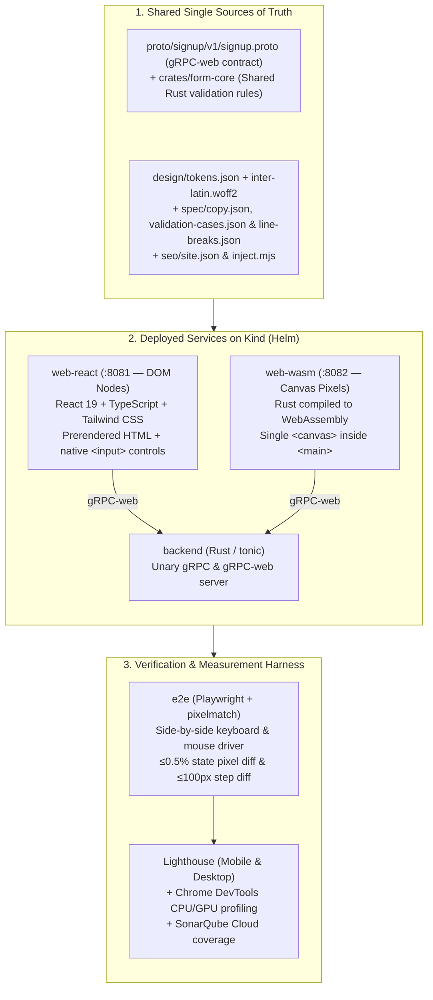
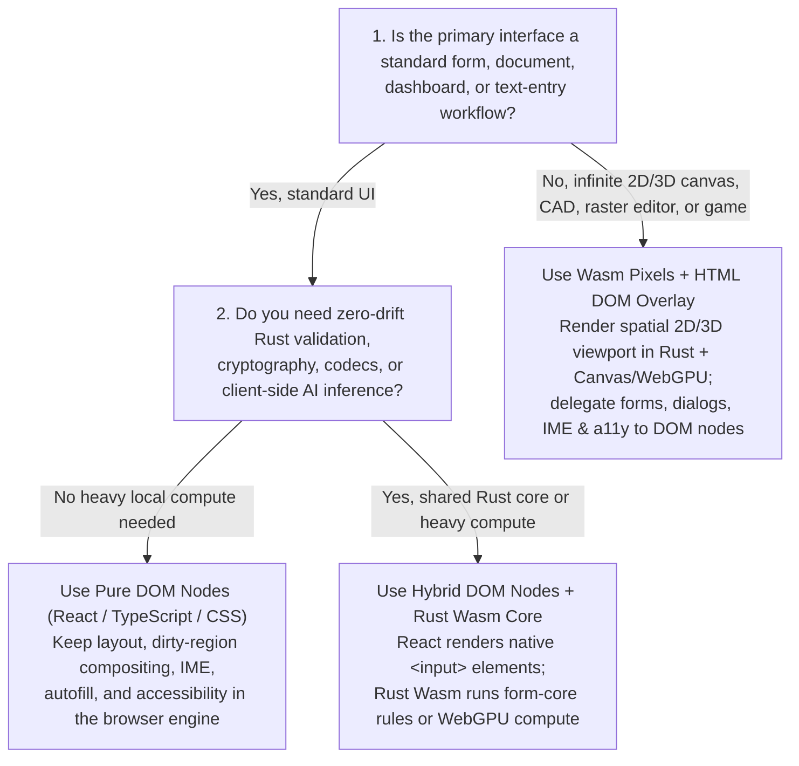

In the previous installment of this series, [How AI Is Rewriting Architecture Decision Records: The Case for WebAssembly Adoption](), we examined why generative AI workloads—untrusted agentic code execution, bursty serverless inference requiring sub-millisecond cold starts, and `WASI-NN` / `WebGPU` hardware bridges—have flipped the enterprise ADR in favor of WebAssembly. Coupled with the earlier articles on [enterprise Rust adoption]() and [monorepos with microservices](), a clear pattern emerged: AI coding agents dramatically compress the engineering cost of writing systems-level Rust and compiling it to WebAssembly.

That velocity raises a tempting follow-up question for software architects: **if AI coding assistants can write thousands of lines of Rust and WebAssembly without slowing down feature delivery, why stop at backend sandboxes and compute pipelines? Should we also replace traditional HTML DOM frontends (React, TypeScript, and CSS) with Rust compiled to WebAssembly rendering directly to a `<canvas>`?**

To answer that question with empirical data rather than whiteboard speculation, I built **[`marcelomiyake/nodes-vs-pixels`](https://github.com/marcelomiyake/nodes-vs-pixels)**: a controlled Proof of Concept (PoC) that implements the exact same sign-up interface twice inside a single monorepo:

* **`web-react` (Nodes)**: React 19, TypeScript, and Tailwind CSS rendering standard HTML DOM nodes (`<form>`, `<input>`, `<label>`, `<button>`), prerendered at build time with inlined CSS.
* **`web-wasm` (Pixels)**: Rust compiled to `wasm32-unknown-unknown` via `wasm-pack`, painting every pixel of the page onto a **single `<canvas>` inside `<main>`**—with zero `<input>`, `<label>`, or `<button>` elements in the DOM.

Both frontends talk to the same **Rust `tonic` backend** over **gRPC-web** (`application/grpc-web+proto`), share the same design tokens, font, copy, and validation conformance vectors, and are verified against each other by a Playwright visual parity suite that fails if more than **0.5%** of their pixels differ.

In this post, we walk through how the experiment was built, what it actually takes to replace the browser's DOM in Rust, how many tokens and review rounds the AI agents spent on each frontend, the measured CPU and GPU memory profiles in Chrome, the pros and cons of each architecture, and how these findings refine a modern WebAssembly ADR.

---

## Designing a controlled experiment: [`nodes-vs-pixels`](https://github.com/marcelomiyake/nodes-vs-pixels)

When architectural comparisons between React and Rust/WebAssembly go wrong, it is usually because the two implementations do not actually do the same work: one app uses different fonts or spacing, skips edge-case validation, omits keyboard navigation, or mocks the network layer.

To eliminate drift between the two frontends and the backend, [`nodes-vs-pixels`](https://github.com/marcelomiyake/nodes-vs-pixels) is structured as a single workspace where every contract, visual token, string, and validation vector comes from a shared source of truth:



### Repository layout and shared contracts

| Path | Role in the Experiment |
| :--- | :--- |
| [`proto/`](https://github.com/marcelomiyake/nodes-vs-pixels/tree/main/proto) | Defines `signup.v1.SignupService/SignUp` (`SignUpRequest`, `SignUpResponse`, `FieldViolation`, `Field`, and `ViolationCode`). |
| [`design/`](https://github.com/marcelomiyake/nodes-vs-pixels/tree/main/design) | [`tokens.json`](https://github.com/marcelomiyake/nodes-vs-pixels/blob/main/design/tokens.json) and the subset [`inter-latin.woff2`](https://github.com/marcelomiyake/nodes-vs-pixels/tree/main/design/fonts) font shared by both frontends. `web-react` generates CSS custom properties from `tokens.json`; `web-wasm` generates Rust constants from it in [`build.rs`](https://github.com/marcelomiyake/nodes-vs-pixels/blob/main/web-wasm/build.rs). |
| [`spec/`](https://github.com/marcelomiyake/nodes-vs-pixels/tree/main/spec) | [`copy.json`](https://github.com/marcelomiyake/nodes-vs-pixels/blob/main/spec/copy.json) (all labels, placeholders, hints, and error messages), [`validation-cases.json`](https://github.com/marcelomiyake/nodes-vs-pixels/blob/main/spec/validation-cases.json) (conformance test vectors executed by both Rust and TypeScript test suites), and [`line-breaks.json`](https://github.com/marcelomiyake/nodes-vs-pixels/blob/main/spec/line-breaks.json) (line-break opportunities recorded from Chrome at `min-content` width). |
| [`seo/`](https://github.com/marcelomiyake/nodes-vs-pixels/tree/main/seo) | Single source of SEO metadata ([`site.json`](https://github.com/marcelomiyake/nodes-vs-pixels/blob/main/seo/site.json)) injected into both `web-react/dist/client` and `web-wasm/dist` at build time by [`inject.mjs`](https://github.com/marcelomiyake/nodes-vs-pixels/blob/main/seo/inject.mjs). |
| [`crates/form-core/`](https://github.com/marcelomiyake/nodes-vs-pixels/tree/main/crates/form-core) | Pure Rust validation crate (225 lines in [`src/lib.rs`](https://github.com/marcelomiyake/nodes-vs-pixels/blob/main/crates/form-core/src/lib.rs)) linked directly into both the `backend` and `web-wasm`. |
| [`backend/`](https://github.com/marcelomiyake/nodes-vs-pixels/tree/main/backend) | Rust `tonic` + `tonic-web` server serving both native gRPC and HTTP/1.1 gRPC-web on a single port, validating submissions with `form-core` and issuing UUIDv4 account IDs. |
| [`web-react/`](https://github.com/marcelomiyake/nodes-vs-pixels/tree/main/web-react) | React 19, TypeScript, Vite, and Tailwind CSS v4 frontend using `@connectrpc/connect-web` for gRPC-web calls, build-time SSR prerendering ([`scripts/prerender.mjs`](https://github.com/marcelomiyake/nodes-vs-pixels/blob/main/web-react/scripts/prerender.mjs)), and inlined CSS. |
| [`web-wasm/`](https://github.com/marcelomiyake/nodes-vs-pixels/tree/main/web-wasm) | Rust crate compiled to WebAssembly (`wasm32-unknown-unknown`) that lays out, paints, and handles all interaction on a single `<canvas>` element. |
| [`e2e/`](https://github.com/marcelomiyake/nodes-vs-pixels/tree/main/e2e) | Playwright end-to-end test suite driving both frontends simultaneously and verifying pixel-level visual parity via `pixelmatch`. |
| [`deploy/`](https://github.com/marcelomiyake/nodes-vs-pixels/tree/main/deploy) | Local Kubernetes cluster configuration (`Kind`), Nginx reverse-proxy templates (serving static assets and proxying `/signup.v1.SignupService/` to the backend), and Helm chart. |

### How the PoC was built and verified

Following the harness and loop engineering practices from earlier posts, the repository was built with a two-model authoring and review loop:

1. **Authoring ([Claude Code](https://claude.com/claude-code) with Claude Opus 5.5)**: Every change was authored on a short-lived branch as a [Conventional Commit](https://www.conventionalcommits.org/) of at most 1,000 changed lines (lockfiles aside), with `cargo clippy` (both native and `--target wasm32-unknown-unknown` with `-D warnings`), `cargo test`, ESLint, TypeScript type-checking, and Vitest suites passing.
2. **Adversarial commit review ([Codex](https://developers.openai.com/codex) with `gpt-6.1-sol` at `medium` reasoning effort)**: Before any branch fast-forwarded to `main`, Codex reviewed each commit locally:
   ```sh
   codex review --commit <sha> -c model='"gpt-6.1-sol"' -c model_reasoning_effort='"medium"'
   ```
   Claude Code resolved every valid finding in the commit it concerned (or documented why Chrome's actual browser behavior proved a finding wrong) and re-ran the review until zero findings remained.
3. **Static analysis and cluster gates**: Both Rust crates and the TypeScript projects were analyzed for test coverage and code smells on **SonarQube Cloud** (`make sonar`), deployed to a local **Kind** Kubernetes cluster via Helm (`make deploy`), verified with Playwright (`make e2e`), and audited with **Lighthouse** on mobile and desktop (`make lighthouse`).

---

## Visual parity: Nodes vs. Pixels side by side

Can a Rust WebAssembly module painting onto an HTML `<canvas>` visually match a Tailwind CSS + React DOM page down to individual pixels?

Yes. In [`e2e/tests/parity.spec.ts`](https://github.com/marcelomiyake/nodes-vs-pixels/blob/main/e2e/tests/parity.spec.ts), Playwright opens both `http://localhost:8081/` (`web-react`) and `http://localhost:8082/` (`web-wasm`) at desktop (`1280×800`) and phone (`390×844`) viewports across three states—**Empty**, **Errors**, and **Success**—and compares full-page PNG screenshots using `pixelmatch` (`threshold: 0.1`). The test fails if more than **0.5%** (`MAX_DIFF = 0.005`) of pixels differ. Across interactive steps in [`e2e/tests/form.spec.ts`](https://github.com/marcelomiyake/nodes-vs-pixels/blob/main/e2e/tests/form.spec.ts), at most **100 pixels** (`SAME = 100`) may differ (and in the benchmark check run, at most **69 pixels** differed across steps 4 to 6).

Here are the actual screenshots captured from the Kind cluster by `make screenshots`:

| State &amp; Viewport | `web-react` (DOM Nodes) | `web-wasm` (Canvas Pixels) |
| :--- | :---: | :---: |
| **Empty (Desktop, 1280×800)** | {: width="320" height="214" } | {: width="320" height="214" } |
| **Empty (Phone, 390×844)** | {: width="195" height="422" } | {: width="195" height="422" } |
| **Validation Errors (Desktop)** | {: width="320" height="235" } | {: width="320" height="235" } |
| **Validation Errors (Phone)** | {: width="195" height="440" } | {: width="195" height="440" } |
| **Account Created (Desktop)** | {: width="320" height="200" } | {: width="320" height="200" } |
| **Account Created (Phone)** | {: width="195" height="422" } | {: width="195" height="422" } |

### Testing a page that has no DOM controls

A revealing detail in the E2E suite is [`e2e/tests/form.spec.ts`](https://github.com/marcelomiyake/nodes-vs-pixels/blob/main/e2e/tests/form.spec.ts#L108-L119), which asserts the entire DOM structure of the WebAssembly app:

```typescript
test('the canvas app is one canvas that takes all input', async ({ page }) => {
  await open(page, APPS[1].url);
  expect(await page.evaluate(() => [...document.body.querySelectorAll('*')].map((element) => element.tagName))).toEqual([
    'MAIN',
    'CANVAS',
    'SCRIPT',
  ]);
  const canvas = page.getByRole('main').locator('canvas');
  await expect(canvas).toHaveAttribute('tabindex', '0');
  await expect(canvas).toHaveAccessibleName('Create your account');
  await expect(page.locator('input, button, label, select, textarea')).toHaveCount(0);
});
```

Because `web-wasm` has zero `<input>`, `<button>`, or `<label>` elements, Playwright cannot locate controls by ID or role inside the canvas. Instead, the `Pair` harness in [`e2e/tests/apps.ts`](https://github.com/marcelomiyake/nodes-vs-pixels/blob/main/e2e/tests/apps.ts) queries the bounding box of a selector on the **React** page (`this.react.locator(selector).boundingBox()`) and clicks the exact same `(x, y)` coordinates and presses the exact same key sequences on **both** pages. Because both apps compute identical layouts, every click, double-click word selection, `Tab` traversal, `Control+Backspace` word deletion, and scroll adjustment lands on the exact same pixel in both tabs.

---

## What it takes to replace the DOM: 680 lines of React vs. 7,528 lines of Rust

When you write `<input type="password" id="password" />` in React, you are writing one line of JSX that delegates decades of systems engineering to Blink/Chrome: box layout, font shaping, bidirectional text, grapheme segmentation, word movement, undo/redo history coalescing, clipboard security, focus rings, caret blinking, and scroll anchoring.

When you replace the DOM with a single `<canvas>`, **your application becomes the browser engine**.

Early in the experiment (commit [`76337f2`](https://github.com/marcelomiyake/nodes-vs-pixels/commit/76337f2)), `web-wasm` painted the card on a canvas while positioning transparent native HTML `<input>` and `<button>` elements over the canvas (`overlay.rs`) to let Chrome handle text editing and focus. To test a true pixels-only architecture, commits [`45e5963`](https://github.com/marcelomiyake/nodes-vs-pixels/commit/45e5963) and [`0018b68`](https://github.com/marcelomiyake/nodes-vs-pixels/commit/0018b68) removed the native overlay completely and moved all input, editing, focus, clipboard, and scrolling into Rust.

Comparing the source footprint of the two frontends shows the immediate architectural tax of leaving the DOM behind:

| Subsystem / Responsibility | `web-react` (TypeScript / TSX / MJS) | `web-wasm` (Rust) |
| :--- | :--- | :--- |
| **Build-Time Codegen / SSR / Theme** | [`prerender.mjs`](https://github.com/marcelomiyake/nodes-vs-pixels/blob/main/web-react/scripts/prerender.mjs) (30) + [`theme.mjs`](https://github.com/marcelomiyake/nodes-vs-pixels/blob/main/web-react/scripts/theme.mjs) (56) = **86 lines** | [`build.rs`](https://github.com/marcelomiyake/nodes-vs-pixels/blob/main/web-wasm/build.rs) (176) + [`lib.rs`](https://github.com/marcelomiyake/nodes-vs-pixels/blob/main/web-wasm/src/lib.rs) (33 prod / 47 test) + [`style.rs`](https://github.com/marcelomiyake/nodes-vs-pixels/blob/main/web-wasm/src/style.rs) (41) = **250 prod lines** (297 total) |
| **Form Validation Rules** | [`validation.ts`](https://github.com/marcelomiyake/nodes-vs-pixels/blob/main/web-react/src/validation.ts) = **119 lines** | Shared from [`crates/form-core/src/lib.rs`](https://github.com/marcelomiyake/nodes-vs-pixels/blob/main/crates/form-core/src/lib.rs) (185 prod / 40 test) |
| **Form State Machine &amp; Copy** | [`useSignUpForm.ts`](https://github.com/marcelomiyake/nodes-vs-pixels/blob/main/web-react/src/useSignUpForm.ts) (77) + [`copy.ts`](https://github.com/marcelomiyake/nodes-vs-pixels/blob/main/web-react/src/copy.ts) (18) = **95 lines** | [`form.rs`](https://github.com/marcelomiyake/nodes-vs-pixels/blob/main/web-wasm/src/form.rs) = **203 prod lines** (353 total with tests) |
| **gRPC-Web Client Transport** | [`api.ts`](https://github.com/marcelomiyake/nodes-vs-pixels/blob/main/web-react/src/api.ts) (`@connectrpc/connect-web`) = **52 lines** | [`grpc_web.rs`](https://github.com/marcelomiyake/nodes-vs-pixels/blob/main/web-wasm/src/grpc_web.rs) (custom 5-byte frame &amp; trailer codec) = **157 prod lines** (319 total) |
| **UI Components / Layout &amp; Painting** | [`SignUpForm.tsx`](https://github.com/marcelomiyake/nodes-vs-pixels/blob/main/web-react/src/SignUpForm.tsx) (95), [`TermsCheckbox.tsx`](https://github.com/marcelomiyake/nodes-vs-pixels/blob/main/web-react/src/components/TermsCheckbox.tsx) (70), [`TextField.tsx`](https://github.com/marcelomiyake/nodes-vs-pixels/blob/main/web-react/src/components/TextField.tsx) (66), [`SuccessPanel.tsx`](https://github.com/marcelomiyake/nodes-vs-pixels/blob/main/web-react/src/components/SuccessPanel.tsx) (32), [`BrandMark.tsx`](https://github.com/marcelomiyake/nodes-vs-pixels/blob/main/web-react/src/components/BrandMark.tsx) (12), [`App.tsx`](https://github.com/marcelomiyake/nodes-vs-pixels/blob/main/web-react/src/App.tsx) (19), [`main.tsx`](https://github.com/marcelomiyake/nodes-vs-pixels/blob/main/web-react/src/main.tsx) (21), [`entry-server.tsx`](https://github.com/marcelomiyake/nodes-vs-pixels/blob/main/web-react/src/entry-server.tsx) (13) = **328 lines** | [`layout.rs`](https://github.com/marcelomiyake/nodes-vs-pixels/blob/main/web-wasm/src/layout.rs) (452 prod / 250 test) + [`scene.rs`](https://github.com/marcelomiyake/nodes-vs-pixels/blob/main/web-wasm/src/scene.rs) (321 prod / 465 test) = **773 prod lines** (1,488 total) |
| **Text Shaping, Bidi &amp; Line Breaking** | *Delegated to browser DOM / CSS engine* (**0 lines**) | [`text.rs`](https://github.com/marcelomiyake/nodes-vs-pixels/blob/main/web-wasm/src/text.rs) = **672 prod lines** (949 total) |
| **Single-Line Editor, Selection &amp; Masking** | *Delegated to native `<input>`* (**0 lines**) | [`editing.rs`](https://github.com/marcelomiyake/nodes-vs-pixels/blob/main/web-wasm/src/editing.rs) = **625 prod lines** (905 total) |
| **Unicode Emoji Backspace State Machine** | *Delegated to native `<input>`* (**0 lines**) | [`backspace.rs`](https://github.com/marcelomiyake/nodes-vs-pixels/blob/main/web-wasm/src/backspace.rs) = **152 prod lines** (202 total) |
| **Page-Wide Undo / Redo Coalescing** | *Delegated to browser page history* (**0 lines**) | [`history.rs`](https://github.com/marcelomiyake/nodes-vs-pixels/blob/main/web-wasm/src/history.rs) = **95 prod lines** (184 total) |
| **Keyboard, Mouse, Focus &amp; Scroll Engine** | *Delegated to browser event loop* (**0 lines**) | [`input.rs`](https://github.com/marcelomiyake/nodes-vs-pixels/blob/main/web-wasm/src/input.rs) (1,173 prod / 895 test) + [`web.rs`](https://github.com/marcelomiyake/nodes-vs-pixels/blob/main/web-wasm/src/web.rs) (763 prod) = **1,936 prod lines** (2,831 total) |
| **Frontend Total (Production / All Lines)** | **680 production lines** (+ 378 test lines = **1,058 total**) | **4,863 production lines** (+ 2,665 inline test lines = **7,528 total**) |

Even for a single card with four text inputs, one checkbox, and one submit button, **the Rust `<canvas>` frontend requires ~7.1x more production code (4,863 vs. 680 lines)** than the React DOM frontend. Looking inside the `web-wasm` modules shows why:

### 1. Subpixel text rendering and whole-pixel snapping (`web.rs`, `layout.rs`, `scene.rs`)
By default, an HTML `<canvas>` has a transparent backdrop (`alpha: true`), which forces Chrome to use grayscale antialiasing instead of the subpixel LCD antialiasing used on opaque DOM elements. In [`web-wasm/src/web.rs`](https://github.com/marcelomiyake/nodes-vs-pixels/blob/main/web-wasm/src/web.rs#L58-L64), the canvas context must be initialized with `{ alpha: false }` so font stems match the DOM's subpixel rendering. Furthermore, CSS snaps borders and the 1px text caret to device pixel boundaries; `web-wasm` had to replicate Chrome's whole-pixel coordinate snapping (commit [`c60f8fc`](https://github.com/marcelomiyake/nodes-vs-pixels/commit/c60f8fc)) and half-leading rounding (`((line_height - ascent - descent) / 2.0).floor()`) so baselines never drift by a single pixel.

### 2. Bidirectional text and contextual glyph shaping (`text.rs`)
The HTML Canvas 2D API only exposes `measureText(text).width` for a whole string—it does not tell you where each character or caret stop sits inside a shaped word. In [`web-wasm/src/text.rs`](https://github.com/marcelomiyake/nodes-vs-pixels/blob/main/web-wasm/src/text.rs#L59-L165):
* `char_bounds` runs the **Unicode Bidirectional Algorithm** (`unicode_bidi::BidiInfo`) to reorder mixed left-to-right (Latin) and right-to-left (Arabic, Hebrew) visual runs while returning character bounds in logical order.
* Because ligatures, kerning pairs, Arabic cursive joining, and Indic vowel signs change a grapheme cluster's width depending on its neighbors, `run_bounds` measures each cluster in the context of `CONTEXT = 2` adjacent grapheme clusters on either side (and measures standalone combining marks against a dotted circle `◌`, `\u{25CC}`, just as HarfBuzz/Chrome does).

### 3. Chrome's Backspace state machine for emoji and combining marks (`backspace.rs`)
In Chrome, pressing `Backspace` vs. `Delete` is asymmetric:
* If you type `e` followed by a combining acute accent (`\u{0301}`), `Backspace` deletes **only the accent** (leaving `e`), whereas `Delete` from before the character deletes the whole grapheme cluster.
* However, if the caret is after a multi-codepoint emoji—such as a skin-tone modifier (`👍🏽`), a keycap (`1️⃣`), a regional indicator flag pair (`🇺🇸`), a subdivision tag sequence (`🏴󠁧󠁢󠁥󠁮󠁧󠁿`), or a Zero-Width Joiner (ZWJ) family sequence (`👨‍👩‍👧`, 5 code points)—`Backspace` deletes **the entire emoji sequence at once**.

To match Chrome's behavior, [`web-wasm/src/backspace.rs`](https://github.com/marcelomiyake/nodes-vs-pixels/blob/main/web-wasm/src/backspace.rs) implements an 11-state finite automaton over Unicode properties from `icu_properties` (`VariationSelector`, `RegionalIndicator`, `EmojiModifierBase`, `ExtendedPictographic`, `CanonicalCombiningClass`).

### 4. Password word-boundary masking, undo coalescing, and scroll anchoring (`editing.rs`, `history.rs`, `input.rs`)
* **Password security in word navigation**: In [`editing.rs`](https://github.com/marcelomiyake/nodes-vs-pixels/blob/main/web-wasm/src/editing.rs#L109-L114), a password field masks each grapheme cluster with a bullet (`•`, `\u{2022}`) and treats the entire value as **one single word** when pressing `Ctrl+ArrowLeft` / `Alt+ArrowLeft`—otherwise word-jump shortcuts would reveal where spaces or punctuation sit inside a masked password. Equally, `Event::Copy` and `Event::Cut` are blocked on password fields.
* **Page-wide undo/redo**: Chrome maintains one shared undo stack for the whole page rather than one per `<input>`. In [`history.rs`](https://github.com/marcelomiyake/nodes-vs-pixels/blob/main/web-wasm/src/history.rs), consecutive typing merges into an open undo step, `Backspace` merges only after another `Backspace`, `Delete` merges into any open step, and `Paste`/`Cut` record isolated steps.
* **Scroll anchoring (`Anchor`)**: On a short phone viewport (`390×300`), tabbing out of an invalid field above the viewport inserts an error message that pushes the rest of the card down. Chrome's CSS Scroll Anchoring adjusts `scrollY` so the currently visible control stays fixed on screen; [`web-wasm/src/web.rs`](https://github.com/marcelomiyake/nodes-vs-pixels/blob/main/web-wasm/src/web.rs#L115-L125) and [`layout.rs`](https://github.com/marcelomiyake/nodes-vs-pixels/blob/main/web-wasm/src/layout.rs) had to implement an explicit `Anchor` solver to match `Math.round(scrollY)` pixel for pixel.

---

## What the AI agents spent: tokens, time, and review rounds

Lines of code are only a proxy for effort. The two agents' session logs measure it directly.

Claude Code wrote the whole repository in a single session: Claude Opus 5.5 at `xhigh` effort, 11 hours of wall-clock time (7.3 of them active), 1,148 API calls, and nine automatic context compactions. Claude Code estimated the session's cost at **$110.52**. Assigning each API call to the area its tool calls touched—paths such as `web-react/` or `web-wasm/`, commands such as `pnpm --filter web-react` or `wasm-pack`—splits that session as follows:

| Area | API Calls | Output Tokens | All Tokens | Active Time | Share of the $110.52 |
| :--- | :---: | :---: | :---: | :---: | :---: |
| **`web-react`** | 94 | 0.14 M | 22 M | 0.6 h | ~$10 |
| **`web-wasm`** | 663 | 0.98 M | 150 M | 3.7 h | ~$65 |
| **Both frontends** (e2e and parity tests, builds of both) | 266 | 0.44 M | 59 M | 2.3 h | ~$26 |
| **Shared** (contract, tokens, `form-core`, backend, SEO, deploy) | 125 | 0.12 M | 22 M | 0.7 h | ~$10 |
| **Total** | **1,148** | **1.67 M** | **254 M** | **7.3 h** | **$110.52** |

Output tokens include the model's thinking. *All tokens* adds the input each call reads: every call re-reads the whole context (about 220,000 tokens on average, mostly from the prompt cache), so effort grows with the number of calls. *Active time* counts the time from each call to the next, including the builds and tests it ran, up to 5 minutes.

Codex reviewed the commits in 104 `codex review` runs (GPT-6.1 Sol at `medium` effort). Each run's log names the commit it reviewed, and a commit was reviewed again after every fix, so the reviews are review rounds:

| Area | Reviews | Commits | Input Tokens | Output Tokens | Review Time |
| :--- | :---: | :---: | :---: | :---: | :---: |
| **`web-react`** | 13 | 6 | 2.3 M | 11 k | 0.2 h |
| **`web-wasm`** | 73 | 23 | 26.2 M | 157 k | 1.9 h |
| **Shared, tests, and docs** | 18 | 15 | 2.1 M | 12 k | 0.2 h |
| **Total** | **104** | **44** | **30.6 M** | **180 k** | **2.3 h** |

Four findings stand out:

1. **The canvas frontend cost about 7x the React frontend to write**: 7x the API calls and output tokens, 6.8x the tokens, and 6x the active time—close to its 7.1x production-code ratio. Splitting the "both frontends" work evenly gives 3.5x; counting all of it against the canvas, whose parity those tests check, gives 9.5x.
2. **Most of that cost arrived after the native inputs were removed**: Until I pointed out that the first canvas version (commit [`76337f2`](https://github.com/marcelomiyake/nodes-vs-pixels/commit/76337f2)) still relied on HTML `<input>` elements laid over the canvas, `web-wasm` had used 50 M tokens against React's 18 M (2.8x). Rebuilding everything those inputs did—carets, selection, undo, scrolling, and the clipboard—took another 101 M tokens, plus 32 M on work across both frontends, mostly the parity tests.
3. **Reviews diverged even further: 11x the tokens and 12x the time**: Canvas commits needed more rounds (3.2 on average vs. 2.2, and 9 for `feat(web-wasm): break canvas text where Chrome does`), and each review read twice as much (358,000 tokens vs. 178,000).
4. **Review was cheap next to authoring**: Codex used an eighth of Claude Code's tokens (31 M vs. 254 M) and ran on a ChatGPT Plus subscription with no per-token cost; the account's use of its weekly Codex limit rose from 1% to 26% during the session. With both agents counted, `web-wasm` took 177 M tokens and `web-react` 24 M—7.3x.

The logs also expose one gap in the review loop: every commit made in the session has at least one Codex review except [`0018b68`](https://github.com/marcelomiyake/nodes-vs-pixels/commit/0018b68) (`refactor(web-wasm): remove the overlay of native controls`), which no review log names.

*(Method: each API call is attributed from its tool calls, and a call without tool calls inherits the previous call's area. Claude Code's context compactions, about 2% of its tokens, and later documentation-only sessions are excluded.)*

---

## Empirical results: Lighthouse, CPU, and the GPU memory tax

Once both frontends achieved visual and behavioral parity on the Kind cluster, how did they perform?

### 1. Bundle sizes, Lighthouse scores, and the accessibility score paradox

Both frontends are served from Nginx containers with identical font and SEO assets:
* **`web-react` build output**: `19 KiB` prerendered `index.html` (with `14 KiB` of Tailwind CSS inlined), `340 KiB` minified JS bundle (`index-pOAmR297.js`), and the shared `inter-latin.woff2` font—**`155 KiB` total compressed transfer size** reported by Lighthouse.
* **`web-wasm` build output**: `2.2 KiB` `index.html`, `36 KiB` `wasm-bindgen` JS glue (`web_wasm.js`), `288 KiB` optimized WebAssembly binary (`web_wasm_bg.wasm`), and the shared font—**`178 KiB` total compressed transfer size** reported by Lighthouse.

Running `make lighthouse` against both deployed services produced these results (from the `lighthouse/*.json` reports it writes locally; the directory is git-ignored, so the reports are not in the repository):

| Lighthouse Metric | `web-react` Desktop | `web-wasm` Desktop | `web-react` Mobile | `web-wasm` Mobile |
| :--- | :---: | :---: | :---: | :---: |
| **Performance Score** | **100** | **100** | **100** | **99** |
| **Accessibility Score** | **100** | **100** | **100** | **100** |
| **Best Practices Score** | **100** | **100** | **100** | **100** |
| **SEO Score** | **100** | **100** | **100** | **100** |
| **First Contentful Paint (FCP)** | 0.3 s | **0.2 s** | 1.2 s | **0.8 s** |
| **Largest Contentful Paint (LCP)** | **0.4 s** | **0.4 s** | **1.7 s** | 2.0 s |
| **Total Blocking Time (TBT)** | **0 ms** | **0 ms** | **10 ms** | 110 ms |
| **Cumulative Layout Shift (CLS)** | **0** | **0** | **0** | **0** |
| **Main-Thread Work** | **0.1 s** | **0.1 s** | **0.3 s** | 0.4 s |
| **Total Byte Weight** | **155 KiB** | 178 KiB | **155 KiB** | 178 KiB |

Look closely at the **Accessibility Score: 100** on `web-wasm`. How did a page with **zero `<input>`, `<label>`, or `<button>` elements** score 100/100 on Lighthouse Accessibility?

Because `web-wasm` renders `<main><canvas id="app" tabindex="0" aria-label="Create your account"></canvas></main>`. Automated axe/Lighthouse rules check whether every element present in the DOM has a valid role, landmark, contrast, and accessible name. Since the `<canvas>` sits inside `<main>` and has an `aria-label`, the automated linter reports zero violations—even though a real screen-reader user hears only *"Create your account"* and cannot perceive a single text field, error message, or button inside the canvas. **Automated accessibility scores validate DOM nodes; they are blind to UIs trapped inside pixels.**

### 2. Runtime CPU benchmarks across 6 user-journey steps

Lighthouse only measures initial page load. To measure runtime CPU and memory during real interaction, both apps were driven through the exact same six steps in headless Chrome 156 against the Kind deployment on Linux (Intel Core i7-8750H, NVIDIA GeForce GTX 1060, `1280×800` viewport, 5-run median per app, fresh browser instance per run):

1. **Load**: Load the page and wait 3 seconds after first paint.
2. **Idle**: Sit untouched for 10 seconds.
3. **Idle, field focused**: Press `Tab` to focus the first field (`fullName`) and wait 10 seconds.
4. **Empty submit**: Press `Enter` to trigger required-field errors on all 5 fields and wait 1 second.
5. **Typing**: Type all four fields (63 characters at 50 ms per keystroke) with `Tab` between them, then `Tab` and `Space` to check the terms box.
6. **Sign-up**: Press `Enter` to submit over gRPC-web to the Rust backend and wait 1 second.

Here is the median CPU time in milliseconds (`web-react` / `web-wasm`) with GPU rasterization at `1×` device pixel ratio:

| Step | Main Thread (`React / Wasm`) | Script (`React / Wasm`) | Layout &amp; Style (`React / Wasm`) | Page Renderer Process (`React / Wasm`) | GPU Process (`React / Wasm`) |
| :--- | :---: | :---: | :---: | :---: | :---: |
| **1. Load (3 s)** | 73 / **64 ms** | 37 / **24 ms** | 3.6 / **0.5 ms** | 120 / **100 ms** | 70 / **60 ms** |
| **2. Idle, unfocused (10 s)** | **0.3** / 1.9 ms | **0** / 0.3 ms | 0 / 0 ms | 0 / 0 ms | 20 / 20 ms |
| **3. Idle, field focused (10 s)** | **5.7** / 24 ms | **0** / 16 ms | 0 / 0 ms | **10** / 40 ms | **50** / 100 ms |
| **4. Empty submit (1 s)** | **6.2** / 8.3 ms | **3.1** / 5.6 ms | 0.6 / **0.1 ms** | **10** / 20 ms | 10 / 10 ms |
| **5. Typing 63 chars** | **130** / 178 ms | **27** / 117 ms | 11.6 / **0.4 ms** | **220** / 290 ms | **180** / 410 ms |
| **6. Sign-up (gRPC-web)** | 12 / **10 ms** | **5.1** / 5.5 ms | 1.8 / **0 ms** | 10 / 10 ms | **10** / 20 ms |

Five structural findings stood out across every run:

1. **Initial load costs slightly less main-thread time in Wasm (`64 ms` vs. `73 ms`)**: Because the canvas page has only 65 total DOM nodes (`<head>` metadata + `<main><canvas><script>`) and no CSS layout tree to compute, `web-wasm` spends `24 ms` in script and `0.5 ms` in layout/style, versus `37 ms` in script (React bundle execution and hydration) and `3.6 ms` in layout/style for `web-react`.
2. **Typing costs the canvas app 4.3x more script time and 2.3x more GPU time**: In `web-react`, typing a character updates React state and lets Chrome's Blink engine dirty only the text run inside that `<input>` box (`27 ms` script, `11.6 ms` layout/style, `180 ms` GPU across 63 keys). In `web-wasm`, every single keystroke re-runs layout and repaints the **entire `1280×856` `<canvas>`** from Rust via Canvas 2D FFI calls (`__wbg_set_font_…`, `__wbg_set_fillStyle_…`, `fillText`), consuming **`117 ms` of script time** and **`410 ms` of GPU process time**.
3. **Focusing an input burns idle CPU and GPU in the canvas app**: When an `<input>` is focused in `web-react`, Chrome blinks the native caret itself with **0 ms of JavaScript** (`5.7 ms` main thread, `50 ms` GPU over 10 seconds). In `web-wasm`, a `500 ms` timer (`BLINK_MS` in `web-wasm/src/web.rs`) wakes up twice a second and repaints the whole canvas just to toggle the 1px caret—spending **`16 ms` of script**, **`24 ms` on the main thread (4.2x React)**, and **`100 ms` in the GPU process (2x React)** while the user isn't touching a key.
4. **High-DPI (`2×` Retina) displays scale GPU cost for pixels, not nodes**: When running at a `2×` device pixel ratio, `web-wasm` must rasterize **4x as many pixels**. Its GPU process time jumps from `100 ms` to **`160 ms`** during focused idle (Step 3) and from `410 ms` to **`640 ms`** during typing (Step 5), whereas `web-react` stays nearly flat at **`60 ms`** and **`190 ms`**.
5. **Without a GPU, software rasterization punishes the canvas app severely**: On machines or headless environments using software rasterization, Chrome paints the `<canvas>` on the page's main thread. Under software rasterization, typing 63 characters in `web-wasm` takes **`700 ms` of main-thread time** against `web-react`'s **`130 ms` (5.4x slower)**, and **`810 ms`** of renderer process CPU against **`230 ms`**. Even sitting idle with a focused field takes **`96 ms`** every 10 seconds against React's **`5.6 ms` (17x more main-thread work)**.

### 3. Memory and the hidden GPU pixel buffer tax

At first glance, Chrome's standard tab memory metrics make the two apps look nearly identical in RAM:

| Memory &amp; DOM Metric (GPU Raster, `1×`) | After Loading (`React / Wasm`) | After Signing Up (`React / Wasm`) |
| :--- | :---: | :---: |
| **Page Renderer Private Memory (`/proc/<pid>/smaps_rollup`)** | **17.5** / 17.7 MiB | **19.8** / 21.1 MiB |
| **JavaScript Heap Used (post-GC)** | 2.67 / **1.52 MiB** | 3.27 / **1.64 MiB** |
| **WebAssembly Linear Memory (`ArrayBuffer`)** | — / **1.19 MiB** | — / **1.19 MiB** |
| **Combined JS + Wasm Heap** | **2.67** / 2.71 MiB | 3.27 / **2.83 MiB** |
| **DOM Nodes** | 114 / **65** | 66 / **65** |
| **JS Event Listeners** | 162 / **26** | 157 / **26** |

On the CPU heap side, `web-wasm` is remarkably compact: its JS glue heap (`1.52 MiB`) plus its Rust linear memory (`1.19 MiB`, which never grew during the entire test) total `2.71 MiB`—matching `web-react`'s `2.67 MiB` JS heap after load and beating `web-react` (`2.83 MiB` vs. `3.27 MiB`) after sign-up, with one-sixth the event listeners (`26` vs. `162`).

**However, standard tab memory footprints hide where the canvas's pixels actually live.** The `<canvas>` backing store covers the entire page at the screen's physical resolution:

**Canvas Buffer = page width × page height × DPR<sup>2</sup> × 4 bytes**
{: .text-center }

For a `1280×856` page, a single uncompressed RGBA buffer is **`4.18 MiB` at `1×`** and **`16.72 MiB` at `2×`**. Inspecting Chrome's `memory-infra` dump after typing a name reveals the real cost inside the GPU process:

| GPU / Pixel Allocation (`memory-infra` dump) | At `1×` DPR (`React / Wasm`) | At `2×` DPR (`React / Wasm`) |
| :--- | :---: | :---: |
| **Skia GPU Resources (in GPU process)** | **8.5** / 52 MiB *(6.1x)* | **8.5** / 147 MiB *(17.3x)* |
| **Shared Images (in GPU process)** | **10–12** / 15–20 MiB | **10** / 53 MiB *(5.1x)* |
| **Canvas Buffer (in page renderer)** | — / 12.5–16.7 MiB | — / 50 MiB |

*(Note: `memory-infra` categories can overlap, so rows do not sum linearly.)*

* At `1×`, Skia's GPU resources in the GPU process are **6.1x larger** for the canvas app (`52 MiB` vs. `8.5 MiB`).
* At `2×` (standard on modern laptops and phones), Skia's GPU resources jump to **`147 MiB` for `web-wasm` vs. `8.5 MiB` for `web-react`—a 17.3x multiplier**—while Chrome holds **`50 MiB`** in the renderer for a canvas whose raw pixels are `16.7 MiB`.
* Without GPU acceleration (software rasterization), that pixel buffer moves into the tab's own RAM, raising `web-wasm`'s private renderer memory after load to `22.7 MiB` vs. React's `18.6 MiB` (a `4.1 MiB` delta matching the `4.2 MiB` `1280×856` canvas buffer at `1×`).

---

## Pros and cons: React DOM nodes vs. Rust WebAssembly pixels

Synthesizing the engineering implementation and the runtime telemetry yields a clear trade-off matrix between the two approaches:

### Option A: React + TypeScript + Tailwind CSS (`web-react` — DOM Nodes)

#### Pros
* **Free browser platform integration**: By rendering semantic `<form>`, `<input>`, `<label>`, and `<button>` nodes, the application automatically inherits Input Method Editors (IME) for Chinese, Japanese, and Korean (CJK), mobile on-screen virtual keyboards (`type="email"`, `type="password"`), password managers (1Password, Bitwarden, iCloud Keychain, Chrome Autofill via `autocomplete`), spell checking, context menus, and native text selection.
* **True accessibility semantics**: Screen readers (NVDA, JAWS, VoiceOver) traverse every label, field hint (`aria-describedby`), invalid state (`aria-invalid`), and live error alert (`role="alert"`) without custom assistive bridges.
* **Compositor efficiency during interaction**: Chrome only repaints the dirty rectangle of the active `<input>` when typing (`27 ms` script vs. `117 ms`) and Chrome blinks the text caret itself with **`0 ms`** of script overhead.
* **Constant GPU memory across DPI scales**: Skia GPU memory stays flat at **`8.5 MiB`** on both `1×` and `2×` displays.
* **7x smaller application codebase**: `680` lines of production TypeScript/TSX vs. `4,863` lines of production Rust, because text shaping, bidi layout, undo history, and keyboard/mouse state machines live inside the browser. It also took about a seventh of the AI agents' authoring tokens (22 M vs. 150 M) and an eleventh of their review tokens.

#### Cons
* **Cross-language validation duplication**: Because the backend is in Rust (`crates/form-core`) and the frontend is in TypeScript (`web-react/src/validation.ts`), validation rules must either be implemented in both languages and kept in sync via shared conformance vectors (`spec/validation-cases.json`)—where subtle standard-library differences surface, such as `String.prototype.trim` in JS not matching Rust's Unicode `White_Space` `str::trim` (requiring a custom `\p{White_Space}` trimmer in [`validation.ts`](https://github.com/marcelomiyake/nodes-vs-pixels/blob/main/web-react/src/validation.ts#L43-L51))—or compiled to a small Wasm helper module.
* **Higher DOM listener and GC heap growth**: Attaches `162` JS event listeners (vs. `26`) and grows the JS heap from `2.67 MiB` to `3.27 MiB` after form interaction.

---

### Option B: Rust + WebAssembly + `<canvas>` (`web-wasm` — Pixels)

#### Pros
* **Zero-drift code sharing with a Rust backend**: Links [`crates/form-core`](https://github.com/marcelomiyake/nodes-vs-pixels/tree/main/crates/form-core) and [`proto/signup/v1/signup.proto`](https://github.com/marcelomiyake/nodes-vs-pixels/blob/main/proto/signup/v1/signup.proto) directly into both the `tonic` server and the client binary. Client and server execute the exact same compiled Rust functions for Unicode code-point counting, whitespace trimming, and password symbol classification.
* **Deterministic layout and flat linear memory**: Bypasses CSS cascade quirks and DOM layout recalculation (`0.4 ms` vs. `11.6 ms`), keeps WebAssembly linear memory completely flat at **`1.19 MiB`**, and decoupled core logic (`layout.rs`, `scene.rs`, `editing.rs`, `input.rs`, `backspace.rs`, `history.rs`) can be unit-tested natively with `cargo test` in milliseconds without spinning up a browser.
* **Slightly lighter and faster first load on desktop**: `64 ms` vs. `73 ms` of main-thread time and a `0.2 s` vs. `0.3 s` First Contentful Paint, with minimal HTML and no DOM hydration.

#### Cons
* **Loss of essential browser and OS input capabilities**:
  1. **No IME or mobile virtual keyboard**: A `<canvas>` has no input method binding, so users cannot compose CJK characters via an OS IME, and tapping a field on a phone does not open the on-screen keyboard.
  2. **No autofill, password managers, or spellcheck**: Browser credential managers and address autofill cannot detect or populate fields painted as pixels.
  3. **Inaccessible to screen readers**: Assistive technologies see only a single `<canvas aria-label="Create your account">` element; the internal fields, checkboxes, and validation errors are invisible to the accessibility tree.
  4. **No browser context menu or page text selection**: Right-clicking does not offer Cut/Copy/Paste/Translate, and static text on the card cannot be selected or searched with `Ctrl+F`.
  5. **Incomplete OS keyboard conventions**: Implements Linux and macOS editing shortcuts, but lacks Windows-specific word-jump boundaries and macOS Emacs-style Control bindings (`Ctrl+A`, `Ctrl+E`, `Ctrl+K`).
  6. **Complex script shaping discrepancies**: Because the Canvas 2D API only exposes whole-string widths (`measureText`), scripts where HarfBuzz reorders or splits glyphs across grapheme clusters—such as **Burmese, Sinhala, Kannada, and Khmer**—can place the canvas caret a few pixels away from Chrome's native DOM caret.
* **Higher interaction CPU, idle drain, and 6x–17x GPU memory overhead**: Repainting the canvas on every keystroke and every `500 ms` caret blink consumes 4.3x more script time while typing, burns CPU/GPU while idle, spikes to `700 ms` main-thread time without a GPU, and consumes `147 MiB` of Skia GPU resources on a `2×` screen.
* **Production debugging opacity in Chrome DevTools**: Unless rebuilt without `wasm-opt` (`--no-opt`, which nearly doubles binary size), CPU flame charts show anonymous `wasm-function[209]` frames, and Chrome's Memory panel shows Rust's entire heap as a single opaque `system / JSArrayBufferData` buffer without per-struct allocation tracking.

---

## How this experiment refines the 2026 WebAssembly ADR

In [Part 3 of this series](), we saw why AI workloads are driving WebAssembly adoption for serverless inference, edge functions, and untrusted agent sandboxes. How does [`nodes-vs-pixels`](https://github.com/marcelomiyake/nodes-vs-pixels) fit into that architectural picture?

It demonstrates a crucial principle for AI-era Architecture Decision Records:

> **AI coding agents collapse the *build-time cost* of writing complex low-level software, but they do not alter the *runtime physics* or *platform integration boundaries* of the target environment.**

Before AI coding assistants, no rational team would spend weeks writing 7,500 lines of Rust—complete with a Unicode Bidirectional algorithm, an 11-state emoji Backspace state machine, and a custom scroll-anchoring solver—just to render a sign-up form on a `<canvas>`. With Claude Opus 5.5 writing atomic commits and GPT-6.1 Sol reviewing them against a Playwright pixelmatch harness, building that engine is now astonishingly practical: the whole canvas frontend took 3.7 active hours and about $65 of Claude Code's estimated session cost, plus 73 Codex review rounds. Practical—but still about seven times what the React frontend cost, because AI shrinks the absolute cost of a custom UI engine, not its ratio to the one the browser already ships.

**Yet the fact that AI *can* build a custom canvas UI engine cheaply does not mean your architecture *should* bypass the DOM.** Even with a bug-free, pixel-accurate Rust canvas implementation:
* You still pay a **17x GPU memory tax** (`147 MiB` vs. `8.5 MiB` at `2×` DPR) and **4.3x script CPU overhead** on every keystroke.
* You still break **mobile virtual keyboards, CJK IME composition, password managers, and screen readers** unless you re-introduce a hidden synchronized DOM overlay (the exact complexity Flutter Web had to adopt, and that commit [`0018b68`](https://github.com/marcelomiyake/nodes-vs-pixels/commit/0018b68) stripped out to test pure canvas rendering).

### When to choose Nodes, Pixels, or a Hybrid Wasm Core



1. **Choose DOM Nodes (`web-react` pattern)** for forms, dashboards, content pages, e-commerce checkouts, and document workflows. Let the browser's C++ engine handle layout, dirty-region compositing, IME, autofill, and accessibility.
2. **Choose a Hybrid DOM + Rust Wasm Core** when you want single-source Rust business rules (like [`crates/form-core`](https://github.com/marcelomiyake/nodes-vs-pixels/tree/main/crates/form-core)), local cryptography, CRDT state synchronization, or client-side AI inference, **without** drawing your own text inputs. Compile `form-core` to a tiny Wasm module and call it from React's `useSignUpForm` hook—getting zero-drift Rust validation alongside native `<input>` nodes.
3. **Choose Wasm + Canvas/WebGPU Pixels** only when the core product *is* an infinite 2D/3D spatial surface that DOM nodes cannot represent cleanly (such as Figma, Adobe Photoshop Web, PhotoCraft, CAD modelers, or browser DAWs)—and even then, use standard HTML DOM nodes for surrounding forms, menus, and text-input overlays so mobile keyboards, IMEs, password managers, and screen readers continue to work.

---

## Sample ADR: documenting the boundary between DOM Nodes and Wasm Pixels

Below is the companion ADR to [ADR 0038 from the previous post](#the-updated-2026-adr-sample-template), capturing the client-side architectural boundary proven by [`nodes-vs-pixels`](https://github.com/marcelomiyake/nodes-vs-pixels):

```markdown
# ADR 0039: Retain HTML DOM Nodes for Standard UIs; Restrict Rust/Wasm Canvas Rendering to Spatial Viewports

## Status
Accepted (Amends ADR 0038 for Client-Side Browser Applications)

## Date
2026-10-22

## Context
Following ADR 0038 (which adopted Rust + WebAssembly for serverless AI inference and agentic sandboxing)
and our backend standardization on Rust + tonic (ADR 0035), our engineering team evaluated whether AI-assisted
development (Claude Code + Codex) makes it advantageous to unify our entire stack in Rust by replacing our
React/TypeScript/Tailwind web frontends with Rust compiled to WebAssembly rendering directly to an HTML <canvas>.

To evaluate this decision empirically, we built the `nodes-vs-pixels` Proof of Concept, implementing the exact
same sign-up form and gRPC-web client in React (`web-react`) and in Rust/Wasm on a single `<canvas>` (`web-wasm`),
verified to within 0.5% pixel parity across desktop and mobile viewports.

The PoC revealed that while AI agents enabled us to build a pixel-accurate Rust canvas renderer (4,863 production
lines of Rust vs. 680 in React) achieving 100/100 desktop Lighthouse scores:
1. Runtime interaction cost increased: Typing 63 characters took 4.3x more script time (117ms vs. 27ms) and
   2.3x more GPU time (410ms vs. 180ms) due to full-canvas repaints, plus continuous CPU/GPU wakeups every 500ms
   to blink the text caret while idle. Without hardware GPU acceleration, typing took 5.4x more main-thread time
   (700ms vs. 130ms).
2. High-DPI GPU memory multiplied: On 2x displays, Skia GPU memory rose to 147 MiB for the canvas app versus
   8.5 MiB for React (17.3x higher).
3. Platform integration broke: Rendering form controls as canvas pixels eliminated mobile on-screen keyboards,
   CJK Input Method Editors (IME), browser password managers/autofill, native spellcheck, context menus, and
   screen-reader form semantics (despite a 100/100 automated Lighthouse Accessibility score).
4. Build effort still scaled with the code: even with AI agents, the canvas frontend took about 7x the authoring
   tokens and time of the React frontend (150M vs. 22M Claude Code tokens; 3.7 vs. 0.6 active hours) and 11x its
   review tokens (26.2M vs. 2.3M Codex tokens).

## Decision
1. We will retain React, TypeScript, and Tailwind CSS (HTML DOM nodes) for all standard application interfaces,
   forms, navigation, authentication flows, and document-centric views.
2. Where client-side validation or domain logic must match our Rust backend with zero drift, we will compile
   shared pure-Rust domain crates (such as `crates/form-core`) to WebAssembly and invoke them as stateless
   functions from React hooks, keeping all visual rendering and input handling in native DOM elements.
3. We will reserve Rust + WebAssembly `<canvas>` / WebGPU rendering strictly for non-DOM spatial viewports
   (such as interactive vector/raster editors, 2D/3D visualizations, and real-time signal timelines), and any
   text entry or modal form inside those tools must delegate to an HTML DOM overlay.

## Consequences

### Positive
- Preserves full browser platform capabilities (IME composition, mobile virtual keyboards, password managers,
  autofill, and screen-reader accessibility trees) with zero custom reimplementation.
- Avoids the 17x High-DPI GPU memory overhead and 4.3x typing script penalty on form-heavy pages.
- Shares complex validation and domain invariants (`form-core`) between Rust backend and browser client via
  lightweight Wasm function calls without maintaining a 7,500-line custom UI engine.

### Negative & Mitigations
- Polyglot Frontend/Backend Boundary: Engineers and AI agents maintain TypeScript/React for UI components alongside
  Rust for backend and shared core crates.
  Mitigation: Enforce shared protobuf contracts (`proto/`), design tokens (`design/tokens.json`), UI copy
  (`spec/copy.json`), and language-agnostic conformance test vectors (`spec/validation-cases.json`) in CI.
- Automated Accessibility Blind Spots: As `web-wasm` demonstrated, Lighthouse Accessibility scores 100/100 on a
  labelled `<canvas>` with zero accessible internal controls.
  Mitigation: Our E2E Playwright harness (`e2e/`) must assert semantic DOM roles, focus management, and keyboard
  workflows directly rather than relying solely on automated Lighthouse category scores.
```

---

## Key takeaways

1. **AI lowers implementation cost, not runtime cost**: AI coding agents (Claude Opus 5.5 + GPT-6.1 Sol review loops) make it feasible to write a 7,500-line custom layout, bidirectional text, and canvas rendering engine in Rust that matches React to within `0.5%` of pixels. Only running the resulting binary against real browser telemetry reveals the `147 MiB` `2×` GPU memory footprint and `4.3x` typing script cost. And AI shrinks the build cost without closing the gap: the canvas frontend still took about 7x the React frontend's agent tokens to write and 11x to review.
2. **Every `<input>` tag hides an iceberg of platform engineering**: Replacing DOM nodes with pixels means taking personal ownership of Unicode UAX #9 bidirectional runs, UAX #14 line breaking, `Intl.Segmenter` dictionary word boundaries, 11-state ZWJ emoji Backspace rules, password word-boundary masking, undo coalescing, and scroll anchoring—and you *still* lose mobile virtual keyboards, CJK IMEs, password managers, and screen-reader semantics.
3. **A 100/100 Lighthouse Accessibility score does not mean a page is accessible**: A single `<main><canvas tabindex="0" aria-label="...">` passes automated DOM accessibility audits while presenting a black box to assistive technologies.
4. **Use WebAssembly for what the browser cannot do, not to reimplement what the browser already does best**: Combine WebAssembly's strengths—shared Rust domain logic (`form-core`), sandboxed agent execution, `WASI-NN` / `WebGPU` compute, and spatial 2D/3D viewports—with the HTML DOM's strengths for forms, text entry, and accessible user interfaces.
