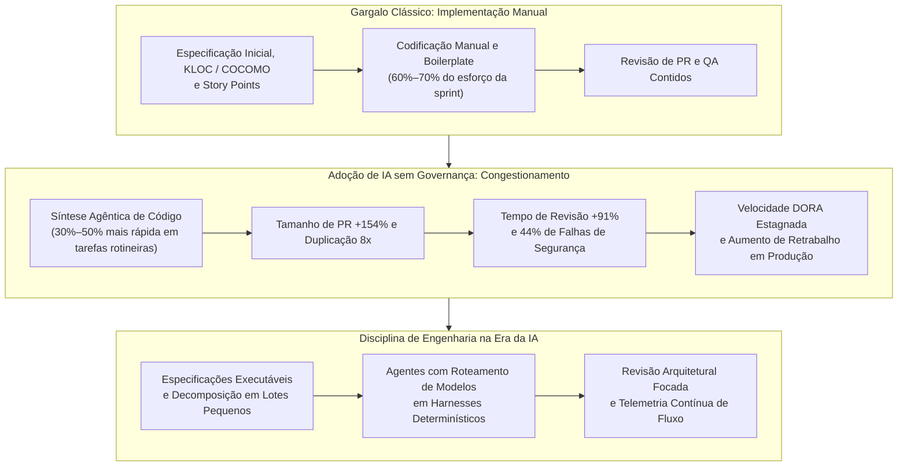
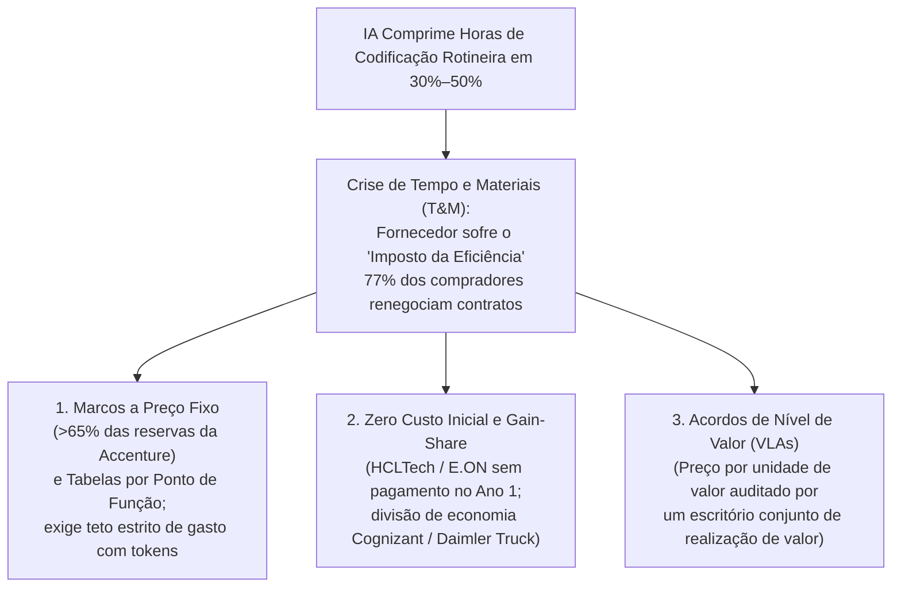
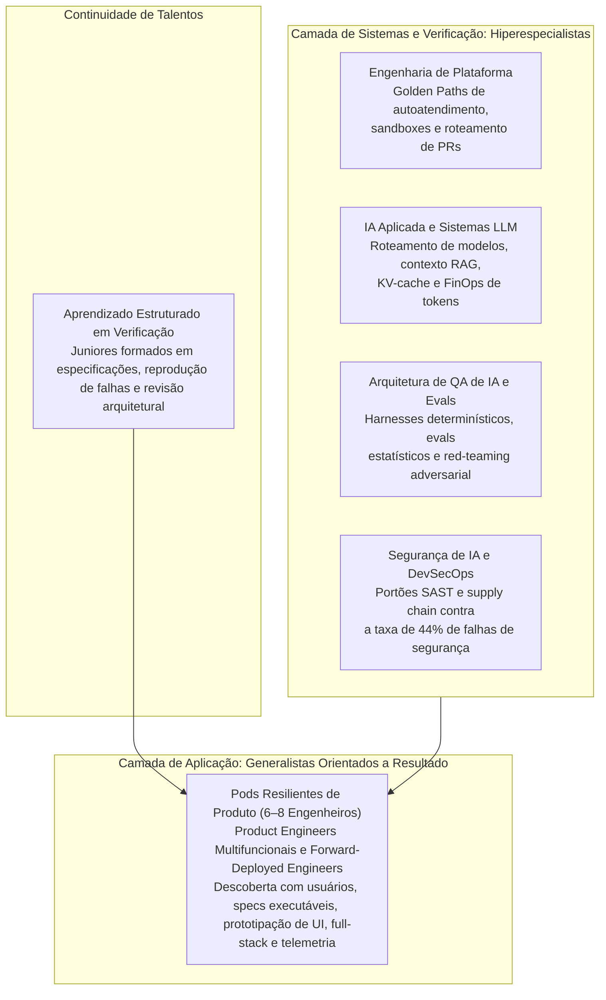

Nas organizações globais de tecnologia, assistentes de código e agentes autônomos atingiram adoção praticamente universal: **75% a 95%** dos engenheiros de software utilizam ferramentas de IA ao menos semanalmente, e cerca de **70%** operam de duas a quatro ferramentas distintas em paralelo. Ainda assim, a telemetria empírica de dezenas de milhares de desenvolvedores revela um contraste marcante entre **a velocidade individual de geração de código** e **a velocidade organizacional de entrega em produção**.

À medida que o custo marginal de produzir sintaxe se aproxima de zero, a restrição dominante na engenharia de software migrou da implementação manual para **disciplina de especificação, verificação arquitetural, governança de segurança e capacidade humana de revisão**. Em artigos anteriores sobre [Spec-Driven Development](), [Context Engineering](), [Harness Engineering]() e [Por que Harness Engineering importa](), explorei esses controles de verificação nos níveis de repositório e runtime.

Neste artigo, ampliamos a lente para analisar como essa migração do gargalo está transformando toda a indústria de software — desmontando modelos paramétricos COCOMO baseados em tamanho físico e estimativas tradicionais em story points, valorizando métricas funcionais, reescrevendo modelos comerciais de precificação em TI, alterando o Custo Total de Propriedade (TCO) de sistemas em produção, expondo os limites de pods enxutos "AI-native", bifurcando carreiras técnicas e consolidando um novo conjunto de práticas operacionais.

---

## 1. Reconstruindo estimativas de software: do esforço de digitação à capacidade de verificação

### Por que os modelos COCOMO baseados em tamanho físico quebram com a IA

Muito antes de equipes ágeis debaterem cartas de Fibonacci, a engenharia de custos corporativa e de defesa apoiava-se no **Constructive Cost Model (COCOMO)**, de Barry Boehm. Publicado em 1981 (*Software Engineering Economics*) a partir de regressões sobre 63 projetos em cascata na TRW entre 2.000 e 100.000 linhas de código, o COCOMO Básico e o Intermediário adotavam o tamanho físico do programa — milhares de linhas de código (`KLOC`) — como preditor central do esforço em pessoas-mês (`PM`), com coeficientes específicos para os modos Orgânico, Semidestacado e Embarcado. O COCOMO Intermediário passou então a ajustar essa estimativa por um Fator de Ajuste de Esforço (`EAF`) composto por 15 direcionadores de custo:

**PM = ai(KLOC)bi · EAF**
{: .text-center }

Quando Boehm e pesquisadores da University of Southern California (USC) reconstruíram o modelo em 2000 como **COCOMO II** — calibrado sobre 161 projetos —, introduziram o modelo de Design Inicial (aceitando Pontos de Função) ao lado da equação Pós-Arquitetura:

**PM = A · (Size)E · ∏ EMi**
{: .text-center }

Nessa formulação, *A* = 2,94, o expoente de escala *E* = 0,91 + 0,01 · ∑ SFj varia de 0,91 a 1,226 conforme cinco Fatores de Escala organizacionais (`PREC`, `FLEX`, `RESL`, `TEAM`, `PMAT`), e ∏ EMi é o produto de 17 Multiplicadores de Esforço.

Um estudo conceitual de 2026 publicado na *Frontiers in Artificial Intelligence*, [*Toward LLM-aware software effort estimation*](https://www.frontiersin.org/journals/artificial-intelligence/articles/10.3389/frai.2026.1772418/full), argumenta que a inadequação do COCOMO II no desenvolvimento assistido por LLMs é **estrutural, e não paramétrica**: nenhuma recalibração estatística fecha a lacuna quando proxies de tamanho de código, como SLOC, perdem a relação com o esforço humano. Na prática dos modelos COCOMO guiados por `KLOC`, esse descompasso estrutural aparece em três pontos:

1. **A falácia do KLOC**: A premissa matemática do COCOMO é que o volume físico de código correlaciona-se positivamente com o esforço humano de autoria e com a capacidade entregue ao negócio. Quando agentes sintetizam milhares de linhas de código repetitivo, adaptadores e testes unitários em segundos — e privilegiam cópia verbosa em vez de refatoração —, o `KLOC` deixa de medir esforço humano e passa a medir dívida técnica.
2. **Distorção de tabelas de *backfiring* e de fórmulas de manutenção**: Alimentar o COCOMO II com `KLOC` inflado por IA — ou usar [tabelas de conversão (*gearing factors* / *backfiring*) da QSM](https://www.qsm.com/faq/purpose-gearing-factors-slim-estimate) para converter linhas físicas em Pontos de Função — confunde verbosidade redundante com escopo funcional. Ao mesmo tempo, as equações de manutenção do COCOMO II baseadas em Tráfego Anual de Mudanças (`ACT`) ignoram o "imposto de propagação" de localizar e corrigir blocos clonados espalhados por arquivos desconectados.
3. **Trabalho cognitivo externo ao código não modelado**: Os multiplicadores legados `TOOL` e `MODP` (práticas modernas de programação) assumiam código escrito por humanos em fases estáticas; eles não capturam curadoria de contexto, ciclos de prompt–geração–verificação, governança arquitetural nem o custo direto não salarial de tokens de LLM.

### Por que os story points tradicionais quebram com a IA

As equipes ágeis que abandonaram o COCOMO décadas atrás em troca de dimensionamento relativo esbarram exatamente na mesma barreira. Por mais de duas décadas, o planejamento de sprints apoiou-se em story points — uma medida relativa de esforço popularizada por Mike Cohn e estimada em rituais como o Planning Poker. Os story points sintetizavam três variáveis em um único número da sequência de Fibonacci: **volume de implementação**, **complexidade técnica** e **incerteza de requisitos**. Essa abstração funcionava bem enquanto a digitação humana e a codificação manual dominavam o tempo da sprint.

Ambientes nativos de IA como Cursor, GitHub Copilot e Claude Code rompem essa matemática de base em três frentes:

1. **Hiperinflação em código estrutural rotineiro**: Em tarefas padronizadas, ferramentas de IA reduzem o esforço manual de codificação em **30% a 50%**, comprimindo endpoints CRUD, estruturação de interfaces e código repetitivo — que historicamente representavam **60% a 70%** das bases corporativas — em poucos minutos. Equipes que mantêm baselines históricos de Fibonacci ao adotar agentes veem a velocidade inflar em tickets rotineiros sem nenhuma mudança equivalente no valor entregue.
2. **Compressão desigual ao longo do backlog**: Previsões baseadas em story points dependem de consistência relativa entre categorias de tarefas. Enquanto telas e mapeamentos de esquema encolhem drasticamente, o estudo de produtividade de desenvolvedores da McKinsey de 2023 constatou que **a economia de tempo caiu para menos de 10% em tarefas que os desenvolvedores classificaram como de alta complexidade**. Um ticket CRUD histórico de "5 pontos" pode cair para uma hora, enquanto um bug distribuído de "5 pontos" continua exigindo dias.
3. **Inversão cognitiva entre escrever e verificar**: A estimativa clássica perguntava quão difícil era *construir* uma funcionalidade; na era da IA, a pergunta passa a ser quanto tempo levará para *especificar a intenção, curar o contexto, auditar diffs não determinísticos, validar fronteiras entre serviços e capturar regressões sutis*. Como geradores de código produzem com frequência soluções que compilam sem erros, mas violam invariantes de domínio — padrão que documentei na prática no [estudo das cinco implementações de hotéis com IA]() —, o esforço de verificação supera rotineiramente o esforço de escrita.

### Quatro práticas emergentes de estimativa e previsibilidade

Em resposta ao colapso das contagens físicas de linhas e dos pontos subjetivos de esforço, engenheiros de custos e organizações de software estão migrando para quatro práticas complementares:

* **Recalibração paramétrica, Pontos de Função automatizados e camadas agênticas**: Organizações de defesa, setor aeroespacial e portfólios regulados não trocaram equações paramétricas auditáveis por palpites diretos de LLMs — até porque benchmarks empíricos ([*From COCOMO to GPT*](https://ieeexplore.ieee.org/document/11421842)) mostram que LLMs zero-shot ainda perdem em precisão numérica para modelos clássicos de aprendizado de máquina e regressores calibrados. Em vez disso, a estimativa paramétrica adapta-se em três camadas:
  * *Uma proposta de fator `AI Assistance Usage` para o COCOMO e o COSYSMO*: Em [*Systems Acquisition Cost Modeling Initiative for AI Assistance*](https://www.dair.nps.edu/bitstream/123456789/5143/3/SYM-AM-24-080.pdf) (Acquisition Research Symposium de 2024), Ray Madachy, Ryan Bell e Ryan Longshore propõem um fator de custo em cinco níveis, [**AI Assistance Usage**](https://softwarecost.org/data/ai) (`Very Low` a `Very High`), construído sobre o framework COCOMO e alinhado aos processos de ciclo de vida da norma ISO/IEC/IEEE 15288, ao lado do [`COSYSMO_AI`](https://softwarecost.org/tools/COSYSMO_AI/). O fator ainda não está calibrado: uma pesquisa Delphi online, apoiada pelo USC Boehm Center for Systems and Software Engineering, coleta estimativas de especialistas e dados pareados de esforço com e sem IA para derivar seus multiplicadores de esforço. Como em qualquer direcionador do COCOMO, `Nominal` (`1,0`) é o padrão para um projeto típico.
  * *Análise de Pontos de Função (APF / FPA) como medida de tamanho invariante*: Ao contrário do `KLOC`, os [Pontos de Função do IFPUG](https://ifpug.org/event/software-productivity-measurement-in-the-ai-era) (ISO/IEC 20926) e do COSMIC (ISO/IEC 19761) medem *o que* o software entrega em capacidades reconhecíveis pelo usuário — entradas, saídas, consultas, arquivos lógicos e movimentações de dados — independentemente de *como* a sintaxe é escrita. Um sistema de 300 PF continua tendo 300 PF seja codificado manualmente ou orquestrado com agentes; assim, o PF permanece um denominador estável e o impacto real da IA aparece nos numeradores de **horas/PF**, **US\$/PF** e **defeitos/PF**. Analisadores baseados em PLN e LLMs — como o [ScopeMaster](https://www.scopemaster.com/features/automated-function-points/) e frameworks acadêmicos como o [CosMet](https://ieeexplore.ieee.org/document/10938386/) — extraem tamanhos funcionais diretamente de histórias de usuário, reduzindo o trabalho manual de contagem e apontando requisitos ambíguos antes da codificação.
  * *Front-ends agênticos sobre motores determinísticos*: Suítes comerciais envolvem motores matemáticos auditáveis com camadas de ingestão por IA e simulação de Monte Carlo: a Galorath combina o **SEER-SEM** ao [**SEERai**](https://galorath.com/wp-content/uploads/2026/05/Executive-Overview_JAN-2026.pdf) para extrair métricas de tamanho e Estruturas Analíticas de Projeto (WBS) rastreáveis a partir de editais e RFPs; a suíte **SLIM**, da QSM, modela restrições não lineares entre Prazo, Orçamento, Equipe e Qualidade sobre a base histórica de projetos concluídos da QSM; e o [guia da Unison Cost Engineering apresentado no ICEAA](https://www.iceaaonline.com/wp-content/uploads/2025/06/MLN06-Minkiewicz-Guidance-for-AI-Software-Development-ppt.pdf) acrescenta centros explícitos de custo para aquisição e limpeza de dados, ciclos experimentais de ajuste em GPUs e monitoramento pós-implantação contra *data drift* e ataques adversariais.
* **Telemetria enxuta de fluxo (Lean Flow) e decomposição em lotes mínimos**: Equipes de produto de alta performance estão abandonando story points — ou substituindo-os por faixas rápidas em tamanho de camiseta (`XS`, `S`, `M`, `L` ou *Grande Demais para Estimar*) — e aplicando a regra de quebrar histórias até ficarem pequenas e uniformes. A previsibilidade apoia-se em telemetria histórica: **Cycle Time** (média de **4,2 dias** na indústria e **menos de 1 dia** em times de elite), **Flow Time** (tempo total do início à produção), **Flow Load** (trabalho simultâneo em progresso) e **Flow Efficiency** (razão entre tempo ativo de atuação e tempo total decorrido). A eficiência de fluxo expõe imediatamente onde os ganhos da IA travam: o tempo ativo programando cai, enquanto as filas de espera em code review e testes de integração disparam. Em paralelo, o programa DORA, do Google, expandiu suas quatro métricas clássicas para cinco ao introduzir a **Taxa de Retrabalho de Deploy (*Deployment Rework Rate*)** — a proporção de implantações não planejadas feitas para corrigir incidentes em produção — como sinal de alerta precoce quando a velocidade de geração supera o rigor de verificação.
* **Dimensionamento orientado por especificação e peso de verificação**: Onde o planejamento prévio de capacidade por sprint ou estimativas em faixa PERT continuam necessários, as equipes ponderam tickets pela **ambiguidade da especificação** e pela **superfície de verificação**, e não pelas linhas de código esperadas — comprimindo levemente a faixa de construção inicial enquanto ampliam as reservas de revisão de código, integração e segurança. Uma revisão multivocal da literatura de 2026, com 67 fontes, confirma que a disciplina de especificação — e não a capacidade bruta do LLM — é a restrição determinante para a confiabilidade do software assistido por IA. Os tickets passam a orçar explicitamente o tempo de curadoria de contexto, criação de suítes determinísticas de aceitação e validação de integração.
* **Julgamentos comparativos por LLM e Diff Delta™**: Em empresas que mantêm story points por exigência de governança de portfólio ou faturamento, o Planning Poker subjetivo vem sendo substituído por **julgamentos comparativos pareados**, fundamentados na lei de Thurstone e em modelos de preferência de Bradley–Terry. Em vez de chutar valores absolutos de Fibonacci (ou treinar modelos específicos como o GPT2SP, que exigiam grandes bases rotuladas e falhavam em projetos novos), engenheiros ou LLMs via few-shot comparam pares de itens do backlog para decidir qual exige maior esforço, reduzindo vieses de ancoragem. Na análise retrospectiva, plataformas de inteligência de engenharia como o GitClear substituem contagem de commits e linhas de código pelo **Diff Delta™**, medindo alterações duráveis que não sofrem retrabalho imediato e apresentam correlação muito superior com o esforço real de engenharia.

A escala proposta de `AI Assistance Usage` classifica o quanto a IA está integrada ao fluxo de trabalho do projeto. Os multiplicadores de esforço de cada nível ainda estão sendo coletados, portanto a escala ainda não é um ajuste calibrado:

| Nível proposto de `AI Assistance Usage` | Definição do Nível (Madachy, Bell e Longshore, 2024) |
| :--- | :--- |
| **Very Low** | Uso mínimo ou nulo de IA; o desenvolvimento depende principalmente de métodos e ferramentas tradicionais; ferramentas de IA podem existir, mas raramente são consultadas |
| **Low** | Consultas ocasionais à IA, em geral para esclarecimentos ou buscas básicas; a IA não está integrada a fundo no fluxo de trabalho |
| **Nominal** (padrão) | Uso regular de IA para apoio em código, design ou testes; parte reconhecida do ferramental, mas não central |
| **High** | Uso frequente e estratégico de IA, com papel central em múltiplas fases, do design ao code review |
| **Very High** | IA profundamente integrada à maioria das fases e essencial para decisões, resolução de problemas e automação de tarefas; o processo é desenhado em torno da IA |

| Paradigma de Estimativa | Unidade Central de Medida | Restrição Principal Medida | Pontos Fortes com Fluxos de IA | Principais Limitações |
| :--- | :--- | :--- | :--- | :--- |
| **COCOMO Legado / *Backfiring* de KLOC** | `KLOC` físico ou tabelas de conversão KLOC-para-PF | Esforço manual histórico por linha física escrita | Equações fechadas e auditáveis para programas tradicionais em cascata | `KLOC` infla com duplicação por IA; omite revisão externa e custo de tokens |
| **Dimensionamento Funcional (APF) e Paramétricos Ajustados por IA** | Pontos de Função ISO IFPUG / COSMIC + fator proposto `AI Assistance Usage` | Funcionalidade invariante ao usuário vs. horas/PF ajustadas por maturidade | Medida de tamanho agnóstica à tecnologia; ferramentas de contagem automatizada reduzem o esforço manual | Exige requisitos bem redigidos; multiplicadores do fator de IA ainda aguardam calibração via Delphi / dados de projetos |
| **Story Points Clássicos (Planning Poker)** | Pontos relativos de Fibonacci (`1, 2, 3, 5, 8...`) | Volume manual de código, complexidade e incerteza | Estimula alinhamento multidisciplinar para expor premissas ocultas | Baselines quebram sob aceleração desigual da IA; ignora filas de revisão e verificação; sem comparabilidade entre equipes ou fornecedores |
| **Fluxo Enxuto e Contagem de Itens ("No Estimates")** | Cycle Time, Flow Efficiency, Throughput, Rework Rate | Filas de espera, latência de revisão de PR e excesso de WIP | Elimina cerimônias longas; expõe gargalos reais na revisão | Exige maturidade para fatiar o backlog em itens pequenos e confiança dos stakeholders |
| **Julgamento Comparativo com LLM** | Ranking pareado de preferência convertido em pontos | Escopo semântico e complexidade arquitetural relativa | Resolve falta de dados históricos via few-shot; reduz viés humano | Sensível a tickets mal descritos; pode herdar distorções históricas |
| **Telemetria de Verificação e Diff Delta™** | Alteração durável de código e peso de testes/evals | Rigor de especificação, cobertura de validação e código sem churn | Filtra inflação sintática e código descartado em duas semanas | Métrica diagnóstica retrospectiva, não uma previsão pré-sprint |

---

## 2. Realinhamento comercial: precificando software na era pós-hora faturada

### O "Imposto da Eficiência" no modelo de Tempo e Materiais

Para consultorias, fábricas de software e integradores globais de TI, o desenvolvimento assistido por IA desencadeou uma crise comercial imediata. Historicamente, o setor de serviços apoiou-se em dois modelos: **Tempo e Materiais (T&M)** — faturando horas ou diárias de engenharia — e **Preço Fixo**, atrelado a um escopo fechado definido no início do contrato.

Quando assistentes de código e pipelines automatizados comprimem tarefas rotineiras em 30% a 50%, o faturamento por hora impõe um **"Imposto da Eficiência" (*Efficiency Tax*)**: o fornecedor que investe em automação agêntica e entrega mais rápido fatura menos horas, canibalizando a própria receita bruta enquanto o cliente captura 100% do excedente econômico. Já o contrato tradicional de preço fixo permite ao fornecedor reter o ganho de margem — a menos que a área de compras imponha descontos agressivos na largada ou que a evolução rápida do produto gere travamentos constantes de aditivos de escopo.

### Pressão de compradores corporativos e deflação em serviços de TI

As áreas de compras das grandes empresas passaram a exigir essa redução de esforço diretamente nas renovações contratuais:

* **Renegociação em massa de contratos**: O [estudo Enterprise Pulse 2026 da HFS Research](https://www.hfsresearch.com/research/firing-as-a-service-ai-business-model/) apontou que **77%** das empresas planejam renegociar preços com seus provedores de TI, **48%** pretendem transferir escopos para outro provedor e apenas **17%** esperam renovar com poucas mudanças.
* **Descontos de 25%–30% e deflação estrutural**: O CEO da Persistent Systems, Sandeep Kalra, disse à Reuters que clientes pedem o mesmo trabalho com **preços 25% a 30% menores**. O CEO da HCLTech, C. Vijayakumar, prevê uma **deflação anual de 2% a 3%** causada pela IA no nível da indústria e alertou que os cerca de 40% dos serviços do setor mais expostos à IA podem encolher a uma taxa composta de **3% a 5%** ao ano por vários anos.
* **O descompasso entre contratos de IA e receita nas gigantes de TI**: No segundo trimestre do ano fiscal de 2027 (outubro de 2026), a Infosys reportou alta sequencial de **29% na receita específica de IA**, atingindo **10,5% da receita total** (US\$ 5,145 bilhões de receita trimestral e US\$ 5,2 bilhões em valor total de grandes contratos), mas precisou cortar sua projeção anual de crescimento em moeda constante de 1,5%–3% para **1%–2%**, citando a fraqueza macroeconômica na América do Norte e um grande cliente industrial europeu em dificuldades. Wipro (projetando variação sequencial de -1,5% a +0,5%) e HCLTech enfrentam a mesma compressão: contratos legados de manutenção e desenvolvimento encolhem mais rápido do que novos projetos de IA agêntica se convertem em receita reconhecida, enquanto grandes empresas internalizam demandas rotineiras em times próprios e Centros Globais de Capacidade (GCCs).

### Novas arquiteturas comerciais pós-hora faturada

Para escapar do Imposto da Eficiência preservando margens operacionais, consultorias e agências de engenharia estão desacoplando receita de headcount por meio de três estruturas contratuais:

1. **Reservas a preço fixo e tabelas padronizadas por Pontos de Função**: No quarto trimestre do ano fiscal de 2026 da Accenture, trabalhos a preço fixo, incluindo contratos baseados em resultados, representaram **mais de 65% das novas reservas**. Na terceirização corporativa e governamental de Desenvolvimento e Sustentação de Aplicações (ADM), alguns compradores ancoram tabelas de preço fixo em **Pontos de Função contados pelos métodos IFPUG ou COSMIC, padronizados pela ISO (US\$/PF)**, em vez de story points relativos à equipe ou `KLOC` inflado por IA — uma unidade neutra de entrega para comparar custo e densidade de defeitos entre fornecedores que torna visíveis, no preço por PF, os ganhos de eficiência da IA. O preço fixo também transfere o custo de inferência para o fornecedor, e por isso os fornecedores controlam o orçamento interno de tokens nesses contratos: em outubro de 2026, a Accenture limitou o financiamento central do uso do Claude pelos funcionários a **US\$ 29 por mês**, cobrando o excedente do projeto.
2. **Contratos sem custo inicial e compartilhamento de ganhos (*gain-share*)**: Fornecedores assumem o risco inicial de transição em troca de uma parte das economias geradas. Segundo pessoas familiarizadas com o acordo ouvidas pela Reuters, a **HCLTech** não será paga no primeiro ano de um contrato plurianual de gestão de nuvem com o grupo europeu de energia **E.ON**, e os pagamentos a partir do segundo ano estão vinculados a ganhos de eficiência e metas de negócio. A Reuters também informou que o contrato de serviços de workplace da **Cognizant** com a **Daimler Truck** prevê a divisão entre as empresas das economias obtidas com IA.
3. **Acordos de Nível de Valor (*Value Level Agreements* — VLAs)**: Alguns provedores de serviços gerenciados, como a [Version 1](https://www.version1.com/blog/value-level-agreements-the-next-evolution-in-managed-services/), substituem tabelas de homem-hora e SLAs estáticos por **VLAs**, muitas vezes governados em conjunto por um escritório de realização de valor. O contrato precifica uma unidade concreta de valor (custo por transação processada, usuário ativo ou chamado resolvido) e vincula a remuneração a telemetria auditada, como custo unitário de atendimento, *lead time* de mudanças, disponibilidade e MTTR, defeitos escapados e gasto de nuvem por transação.

| Modelo Comercial | Unidade de Cobrança | Captura da Eficiência de IA | Alocação de Risco | Aplicação Principal em 2026 |
| :--- | :--- | :--- | :--- | :--- |
| **Tempo e Materiais (T&M)** | Hora ou diária de desenvolvedor | **100% Cliente** (fornecedor paga o Imposto da Eficiência) | Cliente assume risco de prazo e retrabalho | P&D exploratório, alocação de especialistas e consultoria altamente ambígua |
| **Preço Fixo / Tabela US\$/PF** | Marco de entrega ou Ponto de Função contado | **Fornecedor** (descontados 25%–30% na licitação ou US\$/PF recalibrado) | Fornecedor assume risco de estimativa, estouro e gasto de tokens | Migrações delimitadas, contratos ADM e sistemas CRUD; o preço fixo passa de 65% das reservas da Accenture |
| **Gain-Share / Economia Compartilhada** | Percentual da redução verificada de custos | **Dividida em contrato** (ex.: Cognizant/Daimler Truck) | Fornecedor financia o risco no Ano 1; ganho compartilhado | Modernização corporativa de nuvem e consolidação de aplicações em larga escala |
| **Orientado a Resultados / VLA** | Tabela por unidade de valor e KPIs | **Capturada em conjunto** por faixas de desempenho | Governança compartilhada via escritório conjunto de realização de valor | Engenharia contínua de produtos AI-native e modernização de plataformas |

---

## 3. Dinâmica de custos: construir software ficou realmente mais barato?

### O paradoxo entre custo unitário e custo total

Uma das conclusões mais importantes da economia de engenharia recente é que **embora o custo marginal de gerar linhas iniciais de código tenha caído de 30% a 50%, o Custo Total de Propriedade (TCO) ponta a ponta para construir e manter software em produção permanece praticamente igual — ou maior — do que na era pré-IA**.

Confundir geração de sintaxe com engenharia de sistemas ignora dois princípios econômicos clássicos: a **Lei de Amdahl** (o ganho total de um fluxo é limitado por sua etapa mais lenta não automatizada) e a **Doença de Custos de Baumol** (quando etapas automatizadas barateiam, atividades intensivas em julgamento humano — revisão arquitetural, segurança e integração — passam a representar uma fatia cada vez maior do orçamento). Benchmarks estreitos iniciais mediam a digitação de um servidor HTTP isolado do zero; estudos em ambientes reais mostram outra realidade:

* **O [ensaio clínico randomizado da METR](https://arxiv.org/abs/2507.09089) (-19% na velocidade real vs. +20% na velocidade percebida)**: Avaliando 16 mantenedores experientes de código aberto ao longo de **246 tarefas reais** em repositórios maduros com mais de 1 milhão de linhas de código, a METR descobriu que desenvolvedores autorizados a usar ferramentas de IA (principalmente Cursor Pro com Claude 3.5 e 3.7 Sonnet) levaram **19% mais tempo** do que trabalhando sem IA. Antes do estudo, esses mesmos especialistas previam ficar **24% mais rápidos**; mesmo após terminarem mais devagar, acreditavam ter sido **20% mais rápidos** — um **abismo de percepção de 39 pontos percentuais**. Eliminar o atrito de digitar gera sensação de fluidez mesmo quando o relógio corre em prompts, leitura e depuração de sugestões "quase certas" (frustração relatada por **66%** dos desenvolvedores na pesquisa do Stack Overflow). A METR [alertou depois](https://metr.org/blog/2026-02-24-uplift-update/) que a marca de `-19%` é um retrato do início de 2025: no estudo de acompanhamento, cada vez mais desenvolvedores se recusavam a trabalhar sem IA, o que enviesou a amostra, e as novas estimativas (ganho de **18%** para os participantes originais e de **4%** para os novos recrutados) têm intervalos de confiança que ainda incluem uma desaceleração. A telemetria corporativa mostra para onde o gargalo se desloca em escala.
* **Telemetria organizacional da [Faros AI](https://www.faros.ai/blog/ai-software-engineering)**: Analisando dados de **mais de 10.000 desenvolvedores** em **1.255 times de engenharia**, o relatório de 2025 da Faros AI constatou que a alta adoção de IA elevou a conclusão individual de tarefas em **21%** e o merge de pull requests em **98%**. No nível da empresa, porém, a Faros **não encontrou correlação significativa entre adoção de IA e melhorias na entrega**. O código excedente acumulou-se nas filas de revisão: o tamanho médio dos PRs cresceu **154%**, o tempo de revisão subiu **91%** e os bugs por desenvolvedor aumentaram **9%**. O [relatório de 2026](https://faros.ai/research/ai-acceleration-whiplash), com 22.000 desenvolvedores em 4.000 times, mostra a distância aumentando: o tempo mediano de revisão cresceu cerca de **5x**, os bugs por desenvolvedor subiram **54%** e os incidentes por pull request mais que triplicaram.
* **Pesquisas DORA (2024–2025)**: O relatório DORA de 2024 constatou que cada aumento de 25% na adoção de IA melhora o fluxo individual (**+2,6%**), a satisfação no trabalho (**+2,2%**), a velocidade de code review (**+3,1%**) e a qualidade da documentação (**+7,5%**), mas correlacionou-se com uma **queda estimada de 1,5% na vazão de entrega** e **recuo de 7,2% na estabilidade de entrega**. O [relatório State of AI-Assisted Software Development de 2025](https://research.google/pubs/dora-2025-state-of-ai-assisted-software-development-report/), com quase 5.000 profissionais de tecnologia, constatou que a adoção de IA agora se correlaciona com maior vazão, enquanto a instabilidade das entregas continua subindo. A conclusão central: a IA atua como um **amplificador**, que magnifica as forças das organizações de alta performance e as disfunções das que enfrentam dificuldades.

### Os três impostos ocultos que inflam o TCO do software

Três vetores quantificáveis explicam por que os orçamentos de software continuam subindo:

1. **Tokenomics descontrolado e computação multiagente**: Na transição de assinaturas fixas de autocompletar para loops autônomos tarifados por uso, a conta de inferência cresce exponencialmente. Otimizando o próprio conforto, desenvolvedores costumam enviar tarefas triviais e buscas amplas para modelos de fronteira caros em vez de modelos menores ou open-weight. A telemetria da Jellyfish mostra que os usuários mais intensivos de tokens produzem cerca do **dobro** de pull requests do engenheiro mediano, consumindo aproximadamente **10x mais tokens**. Em junho de 2026, o Gartner [previu que o custo de programar com IA superará o salário médio de um desenvolvedor até 2028](https://gartner.com/en/newsroom/press-releases/2026-06-24-gartner-predicts-ai-coding-costs-will-surpass-average-developer-salary-by-2028-as-token-consumption-surges); um ano antes, havia alertado que **[mais de 40% dos projetos de IA agêntica serão cancelados até o fim de 2027](https://www.gartner.com/en/newsroom/press-releases/2025-06-25-gartner-predicts-over-40-percent-of-agentic-ai-projects-will-be-canceled-by-end-of-2027)** por custos crescentes, retorno nebuloso e controles de risco insuficientes.
2. **Degradação da manutenibilidade ("Modo Somente Escrita")**: Assistentes de código são muito melhores em *adicionar* linhas novas do que em refatorar ou consolidar abstrações existentes. O [estudo longitudinal do GitClear](https://www.gitclear.com/ai_assistant_code_quality_2025_research) sobre 211 milhões de linhas alteradas (2020–2024) registra uma queda estrutural de modularidade: linhas copiadas e coladas subiram de **8,3% para 12,3%** das mudanças, superando linhas movidas/refatoradas pela primeira vez, e blocos que duplicam cinco ou mais linhas multiplicaram-se por **8x** em 2024. Ao mesmo tempo, a refatoração ("código movido") caiu de **25% das linhas alteradas em 2021 para menos de 10% em 2024**. O estudo de 2026 do GitClear, com 623 milhões de mudanças, constatou alta de **47%** em construções que mascaram erros e *churn* de curto prazo **9x** maior entre usuários intensivos de IA do que entre não usuários. Análises da CodeScene indicam que ganhos iniciais de velocidade são anulados em dois meses pelo peso de manutenção de código pouco modular, enquanto a SonarSource aponta *code smells* estruturais em **90%** do código gerado (em linha com o atrito de evolução que medi na [Parte 2 do estudo dos hotéis]()). Esse padrão de clonagem rompe diretamente as premissas de Tráfego Anual de Mudanças (`ACT`) do COCOMO II: inflar o `KLOC` físico com blocos duplicados e desconectados multiplica o esforço de sustentação a cada futura correção de segurança ou mudança de regra de negócio.
3. **Dívida de segurança e custo exponencial de correção em produção**: Na [análise da CodeRabbit](https://coderabbit.ai/blog/state-of-ai-vs-human-code-generation-report) de 470 pull requests open source, PRs com coautoria de IA tiveram **1,7x mais problemas** no total, **75% mais problemas de lógica e correção**, **mais de 3x os problemas de legibilidade** e até **2,74x mais problemas de segurança** do que PRs só de humanos. O [relatório GenAI Code Security 2026 da Veracode](https://www.veracode.com/blog/2026-genai-code-security-report-ai-risk/) mostrou que, embora os modelos gerem código sintaticamente correto quase 100% das vezes, **cerca de 44% das tarefas de geração de código com IA introduziram uma vulnerabilidade de segurança relevante** — praticamente o mesmo índice do primeiro relatório da Veracode —, com taxas de aprovação de apenas **15%** em cross-site scripting (XSS) e **12%** em log injection. A telemetria da Apiiro em repositórios corporativos também detectou um **aumento de 10x** nos achados mensais de segurança ligados à IA entre dezembro de 2024 e junho de 2025 (mais de **10.000 novos alertas por mês**) enquanto erros triviais de sintaxe caíram 76%. Como o custo de remediar defeitos cresce exponencialmente — cerca de **US\$ 100** no design, **US\$ 1.000** nos testes unitários, **US\$ 1.500–US\$ 2.000** no QA e **US\$ 10.000 a US\$ 100.000+** em produção — e a Faros AI constatou que os incidentes por pull request mais que triplicaram com alta adoção de IA, acelerar a geração sem escalar a verificação empurra falhas direto para a faixa mais cara.

### Paradoxo de Jevons e retorno global de engenharia

Ao longo de cinco ondas anteriores de abstração — de Assembly para C (2,5x menos linhas por ponto de função), C para Java/Python (5–15x), Spring Boot (80% menos boilerplate), Swift (70% de redução) e React (70% menos código de configuração) —, baratear a construção acionou o **Paradoxo de Jevons**: a demanda elástica expandiu a força global de desenvolvedores de **10–12 milhões em 2001 para 36,5 milhões em 2025** e o gasto corporativo com software de **US\$ 74 bilhões para US\$ 1,25 trilhão**. Na sexta onda (IA generativa), destravar essa elasticidade depende de superar o gargalo de verificação; caso contrário, instala-se uma automação mediana que desloca tarefas juniores sem reduzir o custo final do sistema validado:

**Custo Total de Desenvolvimento = (Esforço de Entrega × Taxa Média do Time) + Infraestrutura e Tokens + Retrabalho + Suporte Contínuo**
{: .text-center }

Como `Esforço × Taxa` somado ao retrabalho pesa mais do que o valor-hora isolado — uma equipe experiente e disciplinada com IA a US\$ 45–US\$ 60/h entregando em 1.500–2.000 horas (US\$ 67.500–US\$ 120.000) não custa mais do que um time a US\$ 25–US\$ 30/h consumindo 4.000 horas em alto *churn* (US\$ 100.000–US\$ 120.000) —, a arbitragem geográfica passa a combinar custo salarial com maturidade arquitetural, proficiência em inglês e fuso horário. O marketplace de contratação [Second Talent](https://www.secondtalent.com/developer-rate-card/ai-engineer-by-region/) combina esses fatores em um índice proprietário, o Engineering ROI Score:

| Região / Mercado | Salário Base Anual Típico de Eng. de IA (USD) | Contexto Geral de Engenharia e Mercado | Engineering ROI Score da Second Talent (0–100) |
| :--- | :--- | :--- | :--- |
| **Estados Unidos** | US\$ 140.910 (mediana BLS para cientistas de pesquisa em computação e informação) | Mercado de referência para comparações de custo e fuso horário | Sem pontuação |
| **Sudeste Asiático (Singapura)** | US\$ 80.000 – US\$ 150.000 | SWE geral S\$ 4,5K–S\$ 20K+/mês; principal polo financeiro e tecnológico da APAC | **51** (Custo: 4, Talento: 7, Inglês: 10) |
| **América Latina (MX / AR / BR / CO)** | US\$ 58.075 (MX) / US\$ 55.900 (AR) / US\$ 40.800 (BR) | Colômbia US\$ 19,7K–US\$ 38,2K; forte alinhamento de fuso com os EUA (9–10/10) e alta escala de contratação no Brasil (9/10) | **70** (BR e CO) / **65** (AR) / **64** (MX) |
| **Leste Europeu (PL / RO / UA)** | US\$ 55.200 (PL) / US\$ 50.400 (RO) / US\$ 40.800 (UA) | Forte oferta em arquitetura de sistemas e deep-tech (7–8/10) com sobreposição Europa/EUA | **64** (UA) / **63** (RO) / **62** (PL) |
| **Sudeste Asiático Emergente** | US\$ 40K–US\$ 50K (MY) / US\$ 35K–US\$ 45K (ID) | Tailândia US\$ 35K–US\$ 40K; Vietnã US\$ 30K–US\$ 35K; Filipinas US\$ 12K–US\$ 30K | **72** (PH) / **67** (VN) / **62** (ID) / **58** (MY, TH) |
| **Sul da Ásia (Índia)** | US\$ 17.323 (Mediana IA) / US\$ 45K–US\$ 75K (Senior ML EOR) | Taxas de agências US\$ 25–US\$ 49/h; 5,8M de profissionais de TI gerando US\$ 55,7B em P&D | **83** (Custo: 10, Oferta: 10, Inglês: 8) |

---

## 4. Topologia de times: por que pods "AI-native" de 3 pessoas quebram em escala corporativa

### O Projeto OT da Meta e os limites dos pods de 3 a 5 pessoas

Inspirados na receita por funcionário de startups AI-native, executivos testaram encolher times de produto em pods "AI-native" enxutos. No caso mais emblemático entre as Big Techs, o [**Projeto OT ("Organization Transformation")** da Meta](https://blog.pragmaticengineer.com/the-pulse-meta-wanted-to-reduce-teams-by-60-because-of-ai/) previa transformar times de 10 a 20 pessoas em **times "AI-native" de 3 a 5 pessoas** fazendo o mesmo trabalho — uma redução de cerca de **60% no tamanho dos times**. A Meta testou pods AI-native e cortou 10% do quadro, mas cancelou a segunda onda de cortes planejada após uma revolta dos funcionários, uma sequência de quedas em produção e uma onda de pedidos de demissão.

Embora células de 3 a 5 pessoas funcionem muito bem para protótipos greenfield, a operação real mostra quatro modos severos de falha quando times maduros em produção encolhem abaixo de **6 a 8 engenheiros**:

1. **O piso mínimo de 6 engenheiros para sobreaviso 24/7**: Manter uma escala saudável de plantão 24/7 exige no mínimo **6 engenheiros**. Em um pod de 3 a 5 pessoas, uma licença médica somada a férias reduz a operação a 1 ou 2 profissionais, gerando fadiga imediata de alertas e instabilidade em incidentes.
2. **Concentração perigosa do *bus factor***: O *bus factor* já é baixo: na [análise da Metabase](https://www.metabase.com/blog/bus-factor) sobre os 1.000 repositórios mais estrelados do GitHub, quase metade tinha ***bus factor* de dois ou menos**. Cortar uma unidade de domínio de 30 para 18 pessoas cria pontos únicos de falha onde uma única saída paralisa subsistemas críticos cujo contexto histórico não está explícito no código.
3. **"AI brain fry" e exaustão de supervisão**: Encolher a equipe não reduz a carga mental — obriga quem fica a supervisionar múltiplos fluxos paralelos de IA. Dados da Faros AI mostram que desenvolvedores em times de alta adoção tocam **9% mais tarefas** e **47% mais PRs por dia**. Um [estudo do Boston Consulting Group (BCG)](https://www.bcg.com/news/5march2026-when-using-ai-leads-brain-fry) publicado em março de 2026 com 1.488 profissionais nos EUA cunhou o termo **"AI brain fry"** para descrever a fadiga mental causada pelo uso ou supervisão excessivos de ferramentas de IA além da capacidade cognitiva de cada um: a produtividade autodeclarada atingiu o pico com **três ferramentas de IA** e caiu a partir daí, e quem sofria de brain fry relatou **39% mais erros graves** e maior intenção de pedir demissão.
4. **Eliminação da folga organizacional (*slack time*)**: Pods hiperenxutos operando a 100% da capacidade apagando incêndios perdem a margem necessária para refatorar arquitetura, aprimorar especificações, documentar sistemas e formar colegas.

### O fim da pirâmide etária e o estrangulamento de QA

Enquanto pods sustentáveis de produto se estabilizam entre **6 e 8 engenheiros**, duas mudanças estruturais redesenham os organogramas:

* **O colapso da pirâmide de entrada**: Durante décadas, consultorias e empresas escalaram sobre uma base larga de juniores escrevendo código rotineiro e testes unitários sob uma camada estreita de arquitetos seniores. Com agentes automatizando tarefas básicas, a [SignalFire](https://www.signalfire.com/blog/signalfire-state-of-talent-report-2025) constatou que recém-formados passaram a representar apenas **7%** das contratações nas Big Techs, contra 15% antes da pandemia, acompanhados por uma inflação de requisitos em que vagas de entrada pedem 3 a 5 anos de experiência prévia. A senioridade também define o aproveitamento das ferramentas: o levantamento de 2026 do *The Pragmatic Engineer*, com 906 engenheiros, apontou que **63,5%** dos engenheiros Staff+ usam agentes de IA regularmente, contra **49,7%** dos demais engenheiros. Cortar a base reduz a folha no curto prazo, mas seca o pipeline que formaria os arquitetos de sistemas da próxima década.
* **QA mais enxuto diante da enxurrada de pull requests**: À medida que as equipes delegam a geração de scripts de teste à IA, o quadro de QA manual fica sob pressão justamente quando o volume de pull requests cresce (os PRs com merge subiram **98%** na coorte de alta adoção da Faros AI). Mantenedores sentem o impacto direto: o projeto **[`curl` encerrou seu programa de bug bounty na HackerOne](https://daniel.haxx.se/blog/2026/01/26/the-end-of-the-curl-bug-bounty/)** em janeiro de 2026 após a fatia de vulnerabilidades confirmadas cair abaixo de 5% sob uma enxurrada de relatórios de baixa qualidade gerados por IA, e os mantenedores da **[Godot](https://www.theregister.com/2026/02/18/godot_maintainers_struggle_with_draining/)**, com mais de 4.600 pull requests abertos, classificaram as contribuições geradas por IA como "desgastantes e desmoralizantes" e pediram financiamento para contratar mais mantenedores.

Para evitar que pods enxutos afundem em infraestrutura, roteamento de modelos e governança, **90% das organizações** já têm ao menos uma plataforma interna e cerca de três quartos mantêm times dedicados de **Engenharia de Plataforma** (segundo o DORA 2025), escalando sua arquitetura e stack de Software Engineering Intelligence (SEI) conforme o porte:

| Faixa de Engenheiros | Topologia de Infraestrutura e Plataforma | Stack de Governança e SEI | Investimento Anual Típico |
| :--- | :--- | :--- | :--- |
| **Até 30–50 Engenheiros** *(Seed / Série A)* | DevOps generalista (*"you build it, you run it"*); engenheiros de produto gerenciam app e nuvem | Rastreamento leve de fluxo: GitHub Insights, Haystack ou CodePulse | US\$ 2.400 – US\$ 9.000 / ano |
| **50 a 100 Engenheiros** *(Scaleups — "Sinal Amarelo")* | Surgem atritos em CI/CD e aprovações; primeiras **2–3 contratações generalistas de plataforma** | Painéis DORA/SPACE para times: Swarmia, Sleuth ou LinearB | US\$ 12.000 – US\$ 30.000 / ano |
| **100 a 500 Engenheiros** *(Mid-Market — "Sinal Vermelho" sem IDP)* | **Time de Plataforma obrigatório (5–8 pessoas)** + PM construindo *Golden Paths* de autoatendimento | Governança corporativa de ROI de IA, filas de PR e tokens: Faros AI, LinearB ou DX | US\$ 30.000 – US\$ 100.000 / ano |
| **500+ Engenheiros** *(Grandes Empresas)* | Modelo híbrido: núcleo central de plataforma + engenheiros de plataforma alocados nas unidades | Capitalização de P&D, FinOps e telemetria multiagente para diretoria: Jellyfish ou DX | US\$ 100.000 – US\$ 150.000+ / ano |

---

## 5. Bifurcação da força de trabalho e novas práticas para a era da IA

### Generalistas ou especialistas? Ambos, em camadas distintas

Em vez de caminhar de forma homogênea para generalistas ou especialistas, o mercado de engenharia em 2026 sofreu uma **bifurcação estrutural por camada arquitetural**: empresas estão fundindo silos estreitos de execução na **camada de aplicação** em generalistas multifuncionais, enquanto pagam prêmios elevados por hiperespecialistas nas **camadas de fundação, verificação e segurança**.

* **Trilha 1 — Consolidação na camada de aplicação (o *Product Engineer* multifuncional)**: Entregar uma funcionalidade SaaS em 2020 exigia passagens sequenciais de bastão entre PM, designer de UI, engenheiro frontend, engenheiro backend e analista de QA. Ferramentas agênticas de prototipação comprimem essas fronteiras: em Davos, em janeiro de 2026, o CEO da Microsoft, Satya Nadella, contou que o LinkedIn fundiu papéis como gestão de produto, design e engenharia frontend em um único papel de *"construtor full-stack"*. O Product Engineer na era da IA é dono do resultado ponta a ponta — conversando com usuários, escrevendo especificações executáveis, iterando protótipos, curando contexto para agentes e monitorando telemetria em produção — porque, como observa [Addy Osmani](https://addyo.substack.com/p/the-reality-of-ai-assisted-software), escrever código raramente é a etapa mais lenta da entrega; requisitos, design, revisão, testes e coordenação são. No B2B corporativo, esse mesmo perfil aparece como o **Forward-Deployed Engineer (FDE)**, atuando diretamente no cliente para implantar fluxos de IA sem repasses intermediários a taxas globais de US\$ 90–US\$ 300/h.
* **Trilha 2 — Hiperespecialização nas camadas de sistemas, avaliação e segurança**: Generalistas avançando rápido com agentes criam falhas não determinísticas, custos de inferência e riscos de segurança que exigem especialistas profundos:
  * **Engenheiros de IA Aplicada e Sistemas LLM**: Especialistas que arquitetam orquestração multiagente, pipelines RAG, harnesses que preservam KV-cache e roteadores econômicos de modelos.
  * **Arquitetos de QA de IA e Avaliação (*"Evals"*)**: O trabalho diário migra da escrita manual de scripts de teste para a arquitetura de testes e avaliação — unindo pipelines determinísticos autorreparáveis a harnesses estatísticos de avaliação de LLMs (*evals*), validação de dados sintéticos e *red-teaming* adversarial.
  * **Engenheiros de Segurança de IA e DevSecOps**: Como cerca de 44% das tarefas de geração de código com IA ainda introduzem uma vulnerabilidade e os alertas mensais ligados à IA cresceram 10x nos dados da Apiiro, especialistas em Segurança de IA e DevSecOps constroem portões automatizados de supply chain, isolamento em sandbox e verificação pré-merge que escalam com o volume gerado.

| Arquétipo de Papel | Orientação | Responsabilidades Centrais com IA |
| :--- | :--- | :--- |
| **Product Engineer / Construtor Full-Stack** | Generalista multifuncional | Resultado ponta a ponta ao usuário: especificações, prototipação rápida de UI, curadoria de contexto e full-stack |
| **Forward-Deployed Engineer (FDE)** | Generalista alocado no cliente | Traduz problemas ambíguos de domínio corporativo em fluxos de IA em produção sem repasses |
| **SWE de Camada Única / Júnior Tradicional** | Execução isolada | Componentes isolados de UI, endpoints CRUD básicos ou boilerplate manual a partir de specs fixas |
| **Engenheiro de IA Aplicada / Sistemas LLM** | Hiperespecialista | Roteamento de modelos, arquitetura RAG, design de harnesses agênticos e FinOps de tokens |
| **Arquiteto de QA de IA / Evals** | Hiperespecialista | Arquitetura de testes e evals: harnesses de evals para LLMs, dados sintéticos e portões autorreparáveis |
| **Engenheiro de Segurança de IA e DevSecOps** | Hiperespecialista | SAST automatizado, políticas de sandbox e guardrails de supply chain para código gerado |

### Seis práticas operacionais para líderes de engenharia e arquitetos

Reunidas, as evidências empíricas da indústria apontam um roteiro prático claro:

1. **Aposente o KLOC físico e os story points descalibrados em favor de dimensionamento funcional, telemetria de fluxo e portões de especificação**: Pare de alimentar tabelas de *backfiring* do COCOMO com `KLOC` inflado por IA ou de recalibrar sequências de Fibonacci conforme os modelos mudam. Ancore estimativas de portfólio e contratações em **Pontos de Função IFPUG / COSMIC**, agnósticos à tecnologia, e trate ajustes de produtividade por IA — como o fator proposto **`AI Assistance Usage`** — como provisórios até calibrá-los com *churn* objetivo no git e dados de entrega, em vez de percepções subjetivas dos desenvolvedores. Aplique compressão líquida de esforço somente onde o fluxo de trabalho for de fato redesenhado e realoque o orçamento da WBS da codificação inicial para revisão, segurança e refatoração. No nível da sprint, imponha lotes pequenos de PR para combater a **inflação de +154% nos pull requests**, ancore o trabalho em [especificações executáveis]() e acompanhe **Cycle Time**, **Flow Efficiency** e **Deployment Rework Rate**.
2. **Migre contratos comerciais para além do homem-hora (T&M)**: Tanto na contratação quanto na venda de serviços de software, substitua a cobrança puramente horária em entregas padrão por **marcos a preço fixo**, **tabelas neutras por Ponto de Função (US\$/PF)**, **contratos gain-share** ou **VLAs indexados a KPIs** auditáveis — estabelecendo tetos internos de consumo de tokens em escopos de preço fechado.
3. **Aplique disciplina de FinOps via roteamento de modelos e harnesses limitados**: Reserve modelos caros de fronteira para decisões arquiteturais, revisão de especificações e depuração complexa entre serviços, roteando autocompletar, revisões textuais e tarefas delimitadas para [modelos mais baratos dentro de um harness robusto]() por meio de um [AI Gateway](). Limite rodadas autônomas de reparo em CI (como o teto de 2 tentativas da Stripe) e preserve prefixos de cache de prompt para evitar explosões de 10x na conta de inferência.
4. **Escale a verificação determinística antes de escalar a autonomia dos agentes**: Nunca amplie o volume de PRs de agentes em background sem roteamento automatizado de revisão (ferramentas como `gitStream` aliadas a filtros de diff reduzem em **22% a 31%** as linhas revisadas), portões estáticos (SonarQube, linters, SAST), revisão adversarial entre modelos distintos e monitoramento de **Diff Delta™** e *churn* de duas semanas para impedir que o repositório entre em "Modo Somente Escrita".
5. **Estruture pods resilientes de 6 a 8 pessoas, não ilhas frágeis de 3**: Respeite o piso de 6 engenheiros para sobreaviso 24/7, monitore o *bus factor* dos repositórios, limite a proliferação simultânea de ferramentas para prevenir o **AI brain fry** e estruture *Golden Paths* de Engenharia de Plataforma antes de ultrapassar 100 engenheiros.
6. **Reconstrua a porta de entrada júnior como um aprendizado em verificação e sistemas**: Em vez de congelar vagas iniciais — criando um apagão de arquitetos seniores em cinco anos —, redesenhe o papel júnior como uma formação estruturada em escrita de especificações, reprodução determinística de falhas, construção de harnesses de testes/evals e revisão arquitetural.

A inteligência artificial não tornou a engenharia de software magicamente barata nem tornou a arquitetura obsoleta. Ela barateou a sintaxe — o que torna especificações claras, harnesses disciplinados, portões de segurança e times resilientes mais valiosos do que nunca.
