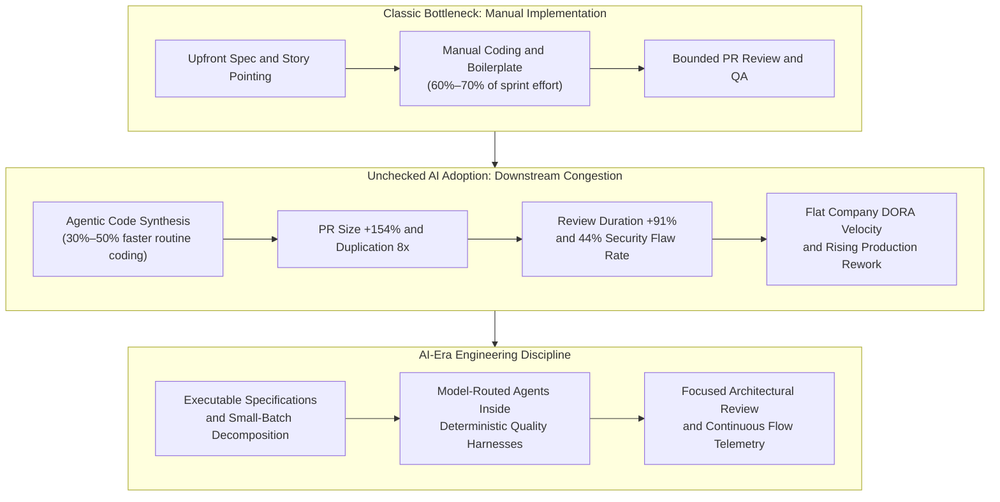
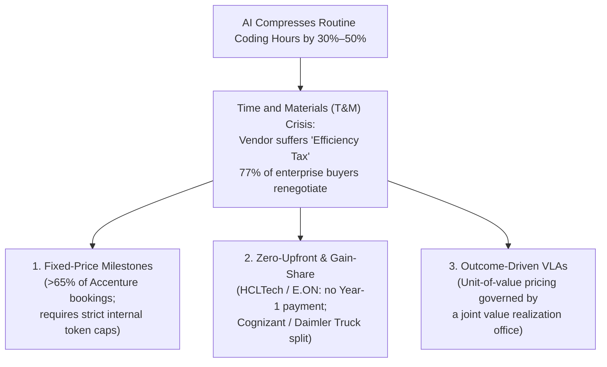
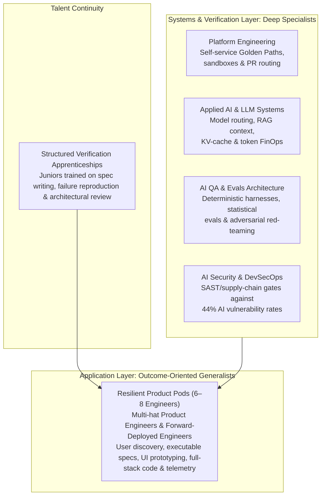

Across global technology organizations, AI coding assistants and autonomous agents have reached near-universal adoption: **75% to 95%** of software engineers now use AI tools at least weekly, and roughly **70%** run two to four distinct AI coding tools side by side. Yet empirical telemetry across tens of thousands of developers exposes a sharp disconnect between **task-level code generation speed** and **organizational delivery velocity**.

As the marginal cost of producing syntax approaches zero, the binding constraint in software production has migrated from manual implementation to **specification discipline, architectural verification, security governance, and human review capacity**. In earlier articles on [Spec-Driven Development](), [Context Engineering](), [Harness Engineering](), and [Why Harness Engineering Matters](), I explored those verification controls at the repository and runtime levels.

In this post, we zoom out to examine how that constraint shift is reshaping the broader software industry—breaking traditional story-point estimation, rewriting commercial IT pricing models, altering the Total Cost of Ownership (TCO) of production systems, testing the limits of hyper-lean "AI-native" pods, bifurcating engineering careers, and establishing a new set of operational practices.

---

## 1. Reconstructing software estimation: from typing effort to verification capacity

### Why traditional story points fracture under AI

For more than two decades, agile planning relied heavily on story points—a relative measure of effort popularized by Mike Cohn and estimated through rituals like Planning Poker. Story points compressed three variables into a single Fibonacci number: **volume of implementation work**, **technical complexity**, and **requirement uncertainty**. That abstraction worked reasonably well while human typing and manual implementation dominated sprint timelines.

AI-native development environments such as Cursor, GitHub Copilot, and Claude Code break that baseline math in three ways:

1. **Hyper-inflation on routine scaffolding**: Across standard tasks, AI coding tools cut manual coding effort by **30% to 50%**, compressing CRUD endpoints, UI scaffolding, and boilerplate—historically **60% to 70%** of enterprise codebases—into minutes. Teams that keep legacy Fibonacci baselines while adopting agentic tools see velocity inflate on routine tickets without any matching change in delivered value.
2. **Uneven compression across the backlog**: Story point forecasting depends on relative consistency across ticket types. While UI scaffolding and schema mapping shrink dramatically, McKinsey's 2023 developer productivity study found that **time savings shrank to less than 10% on tasks developers rated as highly complex**. A historical "5-point" CRUD ticket might drop to an hour, while a "5-point" distributed state bug still takes days.
3. **Cognitive inversion from writing to verifying**: Classic estimation asked how hard a feature was to *write*. AI-era estimation asks how long it takes to *specify intent, curate context, audit non-deterministic diffs, validate system boundaries, and catch subtle regressions*. Because code generators routinely emit diffs that compile cleanly while violating domain invariants—a pattern I documented firsthand in the [five AI hotel implementations study]()—verification effort frequently exceeds authoring effort.

### Three emerging estimation and forecasting practices

In response, engineering organizations are replacing subjective effort points with three complementary practices:

* **Lean flow telemetry and "split until small"**: High-performing teams are retiring story points—or collapsing upfront sizing into quick T-shirt buckets (`XS`, `S`, `M`, `L`, or *Too Big to Estimate*)—and enforcing strict small-batch decomposition. Forecasting relies on historical flow metrics: **Cycle Time** (averaging **4.2 days** across the industry and **under 1 day** for elite teams), **Flow Time** (total elapsed time from start to production), **Flow Load** (active work in progress), and **Flow Efficiency** (active touch time divided by total elapsed time). Flow efficiency immediately exposes where AI gains stall: active coding shrinks while wait queues in code review and integration testing expand. Alongside this, Google's DORA program expanded its classic four keys to five by adding **Deployment Rework Rate**—the share of unplanned deployments triggered to remediate production incidents—as an early warning indicator when AI generation outpaces verification rigor.
* **Specification-driven and verification-weighted sizing**: Where upfront sprint capacity planning is still required, teams weight work by **specification ambiguity** and **verification surface area** rather than expected lines of code. A 2026 multivocal literature review of 67 sources reinforces that specification discipline—not raw model capability—is the primary constraint on AI-assisted software dependability. Tickets explicitly budget time for context curation, deterministic acceptance harnesses, and cross-service integration checks.
* **LLM comparative judgments and Diff Delta™**: In enterprise settings that retain story points for portfolio governance or client reporting, teams are moving away from Planning Poker toward **pairwise comparative judgment** grounded in Thurstone's law and Bradley–Terry preference models. Instead of guessing absolute Fibonacci numbers (or training brittle project-specific estimators like early GPT2SP models that fail on cold-start repos), engineers or few-shot LLMs compare pairs of backlog items to judge which requires more effort, lowering bias and cold-start data requirements. Retrospectively, engineering intelligence platforms such as GitClear replace raw commit and line counts with **Diff Delta™**, weighting durable, non-churned code changes that correlate far better with genuine engineering effort than raw lines added.

| Estimation Paradigm | Core Unit of Measure | Primary Constraint Captured | Strengths in AI Workflows | Key Limitations |
| :--- | :--- | :--- | :--- | :--- |
| **Classic Story Points (Planning Poker)** | Relative Fibonacci points (`1, 2, 3, 5, 8...`) | Manual coding volume, complexity, and uncertainty | Surfaces hidden assumptions during cross-functional discussion | Baselines fracture under uneven AI speedups; misses review and verification queues |
| **Lean Flow & Issue Count ("No Estimates")** | Cycle Time, Flow Efficiency, Throughput, Rework Rate | Wait queues, PR review latency, and WIP congestion | Cuts ceremony overhead; pinpoints downstream review bottlenecks | Requires disciplined decomposition into uniformly small tickets and stakeholder trust |
| **LLM Comparative Judgment** | Pairwise preference ranking mapped to points | Semantic scope and relative architectural complexity | Works on cold-start projects via few-shot inference; reduces anchoring bias | Sensitive to vague ticket prose; can inherit historical sizing distortions |
| **Verification & Diff Delta™ Telemetry** | Durable code change and test/eval coverage weight | Specification rigor, verification scope, and non-churned output | Filters out AI code bloat and short-term churn | Primarily a retrospective diagnostic metric rather than a pre-sprint forecast |

---

## 2. Commercial realignment: pricing software in the post-hourly era

### The "Efficiency Tax" on Time-and-Materials billing

For software agencies, consultancies, and global system integrators, AI-assisted delivery has triggered an immediate commercial squeeze. Historically, IT services relied on either **Time and Materials (T&M)**—billing clients per developer hour or daily rate card—or **Fixed-Price contracts** tied to a static upfront scope.

When AI tools compress routine coding and test scripting by 30% to 50%, hourly T&M billing imposes an **"Efficiency Tax"**: vendors that invest in agentic toolchains and deliver faster bill fewer hours, cannibalizing their own top-line revenue while the client captures 100% of the productivity surplus. Traditional fixed-price contracts invert that capture, letting the vendor retain margin expansion—unless procurement teams force steep upfront discounts or iterative AI product discovery triggers constant change-request gridlock.

### Enterprise buyer pushback and IT services deflation

Enterprise procurement teams have moved aggressively to capture those expected labor savings upfront:

* **Widespread contract renegotiation**: [HFS Research's 2026 Enterprise Pulse study](https://www.hfsresearch.com/research/firing-as-a-service-ai-business-model/) found that **77%** of enterprises plan to renegotiate pricing with IT service providers, **48%** plan to shift work to another provider, and only **17%** expect to renew with limited change.
* **25%–30% discount demands and structural deflation**: Persistent Systems CEO Sandeep Kalra told Reuters that clients are asking for the same work at prices **25% to 30% lower**. HCLTech CEO C. Vijayakumar expects AI to cause **2% to 3% annual deflation** at an industry level, and warned that the roughly 40% of industry services most exposed to AI could shrink at a **3% to 5%** compound annual rate for several years.
* **The bookings-to-revenue squeeze in global IT**: In Q2 FY27 (October 2026), Infosys reported that AI-specific revenue jumped **29% quarter-over-quarter** to **10.5% of total revenue** (\$5.145 billion quarterly revenue and \$5.2 billion in large-deal total contract value), yet trimmed full-year constant-currency revenue growth guidance from 1.5%–3% down to **1%–2%**, citing macroeconomic weakness in North America and a weak large European manufacturing client. Peers Wipro (guiding -1.5% to +0.5% sequential growth) and HCLTech show the same dynamic: legacy maintenance and development contracts deflate faster than new agentic transformation bookings convert into recognized revenue, while enterprises pull routine development back into internal teams and Global Capability Centers (GCCs).

### Real-world post-hourly pricing architectures

To escape the Efficiency Tax without sacrificing operating margins, consultancies and engineering agencies are decoupling revenue from headcount across three commercial models:

1. **Fixed-price bookings**: In Accenture's fiscal 2026 fourth quarter, fixed-price work, including outcome-based engagements, made up more than **65% of new bookings**. Fixed fees also move inference costs onto the vendor, which is why vendors meter internal LLM token budgets on these engagements: in October 2026, Accenture capped central funding for employees' Claude usage at **\$29 per month**, charging anything above that to the project.
2. **Zero-upfront and shared-savings (gain-share) deals**: Vendors increasingly absorb initial transition risk in exchange for a share of downstream savings. According to people familiar with the agreement cited by Reuters, **HCLTech** will not be paid for the first year of a multiyear cloud management deal with European energy group **E.ON**, with payments from the second year tied to efficiency gains and business outcomes. Reuters also reported that **Cognizant**'s workplace services deal with **Daimler Truck** calls for AI-related savings to be shared between the companies.
3. **Outcome-driven Value Level Agreements (VLAs)**: Some managed-service providers, such as [Version 1](https://www.version1.com/blog/value-level-agreements-the-next-evolution-in-managed-services/), replace hourly rate cards and static SLAs with **VLAs**, often governed jointly through a value realization office. Contracts price a concrete unit of value (cost per processed transaction, active user, or resolved ticket) and tie fees to audited telemetry such as unit cost-to-serve, lead time for change, availability and MTTR, escaped defects, and cloud spend per transaction.

| Commercial Model | Core Billing Unit | Who Captures AI Efficiency | Risk Allocation | Primary 2026 Fit |
| :--- | :--- | :--- | :--- | :--- |
| **Time & Materials (T&M)** | Billable developer hour / day | **100% Client** (vendor absorbs the Efficiency Tax) | Client bears delivery and rework risk | Exploratory R&D, staff augmentation, and ambiguous advisory |
| **Fixed-Price (Output-Based)** | Deliverable milestone / static scope | **Vendor** (minus 25%–30% upfront bid discounts) | Vendor bears estimation, token burn, and overrun risk | Well-bounded legacy migrations, standard CRUD builds, >65% of Accenture bookings |
| **Gain-Share / Shared Savings** | Percentage of verified cost reduction | **Split contractually** (e.g., Cognizant/Daimler Truck) | Vendor fronts Year-1 capital risk; shared upside | Large-scale cloud modernization and legacy application consolidation |
| **Outcome-Driven / VLA** | Unit-of-value card and KPI telemetry | **Co-captured** via shared-risk performance bands | Jointly governed by a value realization office | Continuous AI-native product engineering and platform modernization |

---

## 3. Software cost dynamics: is building software actually cheaper now?

### The unit-cost vs. total-cost paradox

One of the most important findings in modern engineering economics is that **while the marginal cost of generating initial code has dropped by 30% to 50%, the end-to-end Total Cost of Ownership (TCO) of building and operating production software remains roughly flat—or higher—than before AI**.

Conflating syntax generation with systems engineering ignores two classic economic principles: **Amdahl's Law** (a pipeline's overall speedup is bounded by its slowest unaccelerated stage) and **Baumol's Cost Disease** (as automated stages become cheap, human-intensive verification, security review, and integration consume an ever-larger share of total budget). Early narrow benchmarks—such as timing developers writing an isolated HTTP server from scratch—measured typing speed in a vacuum. Production studies tell a very different story:

* **The [METR Randomized Controlled Trial](https://arxiv.org/abs/2507.09089) (-19% actual speed vs. +20% perceived speed)**: Evaluating 16 experienced open-source maintainers across **246 real tasks** in mature repositories exceeding 1 million lines of code, METR found that developers allowed to use AI tools (primarily Cursor Pro with Claude 3.5 and 3.7 Sonnet) took **19% longer** than when working without AI. Before starting, those developers predicted a **24% speedup**; even after finishing slower, they believed AI had made them **20% faster**—a **39-percentage-point perception gap**. Removing the friction of typing feels productive even while total clock time leaks into prompting, reading, and debugging "almost right" suggestions (a frustration echoed by **66%** of developers in Stack Overflow's survey). METR [has since cautioned](https://metr.org/blog/2026-02-24-uplift-update/) that `-19%` is an early-2025 snapshot: in its follow-up study, developers increasingly refused to work without AI, which biased the sample, and the new estimates (an **18%** speedup for returning participants and **4%** for new recruits) have confidence intervals that still include a slowdown. Enterprise-wide telemetry shows where the bottleneck moves next.
* **[Faros AI](https://www.faros.ai/blog/ai-software-engineering) organizational telemetry**: Across **10,000+ developers** and **1,255 engineering teams**, Faros AI's 2025 report observed that high AI adoption raised individual task completion by **21%** and merged pull requests by **98%**. Yet at the company level, Faros found **no significant correlation between AI adoption and improvements in delivery**. Surplus code piled up in review queues: average PR size jumped **154%**, PR review time rose **91%**, and bugs per developer climbed **9%**. Its [2026 report](https://faros.ai/research/ai-acceleration-whiplash), covering 22,000 developers across 4,000 teams, shows the gap widening: median review time is up roughly **5x**, bugs per developer are up **54%**, and incidents per pull request have more than tripled.
* **DORA research (2024–2025)**: DORA's 2024 report found that each 25% increase in AI adoption improved individual flow (**+2.6%**), job satisfaction (**+2.2%**), code review speed (**+3.1%**), and documentation quality (**+7.5%**), but correlated with an estimated **1.5% drop in delivery throughput** and a **7.2% drop in delivery stability**. The [2025 State of AI-Assisted Software Development report](https://research.google/pubs/dora-2025-state-of-ai-assisted-software-development-report/), surveying nearly 5,000 technology professionals, found that AI adoption now correlates with higher throughput while delivery instability keeps rising. Its core conclusion: AI is an **amplifier** that magnifies the strengths of high-performing organizations and the dysfunctions of struggling ones.

### The three hidden taxes inflating software TCO

Three measurable cost drivers explain why engineering budgets are not shrinking:

1. **Runaway tokenomics and multi-agent compute**: As teams move from fixed-seat autocomplete plugins to usage-billed autonomous agent loops, inference bills compound rapidly. Developers optimizing for personal convenience routinely route trivial edits and broad repository searches to expensive frontier models rather than smaller or open-weight alternatives. Jellyfish's telemetry shows the heaviest token users producing roughly **twice** the pull-request throughput of the median engineer while consuming about **10x the tokens**. In June 2026, Gartner [predicted that AI coding costs will surpass the average developer's salary by 2028](https://gartner.com/en/newsroom/press-releases/2026-06-24-gartner-predicts-ai-coding-costs-will-surpass-average-developer-salary-by-2028-as-token-consumption-surges); a year earlier, it had warned that **[over 40% of agentic AI projects will be canceled by the end of 2027](https://www.gartner.com/en/newsroom/press-releases/2025-06-25-gartner-predicts-over-40-percent-of-agentic-ai-projects-will-be-canceled-by-end-of-2027)** due to escalating costs, unclear business value, and weak risk controls.
2. **Codebase maintainability decay ("Write-Only Mode")**: Coding assistants strongly favor *adding* lines over refactoring or consolidating abstractions. [GitClear's longitudinal study](https://www.gitclear.com/ai_assistant_code_quality_2025_research) of 211 million changed lines (2020–2024) documents a structural erosion in modularity: copy-pasted lines climbed from **8.3% to 12.3%** of changes, surpassing moved/refactored lines for the first time, and code blocks duplicating five or more lines grew **8x** during 2024. Meanwhile, refactored ("moved") code fell from **25% of changed lines in 2021 to under 10% in 2024**. GitClear's 2026 follow-up, covering 623 million changes, found error-masking constructs up **47%**, and heavy AI users producing **9x** more short-term churn than non-users. Separate analyses by CodeScene find initial AI speedups erased within two months by maintenance drag on unhealthy code, while SonarSource flags structural code smells in **90%** of AI-generated output (aligning with the maintenance friction I measured in [Part 2 of the hotel case study]()).
3. **Security debt and exponential production remediation**: In [CodeRabbit's analysis](https://coderabbit.ai/blog/state-of-ai-vs-human-code-generation-report) of 470 open-source pull requests, AI-co-authored PRs contained **1.7x more issues** overall, **75% more logic and correctness issues**, **more than 3x the readability issues**, and up to **2.74x more security issues** than human-only PRs. [Veracode's 2026 GenAI Code Security report](https://www.veracode.com/blog/2026-genai-code-security-report-ai-risk/) found that although models produce syntactically correct code nearly 100% of the time, **roughly 44% of AI code generation tasks introduced a risky security vulnerability**—barely changed since Veracode's first report—with security pass rates of just **15%** on cross-site scripting (XSS) and **12%** on log injection. Apiiro's telemetry across enterprise repositories similarly recorded a **10x rise** in monthly AI-linked security findings between December 2024 and June 2025 (exceeding **10,000 new findings per month**) even as syntax errors fell 76%. Because defect remediation scales exponentially—roughly **\$100** in design, **\$1,000** in unit testing, **\$1,500–\$2,000** in QA, and **\$10,000 to \$100,000+** in live production—and Faros AI found incidents per pull request more than tripled under high AI adoption, unchecked AI velocity pushes defects straight into the most expensive tier.

### Jevons Paradox and global engineering ROI

Historically, five software abstraction waves—Assembly to C (2.5x fewer lines per function point), C to Java/Python (5–15x), Spring Boot (80% less boilerplate), Swift (70% reduction), and React (70% less setup boilerplate)—triggered **Jevons Paradox**: lowering unit construction effort expanded global developer headcount from **10–12 million in 2001 to 36.5 million in 2025** and enterprise software spending from **\$74 billion to \$1.25 trillion**. Whether GenAI sparks an equally elastic sixth demand wave depends on breaking the verification bottleneck; otherwise, organizations risk "so-so automation" that displaces entry-level tasks without reducing verified end-to-end system cost:

**Total Development Cost = (Delivery Effort × Blended Team Rate) + Infrastructure & Token Spend + Rework + Ongoing Support**
{: .text-center }

Because `Delivery Effort × Rate` plus rework outweighs hourly rate cards alone—an experienced AI-disciplined team at \$45–\$60/hr delivering in 1,500–2,000 hours (\$67,500–\$120,000) costs no more than a \$25–\$30/hr team spending 4,000 hours in high-churn rework (\$100,000–\$120,000)—global talent strategy increasingly weighs cost alongside engineering depth, English fluency, and time-zone overlap. Staffing marketplace [Second Talent](https://www.secondtalent.com/developer-rate-card/ai-engineer-by-region/) combines those factors into a proprietary Engineering ROI Score:

| Region / Market | Typical AI Engineer Annual Base (USD) | General SWE / Market Context | Second Talent Engineering ROI Score (0–100) |
| :--- | :--- | :--- | :--- |
| **United States** | \$140,910 (BLS median for computer and information research scientists) | Reference market for cost and time-zone comparisons | Not scored |
| **Southeast Asia (Singapore)** | \$80,000 – \$150,000 | General SWE S\$4.5K–S\$20K+/mo; premier APAC financial and regional tech hub | **51** (Cost: 4, Talent: 7, English: 10) |
| **Latin America (MX / AR / BR / CO)** | \$58,075 (MX) / \$55,900 (AR) / \$40,800 (BR) | Colombia \$19.7K–\$38.2K; US time-zone overlap (9–10/10) and deep hiring pool in Brazil (9/10) | **70** (BR & CO) / **65** (AR) / **64** (MX) |
| **Eastern Europe (PL / RO / UA)** | \$55,200 (PL) / \$50,400 (RO) / \$40,800 (UA) | Strong systems architecture and deep-tech supply (7–8/10) with EU/US overlap | **64** (UA) / **63** (RO) / **62** (PL) |
| **Emerging Southeast Asia** | \$40K–\$50K (MY) / \$35K–\$45K (ID) | Thailand \$35K–\$40K; Vietnam \$30K–\$35K; Philippines \$12K–\$30K | **72** (PH) / **67** (VN) / **62** (ID) / **58** (MY, TH) |
| **South Asia (India)** | \$17,323 (Median AI) / \$45K–\$75K (Senior ML EOR) | Agency rates \$25–\$49/hr; 5.8M IT workforce generating \$55.7B R&D revenue | **83** (Cost: 10, Supply: 10, English: 8) |

---

## 4. Team topology: why 3-person "AI-native" pods break at enterprise scale

### Meta's Project OT and the limits of 3–5 person pods

Inspired by the revenue-per-employee ratios of AI-native startups, executives have tested shrinking product teams into small "AI-native" pods. In the most visible Big Tech test case, [Meta's internal **Project OT ("Organization Transformation")**](https://blog.pragmaticengineer.com/the-pulse-meta-wanted-to-reduce-teams-by-60-because-of-ai/) envisioned turning 10-to-20 person teams into **3-to-5 person "AI-native" teams** doing the same work—a roughly **60% headcount reduction**. Meta piloted AI-native pods and cut 10% of its staff, then canceled a planned second wave of cuts after an employee revolt, a string of outages, and a resignation wave.

While 3-to-5 person pods excel on zero-to-one greenfield prototypes, operational data shows four failure modes when mature production teams shrink below **6 to 8 engineers**:

1. **The 6-engineer 24/7 on-call threshold**: Sustaining a healthy 24/7 production rotation requires at least **6 engineers**. In a 3-to-5 person pod, one illness overlapping with one vacation leaves 1 or 2 people carrying round-the-clock pager duty, driving immediate alert fatigue and incident risk.
2. **Dangerous bus-factor concentration**: Bus factors are already thin: in [Metabase's analysis](https://www.metabase.com/blog/bus-factor) of the 1,000 most-starred GitHub repositories, nearly half had a **bus factor of two or less**. Downsizing a 30-person domain unit to 18 concentrates institutional context into single points of failure that agents cannot reconstruct from source files alone.
3. **"AI brain fry" and supervision fatigue**: Shrinking headcount does not shrink cognitive load—it turns remaining engineers into parallel air-traffic controllers. Faros AI shows developers on high-adoption teams touch **9% more tasks** and **47% more PRs per day**. A March 2026 [Boston Consulting Group (BCG) study](https://www.bcg.com/news/5march2026-when-using-ai-leads-brain-fry) of 1,488 US workers coined **"AI brain fry"** for mental fatigue from excessive use or oversight of AI tools beyond one's cognitive capacity: self-reported productivity peaked at **three AI tools** and eroded beyond that, and workers with brain fry reported **39% more major errors** and higher intent to quit.
4. **Zero slack for architecture and mentorship**: Hyper-lean pods running at 100% reactive utilization lose the organizational slack required to pay down technical debt, refine specifications, maintain runbooks, and mentor newer engineers.

### The collapse of the staffing pyramid and the QA crunch

Even as resilient product pods settle around **6 to 8 engineers**, two structural shifts are reshaping internal org charts:

* **The vanishing entry-level pyramid**: Traditional consultancies and product orgs relied on a wide base of juniors writing routine code and unit tests beneath a narrow senior tier. With coding agents absorbing entry-level implementation, [SignalFire](https://www.signalfire.com/blog/signalfire-state-of-talent-report-2025) found that new graduates made up just **7%** of Big Tech hires, down from 15% before the pandemic, alongside "experience inflation" demanding 3–5 years of production background for entry roles. Seniority also shapes agent leverage: The Pragmatic Engineer's 2026 survey of 906 engineers found that **63.5%** of Staff+ engineers regularly use AI agents, versus **49.7%** of other engineers. Cutting the junior rung lowers immediate payroll, but hollows out the 5-to-10 year pipeline of future systems architects.
* **Thinner QA vs. pull-request floods**: As teams hand test-script generation to AI, manual QA headcount is under pressure just as pull-request volume climbs (merged PRs rose **98%** in Faros AI's high-adoption cohort). Maintainers are feeling the crush directly: **[`curl` shut down its HackerOne bug bounty](https://daniel.haxx.se/blog/2026/01/26/the-end-of-the-curl-bug-bounty/)** in January 2026 after the share of confirmed vulnerabilities fell below 5% under a wave of AI-generated slop reports, and **[Godot](https://www.theregister.com/2026/02/18/godot_maintainers_struggle_with_draining/)** maintainers, facing more than 4,600 open pull requests, called AI-generated submissions "draining and demoralizing" and asked for funding to hire more maintainers.

To keep leaner feature pods from drowning in infrastructure, model-routing, and security overhead, **90% of organizations** now have at least one internal platform and about three-quarters have dedicated **Platform Engineering** teams (per DORA 2025), scaling their governance and Software Engineering Intelligence (SEI) stack by headcount tier:

| Headcount Tier | Infrastructure & Platform Topology | SEI & Governance Stack | Typical Annual Tooling Spend |
| :--- | :--- | :--- | :--- |
| **Under 30–50 Engineers** *(Seed / Series A)* | Generalist *"you build it, you run it"* DevOps; product engineers own app and cloud config | Lightweight flow tracking: GitHub Insights, Haystack, or CodePulse | \$2,400 – \$9,000 / yr |
| **50 to 100 Engineers** *(Scaleups — "Yellow Light")* | CI/CD and approval friction surfaces; first **2–3 generalist platform hires** | Team DORA/SPACE cockpits: Swarmia, Sleuth, or LinearB | \$12,000 – \$30,000 / yr |
| **100 to 500 Engineers** *(Mid-Market — "Red Light" without IDP)* | Mandatory **5–8 person Platform Team** + PM delivering self-service *Golden Paths* | Enterprise AI ROI, PR queue, and token governance: Faros AI, LinearB, or DX | \$30,000 – \$100,000 / yr |
| **500+ Engineers** *(Large Enterprise)* | Hybrid topology: central platform core + embedded business-unit platform engineers | Board-level R&D capitalization, FinOps cost mapping, and agent telemetry: Jellyfish or DX | \$100,000 – \$150,000+ / yr |

---

## 5. Workforce bifurcation and new practices for AI-era teams

### Are engineers becoming generalists or specialists? Both.

Rather than moving uniformly toward generalization or specialization, the 2026 engineering labor market has **bifurcated across architectural layers**: organizations are collapsing narrow single-layer silos at the **application layer** into multi-hat generalists, while paying steep premiums for deep specialists at the **foundation, verification, and security layers**.

* **Track 1 — Application-layer consolidation (the multi-hat Product Engineer)**: Shipping a SaaS feature in 2020 often meant sequential handoffs across a PM, UI designer, frontend engineer, backend engineer, and QA tester. Agentic prototyping collapses those boundaries: speaking at Davos in January 2026, Microsoft CEO Satya Nadella described how LinkedIn merged roles such as product management, design, and frontend engineering into a single *"full-stack builder"* role. AI-era Product Engineers own user outcomes end to end—talking to users, writing executable specs, iterating UI prototypes, curating agent context, and monitoring production—because, as [Addy Osmani](https://addyo.substack.com/p/the-reality-of-ai-assisted-software) notes, writing code is rarely the slowest part of delivery; requirements, design, review, testing, and coordination are. In enterprise B2B, the same multi-hat profile appears as the **Forward-Deployed Engineer (FDE)**, embedding directly with customers to ship domain AI workflows with zero handoffs at \$90–\$300/hr.
* **Track 2 — Systems-layer hyper-specialization**: Generalists moving fast with coding agents create non-deterministic failure modes, token bills, and security exposure that require deep domain specialists:
  * **Applied AI & LLM Systems Engineers**: Specialists who design multi-agent orchestration, RAG context pipelines, cache-preserving harnesses, and cost-aware model routers.
  * **AI QA & Evaluation ("Evals") Architects**: Daily work shifts from writing manual test scripts toward test and evaluation architecture—combining auto-healing deterministic UI/API pipelines with statistical LLM evaluation harnesses, synthetic datasets, and adversarial red-teaming.
  * **AI Security & DevSecOps Engineers**: With roughly 44% of AI code generation tasks still introducing a vulnerability and monthly AI-linked findings up 10x in Apiiro's data, AI Security and DevSecOps specialists build automated supply-chain, sandbox, and pre-merge security gates that scale with generated code volume.

| Role Archetype | Orientation | Core Responsibilities in AI Workflows |
| :--- | :--- | :--- |
| **Product Engineer / Full-Stack Builder** | Multi-hat generalist | End-to-end user outcomes: spec authoring, rapid UI prototyping, context curation, full-stack delivery |
| **Forward-Deployed Engineer (FDE)** | Client-embedded generalist | Translates ambiguous enterprise domain problems into deployed AI workflows without handoffs |
| **Narrow Single-Layer / Junior SWE** | Isolated execution | Standalone UI components, routine CRUD endpoints, or manual boilerplate from static tickets |
| **Applied AI / LLM Systems Engineer** | Deep specialist | Model routing, RAG context pipelines, agentic harness design, and token FinOps |
| **AI QA / Evals Architect** | Deep specialist | Test and eval architecture: LLM eval harnesses, synthetic data checks, auto-healing gates |
| **AI Security & DevSecOps Engineer** | Deep specialist | Automated SAST, sandbox policies, and supply-chain guardrails for generated code |

### Six operational practices for engineering leaders and architects

Taken together, the industry numbers point to a clear engineering playbook:

1. **Retire story points in favor of flow telemetry, small batches, and spec gates**: Stop recalibrating Fibonacci baselines around shifting model capabilities. Enforce small PR batch sizes to counter the **+154% PR size bloat**, weight planning around [executable specifications](), and track **Cycle Time**, **Flow Efficiency**, and **Deployment Rework Rate** to spot review congestion early.
2. **Move commercial contracts off hourly T&M**: Whether buying or selling software services, replace pure hourly billing on standard delivery with **Fixed-Price milestones**, **shared-savings gain-share**, or **KPI-indexed VLAs** backed by transparent delivery telemetry—while capping internal token burn on fixed-fee scopes.
3. **Apply FinOps discipline through model routing and bounded harnesses**: Reserve expensive frontier models for architecture, specification review, and gnarly cross-service debugging, while routing routine completions, copy-editing, and bounded code tasks to [smaller, cheaper models inside a strong harness]() via an [AI gateway](). Cap autonomous CI repair loops (such as Stripe's 2-round limit) and preserve prompt-cache prefixes to avoid 10x token cost blowups.
4. **Scale deterministic verification before scaling agent autonomy**: Never expand background agent PR volume without automated review routing (tools like `gitStream` alongside diff-viewer filtering cut reviewed lines by **22% to 31%**), static analysis gates (SonarQube, linters, SAST), adversarial cross-model diff checks, and **Diff Delta™** / 2-week churn monitoring to keep repositories out of "Write-Only Mode."
5. **Staff 6-to-8 person resilient Product Pods, not fragile 3-person islands**: Respect the 6-engineer 24/7 on-call floor, track repository bus factor, cap simultaneous tool sprawl to prevent **AI brain fry**, and introduce dedicated Platform Engineering *Golden Paths* before passing 100 engineers.
6. **Rebuild the junior rung around verification and systems thinking**: Instead of eliminating entry-level hiring—and creating a senior architect cliff five years later—redesign junior roles as structured apprenticeships in specification writing, failure reproduction, deterministic test/eval harnesses, and architectural code review.

AI has not made software engineering effortlessly cheap or rendered architecture obsolete. It has made syntax cheap—which makes clear specifications, disciplined harnesses, security gates, and resilient engineering teams more valuable than ever.
